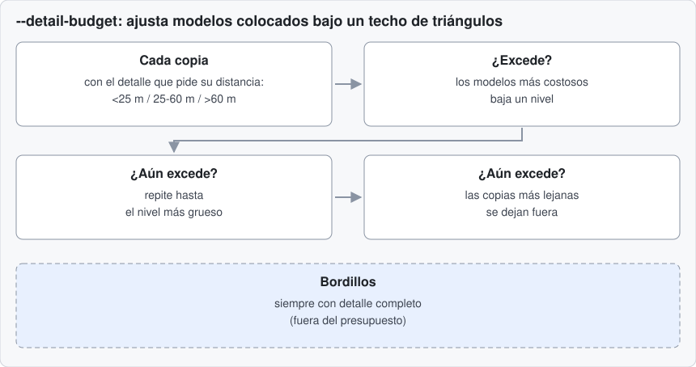

# Niveles de detalle y presupuesto {#levels-of-detail-and-the-budget}

Un **triángulo** es una pieza plana y diminuta de un modelo 3D. Más triángulos significa un archivo más grande y más lento. El **presupuesto** es un límite de cuántos pueden ser. Un **nivel de detalle** es una copia más simple de un modelo, que se usa cuando está lejos.

Lo colocado alrededor de un circuito tiene, en su nivel más fino, varios millones de triángulos. Por ejemplo, cientos de tramos de quitamiedos y pilas de neumáticos de unos mil triángulos cada uno. Un corredor urbano contiene más de cien mil copias. Por eso cada exportación de circuito da a los modelos colocados un **presupuesto de triángulos** y decide, para cada modelo, en qué nivel de detalle se dibuja y, si hace falta, qué copias se dejan fuera.

El esquema se escribió para Forza
([`forzaplacement.py`](https://github.com/Holdi601/3DHeat-GameFiles/blob/main/heat3d_gamefiles/forzaplacement.py):
`choose_levels`, `auto_budget`, `_fit`), y BeamNG y AC Rally reutilizan sus partes.
El terreno no cuenta para el presupuesto.

## Bandas de distancia {#distance-bands}

La distancia de cada copia a la conducción se mide en el plano del suelo, hasta la muestra de vuelta más cercana. La vuelta se reduce primero a un máximo de 1.000 puntos, lo que cuesta unos metros de precisión y nada que importe aquí. Luego las copias caen en tres bandas, y cada par (modelo, banda) se presupuesta por separado:

| Banda | Distancia | Empieza en |
|---|---|---|
| cerca | menos de 25 m (`NEAR`) | el nivel más fino |
| media | 25-60 m (`FAR`) | un nivel más grosero |
| lejos | 60 m o más | el nivel más grosero |

Sin una ruta (Forza `terrain --box`), la distancia se mide hasta el centro de la caja.

## Bajar de nivel para encajar {#stepping-down-to-fit}



El coste de una entrada (modelo, banda) son las copias por los triángulos en su nivel actual. Mientras el total supere el presupuesto, la entrada que más cuesta baja un nivel, y eso se repite hasta que el total encaja o ninguna entrada puede bajar más. Las entradas fijadas nunca bajan:

| Juego | Fijado en detalle completo |
|---|---|
| Forza | bordillos (`road_gen_rum*`) |
| BeamNG | bordillos, y cada forma que lleva superficie de conducción |
| AC Rally | bordillos |

El resumen de Forza lo informa como `N of M models drawn at a coarser level to fit the budget`.

## El presupuesto automático {#the-automatic-budget}

Sin `--detail-budget`, el presupuesto se ajusta solo para que **no se deje fuera ninguna copia**:

```
budget = max(1,500,000, 1.25 x sum(copies x coarsest level))
```

Las entradas fijadas cuentan en su nivel más fino. El 25% (`HEADROOM`) permite que lo que está junto a la carretera conserve algo de detalle. En un circuito de campo esto da el mínimo de 1,5 millones (`DEFAULT_BUDGET`). En un circuito urbano, donde el corredor tiene más de cien mil copias, sube a más de diez millones, y el archivo a varios cientos de MB. El visor lo carga.

## Un presupuesto que tú das {#a-budget-you-give}

`--detail-budget N` es un **techo**. Los niveles bajan como se ha descrito. Si ni los niveles más gruesos encajan, se dejan fuera copias:

| Juego | Orden en que se dejan fuera las copias |
|---|---|
| Forza | primero todo lo que está a 25 m o más de la conducción, luego lo que está junto a la carretera; dentro de cada grupo, primero lo que parece más pequeño desde la carretera: mayor distancia / tamaño (tamaño = la diagonal de la caja que envuelve el modelo por su mayor escala, con un mínimo de 0,25 m) |
| BeamNG | lo más lejos de la conducción primero |
| AC Rally | lo más lejos de la conducción primero, como BeamNG |
| Battlefield 6 | lo más pequeño primero: diagonal de la caja que envuelve por la escala |

Los bordillos (y, en BeamNG, los modelos de superficie de conducción) nunca se dejan fuera, así que un presupuesto menor de lo que cuestan ellos por sí solos lo supera solo lo que ocupan ellos, y nada más.

La herramienta usa distancia dividida por tamaño en Forza porque, si se ordenara solo por distancia, una unidad de aire acondicionado en una pared a nueve metros duraría más que la fachada de veinte metros a la que está sujeta, a doce metros. Lo que está junto a la carretera va el último, sea cual sea su tamaño, porque una barrera de tres metros a cinco metros de la línea es el borde de la pista, mientras que un edificio de cincuenta metros a sesenta metros atrás es escenografía.

El resumen informa `N of M copies left out to fit the budget, the smallest and furthest from the driving first (--detail-budget raises it)` (Forza), o `N copies left out to fit the budget, the furthest from the driving first (--detail-budget raises it)` (BeamNG, AC Rally).

## Edificios completos (Forza) {#whole-buildings-forza}

Un sustituto de edificio entero cuenta como una copia, a una distancia medida hasta el borde más cercano del edificio. Se conserva o se deja fuera como una unidad. Las piezas modulares que sustituye no se presupuestan en absoluto. Ver [Forza Horizon](course-forza-horizon.md#buildings-drawn-whole).

## Qué es un nivel de detalle, por juego {#what-a-level-of-detail-is-per-game}

| Juego | Los niveles vienen de |
|---|---|
| Forza | la máscara de nivel por triángulo de las submallas del `Mesh` del modelo (bit `level + 1`); las piezas destrozables `0xFFFF` solo para un modelo sin nivel marcado |
| BeamNG | los `details` de la forma `.cdae` con tamaño no negativo, del mayor al menor; para `.dae`, el número final de los nombres de nodo de malla (`barrier75`, `barrier40`) |
| AC Rally | los niveles de detalle guardados de la malla estática, del más fino al más grosero |
| Battlefield 6 | los niveles de detalle del MeshSet, del más fino al más grosero, contando solo las secciones dibujadas (no las copias de sombra y de profundidad), y sin contar un último nivel que sea un sustituto de vista lejana (materiales `M_LastLod`, `M_Billboard`, `M_Vista`: el celosía de un pilón se volvería un pincho macizo) |

El `level` de Battlefield 6 no tiene vuelta, así que no hay bandas de distancia: cada malla es una entrada, y cada copia está en el mismo nivel. El presupuesto automático es la fórmula de arriba con el fondo del terreno fijado; el campo de alturas queda fuera del presupuesto y su tamaño lo fija `--ground-spacing`. Con un presupuesto que tú das, cuando cada malla está en su nivel más grosero, se dejan fuera copias primero las más pequeñas, siendo el tamaño la diagonal de la caja de la malla por la escala de la copia, ya que no hay conducción desde la que medir distancia. El fondo del terreno nunca se deja fuera. Un nivel llega a unos diez millones de triángulos automáticamente.

## Elegir un número {#choosing-a-number}

| Quieres | Prueba |
|---|---|
| todo, con detalle completo cerca de la carretera | déjalo automático |
| un archivo unas cuantas veces más pequeño | `--detail-budget 500000` con `--texture-size 1024` |
| solo el suelo | `--no-placed` (no interviene ningún presupuesto) |
