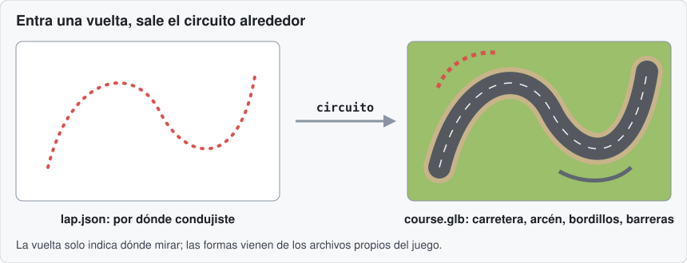
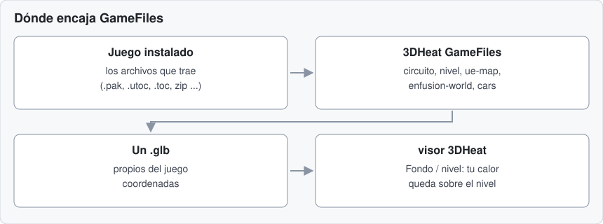

# 3DHeat GameFiles {#dheat-gamefiles}

**¿Qué es?** Una herramienta que construye un modelo 3D de un circuito de carreras o de un nivel de
juego a partir de los archivos de un juego que ya tienes instalado.

**¿Para qué lo usaría?** El visor 3DHeat pinta por dónde condujiste o jugaste como un mapa de calor.
Con esta herramienta lo pinta sobre el circuito o el nivel reales, no sobre un espacio vacío.

**Ejemplo:** toma una vuelta que hayas dado. La herramienta construye la carretera y el terreno
alrededor como un solo archivo 3D, así que el visor puede pintar tu velocidad o tus choques sobre el
circuito real:



¿Nuevo en la línea de comandos? Empieza por [Antes de empezar](before-you-start.md).

Con más detalle: lee los datos de nivel de los archivos que trae un juego y los escribe como un
archivo binario glTF (`.glb`). Su tarea principal es la **exportación de circuito**: le das una vuelta,
y escribe el terreno, la carretera separada del arcén y de la hierba, y los bordillos, barreras,
muros de neumáticos, señales y edificios alrededor.

Forma parte de [3DHeat](https://github.com/Holdi601/3DHeat), un visor de mapas de calor 3D de
telemetría en tiempo real, análisis de carreras y revisión de partidas
([documentación](https://holdi601.github.io/3DHeat/)). Los archivos `.glb` que escribe esta
herramienta son los niveles sobre los que el visor dibuja el mapa de calor.



Es una de tres formas de llevar la geometría de un nivel a 3DHeat:

| Vía | Necesita | Da |
|---|---|---|
| 3DHeat Unreal Exporter | el proyecto de Unreal abierto en el editor | geometría exacta |
| 3DHeat GameCapture | una pantalla y una captura | una estimación |
| **3DHeat GameFiles** | **el juego instalado, tal como se distribuye** | **geometría exacta, sin proyecto** |

Paquete de Python: `heat3d_gamefiles`. Repositorio:
[Holdi601/3DHeat-GameFiles](https://github.com/Holdi601/3DHeat-GameFiles). Licencia: MIT.

## Qué puede hacer {#what-it-can-do}

| Juego o motor | Exportación de circuito (`course`) | Lectura de archivos |
|---|---|---|
| Forza Horizon (ForzaTech) | sí: terreno, carretera y arcén, textura del suelo, modelos colocados con sus propias texturas | `identify`, `list`, `extract` sobre un `.minizip`; `identify` sobre un `.modelbin`; modelos, terreno y texturas mediante `course` y `terrain` |
| BeamNG.drive | sí: terreno, calcomanías de carretera, circuitos modelados, modelos colocados, agua | `identify`, `list`, `extract` sobre zips de nivel; `identify` sobre `.ter`, `.cdae`; `.dae` mediante `course` |
| Assetto Corsa Rally (Unreal 5.6) | sí: teselas de terreno de la etapa, color del suelo horneado, modelos colocados en colores planos | `identify`, `list`, `extract` sobre IoStore `.utoc`/`.ucas`; paquetes zen, mallas estáticas, texturas mediante `course` |
| Unreal `.pak` (versiones 8-12) | no | `identify`, `list`, `extract` |
| Unity (formato 22 y posteriores) | no | `identify`, `meshes` |
| Battlefield 6 (Frostbite `.toc`/`.cas`) | no hay vuelta; un nivel completo con `level`: terreno, mallas colocadas, sus mapas de color con `--textures` | `identify`, `levels`; paquetes, mallas, terreno, texturas y colocación mediante `level` |
| Source 2 `.vpk` | no | `identify`, `list`, `extract` |
| Juegos de Unreal 5 con World Partition | no hay vuelta; un mapa completo con `ue-map` (listados con `ue-maps`): paisaje, edificios HLOD y objetos, agua | - |
| Arma Reforger (Enfusion) | no hay vuelta; un mundo completo con `enfusion-world` (listado con `enfusion-worlds`): terreno en sus colores, el mar, edificios como cajas | - |
| Forza (coches) | `cars`: cada coche con poco detalle, para la pestaña Análisis de carrera del visor | - |

Las vueltas de Assetto Corsa EVO e iRacing se rechazan, con el motivo. Consulta
[Límites y huecos conocidos](limits-and-known-gaps.md).

## Instalación {#install}

¿Nuevo en la línea de comandos? Lee primero [Antes de empezar](before-you-start.md).

Necesitas **Python 3.10 o posterior** (desarrollado con 3.13) y los paquetes de
[`requirements.txt`](https://github.com/Holdi601/3DHeat-GameFiles/blob/main/requirements.txt).

```
git clone https://github.com/Holdi601/3DHeat-GameFiles.git
cd 3DHeat-GameFiles
pip install -r requirements.txt
```

Luego compruébalo: `python -m heat3d_gamefiles --help`. Deberías ver
`usage: heat3d_gamefiles [-h]` y la lista de verbos. Ejecuta cada comando desde la carpeta del
repositorio, como `python -m heat3d_gamefiles <verb>`.

| Paquete | Para qué sirve |
|---|---|
| numpy | todo lo que decodifica geometría |
| lz4 | archivos de Forza (sobre todo bloques LZ4), algunos paquetes de Unity, bloques LZ4 de IoStore |
| Pillow | decodificar texturas BC1-BC7, escribir las texturas JPEG del `.glb` |
| msgpack, zstandard | las formas compiladas de BeamNG (`.cdae`) |
| cryptography | solo para abrir un `.pak` cifrado con una clave que ya tengas |
| pytest | las pruebas |

El contenido de Unreal comprimido con **Oodle** necesita una biblioteca Oodle que ya esté en tu equipo.
Esta herramienta nunca incluye una. Consulta [Oodle](reader-oodle.md).

La herramienta está escrita para Windows. Encuentra los juegos mediante la lista de bibliotecas de
Steam y `%LOCALAPPDATA%`, y carga Oodle como una DLL de Windows. Otras plataformas no se han
probado.

## Inicio rápido {#quick-start}

Una **vuelta** (archivo de vuelta) es un registro de por dónde fue tu coche: una lista de puntos x, y, z.
Viene de [3DHeat GameCapture](https://github.com/Holdi601/3DHeat-GameCapture) o de la biblioteca de
vueltas de la app FH Companion; también sirve un CSV escrito a mano
([Entradas de vuelta](lap-inputs.md)).

```
# Forza: un archivo de vuelta, una carpeta de vueltas, o el nombre de un circuito de la biblioteca de FH Companion
python -m heat3d_gamefiles course "Example Circuit"
python -m heat3d_gamefiles course path\to\lap.json -o course.glb

# BeamNG.drive o Assetto Corsa Rally: un archivo heat3d-lap indica de qué juego es
python -m heat3d_gamefiles course my_lap.json

# Cada circuito de la biblioteca de FH Companion, un .glb por cada uno
python -m heat3d_gamefiles courses -o courses

# Battlefield 6: lista los niveles y luego exporta uno (archivo grande; ver Comandos)
python -m heat3d_gamefiles levels
python -m heat3d_gamefiles level <level> -o level.glb --textures

# Unreal 5 World Partition y Arma Reforger: lista y luego exporta
python -m heat3d_gamefiles ue-maps "<game>"
python -m heat3d_gamefiles ue-map "<game>" <map> -o map.glb
python -m heat3d_gamefiles enfusion-worlds
python -m heat3d_gamefiles enfusion-world <world> -o world.glb

# Cada coche de Forza, para la pestaña Análisis de carrera del visor
python -m heat3d_gamefiles cars -o forza.h3dcars

# ¿Qué es este archivo?
python -m heat3d_gamefiles identify some_archive.pak
```

Abre el `.glb` en el visor 3DHeat. Se conservan las coordenadas propias del mundo del juego
(ver [Formato de salida](output-format.md)), así que una vuelta grabada queda alineada con el circuito.

## Mapa de esta documentación {#map-of-this-documentation}

- [Antes de empezar](before-you-start.md): Python, una terminal, el primer comando.
- [Comandos](commands.md): cada verbo y opción, con ejemplos.
- [Referencia de comandos](../cli-reference.md): el `--help` de cada verbo, generado desde el código.
- [Inspeccionar archivos](inspecting-archives.md): `identify`, `list`, `extract`, `meshes`, paso a paso.
- [Exportación de circuito](course-export.md): cómo una vuelta se convierte en circuito, para todos los juegos.
  - [Forza Horizon](course-forza-horizon.md)
  - [BeamNG.drive](course-beamng.md)
  - [Assetto Corsa Rally](course-assetto-corsa-rally.md)
  - [Niveles de detalle y presupuesto](detail-budget.md)
- [Niveles completos](whole-levels.md): un nivel, mapa o mundo sin vuelta.
  - [Niveles de Battlefield 6](level-battlefield.md): `levels`, `level`
  - [Mapas de Unreal 5](level-unreal-world-partition.md): `ue-maps`, `ue-map`
  - [Mundos de Arma Reforger](level-arma-reforger.md): `enfusion-worlds`, `enfusion-world`
- [Coches de Forza](forza-cars.md): `cars`, el archivo de coches para la pestaña Análisis de carrera del visor.
- [Entradas de vuelta](lap-inputs.md): cada forma de archivo de vuelta que acepta la herramienta.
- [Formato de salida](output-format.md): lo que hay dentro del `.glb`.
- [Lectores de archivos](archive-readers.md): una página por formato de contenedor, con lo que lee,
  lo que no lee, y por qué.
- [Límites y huecos conocidos](limits-and-known-gaps.md)
- [Solución de problemas](troubleshooting.md): los mensajes de error y qué hacer con cada uno.
- [Normas y licencias](rules-and-licences.md): sin claves, tus propios archivos, sin redistribución.
- [Actualizaciones](updates.md): la comprobación de actualizaciones y `heat3d_update`.
- [Desarrollo](development.md): mapa de módulos y pruebas, incluidas las que se ejecutan contra juegos instalados.
- [Mantenimiento](maintaining.md): la lista de comprobación de cada versión de estas páginas.

## Parte de 3DHeat {#part-of-3dheat}

3DHeat GameFiles es una de las herramientas gratuitas que rodean al visor 3DHeat:

| Herramienta | Qué hace | Documentación |
|---|---|---|
| [3DHeat](https://github.com/Holdi601/3DHeat) | el visor: mapas de calor 3D, análisis de carreras y revisión de partidas en el navegador | [sitio](https://holdi601.github.io/3DHeat/) |
| [GameFiles](https://github.com/Holdi601/3DHeat-GameFiles) | circuitos y niveles a partir de los archivos que traen los juegos, como `.glb` | [sitio](https://holdi601.github.io/3DHeat-GameFiles/) |
| [GameCapture](https://github.com/Holdi601/3DHeat-GameCapture) | telemetría de vueltas de juegos de carreras; niveles reconstruidos a partir de vídeo de juego | [sitio](https://holdi601.github.io/3DHeat-GameCapture/) |
| [Unreal Exporter](https://github.com/Holdi601/3DHeat-UnrealExporter) | un plugin del editor de Unreal que guarda un nivel como `.glb` | [sitio](https://holdi601.github.io/3DHeat-UnrealExporter/) |
| [CS2](https://github.com/Holdi601/3DHeat-CS2) | demos de Counter-Strike 2 en archivos de partida; mapas en `.glb` | [sitio](https://holdi601.github.io/3DHeat-CS2/) |
| [Watcher](https://github.com/Holdi601/3DHeat-Watcher) | registra tu juego en segundo plano a partir de lo que publican los juegos | [sitio](https://holdi601.github.io/3DHeat-Watcher/) |
| [Ext-WarThunder](https://github.com/Holdi601/3DHeat-Ext-WarThunder) | repeticiones de War Thunder en archivos de partida | [sitio](https://holdi601.github.io/3DHeat-Ext-WarThunder/) |
| [Ext-WoT](https://github.com/Holdi601/3DHeat-Ext-WoT) | repeticiones de World of Tanks en archivos de partida | [sitio](https://holdi601.github.io/3DHeat-Ext-WoT/) |
| [Ext-WoWs](https://github.com/Holdi601/3DHeat-Ext-WoWs) | repeticiones de World of Warships en archivos de partida | [sitio](https://holdi601.github.io/3DHeat-Ext-WoWs/) |
| [Ext-Squad](https://github.com/Holdi601/3DHeat-Ext-Squad) | demos de servidores de Squad en archivos de partida | [sitio](https://holdi601.github.io/3DHeat-Ext-Squad/) |
| [Ext-DCS](https://github.com/Holdi601/3DHeat-Ext-DCS) | mapas de DCS World en niveles `.glb` | [sitio](https://holdi601.github.io/3DHeat-Ext-DCS/) |
| [Ext-IL2](https://github.com/Holdi601/3DHeat-Ext-IL2) | mapas de IL-2 Sturmovik en niveles `.glb` | [sitio](https://holdi601.github.io/3DHeat-Ext-IL2/) |

Los archivos de partida del visor se describen en
[Un archivo por partida: `.3dheat`](https://holdi601.github.io/3DHeat/container.html);
un nivel hecho aquí se carga junto a ellos en el panel Fondo / nivel del visor.
