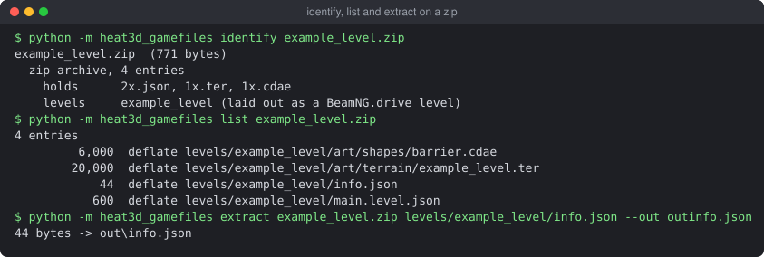

# Inspeccionar archivos: `identify`, `list`, `extract`, `meshes` {#inspecting-archives-identify-list-extract-meshes}

Un juego empaqueta sus archivos en grandes cajas llamadas **archivos comprimidos** (archives). Estos comandos
miran la etiqueta de una caja, listan lo que hay dentro y sacan una cosa.

Antes de exportar nada de un juego que no conoces, mira lo que trae. Estos cuatro comandos
leen un archivo y te dicen qué es y qué contiene; no escriben nada, salvo la única entrada que pidas con `extract`.



*Una ejecución sobre un zip de prueba con la estructura de un nivel de BeamNG.drive.*

## Paso a paso {#step-by-step}

1. **Pregunta qué es el archivo.** `identify` lee los bytes, no la extensión:

   ```
   python -m heat3d_gamefiles identify "C:\Games\<juego>\Content\Paks\<archivo>.pak"
   ```

   Indica el formato (Unreal `.pak`, IoStore `.utoc`/`.ucas`, paquete de Unity o
   `SerializedFile`, Frostbite `.toc`, Source 2 `.vpk`, ForzaTech `.minizip` o
   `.modelbin`, BeamNG `.cdae`/`.ter`, zip), su versión, cuántas entradas tiene
   y si está cifrado.

2. **Lista lo que hay dentro.** `list` imprime una línea por entrada: tamaño, compresión,
   ruta. Acótalo con `--filter` y límítalo con `--limit`:

   ```
   python -m heat3d_gamefiles list <archivo> --filter Maps/ --limit 50
   ```

3. **Saca una entrada.** `extract` escribe una entrada (en la carpeta en la que estás, salvo que
   `--out` indique otra), por la ruta que imprimió `list` (o `#12`, por número, en un `.minizip` sin nombres):

   ```
   python -m heat3d_gamefiles extract <archivo> <ruta interna> --out out\entrada.bin
   ```

4. **Unity:** `meshes` lista y comprueba las mallas de un `SerializedFile`:

   ```
   python -m heat3d_gamefiles meshes <unity .assets> --limit 20
   ```

## Opciones {#options}

| Comando | Opción | Significado |
|---|---|---|
| `identify` | `<archivo>` | cualquier archivo |
| `list` | `<archivo>` | `.pak`, `.utoc` (o el `.ucas` que tiene al lado), `.vpk`, `.minizip`, zip |
| | `--filter TEXTO` | solo las rutas que contengan TEXTO |
| | `--limit N` | como mucho N líneas |
| | `--key HEX` | una clave AES-256 (64 dígitos hexadecimales) que ya tengas; solo un `.pak` cifrado la necesita |
| `extract` | `<archivo> <ruta>` | el archivo y la ruta de la entrada tal como la imprime `list` |
| | `--out FILE` | dónde escribirla (por defecto: el nombre del archivo de la entrada) |
| | `--key HEX` | igual que en `list` |
| `meshes` | `<archivo>`, `--limit N` | un `SerializedFile` de Unity; como mucho N mallas |

La herramienta no trae claves ni las recupera: un archivo cifrado solo se abre con una clave que tú
le pases. Un archivo que no puede leer se rechaza en una línea con código de salida 1.
Todos los comandos y códigos de salida están en [Comandos](commands.md); cómo se lee cada formato
está en [Lectores de archivos](archive-readers.md).
