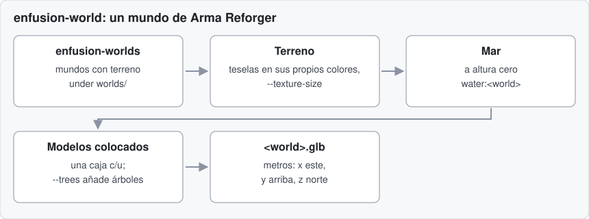

# Mundos de Arma Reforger: `enfusion-worlds` y `enfusion-world` {#arma-reforger-worlds-enfusion-worlds-and-enfusion-world}

**¿Qué es?** Un mundo completo de Arma Reforger como un único archivo 3D. **¿Para qué?** Para que el calor del juego tenga debajo el suelo y los edificios. (*Enfusion* es el motor con el que está hecho Arma Reforger; un *mundo* es lo que el juego llama mapa.)

Exporta un mundo Enfusion completo de Arma Reforger instalado: el terreno con los colores de sus propias losetas de supertextura, el mar, y cada modelo colocado como una caja, en los metros propios del juego.



## Paso a paso {#step-by-step}

1. **Listar los mundos** que tienen terreno:

   ```
   python -m heat3d_gamefiles enfusion-worlds
   python -m heat3d_gamefiles enfusion-worlds --install "D:\Games\Arma Reforger"
   ```

2. **Exportar uno**, por el nombre de su carpeta dentro de `worlds/` tal como aparece en la lista:

   ```
   python -m heat3d_gamefiles enfusion-world <world> -o world.glb
   ```

3. **Variantes:**

   ```
   python -m heat3d_gamefiles enfusion-world <world> --trees               # vegetation too, as boxes
   python -m heat3d_gamefiles enfusion-world <world> --texture-size 0      # flat colour, small file
   python -m heat3d_gamefiles enfusion-world <world> --ground-spacing 4 --no-structures
   ```

4. **Abre `world.glb`** en el panel de Fondo / nivel del visor de 3DHeat ([cargar un nivel](https://holdi601.github.io/3DHeat/levels.html)).

## Opciones {#options}

| Opción | Por defecto | Significado |
|---|---|---|
| `<world>` | obligatorio | un mundo tal como lo imprime `enfusion-worlds` |
| `-o`, `--out FILE` | `<world>.glb` | el archivo que se escribe |
| `--install FOLDER` | la biblioteca de Steam que tiene el juego | la carpeta del juego |
| `--ground-spacing METRES` | 2 (el propio del terreno) | la separación de vértices del terreno en el archivo |
| `--texture-size PIXELS` | 4096 | el lado mayor de la imagen de color del suelo; 0 para color plano |
| `--no-structures` | | deja fuera los modelos colocados |
| `--trees` | desactivado | coloca también árboles y otra vegetación, como cajas |

## Salida de ejemplo {#example-output}

```text
<world> -> world.glb
  ground      <n> triangles, <w> x <h> m; <n> of <n> tile-edge vertices disagree; colour <w> x <h>
  structure   <n> boxes from <n> entities
  water       <n> triangles (the sea)
  left out    <what>: <n>, ...
```

## Las partes {#the-parts}

`ground:<world>` (el terreno), `water:<world>` (el mar, a altura cero) y `structure:<world>` (las cajas). Las coordenadas son las del propio juego: x al este, y hacia arriba, z al norte, en metros; es lo que informa una grabación dentro del juego. El marco del juego es zurdo; *Invertir un eje del mundo* en el visor lo muestra sin reflejar.

## Cómo se lee y se comprueba {#how-it-is-read-and-checked}

No hace falta Workbench y nada está cifrado.

| Formato | Qué es | Comprobado contra |
|---|---|---|
| `.pak` | un bloque de datos y un árbol de directorios, entradas guardadas o en zlib | el árbol usa exactamente su bloque; las entradas zlib muestreadas se descomprimen exactamente a su tamaño declarado |
| `.edds` | una cabecera DDS, y luego por nivel de mip fragmentos `COPY` o `LZ4 ` | los niveles fragmentados se decodifican exactamente a su tamaño usando exactamente sus bytes |
| `.terr` / `.ttile` | una cabecera y losetas de alturas de 16 bits | cada borde compartido entre losetas coincide exactamente |
| supertextura | el color de suelo de cada loseta, unos 1 metro por píxel | coincide con el mar en las alturas; ningún volteo ni transposición encaja igual de bien |
| `.ent` | nombres, GUID de recursos, y luego entidades como valores tipados | un archivo de mundo se parsea hasta su último byte |
| `resourceDatabase.rdb` | GUID a ruta | casi todo GUID que usa un mundo nombra un archivo que existe |

Los objetos marcados como situados a una altura absoluta quedan a centímetros del terreno decodificado (con la rejilla transpuesta quedarían a metros de distancia). No se dibujan: los triángulos propios de los modelos, los árboles por defecto (`--trees` los añade como cajas), las entidades hijas, los lagos y ríos, y las texturas con cabeceras anteriores a DX10.

**Términos:** la licencia del juego permite el uso no comercial y prohíbe la ingeniería inversa de los archivos del juego. Leer tu propia instalación es decisión tuya bajo esa licencia; la salida es para tu propio uso y no debe compartirse.
