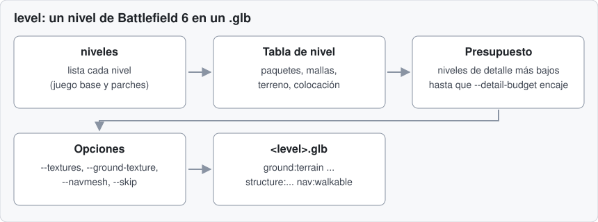

# Niveles de Battlefield 6: `levels` y `level` {#battlefield-6-levels-levels-and-level}

**¿Qué es?** Un nivel completo de Battlefield 6 como un único archivo 3D. **¿Para qué?** Para que el calor de tus partidas tenga debajo el suelo y los edificios. (*Frostbite* es el motor con el que está hecho Battlefield; un *campo de alturas* es el suelo guardado como una rejilla de alturas.)

Exporta un nivel completo de Frostbite del juego instalado: el campo de alturas del terreno, cada malla que colocan sus grupos de modelos estáticos, los objetos colocados uno a uno, el fondo del terreno alrededor del mapa, y, si se pide, los mapas de color de las superficies, las calcomanías del terreno horneadas en el suelo y las superficies transitables de los soldados.



## Paso a paso {#step-by-step}

1. **Listar los niveles** que trae el juego:

   ```
   python -m heat3d_gamefiles levels
   python -m heat3d_gamefiles levels --install "D:\Games\<game folder>"
   ```

   Cada línea es una tabla de nivel (`levels/<level>/<level>.toc`) con su tamaño y de dónde viene: `Data` para el juego base, `Update/<pack>` para una actualización.

2. **Exportar uno**, por su nombre, una parte única de él o su ruta `.toc`. Empieza sin textura para ver la forma y el tamaño:

   ```
   python -m heat3d_gamefiles level <level> -o level.glb
   ```

3. **Añade color** una vez que se vea bien:

   ```
   python -m heat3d_gamefiles level <level> -o level.glb --textures 512 --ground-texture 0.5
   ```

4. **Añade las superficies transitables**, o reduce el archivo:

   ```
   python -m heat3d_gamefiles level <level> --textures 512 --ground-texture 0.5 --navmesh
   python -m heat3d_gamefiles level <level> --textures 256 --detail-budget 3000000 --ground-spacing 8
   ```

5. **Abre `level.glb`** en el panel de Fondo / nivel del visor de 3DHeat ([cargar un nivel](https://holdi601.github.io/3DHeat/levels.html)).

## Opciones {#options}

| Opción | Por defecto | Significado |
|---|---|---|
| `<level>` | obligatorio | un nombre tal como lo imprime `levels`, una parte única de uno, o la `.toc` de un nivel |
| `-o`, `--out FILE` | `<level>.glb` | el archivo que se escribe |
| `--install FOLDER` | se busca en las bibliotecas de Steam | la carpeta del juego |
| `--textures [PIXELS]` | desactivado; 512 sin tamaño | el mapa de color de cada superficie, como mucho PIXELS por lado |
| `--ground-texture [METRES]` | desactivado; 0.5 sin tamaño | hornea carreteras, plataformas y marcas en el color del suelo, METRES por píxel |
| `--navmesh` | desactivado | añade la malla de navegación del soldado como `nav:walkable` |
| `--ground-spacing METRES` | 4 | la separación más fina del campo de alturas; 0 lo deja fuera |
| `--detail-budget N` | las copias más gruesas más un cuarto, como mínimo 1.500.000 | un techo de triángulos (el terreno nunca se simplifica) |
| `--skip TEXT` | | deja fuera los grupos de modelos cuyo nombre de partición contiene TEXT; se puede repetir |
| `--by-mesh` | desactivado | una parte por malla de origen y material, para averiguar qué es una parte |
| `--clamped-uvs` | desactivado | para visores que no pueden repetir una textura |

La tabla completa, con los tamaños que cabe esperar (un nivel completo son cientos de MB), está en [Comandos](commands.md#levels-and-level-frostbite). Cómo se leen las tablas, paquetes, mallas y el terreno está en [Frostbite](reader-frostbite.md).

## Salida de ejemplo {#example-output}

Lo que imprime `level`, en resumen (las líneas tal como las escribe el código; `<n>` y los nombres cambian según el nivel):

```text
<n> copies of <n> meshes, from <n> static model groups
      <n>  <group>
      <n>  placed one by one (object and prefab references)
<n> meshes left out: <why>
<n> triangles, budget <n>; <n> meshes drawn at a coarser level to fit
           <n>  ground:terrain
           <n>  structure:buildings, <n> textures
           ...
<n> of <n> drawn sections carry their colour map; the rest are flat colours
Ground: <what the ground is>.
Navigation mesh: <tiles read>.
-> level.glb (<n> MB)
```

## Las partes {#the-parts}

`ground:terrain` (el campo de alturas), `ground:terrain backdrop` y `ground:terrain blend`, `structure:<kind>` por tipo de malla (por mapa de color con `--textures`, con ` (destructible)` para lo que puede destruirse en una partida), y `nav:walkable` con `--navmesh`. Ver [Formato de salida](output-format.md).

El archivo contiene el contenido del juego: es para la máquina en la que se hizo, no para pasarlo de un lado a otro ([Reglas y licencias](rules-and-licences.md)).
