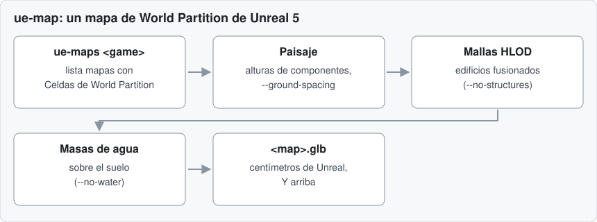

# Mapas de Unreal 5 World Partition: `ue-maps` y `ue-map` {#unreal-5-world-partition-maps-ue-maps-and-ue-map}

**¿Qué es?** Un mapa completo de un juego de Unreal 5 como un único archivo 3D: el suelo, los edificios y el agua. **¿Para qué?** Para que el calor de ese juego tenga el mapa debajo. (*World Partition* es la forma en que Unreal 5 divide un mapa grande en piezas; *HLOD* es un sustituto simplificado de un grupo de edificios, el que el juego dibuja de lejos.)

Exporta un mapa completo de un juego de Unreal 5 cuyos mapas están cocinados como celdas World Partition: el paisaje (landscape), las mallas HLOD fusionadas del mapa (sus edificios y objetos tal como el juego los dibuja a distancia) y sus masas de agua. No hacen falta editor ni proyecto, solo el juego instalado.



## Paso a paso {#step-by-step}

1. **Listar los mapas.** `<game>` es la carpeta del juego, su `Content/Paks`, o el nombre de su carpeta en una biblioteca de Steam:

   ```
   python -m heat3d_gamefiles ue-maps "<Steam game folder name>"
   python -m heat3d_gamefiles ue-maps "D:\Games\<game>"
   ```

   Se imprime cada mapa con celdas World Partition cocinadas, con su ruta de paquete.

2. **Exportar uno** por su nombre o una parte única de él:

   ```
   python -m heat3d_gamefiles ue-map "<game>" <map> -o map.glb
   ```

3. **Solo el suelo, o más grosero:**

   ```
   python -m heat3d_gamefiles ue-map "<game>" <map> --no-structures --no-water
   python -m heat3d_gamefiles ue-map "<game>" <map> --ground-spacing 4
   ```

4. **Abre `map.glb`** en el panel de Fondo / nivel del visor de 3DHeat ([cargar un nivel](https://holdi601.github.io/3DHeat/levels.html)).

## Opciones {#options}

| Opción | Por defecto | Significado |
|---|---|---|
| `<game>` | obligatorio | la carpeta del juego, su `Content/Paks`, o su nombre de carpeta de Steam |
| `<map>` | obligatorio | un nombre tal como lo imprime `ue-maps`, o una parte única de uno |
| `-o`, `--out FILE` | `<map>.glb` | el archivo que se escribe |
| `--ground-spacing METRES` | 2 | la separación de vértices del paisaje, redondeada a un número entero de sus propios cuadriláteros |
| `--no-structures` | | deja fuera los edificios y objetos HLOD |
| `--no-water` | | deja fuera las masas de agua |

El contenido comprimido con Oodle necesita una biblioteca Oodle ya presente en el equipo (ver [Oodle](reader-oodle.md)).

## Salida de ejemplo {#example-output}

```text
<map> -> map.glb
  ground      <n> triangles from <n> landscape components; <n> of <n> vertices stored twice disagree
  structure   <n> triangles in <n> HLOD meshes
  water       <n> triangles from <n> water bodies
```

El recuento de discrepancias es una autocomprobación: los componentes de paisaje vecinos guardan su borde compartido dos veces, y las dos copias deben coincidir. Un mapa de 3 km a 2 m son unos 4,6 millones de triángulos de suelo.

## Las partes {#the-parts}

`ground:<map>` (el paisaje), `structure:<map>` (las mallas HLOD) y `water:<map>` (el agua que está por encima del suelo).

**Unidades:** es la única exportación que **no está en metros**: centímetros de Unreal, con Y y Z intercambiadas (Y hacia arriba), el marco que escribe el Exportador de Unreal de 3DHeat. La telemetría del mismo juego usa el mismo marco, así que cae sobre el mapa.

## Cómo se lee y se comprueba {#how-it-is-read-and-checked}

| Parte | Se lee de | Comprobado contra |
|---|---|---|
| suelo | el mapa de alturas de 16 bits de cada componente de paisaje, colocado por su base de sección en la transformación del paisaje | cada vértice guardado dos veces (en una costura o borde de componente) debe coincidir; las discrepancias se cuentan e imprimen, no se suavizan |
| estructura | las mallas HLOD fusionadas del mapa, que construye el motor en espacio del mundo | una malla solo se conserva si los límites que guarda su componente describen sus propios vértices |
| agua | la malla de cada masa de agua, colocada sobre la rejilla del suelo, conservada donde está por encima del suelo | el agua queda unos metros por encima del suelo que hay debajo, como un río sobre su lecho |

Las propiedades del paisaje se encuentran por su forma, no por su número de ranura (las ranuras se mueven entre versiones del motor). Las estructuras son los sustitutos simplificados, no los modelos de máximo detalle. El follaje, las calcomanías y los materiales de paisaje no se exportan; el suelo no lleva textura y el visor lo sombrea. Detalles del archivo: [Unreal 5 IoStore](reader-unreal-iostore.md).

**Términos:** las licencias de los juegos suelen permitir el uso personal y no comercial, y prohíben la ingeniería inversa "to the extent that such actions cannot be prohibited by law". Leer tu propia instalación es decisión tuya bajo ellas; la salida es para tu propio uso y no debe compartirse.
