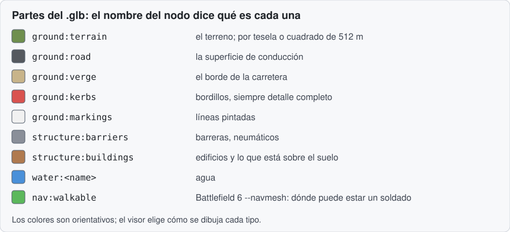

# Formato de salida {#output-format}

Un `.glb` es un archivo 3D: el suelo, los edificios y el agua de un circuito o de un nivel, que se abre en el panel Fondo / nivel del visor de 3DHeat.

Cada exportación (`course`, `courses`, `terrain`, `level`, `ue-map`, `enfusion-world`) escribe un archivo **glTF 2.0 binario** (`.glb`). Es deliberadamente pequeño y plano, y está organizado tal como lo lee el visor de 3DHeat. Fuente:
[`glb.py`](https://github.com/Holdi601/3DHeat-GameFiles/blob/main/heat3d_gamefiles/glb.py).

## Estructura {#structure}

```
scene 0
 ├─ node "ground:terrain x-2046 z1023"  -> mesh 0 -> 1 primitive, material 0
 ├─ node "ground:road x-2046 z1023"     -> mesh 1 -> 1 primitive, material 1
 ├─ node "ground:markings"               -> mesh 2 -> ...
 ├─ node "ground:kerbs road_gen_rum_..." -> ...
 ├─ node "structure:barriers bar_armco_bclr"
 └─ ...
```

- **Un nodo por parte**, todos en la raíz de la escena, **sin transformaciones**. Toda la geometría ya está en coordenadas del mundo.
- Cada nodo tiene su propia malla con **una primitiva** y su propio material. El nodo, la malla y el material llevan todos el nombre de la parte.
- Cada primitiva tiene **sus propias matrices de vértices compactas**, solo los vértices que usa esa parte. Una matriz de vértices compartida es glTF válido, pero un lector que expande las matrices de cada primitiva tendría cada vértice guardado una vez por parte.
- `asset.generator` es `heat3d_gamefiles`.
- **No se escriben `extras`**: ningún metadato personalizado, ni vuelta, ni nombre de juego o de circuito. La única excepción es una parte de Battlefield 6 de una malla destructible, que lleva `{"destructible": true}` en su nodo. Todo lo que necesita el visor está en los nombres de los nodos.

## Nombres de nodo: la clasificación {#node-names-the-classification}



El visor toma la clase de una parte del **nombre del nodo** (y, si no lo hay, del nombre de la malla), y solo cuando coincide con

```
^(ground|structure|water)\s*[:|]
```

Lo demás se clasifica con una heurística escrita para paisajes de Unreal. Así que cada parte que escribe el exportador empieza por uno de estos prefijos, o por `nav:` (más abajo):

| Prefijo | Significado | Partes que se escriben |
|---|---|---|
| `ground:` | la superficie de conducción y la tierra | `ground:road`, `ground:verge`, `ground:terrain`, `ground:gravel and dirt`, `ground:kerbs`, `ground:markings`, `ground:tyre marks` |
| `structure:` | lo que está sobre ella | `structure:barriers`, `structure:props`, `structure:signs`, `structure:buildings`, `structure:infrastructure`, `structure:bridges`, `structure:rocks`, `structure:smashables`, `structure:trees` |
| `water:` | agua | `water:water`; `water:<map>` (`ue-map`), `water:<world>` (`enfusion-world`) |
| `nav:` | por dónde puede caminar un soldado (Battlefield 6, solo con `--navmesh`) | `nav:walkable` |

`nav:` no coincide con el patrón del visor de arriba, así que el visor la ordena con su heurística; es una parte aparte para que puedas mostrarla u ocultarla por separado. `ue-map` escribe `ground:<map>`, `structure:<map>` y `water:<map>`; `enfusion-world` escribe `ground:<world>`, `structure:<world>` y `water:<world>`.

Después del tipo viene, según el juego:

| Ejemplo | Significado |
|---|---|
| `ground:road x-2046 z1023` | suelo de Forza en la loseta de terreno llamada `x-2046 z1023` (unidades de cuadrícula, 1023 por cada 512 m) |
| `ground:road 3_-2` | suelo de BeamNG en el cuadrado de 512 m (3, -2) |
| `ground:road 3_-2 asphalt_light` | superficie de conducción modelada de BeamNG, del material `asphalt_light`, en ese cuadrado |
| `ground:road 1_-4` | suelo de AC Rally en el cuadrado de 512 m (1, -4) del espacio de Unreal |
| `structure:barriers bar_armco_bclr` | modelos colocados de Forza que comparten una textura (su nombre sin el GUID) |
| `structure:barriers` | modelos colocados sin textura (Forza, AC Rally) |
| `structure:barriers armco_metal` | modelos colocados de BeamNG de un material |
| `ground:markings`, `water:water` | partes planas, una para todo el archivo |
| `ground:terrain` (Battlefield 6) | el mapa de alturas; `ground:terrain backdrop` las mallas de terreno lejano, `ground:terrain blend` las mallas que se funden con el terreno |
| `nav:walkable` (Battlefield 6, `--navmesh`) | la malla de navegación del nivel para un soldado: dónde puede estar de pie, en verde plano |
| `ground:terrain x-512 z-512` (Battlefield 6, `--ground-texture`) | el mapa de alturas bajo una loseta de calcomanía horneada, nombrada por la esquina baja de la loseta en metros |
| `structure:buildings t_concreteclean_01_cs` (Battlefield 6, `--textures`) | cada superficie de ese tipo que muestra ese mapa de color; sin `--textures`, una parte por tipo, sin sufijo |
| `structure:buildings t_concreteclean_01_cs (destructible)` (Battlefield 6) | lo mismo, para las mallas que un partido puede destruir: las que tienen un recurso de destrucción con su propio nombre (muros, casas, objetos). El nodo también lleva los extras de glTF `{"destructible": true}`. Sus estados destruidos no se exportan |

El visor puede filtrar por estos nombres. Por ejemplo, "solo la superficie de carrera" es `ground:road` junto con `ground:kerbs`, en los tres juegos. El prefijo también es la forma en que el visor dibuja una parte: el suelo como la superficie sobre la que está el calor, y la estructura como lo que está sobre ella.

## Unidades, ejes y marco {#units-axes-and-frame}

- **Metros, Y hacia arriba**, la convención de glTF, para todas las exportaciones salvo `ue-map`. No se reescala ni se recentra nada: los números son las coordenadas del mundo del juego, que es precisamente el objetivo de leer el archivo en lugar de reconstruirlo.
- **Mapas de Unreal 5 (`ue-map`): centímetros**, la unidad propia de Unreal, con Y y Z intercambiados para que Y sea hacia arriba: el marco que escribe el exportador de Unreal de 3DHeat y que usa la telemetría del juego. La única exportación que no está en metros.
- **Arma Reforger (`enfusion-world`):** los metros propios del juego, x hacia el este, y hacia arriba, z hacia el norte. El marco del juego es zurdo; la opción *Invertir un eje del mundo* del visor lo muestra sin espejo.
- **Forza:** las coordenadas del mundo propias del juego (x, y hacia arriba, z), sin cambios. Son las mismas que su telemetría, así que una vuelta grabada cae sobre el recorrido.
- **BeamNG.drive:** `(x, z, -y)` del mundo de BeamNG con Z hacia arriba, que es la rotación que aplica la grabadora de telemetría. Una rotación, no un espejo.
- **Battlefield 6:** las coordenadas del mundo propias del juego (x, y hacia arriba, z), sin cambios: las transformaciones de instancia del nivel aplicadas a cada malla tal como están guardadas. Las copias reflejadas se reordenan para que sus normales apunten hacia fuera.
- **Assetto Corsa Rally:** el marco de la vuelta. Los centímetros de Unreal pasan a metros, la Z de Unreal pasa a y, y las X e Y de Unreal pasan a x y z en cualquiera de las ocho orientaciones en que encajó la vuelta (mira [Assetto Corsa Rally](course-assetto-corsa-rally.md#which-stage-and-which-way-round)). Los triángulos se reordenan donde esa transformación refleja.

Cada exportación conserva los ejes que usa su telemetría, así que la grabación y el nivel comparten un marco. No se ha comprobado si ese marco es zurdo o diestro en cada juego.

## Datos de vértices {#vertex-data}

La opción por defecto es la forma **cuantizada** (`quantize=True`). Necesita la extensión `KHR_mesh_quantization`, que aparece en `extensionsUsed` y en `extensionsRequired`.

| Atributo | Cuantizado (por defecto) | Precisión completa (`quantize=False`) |
|---|---|---|
| `POSITION` | VEC3 float32, con mínimo y máximo | VEC3 float32 |
| `NORMAL` | VEC3 int8 normalizado, rellenado a 4 bytes (paso de 4) | VEC3 float32 |
| `TEXCOORD_0` (solo partes con textura) | VEC2 uint16 normalizado, limitado a 0-1; VEC2 float32 donde las texturas se repiten (Battlefield 6) | VEC2 float32 |
| `COLOR_0` (partes sin textura, cuando alguna parte tiene color) | VEC3 uint8 normalizado, rellenado a 4 bytes | VEC3 float32 |
| índices | uint16 cuando la parte tiene como mucho 65.535 vértices; si no, uint32 | uint32 |

Un vértice ocupa 20 bytes en vez de 32 (24 en vez de 44 con color). Eso quita un tercio de cada archivo, y es la diferencia entre que un recorrido de ciudad cargue en una pestaña del navegador o no. El coste es menos de medio grado de normal y 1/65.535 de UV (una quinceava parte de un texel a 4.096 px). La línea de comandos siempre escribe la forma cuantizada. `write_glb(..., quantize=False)` en Python escribe la otra.

Las normales vienen del juego cuando las guarda (el terreno y los modelos de Forza, las formas y el terreno de BeamNG). Si no, se calculan como normales suaves ponderadas por área a partir de los triángulos. Las normales de AC Rally siempre se calculan.

## Materiales, colores y texturas {#materials-colours-and-textures}

- Cada material tiene `metallicFactor 0`, `roughnessFactor 1`.
- **Parte con textura:** `baseColorTexture` con la imagen de la parte, sus UV, y sin color de vértice. glTF multiplica las dos cosas, así que una superficie saldría oscurecida dos veces.
- **Parte sin textura:** color de vértice `COLOR_0` con el color plano de la parte, y un `baseColorFactor` blanco. Si ninguna parte del archivo tiene color, no hay `COLOR_0`. Cuando las partes comparten vértices, gana el color de la parte posterior, así que las partes planas se escriben en orden de importancia creciente.
- **Las imágenes** se incrustan en el fragmento binario como **JPEG**, calidad 90, sin submuestreo de crominancia, solo RGB (el alfa se descarta), salvo un mapa de recortes de Battlefield 6 (hojas, vallas), que es **PNG** con su alfa, en un material con `alphaMode` MASK, `alphaCutoff` 0.5 y `doubleSided` (mira [Frostbite](reader-frostbite.md#textures-and-materials)). El visor de 3DHeat descarta los texels por debajo del corte. Un suelo de 2048 px de hierba y copas de árbol es ruido para un codificador sin pérdida: varios megabytes por loseta como PNG, menos de uno como JPEG. Una imagen compartida por varias partes se guarda una sola vez.
- **Un solo muestreador** para todas las texturas: ampliación lineal, reducción lineal-con-mipmap-lineal, **recorte al borde** en ambos ejes, para las exportaciones de recorridos, cuyas texturas cubren sus superficies una sola vez. BeamNG dibuja las texturas repetidas de modelos como colores planos (mira [BeamNG.drive](course-beamng.md#placed-models)).
- Un Battlefield 6 exportado con `--textures`, cuyos materiales forman mosaico, escribe las coordenadas de textura propias del juego, sin recortar, como `TEXCOORD_0` float32 incluso en la forma cuantizada, con un muestreador que **repite** en ambos ejes (`write_glb(..., repeat=True)`): una pared de ladrillo es un par de triángulos cuyo UV va de 0 a 40. El visor de 3DHeat envuelve esa textura dentro de su atlas (mira su página *Model levels*). Para un renderizador que no puede repetir una textura, `level --clamped-uvs` (`write_level(..., clamped=True)`) corta cada triángulo a lo largo de las líneas donde su textura se repite y mueve cada trozo a 0..1: los mismos píxeles sobre la misma superficie, con alrededor de una quinta parte más de triángulos. Los triángulos sobre los que una textura se repite más de 16 veces conservan sus coordenadas. Un triángulo que su textura cortaría en más de 4 trozos (corteza que se repite por cada rama de un árbol, y que, cortada, convirtió los 1.099 triángulos de un árbol en 51.735) va a una parte propia, `<part> (average colour)`, con el color medio de la textura; `level` indica cuántos son.

| Textura | Tamaño | Cubre |
|---|---|---|
| suelo (todos los juegos salvo Battlefield 6) | `--texture-size`: 2048, 1024 o 512 px | un cuadrado de 512 m: 25, 50 o 100 cm por píxel |
| mapa de alturas de Battlefield 6 | el mip más grande del mapa de color del fondo del nivel, recortado | el cuadrado de terreno: 32 m por píxel en el nivel comprobado |
| superficies de Battlefield 6 | `--textures`: como mucho esa cantidad de px por lado | la textura propia de la superficie, una vez por pieza (cortada donde se repite) |
| suelo horneado de Battlefield 6 | `--ground-texture`: metros por píxel, losetas de como mucho 4.096 px | una loseta de la extensión de las calcomanías: 2.048 m a 0,5 m por píxel |
| modelo colocado de Forza | como mucho 256 px | la disposición UV propia del modelo |
| modelo colocado de BeamNG | como mucho 256 px | la disposición UV propia del modelo, solo donde no se repite |
| modelo colocado de AC Rally | ninguna | colores planos |

## Lo que rechaza el escritor {#what-the-writer-refuses}

`write_glb` lanza un error en vez de escribir un archivo que un visor abriría y mostraría mal:

| Rechazado | Porque |
|---|---|
| posiciones que no son N x 3, o que no son finitas | una malla rota |
| un índice más allá del final de la lista de vértices | se ve como ruido |
| una parte con textura cuando el archivo no tiene UV | se ve como un solo píxel emborronado |
| ningún triángulo | se ve como nada |
| un array de normales, colores o UV con longitud incorrecta, o no finito | hace falta uno por vértice |

## Leerlo en otros programas {#reading-it-elsewhere}

Cualquier visor de glTF 2.0 que admita `KHR_mesh_quantization` debería abrir estos archivos. Solo se ha comprobado el visor de 3DHeat; los demás visores no están verificados. Un lector sin la extensión rechaza el archivo, porque está marcada como obligatoria. Los archivos pueden ser grandes: unos 80 MB para un circuito de campo, y hasta varios cientos de MB para un recorrido urbano con el presupuesto automático.

## En 3DHeat {#in-3dheat}

Carga el `.glb` en el panel Fondo / nivel del visor de [3DHeat](https://github.com/Holdi601/3DHeat); la telemetría que grabas en el mismo juego encaja sobre él, porque ambos conservan las coordenadas del juego. La documentación propia del visor ([holdi601.github.io/3DHeat](https://holdi601.github.io/3DHeat/)) cubre el panel Fondo / nivel y los archivos de partida que escriben las demás herramientas ([Un archivo por partida: `.3dheat`](https://holdi601.github.io/3DHeat/container.html)). Un nivel no se guarda dentro de cada archivo `.3dheat`: una partida nombra el nivel en sus `references` (`kind: "level"`, nombre y sha256), y el `.glb` se queda al lado de las partidas.
