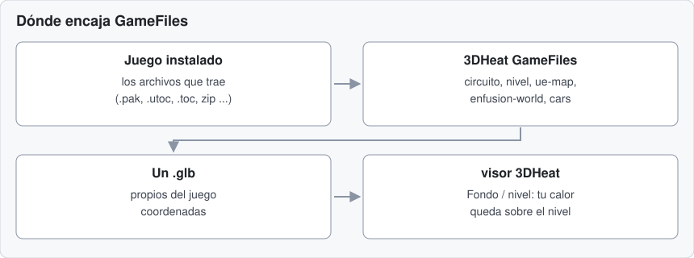

# Niveles completos {#whole-levels}

**En pocas palabras:** en shooters y otros juegos sin vueltas, la herramienta guarda
el mapa entero como un único archivo 3D, para que el visor pueda dibujar por dónde se movieron los jugadores.

`course` recorta el suelo alrededor de una vuelta. En los juegos sin vueltas la herramienta exporta
un nivel, mapa o mundo completo de una vez:

| Juego o motor | Listar | Exportar | Página |
|---|---|---|---|
| Battlefield 6 (Frostbite) | `levels` | `level <nivel>` | [Niveles de Battlefield 6](https://holdi601.github.io/3DHeat-Ext-Battlefield/level-battlefield.html) |
| Juegos de Unreal 5 con World Partition | `ue-maps <juego>` | `ue-map <juego> <mapa>` | [Mapas de Unreal 5](level-unreal-world-partition.md) |
| Arma Reforger (Enfusion) | `enfusion-worlds` | `enfusion-world <mundo>` | [Mundos de Arma Reforger](https://holdi601.github.io/3DHeat-Ext-Reforger/level-arma-reforger.html) |

Cada pareja funciona igual: el primer comando lista lo que tiene el juego instalado, y el
segundo escribe uno de ellos como un único `.glb` en las coordenadas de mundo propias del juego, así que las posiciones
registradas en ese juego caen sobre él. Las partes se llaman
`ground:`, `structure:` y `water:` como en todas las demás exportaciones (ver
[Formato de salida](output-format.md)); carga el archivo en el panel Fondo / nivel del visor de 3DHeat.

