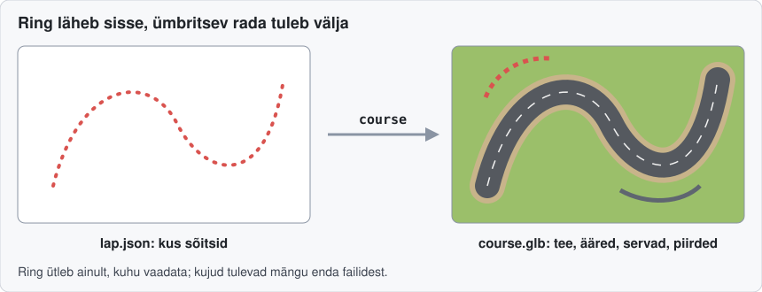
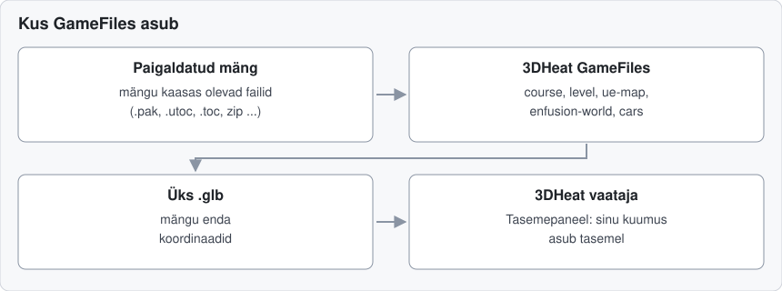

# 3DHeat GameFiles {#dheat-gamefiles}

**Mis see on?** Tööriist, mis koostab 3D-mudeli võistlusrajast või mängutasemest
mängu failidest, mis sul on juba installitud.

**Miks ma seda kasutaksin?** 3DHeat vaataja värvib kuumuskaardina, kus sõitsid või mängisid.
Selle tööriistaga värvib ta seda tegelikul rajal või tasemel, mitte tühjal alal.

**Näide:** võta ring, mille sõitsid. Tööriist koostab selle ümber oleva tee ja maa
ühe 3D-failina, nii et vaataja saab värvida sinu kiiruse või kukkumised tegelikul rajal:



Pole sul käsurealt kogemust? Alusta lehest [Enne alustamist](before-you-start.md).

Üksikasjalikumalt: see loeb tasemeandmed mängu komplektis olevatest arhiividest ja kirjutab
need binaarse glTF-failina (`.glb`). Selle peamine töö on **raja eksport**: annad sellele
ringi ja see kirjutab maapinna, tee, mis eristatakse ääre ja muru järgi, ning servad,
piirded, rehvimüürid, märgid ja hooned selle ümber.

See on osa tööriistast [3DHeat](https://github.com/Holdi601/3DHeat), vaatajast
reaalajas 3D-telemeetria kuumuskaartide, võistlusanalüüsi ja mängu ülevaate jaoks
([dokumentatsioon](https://holdi601.github.io/3DHeat/)). Selle tööriista kirjutatud
`.glb`-failid on tasemed, millele vaataja kuumuse joonistab.



On kolm teed, kuidas tasemegeomeetria 3DHeati saada:

| Tee | Vajab | Annab |
|---|---|---|
| 3DHeat Unreal Exporter | Unreali projekt avatud redaktoris | täpse geomeetria |
| 3DHeat GameCapture | ekraani ja salvestuse | hinnangu |
| **3DHeat GameFiles** | **installitud, komplektis oleva mängu** | **täpse geomeetria, ilma projektita** |

Pythoni pakett: `heat3d_gamefiles`. Repositoorium:
[Holdi601/3DHeat-GameFiles](https://github.com/Holdi601/3DHeat-GameFiles). Litsents: MIT.

## Mida see oskab {#what-it-can-do}

| Mäng või mootor | Raja eksport (`course`) | Arhiivide lugemine |
|---|---|---|
| Forza Horizon (ForzaTech) | jah: maastik, tee ja ääred, maapinna tekstuur, paigutatud mudelid nende enda tekstuuridega | `identify`, `list`, `extract` `.minizip`-failil; `identify` `.modelbin`-failil; mudelid, maastik ja tekstuurid käsu `course` ja `terrain` kaudu |
| BeamNG.drive | jah: maastik, teedekaalud, modelleeritud ringrajad, paigutatud mudelid, vesi | `identify`, `list`, `extract` tasemete zip-failidel; `identify` `.ter`- ja `.cdae`-failidel; `.dae` käsu `course` kaudu |
| Assetto Corsa Rally (Unreal 5.6) | jah: lavade maapinna kahhelid, küpsetatud maapinna värv, paigutatud mudelid lamedates värvides | `identify`, `list`, `extract` IoStore `.utoc`/`.ucas` failidel; zen-paketid, staatilised võrgud, tekstuurid käsu `course` kaudu |
| Unreali `.pak` (versioonid 8-12) | ei | `identify`, `list`, `extract` |
| Unity (formaat 22 ja uuem) | ei | `identify`, `meshes` |
| Battlefield 6 (Frostbite `.toc`/`.cas`) | ei rada; terve tase käsuga `level`: maastik, paigutatud võrgud, nende värvikaardid valikuga `--textures` | `identify`, `levels`; paketid, võrgud, maastik, tekstuurid ja paigutus käsu `level` kaudu |
| Source 2 `.vpk` | ei | `identify`, `list`, `extract` |
| Unreal 5 World Partition mängud | ei rada; terve kaart käsuga `ue-map` (loetletud käsuga `ue-maps`): maastik, HLOD-hooned ja objektid, vesi | - |
| Arma Reforger (Enfusion) | ei rada; terve maailm käsuga `enfusion-world` (loetletud käsuga `enfusion-worlds`): maastik oma värvides, meri, hooned kastidena | - |
| Forza (autod) | `cars`: iga auto madalal detailitasemel vaataja võistlusvahelehe jaoks | - |

Assetto Corsa EVO ja iRacingi ringid lükatakse põhjusega tagasi. Vaata
[Piirangud ja teadaolevad puudused](../limits-and-known-gaps.md).

## Paigaldus {#install}

Pole sul käsurealt kogemust? Loe esmalt [Enne alustamist](before-you-start.md).

Vajad **Python 3.10 või uuemat** (arendatud versioonil 3.13) ja pakette failist
[`requirements.txt`](https://github.com/Holdi601/3DHeat-GameFiles/blob/main/requirements.txt).

```
git clone https://github.com/Holdi601/3DHeat-GameFiles.git
cd 3DHeat-GameFiles
pip install -r requirements.txt
```

Seejärel kontrolli: `python -m heat3d_gamefiles --help`. Peaksid nägema
`usage: heat3d_gamefiles [-h]` ja käskude loendi. Käivita iga käsk hoidla kaustast
kujul `python -m heat3d_gamefiles <verb>`.

| Pakett | Milleks |
|---|---|
| numpy | kõik, mis dekodeerib geomeetriat |
| lz4 | Forza arhiivid (enamasti LZ4 plokid), mõned Unity paketid, IoStore LZ4 plokid |
| Pillow | BC1-BC7 tekstuuride dekodeerimine, JPEG-tekstuuride kirjutamine `.glb`-sse |
| msgpack, zstandard | BeamNG kompileeritud kujud (`.cdae`) |
| cryptography | ainult krüpteeritud `.pak`-faili avamiseks võtmega, mis sul juba on |
| pytest | testid |

Unreali sisu, mis on pakitud **Oodle**-iga, vajab Oodle'i teeki, mis on juba sinu masinas.
Seda tööriistaga ei tarnita kunagi. Vaata [Oodle](../reader-oodle.md).

Tööriist on kirjutatud Windowsi jaoks. See leiab mängud Steami raamatukogude nimekirja ja
`%LOCALAPPDATA%` kaudu ning laeb Oodle'i Windowsi DLL-ina. Teisi platvorme ei ole testitud.

## Kiire algus {#quick-start}

**Ringifail** on salvestus sellest, kuhu su auto läks: x, y, z punktide nimekiri.
See tuleb [3DHeat GameCapture](https://github.com/Holdi601/3DHeat-GameCapture) tööriistast
või FH Companion rakenduse ringide raamatukogust; käsitsi kirjutatud CSV töötab ka
([Ringi sisendid](../lap-inputs.md)).

```
# Forza: ringifail, ringide kaust või rajanimi FH Companion raamatukogust
python -m heat3d_gamefiles course "Example Circuit"
python -m heat3d_gamefiles course path\to\lap.json -o course.glb

# BeamNG.drive või Assetto Corsa Rally: heat3d-lap fail ütleb, mis mängust see on
python -m heat3d_gamefiles course my_lap.json

# Iga rada FH Companion raamatukogus, üks .glb iga kohta
python -m heat3d_gamefiles courses -o courses

# Battlefield 6: loetle tasemed, seejärel ekspordi üks (suur fail; vt Käsud)
python -m heat3d_gamefiles levels
python -m heat3d_gamefiles level <level> -o level.glb --textures

# Unreal 5 World Partition ja Arma Reforger: loetle, seejärel ekspordi
python -m heat3d_gamefiles ue-maps "<game>"
python -m heat3d_gamefiles ue-map "<game>" <map> -o map.glb
python -m heat3d_gamefiles enfusion-worlds
python -m heat3d_gamefiles enfusion-world <world> -o world.glb

# Iga Forza auto vaataja võistlusvahelehe jaoks
python -m heat3d_gamefiles cars -o forza.h3dcars

# Mis fail see on?
python -m heat3d_gamefiles identify some_archive.pak
```

Ava `.glb` 3DHeat vaatajas. Mängu enda maailmakoordinaadid on alles
(vt [Väljundvorming](../output-format.md)), nii et salvestatud ring joondub rajaga.

## Selle dokumentatsiooni kaart {#map-of-this-documentation}

- [Enne alustamist](before-you-start.md): Python, terminal, esimene käsk.
- [Käsud](../commands.md): iga käsk ja valik, näidetega.
- [Käsu viide](../cli-reference.md): iga käsu `--help`, koodist genereeritud.
- [Arhiivide lugemine](../inspecting-archives.md): `identify`, `list`, `extract`, `meshes`, samm-sammult.
- [Raja eksport](../course-export.md): kuidas ring saab rajaks, kõigi mängude jaoks.
  - [Forza Horizon](../course-forza-horizon.md)
  - [BeamNG.drive](../course-beamng.md)
  - [Assetto Corsa Rally](../course-assetto-corsa-rally.md)
  - [Detailitasemed ja eelarve](../detail-budget.md)
- [Terved tasemed](../whole-levels.md): tase, kaart või maailm ilma ringita.
  - [Battlefield 6 tasemed](../level-battlefield.md): `levels`, `level`
  - [Unreal 5 kaardid](../level-unreal-world-partition.md): `ue-maps`, `ue-map`
  - [Arma Reforgeri maailmad](../level-arma-reforger.md): `enfusion-worlds`, `enfusion-world`
- [Forza autod](../forza-cars.md): `cars`, autofail vaataja võistlusvahelehe jaoks.
- [Ringi sisendid](../lap-inputs.md): iga ringifaili kuju, mida tööriist vastu võtab.
- [Väljundvorming](../output-format.md): mis on `.glb`-s sees.
- [Arhiivilugejad](../archive-readers.md): üks lehekülg iga konteinerivormingu kohta: mida see loeb, mida mitte ja miks.
- [Piirangud ja teadaolevad puudused](../limits-and-known-gaps.md)
- [Tõrkeotsing](../troubleshooting.md): veateated ja mida teha.
- [Reeglid ja litsentsid](../rules-and-licences.md): ei mingeid võtmeid, sinu enda failid, ei edastata edasi.
- [Uuendused](../updates.md): uuenduskontroll ja `heat3d_update`.
- [Arendus](../development.md): mooduli kaart ja testid, kaasa arvatud testid, mis töötavad installitud mängude vastu.
- [Hooldamine](../maintaining.md): väljalaske kontrollnimekiri nende lehtede jaoks.

## Osa 3DHeatist {#part-of-3dheat}

3DHeat GameFiles on üks tasuta tööriistadest vaataja 3DHeat ümber:

| Tööriist | Mida see teeb | Dokumentatsioon |
|---|---|---|
| [3DHeat](https://github.com/Holdi601/3DHeat) | vaataja: 3D-kuumuskaardid, võistlusanalüüs ja mängu ülevaade brauseris | [sait](https://holdi601.github.io/3DHeat/) |
| [GameFiles](https://github.com/Holdi601/3DHeat-GameFiles) | rajad ja tasemed mängude failidest, 3D-glb-na | [sait](https://holdi601.github.io/3DHeat-GameFiles/) |
| [GameCapture](https://github.com/Holdi601/3DHeat-GameCapture) | ringi telemeetria võidusõidumängudest; tasemed taastatud mänguvideost | [sait](https://holdi601.github.io/3DHeat-GameCapture/) |
| [Unreal Exporter](https://github.com/Holdi601/3DHeat-UnrealExporter) | Unreal Editori plugin, mis salvestab tasemed `.glb`-na | [sait](https://holdi601.github.io/3DHeat-UnrealExporter/) |
| [CS2](https://github.com/Holdi601/3DHeat-CS2) | Counter-Strike 2 demod mängufailideks; kaardid `.glb`-na | [sait](https://holdi601.github.io/3DHeat-CS2/) |
| [Watcher](https://github.com/Holdi601/3DHeat-Watcher) | salvestab sinu mängu taustal sellest, mida mängud avaldavad | [sait](https://holdi601.github.io/3DHeat-Watcher/) |
| [Ext-WarThunder](https://github.com/Holdi601/3DHeat-Ext-WarThunder) | War Thunderi kordused mängufailideks | [sait](https://holdi601.github.io/3DHeat-Ext-WarThunder/) |
| [Ext-WoT](https://github.com/Holdi601/3DHeat-Ext-WoT) | World of Tanksi kordused mängufailideks | [sait](https://holdi601.github.io/3DHeat-Ext-WoT/) |
| [Ext-WoWs](https://github.com/Holdi601/3DHeat-Ext-WoWs) | World of Warshipsi kordused mängufailideks | [sait](https://holdi601.github.io/3DHeat-Ext-WoWs/) |
| [Ext-Squad](https://github.com/Holdi601/3DHeat-Ext-Squad) | Squadi serverdemod mängufailideks | [sait](https://holdi601.github.io/3DHeat-Ext-Squad/) |
| [Ext-DCS](https://github.com/Holdi601/3DHeat-Ext-DCS) | DCS Worldi kaardid `.glb` tasemeteks | [sait](https://holdi601.github.io/3DHeat-Ext-DCS/) |
| [Ext-IL2](https://github.com/Holdi601/3DHeat-Ext-IL2) | IL-2 Sturmovigi kaardid `.glb` tasemeteks | [sait](https://holdi601.github.io/3DHeat-Ext-IL2/) |

Iga mängu lugeja on omaette väike projekt oma litsentsifaili, väljalasete ja probleemijälgijaga, nii et seda saab eraldi paigaldada, uuendada, hooldada - või õiguste omaniku palvel tagasi võtta -, ilma et see mõjutaks vaatajat või teisi tööriistu.

Vaataja mängufailid on kirjeldatud lehel
[Üks fail mängu kohta: `.3dheat`](https://holdi601.github.io/3DHeat/container.html);
siin tehtud tase laaditakse nende kõrvale vaataja paneelis **Taust / tase**.
