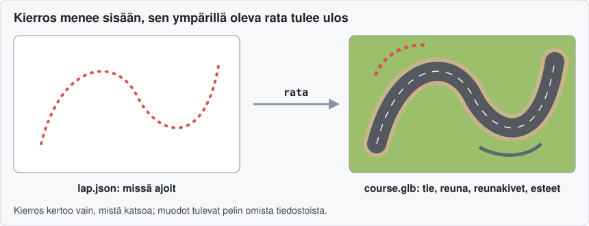
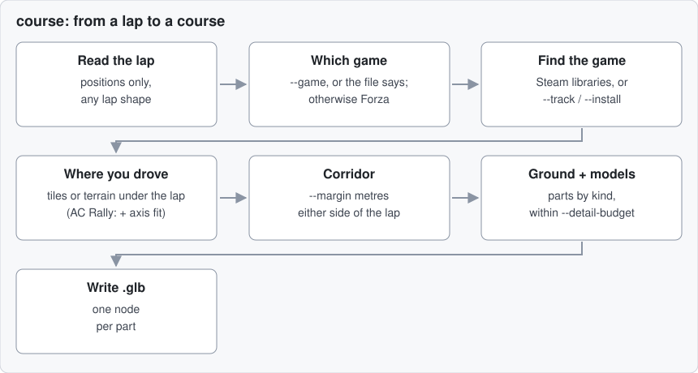

# Radan vienti

**Lyhyesti:** ajoit kierroksen, tämä rakentaa radan, jolla ajoit, 3D-tiedostona.
Kierros on vain lista pisteitä. Tie, nurmi ja reunakivet tulevat pelin omista
tiedostoista.

`course` muuttaa kierroksen radaksi: maan kaistalla kummallakin puolella siitä,
mihin auto ajoi, ja sen päällä seisovat asiat yhtenä `.glb`-tiedostona
katseluohjelmaan. Tämä sivu kertoo, mitä kaikki kolme tuettua peliä yhteisesti
tekevät. Sen alla olevat sivut kertovat, mikä eroaa:

- [Forza Horizon](course-forza-horizon.md): ForzaTech `.minizip`-arkistot
- [BeamNG.drive](course-beamng.md): zip-arkistot, maaston korkeuskenttä, käännetyt muodot
- [Assetto Corsa Rally](course-assetto-corsa-rally.md): Unreal 5 IoStore, World Partition -vaihe
- [Yksityiskohtatasot ja budjetti](detail-budget.md): montako kolmiota sijoitetut mallit saavat ja mitkä kopiot jäävät

## Vaiheet

Alla käytetyt sanat: **koordinaatisto** on se, mihin suuntaan akselit osoittavat;
**käytävä** on kaista kierroksen kummallakin puolella; **laatta** on yksi neliön
muotoinen pala pelin maastoa; **LOD** (yksityiskohtataso) on yksi mallin
yksinkertaisemmista kopioista.

1. **Lue kierros.** Vain pisteet, mistä tahansa [Kierrosten syötteet](lap-inputs.md)
   -sivun muodosta. Nopeutta ja syötteitä ei käytetä. Kierros, jossa on alle
   kaksi näytettä, hylätään ("holds no driving").
2. **Päätä peli.** `--game`, sitten kierrostiedoston oma `game`, sitten Forza
   (katso [Komennot](commands.md#which-game)).
3. **Etsi asennettu peli.** Kaikki kolme etsivät jokaisen Steamin kirjaston, joka on
   listattu Steamin tiedostossa `config\libraryfolders.vdf`. Forza etsii myös
   `C:\XboxGames`. `--track` (Forza) tai `--install` (BeamNG, AC Rally) ohittaa haun.
4. **Etsi, missä kierros ajettiin.** Tätä ei päätetä pelkästään nimen perusteella.
   Forza valitsee radan, jonka maalaatat peittävät kierroksen. BeamNG valitsee
   tason, jonka maasto (tai tiet) ovat kierroksen näytteiden alla. AC Rally kokeilee
   jokaista vaihetta kahdeksassa akselien suunnassa ja valitsee sen, joka asettaa
   suurimman osan kierroksesta tielle.
5. **Leikkaa käytävä**, `--margin` metriä kummallekin puolelle ajolinjaa (alla).
6. **Rakenna maa** käytävän sisään, luokiteltuna tieksi, reunaksi, soraksi ja
   mullaksi, maastoksi, merkinnöiksi, renkaanjäljiksi tai vedeksi, ja paista
   maatekstuuri jokaiselle 512 m:n neliölle.
7. **Sijoita mallit**, jotka seisovat käytävässä, luokittain, yksityiskohtatasolla,
   joka valitaan etäisyyden ja kolmioiden budjetin mukaan.
8. **Kirjoita `.glb`**: yksi nimetty solmu osaa kohden. Katso [Tulostemuoto](output-format.md).

Mitä ajo tulostaa, tässä synteettisellä BeamNG.drive-asennuksella, jonka testit
rakentavat: 50 m:n kierros pitkin tiekaistaletta:

## Käytävä

Leikkaus on kaista ajolinjan ympärillä, ei kierroksen rajauslaatikko. Kiertoradalla
nämä ovat lähes samat. Pisteestä pisteeseen -sprintissä laatikko on enimmäkseen
rinnettä, jonne kukaan ei aja, ja kaista voi olla kymmenesosa sen alasta. Lähde:
[`corridor.py`](https://github.com/Holdi601/3DHeat-GameFiles/blob/main/heat3d_gamefiles/corridor.py).

Näin se rakennetaan:

- Ajo heijastetaan maatasolle: kierroksen x ja z (BeamNG: pelin oman koordinaatiston x ja y).
- Se rasteroidaan **4 m**:n soluihin (`CELL`). Jokainen solu, jonka ajo koskettaa,
  levennetään levyllä, jonka säde on `margin + 4 m` joka suuntaan.
- Peräkkäiset näytteet, jotka ovat alle **50 m** (`JOIN`) toisistaan, yhdistetään
  pisteillä 4 m välein, joten kaistassa ei ole aukkoja. Kauempana toisistaan olevia
  näytteitä käsitellään erillisinä ajon osina eikä yhdistetä. Kirjastorata on monta
  kierrostiedostoa peräkkäin, eikä yhden sprintin maali saa piirtää kaistaa kartan
  yli seuraavaan lähtöön.
- Kolmio säilytetään, jos jokin sen kulmista, minkä tahansa reunan keskipiste tai sen
  painopiste on kaistassa. Keskipisteet tavoittavat ison kolmion, joka kulkee kapean
  kaistan poikki niin, että kaikki sen kulmat ovat sen ulkopuolella.
- Korkeus ei ole koskaan mukana leikkauksessa. Laatikko, joka rajaisi korkeutta,
  leikkaisi maan mäen alta, jonne tie nousee.

Konsoli ilmoittaa käytävän pinta-alan, esimerkiksi
`cutting 80 m either side of the driving: 1.53 km2 of a 6,000 by 3,600 m box`.

BeamNG ja AC Rally rakentavat lisäksi laajemman **ulottuvuus**käytävän
`margin + 60 m`. Sijoitettu malli otetaan huomioon, jos sen origo on
ulottuvuuskäytävässä, ja piirretään vain, jos sen jalanjälki koskettaa todellista
käytävää. Näin pitkä kohde, jonka origo on juuri kaistan ulkopuolella, ei katoa.
BeamNG käyttää ulottuvuuskäytävää myös valitakseen, mitkä tieliitokset maalataan.

## Mistä maa koostuu

Jokainen vienti luokittelee maakolmiot samoihin lajeihin, ja jokainen laji
kirjoitetaan omaksi osakseen, jotta katseluohjelma voi näyttää tai piilottaa sen:

| Laji | Osan nimi | Tasainen väri (lineaarinen RGB) | Forza | BeamNG | AC Rally |
|---|---|---|---|---|---|
| tie | `ground:road` | 0.22, 0.22, 0.23 | tiekaistat: asfalttiosa | `ASPHALT`-tyyppiset kerrokset, tieliitokset, mallinnettu tie | radan laatat (`/MeshesTrack/`) |
| reuna | `ground:verge` | 0.52, 0.47, 0.30 | tiekaistat: olkapää | jalkakäytävät ja reunamallit | - |
| sora ja muta | `ground:gravel and dirt` | 0.50, 0.42, 0.30 | - | mulla-, sora-, hiekka- ja mutakerrokset sekä tarrat | - |
| maasto | `ground:terrain` | 0.30, 0.44, 0.18 | kaikki muu | kaikki muu | `_Terrain`-laatat ja kaukainen maasto |
| reunakivet | `ground:kerbs` | 0.60, 0.12, 0.10 (Forza) | `road_gen_rum*`-rekvisiitta | reunakivi-, reunus- ja tärinämallit | reunakivi- ja reunusmallit |
| merkinnät | `ground:markings` | 0.90, 0.90, 0.88 | tarrojen alimallit, nostettu 5 cm | maalattu tekstuuriin | - |
| renkaanjäljet | `ground:tyre marks` | 0.20, 0.17, 0.16 | tarrojen alimallit, nostettu 5 cm | maalattu tekstuuriin | - |
| vesi | `water:water` | 0.16, 0.34, 0.48 | vesimateriaalit | merivesitaso, vesilohkot, joet | - |

Tasaiset värit on valittu niin, että ne erottuvat yhdellä silmäyksellä, eivätkä ne
yritä vastata peliä. Niitä käytetään osille ilman tekstuuria ja katseluohjelmille,
jotka jättävät tekstuurit huomiotta. Lähde:
[`surfaces.py`](https://github.com/Holdi601/3DHeat-GameFiles/blob/main/heat3d_gamefiles/surfaces.py).

Maa-osat jaetaan 512 m:n neliöittäin, ja jokaisella neliöllä on oma paistettu
kuva, joten osien nimissä on neliö:

| Peli | Maaosan nimi | Neliön avain |
|---|---|---|
| Forza | `ground:road x-2046 z1023` | maalaatan ruudukkonimi (askeleet 1023, katso [Forza Horizon](course-forza-horizon.md)) |
| BeamNG | `ground:road 3_-2` | `floor(x / 512)`, `floor(y / 512)` BeamNG-metreissä |
| AC Rally | `ground:road 1_-4` | `floor(x / 51200)`, `floor(y / 51200)` Unreal-senttimetreissä |

## Mikä seisoo sen päällä

Sijoitetut mallit kirjoitetaan osiin nimeltä `structure:<category>`, tai
`ground:kerbs` reunakiville (kaikissa kolmessa pelissä). Kun osalla on oma
tekstuuri, tekstuurin tai materiaalin nimi seuraa luokkaa, esimerkiksi
`structure:barriers bar_armco_bclr`.

| Luokka | Forza | BeamNG | AC Rally |
|---|---|---|---|
| esteet | kyllä | kyllä | kyllä |
| rekvisiitta | kyllä | kyllä | kyllä |
| kyltit | kyllä | kyllä | kyllä |
| rakennukset | kyllä (koko rakennusten korvikkeet, joissa peli niitä on) | kyllä | kyllä |
| infrastruktuuri | kyllä | kyllä | kyllä |
| sillat | kyllä | kyllä | (luokitellaan infrastruktuuriksi) |
| kivet | kyllä | kyllä | kyllä |
| reunakivet | kyllä, maana | kyllä, maana | kyllä, maana |
| puut | `--trees`-valinnalla | `--trees`-valinnalla | `--trees`-valinnalla |
| murtuvat kappaleet | `--trees`-valinnalla | - | - |

Yksityiskohtien jako on sama kaikissa kolmessa. Kopiot 25 m:n sisällä ajosta
alkavat täydellä yksityiskohdalla, kopiot 25–60 m:n päässä yhden tason
karkeampana, ja kopiot kauempana karkeimmalla tasolla. Sitten kalleimmat mallit
laskevat tasoa, kunnes kolmiobudjetti täyttyy. Jos edes karkeimmat tasot eivät
mahdu antamaasi budjettiin, kopioita jätetään pois. Reunakiviä ei koskaan
yksinkertaisteta tai jätetä pois. Katso [Yksityiskohtatasot ja budjetti](detail-budget.md).

## Vaihtoehdot, jotka muokkaavat tulosta

| Haluat | Käytä |
|---|---|
| pienemmän tiedoston | `--no-textures` (tasaiset värit), `--texture-size 1024` tai `512`, `--detail-budget N`, `--margin 40` |
| vain maan | `--no-placed` |
| myös maiseman | `--trees` |
| toisen vuodenajan (Forza) | `--season winter` |
| pelin, joka ei ole Steamissa | `--track` (Forza) tai `--install` (BeamNG, AC Rally) |
| kierroksen, jota haku ei sijoita | `--level` (BeamNG, AC Rally), `--track` (Forza) |

## Koordinaatit

Jokainen vienti kirjoittaa metreinä, Y ylös, koordinaatistossa, johon saman pelin
tallennettu kierros osuu:

| Peli | Kirjoitettu koordinaatisto |
|---|---|
| Forza | pelin oma maailmakoordinaatisto, muuttamattomana |
| BeamNG | BeamNG:n Z-ylös-maailman `(x, z, -y)`, joka on kierroksen tallentajan käyttämä kierto |
| AC Rally | kierroksen koordinaatisto, löydetty sovittamalla: Unreal-senttimetrit muuttuvat metreiksi, ja Unreal X ja Y muuttuvat kierroksen x:ksi ja z:ksi siinä kahdeksasta suunnasta, joka sopii |

Katso [Tulostemuoto](output-format.md).
