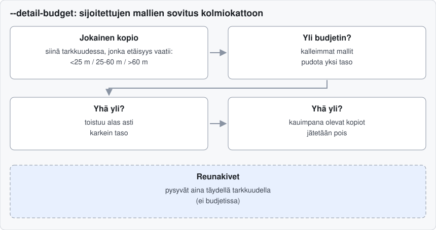

# Yksityiskohtatasot ja budjetti {#levels-of-detail-and-the-budget}

**Kolmio** on pieni litteä pala 3D-mallia. Enemmän kolmioita tarkoittaa suurempaa,
hitaampaa tiedostoa. **Budjetti** on raja sille, kuinka monta niitä saa olla.
**Yksityiskohtataso** on mallin yksinkertaisempi kopio, jota käytetään, kun malli on
kaukana.

Kaikki, mitä kierroksen ympärille sijoitetaan, on hienoimmalla tasolla useita
miljoonia kolmioita. Esimerkiksi satoja suojakaiteen osia ja renkaiden pinoja, joissa
kussakin on noin tuhat kolmiota. Kaupunkikäytävässä on yli sata tuhatta kopiota.
Siksi jokainen radan vienti antaa sijoitetuille malleille **kolmiobudjetin** ja
päättää mallikohtaisesti, millä yksityiskohtatasolla malli piirretään ja tarvittaessa
mitkä kopiot jätetään pois.

Järjestelmä kirjoitettiin Forzaa varten
([`forzaplacement.py`](https://github.com/Holdi601/3DHeat-GameFiles/blob/main/heat3d_gamefiles/forzaplacement.py):
`choose_levels`, `auto_budget`, `_fit`), ja BeamNG ja AC Rally käyttävät sen osia
uudelleen. Maasto ei kuluta budjettia.

## Etäisyysvyöhykkeet {#distance-bands}

Jokaisen kopion etäisyys ajoon mitataan maatasolla lähimpään kierrosnäytteeseen.
Kierros harvennetaan ensin enintään 1 000 pisteeseen. Se maksaa muutaman metrin
tarkkuutta, eikä sillä ole tässä merkitystä. Kopiot jakautuvat sitten kolmeen
vyöhykkeeseen, ja jokainen (malli, vyöhyke) -pari budjetoidaan erikseen:

| Vyöhyke | Etäisyys | Alkaa |
|---|---|---|
| lähellä | alle 25 m (`NEAR`) | hienoimmalta tasolta |
| keskietäisyys | 25–60 m (`FAR`) | yhden tason karkeampana |
| kaukana | 60 m ja enemmän | karkeimmalta tasolta |

Ilman reittiä (Forza `terrain --box`) etäisyys mitataan laatikon keskeltä.

## Laskeminen sopivaksi {#stepping-down-to-fit}



(malli, vyöhyke) -merkinnän hinta on kopioita kertaa kolmiot nykyisellä tasolla.
Kun summa ylittää budjetin, eniten kustantava merkintä laskee yhden tason, ja tämä
toistetaan, kunnes summa mahtuu tai mikään ei voi laskea enempää. Lukitut merkinnät
eivät koskaan laske:

| Peli | Lukittu täydelle yksityiskohdalle |
|---|---|
| Forza | reunakivet (`road_gen_rum*`) |
| BeamNG | reunakivet ja jokainen muoto, joka kantaa ajopintaa |
| AC Rally | reunakivet |

Forzan yhteenveto ilmoittaa tämän muodossa
`N of M models drawn at a coarser level to fit the budget`.

## Automaattinen budjetti {#the-automatic-budget}

Ilman `--detail-budget`-valintaa budjetti mitoittaa itsensä niin, että **yhtään
kopiota ei jätetä pois**:

```
budget = max(1,500,000, 1.25 x sum(copies x coarsest level))
```

Lukitut merkinnät lasketaan hienoimmalla tasollaan. 25 % (`HEADROOM`) antaa
tien vieressä oleville asioille jonkin verran yksityiskohtaa. Maaseudun radalla
tämä on 1,5 miljoonan lattia (`DEFAULT_BUDGET`). Kaupunkiradalla, jossa käytävässä
on yli sata tuhatta kopiota, se kasvaa yli kymmeneen miljoonaan, ja tiedosto
useisiin satoihin megatavuihin. Katseluohjelma lataa sen.

## Antamasi budjetti {#a-budget-you-give}

`--detail-budget N` on **katto**. Tasot laskevat kuten yllä. Jos edes karkeimmat
tasot eivät mahdu, kopioita jätetään pois:

| Peli | Missä järjestyksessä kopiot jätetään pois |
|---|---|
| Forza | ensin kaikki 25 m tai kauempana ajosta, sitten tien vieressä oleva; kussakin ryhmässä ensin se, joka näyttää pienimmältä tieltä: suurin etäisyys / koko (koko = mallin rajauslaatikon lävistäjä kertaa suurin skaala, vähintään 0,25 m) |
| BeamNG | kauimpana ajosta ensin |
| AC Rally | kauimpana ajosta ensin, kuten BeamNG |
| Battlefield 6 | pienimmästä ensin: rajauslaatikon lävistäjä kertaa skaala |

Reunakiviä (ja BeamNG:ssä ajopintaa kantavia malleja) ei koskaan jätetä pois, joten
budjetti, joka on pienempi kuin ne maksavat yksinään, ylittyy niiden takia, eikä
mikään muu aiheuta ylitystä.

Forzassa käytetään etäisyyttä jaettuna koolla, koska pelkkä etäisyys jättäisi
ilmastointiyksikön yhdeksän metrin päässä seinällä eloon kauemmin kuin
kaksikymmenmetrisen julkisivun, johon se kiinnittyy, kaksitoista metriä kauempana.
Tien vieressä olevat asiat menevät viimeisinä koosta riippumatta. Kolme metriä
leveä este viiden metrin päässä ajolinjasta on radan reuna, kun taas viisikymmentä
metriä leveä rakennus kuusikymmentä metriä takana on taustamaisemaa.

Yhteenveto ilmoittaa
`N of M copies left out to fit the budget, the smallest and furthest from the driving first (--detail-budget raises it)`
(Forza) tai `N copies left out to fit the budget, the furthest from the driving first (--detail-budget raises it)`
(BeamNG, AC Rally).

## Kokonaiset rakennukset (Forza) {#whole-buildings-forza}

Kokonainen rakennuksen korvike lasketaan yhdeksi kopioksi, ja sen etäisyys mitataan
rakennuksen lähimpään reunaan. Se pidetään tai jätetään pois yksikkönä. Korvaamia
modulaarisia osia ei budjetoida lainkaan. Katso
[Forza Horizon](course-forza-horizon.md#buildings-drawn-whole).

## Mikä yksityiskohtataso on, pelikohtaisesti {#what-a-level-of-detail-is-per-game}

| Peli | Tasot tulevat |
|---|---|
| Forza | mallin `Mesh`-alimallien kolmiokohtaisesta tasomaskista (bitti `level + 1`); `0xFFFF` rikottaville osille vain mallille, jolla ei ole merkittyä tasoa |
| BeamNG | `.cdae`-muodon `details`, joiden koko on ei-negatiivinen, suurimmasta alkaen; `.dae`:lle verkkosolmujen nimien lopussa oleva numero (`barrier75`, `barrier40`) |
| AC Rally | staattisen mallin tallennetut yksityiskohtatasot, hienoimmasta alkaen |
| Battlefield 6 | MeshSetin yksityiskohtatasot, hienoimmasta alkaen, laskien vain piirretyt osat (ei varjo- ja vain syvyyskopioita), eikä viimeistä tasoa, joka on kaukaisen näkymän korvike (`M_LastLod`, `M_Billboard`, `M_Vista`-materiaalit: pylvään hila muuttuisi kiinteäksi piikiksi) |

Battlefield 6:n `level`-komennolla ei ole kierrosta, joten etäisyysvyöhykkeitä ei
ole: jokainen malli on yksi merkintä, ja jokainen kopio on samalla tasolla.
Automaattinen budjetti on yllä oleva kaava, jossa maaston taustakuva on lukittu.
Korkeuskenttä on budjetin ulkopuolella, ja sen koon määrää `--ground-spacing`.
Antamasi budjetin alla, kun jokainen malli on karkeimmalla tasollaan, kopioita
jätetään pois pienimmästä alkaen. Koko on mallin rajauslaatikon lävistäjä kertaa
kopion skaala, koska ajoa ei ole, josta etäisyyttä voisi mitata. Maaston taustakuvaa
ei jätetä koskaan pois. Taso on automaattisesti noin kymmenen miljoonaa kolmiota.

## Määrän valitseminen {#choosing-a-number}

| Haluat | Kokeile |
|---|---|
| kaiken, täyden yksityiskohdan lähellä tietä | jätä automaattiseksi |
| tiedoston, joka on muutaman kerran pienempi | `--detail-budget 500000` ja `--texture-size 1024` |
| vain maan | `--no-placed` (budjettia ei ole mukana) |
