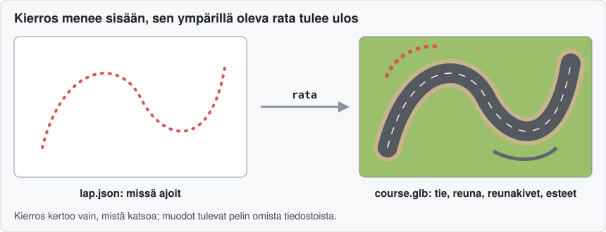
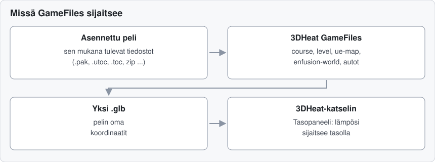

# 3DHeat GameFiles {#dheat-gamefiles}

**Mitä se on?** Työkalu, joka rakentaa 3D-mallin ajoradasta tai pelin kentästä
pelin tiedostoista, jotka sinulla on jo asennettuna.

**Miksi käyttäisin sitä?** 3DHeat-katselin maalaa lämpökartalle, missä ajoit tai pelasit.
Tämän työkalun avulla se maalaa oikealle radalle tai kentälle, ei tyhjään tilaan.

**Esimerkki:** ota kierros, jonka ajoit. Työkalu rakentaa tien ja maaston sen ympärille
yhdeksi 3D-tiedostoksi, jotta katselin voi maalata nopeutesi tai törmäyksesi oikealle radalle:



Uusi komentorivin kanssa? Aloita [Ennen aloittamista](before-you-start.md).

Tarkemmin: se lukee kenttätiedot pelin mukana tulevista arkistoista ja kirjoittaa ne
binäärisenä glTF (`.glb`) -tiedostona. Sen pääasiallinen tehtävä on **radan vienti**: annat
sille kierroksen, ja se kirjoittaa maaston, tien erotettuna reunasta ja nurmesta, sekä reunakivet,
esteet, rengasseinät, kyltit ja rakennukset sen ympärillä.

Se on osa [3DHeat](https://github.com/Holdi601/3DHeat)-ohjelmistoa, katselinta reaaliaikaisille
3D-telemetrialämpökartoille, kilpa-analyysille ja ottelun tarkastelulle
([dokumentaatio](https://holdi601.github.io/3DHeat/)). Tämän työkalun kirjoittamat `.glb`-tiedostot
ovat kenttiä, joille katselin piirtää lämmön.



Se on yksi kolmesta tavasta saada kentän geometria 3DHeatiin:

| Reitti | Tarvitsee | Antaa |
|---|---|---|
| 3DHeat Unreal Exporter | Unreal-projekti auki editorissa | tarkan geometrian |
| 3DHeat GameCapture | näyttö ja tallennus | arvion |
| **3DHeat GameFiles** | **asennettu, toimitettu peli** | **tarkan geometrian, ilman projektia** |

Python-paketti: `heat3d_gamefiles`. Repositorio:
[Holdi601/3DHeat-GameFiles](https://github.com/Holdi601/3DHeat-GameFiles). Lisenssi: MIT.

## Mitä se osaa {#what-it-can-do}

| Peli tai moottori | Radan vienti (`course`) | Arkistojen lukeminen |
|---|---|---|
| Forza Horizon (ForzaTech) | kyllä: maasto, tie ja nurmi, maanpinnan tekstuuri, sijoitetut mallit omissa tekstuureissaan | `identify`, `list`, `extract` `.minizip`-tiedostolle; `identify` `.modelbin`-tiedostolle; mallit, maasto ja tekstuurit `course`- ja `terrain`-komennoilla |
| BeamNG.drive | kyllä: maasto, tien tarrat, mallinnetut radat, sijoitetut mallit, vesi | `identify`, `list`, `extract` kenttäzip-tiedostoille; `identify` `.ter`- ja `.cdae`-tiedostoille; `.dae` `course`-komennolla |
| Assetto Corsa Rally (Unreal 5.6) | kyllä: osuuden maanpintalaatat, leivotut maanpinnan värit, sijoitetut mallit tasaisin väriin | `identify`, `list`, `extract` IoStore `.utoc`/`.ucas`-tiedostoille; zen-paketit, staattiset mallit, tekstuurit `course`-komennolla |
| Unreal `.pak` (versiot 8–12) | ei | `identify`, `list`, `extract` |
| Unity (formaatti 22 ja uudemmat) | ei | `identify`, `meshes` |
| Battlefield 6 (Frostbite `.toc`/`.cas`) | ei kierrosta; koko kenttä `level`-komennolla: maasto, sijoitetut mallit, niiden värikartat `--textures`-asetuksella | `identify`, `levels`; paketit, mallit, maasto, tekstuurit ja sijoittelu `level`-komennolla |
| Source 2 `.vpk` | ei | `identify`, `list`, `extract` |
| Unreal 5 World Partition -pelit | ei kierrosta; koko kartta `ue-map`-komennolla (listataan `ue-maps`-komennolla): maisema, HLOD-rakennukset ja esineet, vesi | - |
| Arma Reforger (Enfusion) | ei kierrosta; koko maailma `enfusion-world`-komennolla (listataan `enfusion-worlds`-komennolla): maasto väreissään, meri, rakennukset laatikoina | - |
| Forza (autot) | `cars`: jokainen auto matalalla tarkkuudella katselimen Kilpa-välilehteä varten | - |

Assetto Corsa EVO:n ja iRacingin kierrokset hylätään perusteluineen. Katso
[Rajoitukset ja tunnetut puutteet](../limits-and-known-gaps.md).

## Asennus {#install}

Uusi komentorivin kanssa? Lue ensin [Ennen aloittamista](before-you-start.md).

Tarvitset **Python 3.10:n tai uudemman** (kehitetty versiolla 3.13) sekä paketit, jotka on lueteltu
tiedostossa [`requirements.txt`](https://github.com/Holdi601/3DHeat-GameFiles/blob/main/requirements.txt).

```
git clone https://github.com/Holdi601/3DHeat-GameFiles.git
cd 3DHeat-GameFiles
pip install -r requirements.txt
```

Tarkista sitten: `python -m heat3d_gamefiles --help`. Pitäisi näkyä `usage: heat3d_gamefiles [-h]`
ja komentojen luettelo. Suorita jokainen komento repositorion kansiosta muodossa
`python -m heat3d_gamefiles <verb>`.

| Paketti | Käytetään |
|---|---|
| numpy | kaikki, mikä purkaa geometriaa |
| lz4 | Forza-arkistot (enimmäkseen LZ4-lohkoja), joitakin Unity-paketteja, IoStore LZ4 -lohkoja |
| Pillow | BC1–BC7-tekstuurien purku, JPEG-tekstuurien kirjoitus `.glb`-tiedostoon |
| msgpack, zstandard | BeamNG:n käännetyt muodot (`.cdae`) |
| cryptography | vain salatun `.pak`-tiedoston avaamiseen avaimella, joka sinulla jo on |
| pytest | testit |

Oodle-pakatun Unreal-sisällön tarvitsee Oodle-kirjaston, joka on jo koneellasi. Yhtään
ei toimiteta tämän työkalun mukana. Katso [Oodle](../reader-oodle.md).

Työkalu on kirjoitettu Windowsille. Se löytää pelit Steamin kirjastoluettelosta ja
`%LOCALAPPDATA%`-kansiosta, ja lataa Oodlen Windows-DLL:nä. Muilla alustoilla ei ole testattu.

## Pikaohje {#quick-start}

**Kierrostiedosto** on tallenne siitä, minne autosi meni: lista x-, y- ja z-pisteistä.
Se tulee [3DHeat GameCapturesta](https://github.com/Holdi601/3DHeat-GameCapture) tai FH Companion
-sovelluksen kierroskirjastosta; käsin kirjoitettu CSV käy myös
([Kierrossyötteet](../lap-inputs.md)).

```
# Forza: kierrostiedosto, kierroskansio tai radan nimi FH Companion -kirjastosta
python -m heat3d_gamefiles course "Example Circuit"
python -m heat3d_gamefiles course path\to\lap.json -o course.glb

# BeamNG.drive tai Assetto Corsa Rally: heat3d-lap-tiedosto kertoo, mistä pelistä se on
python -m heat3d_gamefiles course my_lap.json

# Jokainen rata FH Companion -kirjastosta, yksi .glb kutakin kohti
python -m heat3d_gamefiles courses -o courses

# Battlefield 6: listaa kentät, vie sitten yksi (suuri tiedosto; katso Komennot)
python -m heat3d_gamefiles levels
python -m heat3d_gamefiles level <level> -o level.glb --textures

# Unreal 5 World Partition ja Arma Reforger: listaa, vie sitten
python -m heat3d_gamefiles ue-maps "<game>"
python -m heat3d_gamefiles ue-map "<game>" <map> -o map.glb
python -m heat3d_gamefiles enfusion-worlds
python -m heat3d_gamefiles enfusion-world <world> -o world.glb

# Jokainen Forza-auto katselimen kilpa-välilehteä varten
python -m heat3d_gamefiles cars -o forza.h3dcars

# Mikä tämä tiedosto on?
python -m heat3d_gamefiles identify some_archive.pak
```

Avaa `.glb` 3DHeat-katselimessa. Pelin oman maailman koordinaatit säilyvät (katso
[Tulostemuoto](../output-format.md)), joten tallennettu kierros osuu radalle kohdalleen.

## Dokumentaation kartta {#map-of-this-documentation}

- [Ennen aloittamista](before-you-start.md): Python, pääte, ensimmäinen komento.
- [Komennot](../commands.md): jokainen komento ja asetus esimerkkeineen.
- [Komentoviite](../cli-reference.md): jokaisen komennon `--help`, luotu koodista.
- [Arkistojen tarkastelu](../inspecting-archives.md): `identify`, `list`, `extract`, `meshes`, vaihe vaiheelta.
- [Radan vienti](../course-export.md): miten kierros muuttuu radaksi, kaikille peleille.
  - [Forza Horizon](../course-forza-horizon.md)
  - [BeamNG.drive](../course-beamng.md)
  - [Assetto Corsa Rally](../course-assetto-corsa-rally.md)
  - [Yksityiskohtaisuustasot ja budjetti](../detail-budget.md)
- [Koko kentät](../whole-levels.md): kenttä, kartta tai maailma ilman kierrosta.
  - [Battlefield 6 -kentät](../level-battlefield.md): `levels`, `level`
  - [Unreal 5 -kartat](../level-unreal-world-partition.md): `ue-maps`, `ue-map`
  - [Arma Reforger -maailmat](../level-arma-reforger.md): `enfusion-worlds`, `enfusion-world`
- [Forza-autot](../forza-cars.md): `cars`, katselimen kilpa-välilehden autotiedosto.
- [Kierrossyötteet](../lap-inputs.md): jokainen kierrostiedoston muoto, jonka työkalu hyväksyy.
- [Tulostemuoto](../output-format.md): mitä `.glb`-tiedostossa on.
- [Arkistojen lukijat](../archive-readers.md): yksi sivu kullekin säiliömuodolle, kertoen mitä se lukee,
  mitä ei, ja miksi.
- [Rajoitukset ja tunnetut puutteet](../limits-and-known-gaps.md)
- [Vianmääritys](../troubleshooting.md): virheilmoitukset ja mitä niille tehdään.
- [Säännöt ja lisenssit](../rules-and-licences.md): ei avaimia, omat tiedostot, ei jakelua.
- [Päivitykset](../updates.md): päivitystarkistus ja `heat3d_update`.
- [Kehitys](../development.md): moduulikartta ja testit, myös pelattuja asennuksia vastaan ajettavat testit.
- [Ylläpito](../maintaining.md): julkaisun tarkistuslista näille sivuille.

## Osa 3DHeatia {#part-of-3dheat}

3DHeat GameFiles on yksi 3DHeat-katselimen ympärillä olevista ilmaisista työkaluista:

| Työkalu | Mitä se tekee | Dokumentaatio |
|---|---|---|
| [3DHeat](https://github.com/Holdi601/3DHeat) | katselin: 3D-lämpökartat, kilpa-analyysi ja ottelun tarkastelu selaimessa | [sivusto](https://holdi601.github.io/3DHeat/) |
| [GameFiles](https://github.com/Holdi601/3DHeat-GameFiles) | radat ja kentät pelien toimittamista tiedostoista, `.glb`-muodossa | [sivusto](https://holdi601.github.io/3DHeat-GameFiles/) |
| [GameCapture](https://github.com/Holdi601/3DHeat-GameCapture) | kierrosten telemetria kilpailupeleistä; kentät rakennettu pelivideosta | [sivusto](https://holdi601.github.io/3DHeat-GameCapture/) |
| [Unreal Exporter](https://github.com/Holdi601/3DHeat-UnrealExporter) | Unreal Editor -liitännäinen, joka tallentaa kentän `.glb`-tiedostona | [sivusto](https://holdi601.github.io/3DHeat-UnrealExporter/) |
| [CS2](https://github.com/Holdi601/3DHeat-CS2) | Counter-Strike 2 -demot ottelutiedostoiksi; kartat `.glb`-muotoon | [sivusto](https://holdi601.github.io/3DHeat-CS2/) |
| [Watcher](https://github.com/Holdi601/3DHeat-Watcher) | tallentaa pelaamisesi taustalla pelien julkaisemasta datasta | [sivusto](https://holdi601.github.io/3DHeat-Watcher/) |
| [Ext-WarThunder](https://github.com/Holdi601/3DHeat-Ext-WarThunder) | War Thunder -tallenteet ottelutiedostoiksi | [sivusto](https://holdi601.github.io/3DHeat-Ext-WarThunder/) |
| [Ext-WoT](https://github.com/Holdi601/3DHeat-Ext-WoT) | World of Tanks -tallenteet ottelutiedostoiksi | [sivusto](https://holdi601.github.io/3DHeat-Ext-WoT/) |
| [Ext-WoWs](https://github.com/Holdi601/3DHeat-Ext-WoWs) | World of Warships -tallenteet ottelutiedostoiksi | [sivusto](https://holdi601.github.io/3DHeat-Ext-WoWs/) |
| [Ext-Squad](https://github.com/Holdi601/3DHeat-Ext-Squad) | Squad-palvelindemot ottelutiedostoiksi | [sivusto](https://holdi601.github.io/3DHeat-Ext-Squad/) |
| [Ext-DCS](https://github.com/Holdi601/3DHeat-Ext-DCS) | DCS World -kartat `.glb`-kentiksi | [sivusto](https://holdi601.github.io/3DHeat-Ext-DCS/) |
| [Ext-IL2](https://github.com/Holdi601/3DHeat-Ext-IL2) | IL-2 Sturmovik -kartat `.glb`-kentiksi | [sivusto](https://holdi601.github.io/3DHeat-Ext-IL2/) |

Katselimen ottelutiedostot on kuvattu sivulla
[Yksi tiedosto ottelua kohden: `.3dheat`](https://holdi601.github.io/3DHeat/container.html);
tässä tehty kenttä ladataan niiden viereen katselimen Tausta / kenttä -paneeliin.
