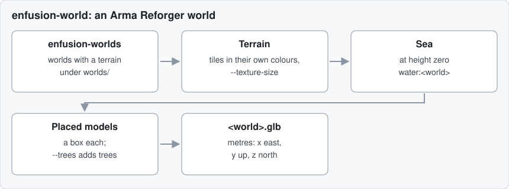

# Arma Reforger -maailmat: `enfusion-worlds` ja `enfusion-world`

**Mikä tämä on?** Koko Arma Reforger -maailma yhtenä 3D-tiedostona. **Miksi?**
Jotta pelin lämpö saa maan ja sen alla olevat rakennukset. (*Enfusion* on moottori,
jolla Arma Reforger on tehty; *maailma* on se, mitä peli kutsuu kartaksi.)

Vie koko Enfusion-maailman asennetusta Arma Reforgerista: maaston sen omilla
supertekstuurilaatoilla, meren, ja jokaisen sijoitetun mallin laatikkona pelin
omissa metreissä.



## Vaihe vaiheelta

1. **Listaa maailmat**, joilla on maasto:

   ```
   python -m heat3d_gamefiles enfusion-worlds
   python -m heat3d_gamefiles enfusion-worlds --install "D:\Games\Arma Reforger"
   ```

2. **Vie yksi**, sen kansion nimellä `worlds/`-kansion alla, kuten listassa:

   ```
   python -m heat3d_gamefiles enfusion-world <world> -o world.glb
   ```

3. **Muunnelmat:**

   ```
   python -m heat3d_gamefiles enfusion-world <world> --trees               # vegetation too, as boxes
   python -m heat3d_gamefiles enfusion-world <world> --texture-size 0      # flat colour, small file
   python -m heat3d_gamefiles enfusion-world <world> --ground-spacing 4 --no-structures
   ```

4. **Avaa `world.glb`** 3DHeat-katseluohjelman Tausta / kenttä -paneelissa ([kentän lataaminen](https://holdi601.github.io/3DHeat/levels.html)).

## Valinnat

| Valinta | Oletus | Merkitys |
|---|---|---|
| `<world>` | pakollinen | maailma sellaisena kuin `enfusion-worlds` sen tulostaa |
| `-o`, `--out FILE` | `<world>.glb` (kohteessa `$HEAT3D_LEVELS/<game>/`, kun se on asetettu) | kirjoitettava tiedosto |
| `--install FOLDER` | se Steam-kirjasto, jossa peli on | pelin kansio |
| `--ground-spacing METRES` | 2 (maaston oma) | maaston kärkipisteiden väli tiedostossa |
| `--texture-size PIXELS` | 4096 | maavärikuvan suurempi sivu; 0 tasaiselle värille |
| `--no-structures` | | jätä sijoitetut mallit pois |
| `--trees` | pois | sijoita myös puut ja muu kasvillisuus laatikkoina |

## Esimerkkitulos

```text
<world> -> world.glb
  ground      <n> triangles, <w> x <h> m; <n> of <n> tile-edge vertices disagree; colour <w> x <h>
  structure   <n> boxes from <n> entities
  water       <n> triangles (the sea)
  left out    <what>: <n>, ...
```

## Osat

`ground:<world>` (maasto), `water:<world>` (meri, korkeudessa nolla) ja
`structure:<world>` (laatikot). Koordinaatit ovat pelin omat: x itään, y ylös,
z pohjoiseen, metreinä, eli sitä, minkä pelin sisäinen tallenne raportoi. Pelin
koordinaatisto on vasenkätinen; *invert world axis* katseluohjelmassa näyttää sen
peilaamattomana.

## Miten se luetaan ja tarkistetaan

Tarvitaan ei Workbenchiä, eikä mitään ole salattu.

| Muoto | Mikä se on | Tarkistettu |
|---|---|---|
| `.pak` | datapala ja hakemistopuu, merkinnät tallennettuina tai zlib-pakattuina | puu käyttää palansa täsmälleen; otannan zlib-merkinnät purkautuvat täsmälleen ilmoitettuun kokoonsa |
| `.edds` | DDS-otsikko, sitten mip-tasoittain `COPY`- tai `LZ4 `-palat | pilkotut tasot dekoodautuvat täsmälleen kokoonsa käyttäen täsmälleen omia tavujaan |
| `.terr` / `.ttile` | otsikko ja 16-bittisten korkeuksien laatat | jokainen jaettu laatan reuna täsmää täsmälleen |
| supertexture | jokaisen laatan maanväri, noin metri pikseliltä | se täsmää korkeuksien meren kanssa; ei käännöstä eikä transpoosia sovi paremmin |
| `.ent` | nimet, resurssi-GUID:t, sitten typeotut entiteetit | maailmatiedosto jäsentyy viimeiseen tavuunsa asti |
| `resourceDatabase.rdb` | GUID polkuun | lähes jokainen maailman käyttämä GUID nimeää tiedoston, joka on olemassa |

Kohteet, jotka on merkitty seisomaan absoluuttisella korkeudella, istuvat
senttien tarkkuudella dekoodatun maaston päällä (jos ruudukko olisi transponoitu,
ne olisivat metrien päässä). Ei piirretä: mallien omat kolmiot, puut oletuksena
(`--trees` lisää ne laatikkoina), lapsientiteetit, järvet ja joet sekä tekstuurit,
joissa on DX10:ää vanhempi otsikko.

**Ehdot:** pelin lisenssi sallii ei-kaupallisen käytön ja kieltää pelitiedostojen
käänteisen suunnittelun. Oman asennuksen lukeminen on sinun päätöksesi sen alla;
tulos on tarkoitettu omaan käyttöösi eikä sitä saa jakaa.
