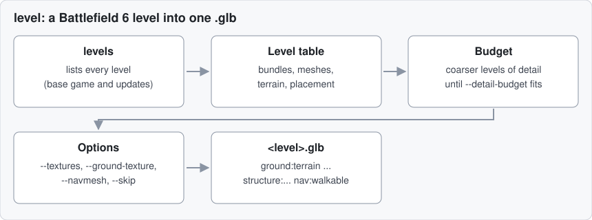

# Battlefield 6 -kentät: `levels` ja `level`

**Mikä tämä on?** Koko Battlefield 6 -kenttä yhtenä 3D-tiedostona. **Miksi?**
Jotta lämpö otteluistasi saa maan ja rakennukset sen alla. (*Frostbite* on moottori,
jolla Battlefield on tehty; *korkeuskenttä* on maa tallennettuna korkeuksien
ruudukkona.)

Vie koko Frostbite-kentän asennetusta pelistä: maaston korkeuskentän, jokaisen
mallin, jonka staattiset mallien ryhmät sijoittavat, yksittäin sijoitetut
kohteet, kartan ympärillä olevan maaston taustan ja pyynnöstä pinnojen värikartat,
maahan paistetut maaston tarrat sekä sotilaiden kävelykelpoiset pinnat.



## Vaihe vaiheelta

1. **Listaa pelin kentät**:

   ```
   python -m heat3d_gamefiles levels
   python -m heat3d_gamefiles levels --install "D:\Games\<game folder>"
   ```

   Jokainen rivi on kenttätaulukko (`levels/<level>/<level>.toc`), jonka koko ja
   lähde näkyvät: `Data` perusversiolle, `Update/<pack>` päivitykselle.

2. **Vie yksi** nimellään, sen yksilöllisellä osalla tai sen `.toc`-polulla. Aloita
   ilman tekstuureja nähdäksesi muodon ja koon:

   ```
   python -m heat3d_gamefiles level <level> -o level.glb
   ```

3. **Lisää väri**, kun se näyttää oikealta:

   ```
   python -m heat3d_gamefiles level <level> -o level.glb --textures 512 --ground-texture 0.5
   ```

4. **Lisää kävelykelpoiset pinnat tai pienennä tiedostoa:**

   ```
   python -m heat3d_gamefiles level <level> --textures 512 --ground-texture 0.5 --navmesh
   python -m heat3d_gamefiles level <level> --textures 256 --detail-budget 3000000 --ground-spacing 8
   ```

5. **Avaa `level.glb`** 3DHeat-katseluohjelman Tausta / kenttä -paneelissa ([kentän lataaminen](https://holdi601.github.io/3DHeat/levels.html)).

## Valinnat

| Valinta | Oletus | Merkitys |
|---|---|---|
| `<level>` | pakollinen | nimi sellaisena kuin `levels` sen tulostaa, sen yksilöllinen osa tai kentän `.toc` |
| `-o`, `--out FILE` | `<level>.glb` (kohteessa `$HEAT3D_LEVELS/<game>/`, kun se on asetettu) | kirjoitettava tiedosto |
| `--install FOLDER` | löytyy Steam-kirjastoista | pelin kansio |
| `--textures [PIXELS]` | pois; ilman kokoa 512 | jokaisen pinnan värikartta, enintään PIXELS sivultaan |
| `--ground-texture [METRES]` | pois; ilman kokoa 0.5 | paista tiet, aukiot ja merkinnät maan väriin, METRES pikseliltä |
| `--navmesh` | pois | lisää sotilaan navigointiverkko nimellä `nav:walkable` |
| `--ground-spacing METRES` | 4 | korkeuskentän hienoin väli; 0 jättää sen pois |
| `--detail-budget N` | karkeimmat kopiot plus neljännes, vähintään 1 500 000 | kolmioiden katto (maastoa ei koskaan karkaisteta) |
| `--skip TEXT` | | jätä pois mallien ryhmät, joiden osion nimessä on TEXT; toistettavissa |
| `--by-mesh` | pois | yksi osa lähdemallia ja materiaalia kohden, jotta näet mikä osa on mikä |
| `--clamped-uvs` | pois | renderöijille, jotka eivät osaa toistaa tekstuuria |

Täysi taulukko, ja odotettavat koot (koko kenttä on satoja megatavuja), on
sivulla [Komennot](commands.md#levels-and-level-frostbite). Miten taulukot, paketit,
mallit ja maasto luetaan, on sivulla [Frostbite](reader-frostbite.md).

## Esimerkkitulos

Mitä `level` tulostaa, pääpiirteittäin (rivit niin kuin koodi ne kirjoittaa; `<n>` ja
nimet vaihtelevat kentän mukaan):

```text
<n> copies of <n> meshes, from <n> static model groups
      <n>  <group>
      <n>  placed one by one (object and prefab references)
<n> meshes left out: <why>
<n> triangles, budget <n>; <n> meshes drawn at a coarser level to fit
           <n>  ground:terrain
           <n>  structure:buildings, <n> textures
           ...
<n> of <n> drawn sections carry their colour map; the rest are flat colours
Ground: <what the ground is>.
Navigation mesh: <tiles read>.
-> level.glb (<n> MB)
```

## Osat

`ground:terrain` (korkeuskenttä), `ground:terrain backdrop` ja
`ground:terrain blend`, `structure:<kind>` mallityypeittäin (värikartoittain
`--textures`-valinnalla, ja ` (destructible)` sille, minkä ottelu voi tuhota), ja
`nav:walkable` `--navmesh`-valinnalla. Katso [Tulostemuoto](output-format.md).

Tiedosto sisältää pelin sisältöä: se on tehty koneelle, jolla se tehtiin, eikä sitä
ole tarkoitettu kierrätettäväksi ([Säännöt ja lisenssit](rules-and-licences.md)).
