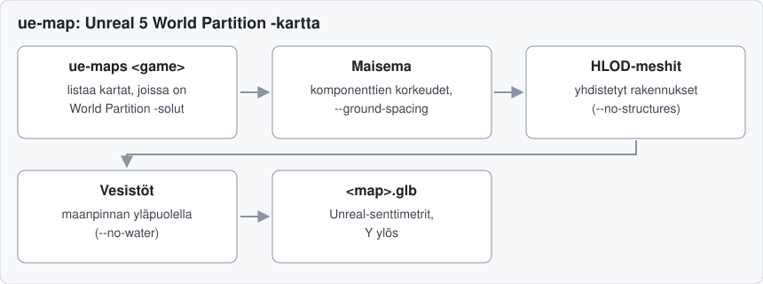

# Unreal 5 World Partition -kartat: `ue-maps` ja `ue-map` {#unreal-5-world-partition-maps-ue-maps-and-ue-map}

**Mikä tämä on?** Koko kartta Unreal 5 -pelistä yhtenä 3D-tiedostona: maa,
rakennukset ja vesi. **Miksi?** Jotta lämpö siitä pelistä saa kartan alleen.
(*World Partition* on se, miten Unreal 5 jakaa ison kartan paloihin; *HLOD* on
yksinkertaistettu korvike rakennusryhmälle, se, jonka peli piirtää kaukaa.)

Vie Unreal 5 -pelin koko kartta, jonka kartat on käännetty World Partition -soluina:
maisema, kartan yhdistetyt HLOD-mallit (sen rakennukset ja rekvisiitta siinä muodossa,
kuin peli ne piirtää etäisyydeltä) ja sen vesialueet. Editoria tai projektia ei tarvita,
vain asennettu peli.



## Vaihe vaiheelta {#step-by-step}

1. **Listaa kartat.** `<game>` on pelin kansio, sen `Content/Paks` tai pelin kansion
   nimi Steam-kirjastossa:

   ```
   python -m heat3d_gamefiles ue-maps "<Steam game folder name>"
   python -m heat3d_gamefiles ue-maps "D:\Games\<game>"
   ```

   Jokainen kartta, jolla on käännetyt World Partition -solut, tulostetaan
   paketin polkunsa kanssa.

2. **Vie yksi** nimellä tai sen yksilöllisellä osalla:

   ```
   python -m heat3d_gamefiles ue-map "<game>" <map> -o map.glb
   ```

3. **Vain maa tai karkeampi:**

   ```
   python -m heat3d_gamefiles ue-map "<game>" <map> --no-structures --no-water
   python -m heat3d_gamefiles ue-map "<game>" <map> --ground-spacing 4
   ```

4. **Avaa `map.glb`** 3DHeat-katseluohjelman Tausta / kenttä -paneelissa
   ([kentän lataaminen](https://holdi601.github.io/3DHeat/levels.html)).

## Valinnat {#options}

| Valinta | Oletus | Merkitys |
|---|---|---|
| `<game>` | pakollinen | pelin kansio, sen `Content/Paks` tai sen Steam-kansion nimi |
| `<map>` | pakollinen | nimi sellaisena kuin `ue-maps` sen tulostaa, tai sen yksilöllinen osa |
| `-o`, `--out FILE` | `<map>.glb` (kohteessa `$HEAT3D_LEVELS/<game>/`, kun se on asetettu) | kirjoitettava tiedosto |
| `--ground-spacing METRES` | 2 | maisemaan kärkipisteiden väli, pyöristettynä sen omien ruutujen kokonaisluvuksi |
| `--no-structures` | | jätä HLOD-rakennukset ja rekvisiitta pois |
| `--no-water` | | jätä vesialueet pois |

Oodlella pakattu sisältö tarvitsee Oodle-kirjaston, joka on jo koneella (katso
[Oodle](reader-oodle.md)).

## Esimerkkitulos {#example-output}

```text
<map> -> map.glb
  ground      <n> triangles from <n> landscape components; <n> of <n> vertices stored twice disagree
  structure   <n> triangles in <n> HLOD meshes
  water       <n> triangles from <n> water bodies
```

Erimielisyyslaskuri on itsetarkistus: naapurimaisemakomponentit tallentavat yhteisen
reunansa kahdesti, ja molempien täytyy täsmätä. 3 km:n kartta 2 m:n välein on noin
4,6 miljoonaa maan kolmiota.

## Osat {#the-parts}

`ground:<map>` (maisema), `structure:<map>` (HLOD-mallit) ja `water:<map>` (maanpinnan
yläpuolella oleva vesi).

**Yksiköt:** tämä on ainoa vienti, joka **ei ole metreissä**: Unreal-senttimetrit, joissa
Y ja Z on vaihdettu (Y ylös), sama koordinaatisto, jonka 3DHeat Unreal Exporter
kirjoittaa. Saman pelin telemetria käyttää samaa koordinaatistoa, joten se osuu
karttaan.

## Miten se luetaan ja tarkistetaan {#how-it-is-read-and-checked}

| Osa | Luettu lähteestä | Tarkistettu |
|---|---|---|
| maa | jokaisen maisemakomponentin 16-bittinen korkeuskenttä, sijoitettuna sen osan pohjan mukaan maisemamuunnoksella | jokainen kahdesti tallennettu kärkipiste (saumalla tai komponentin reunalla) on oltava samaa mieltä; erimielisyydet lasketaan ja tulostetaan, niitä ei tasoiteta |
| rakenteet | kartan yhdistetyt HLOD-mallit, jotka moottori rakentaa maailmatilassa | malli säilytetään vain, jos sen komponentin välimuistiin tallentamat rajat kuvaavat sen omia kärkipisteitä |
| vesi | jokaisen vesialueen malli, asetettuna maaruudukolle ja säilytettynä kohdissa, joissa se on maanpinnan yläpuolella | vesi on muutaman metrin maanpinnan yläpuolella sen alla, kuten joki on pohjansa yläpuolella |

Maiseman ominaisuudet löydetään muodon mukaan, ei paikkanumeron mukaan (paikat
siirtyvät moottoriversioiden välillä). Rakenteet ovat yksinkertaistettuja korvikkeita,
eivät täyden yksityiskohdan malleja. Kasvillisuutta, tarroja ja maisemamateriaaleja
ei viedä: maa on tekstuuritonta, ja katseluohjelma varjostaa sen.
Arkistotiedot: [Unreal 5 IoStore](reader-unreal-iostore.md).

**Omat tiedostosi:** kartta luetaan koneellesi asennetusta pelistä ja kirjoitetaan
levyllesi omaa analyysiäsi varten; mitään pelistä ei toimiteta tämän työkalun mukana.
