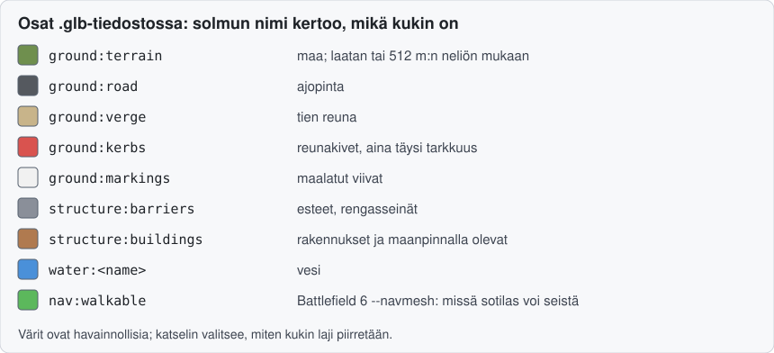

# Tulostemuoto {#output-format}

`.glb` on yksi 3D-tiedosto: radan tai kentän maa, rakennukset ja vesi, jotka avaat 3DHeat-viewerin
Taustan / kentän paneelissa.

Jokainen vienti (`course`, `courses`, `terrain`, `level`, `ue-map`, `enfusion-world`) kirjoittaa yhden **binäärisen glTF 2.0**
-tiedoston (`.glb`). Se on tarkoituksella pieni ja litteä, ja asettelu on sellainen, jonka 3DHeat-viewer lukee kentän.
Lähde:
[`glb.py`](https://github.com/Holdi601/3DHeat-GameFiles/blob/main/heat3d_gamefiles/glb.py).

## Rakenne {#structure}

```
scene 0
 ├─ node "ground:terrain x-2046 z1023"  -> mesh 0 -> 1 primitive, material 0
 ├─ node "ground:road x-2046 z1023"     -> mesh 1 -> 1 primitive, material 1
 ├─ node "ground:markings"               -> mesh 2 -> ...
 ├─ node "ground:kerbs road_gen_rum_..." -> ...
 ├─ node "structure:barriers bar_armco_bclr"
 └─ ...
```

- **Yksi solmu osaa kohden**, kaikki scenen juuressa, **ilman muunnoksia**. Kaikki geometria on jo maailmakoordinaateissa.
- Jokaisella solmulla on oma mesh, jossa on **yksi primitive** ja oma materiaali. Solmulla, meshillä ja materiaalilla on kaikilla osan nimi.
- Jokaisella primitiivillä on **omat tiiviit kärkitaulukkonsa**, vain ne kärjet, joita osa käyttää. Jaettu kärkitaulukko on sallittua glTF:ää, mutta lukija, joka laajentaa jokaisen primitiivin accessorit, pitäisi silloin jokaista kärkeä jokaisen osan kohdalla.
- `asset.generator` on `heat3d_gamefiles`.
- **Vähän `extras`-kenttiä**, eikä radan, pelin tai kentän nimeä:
  - Battlefield 6:n tuhoutuvan meshin osa kantaa `{"destructible": true}` solmussaan;
  - Forzan kurssi kertoo sisällöstään `asset.extras`-kentässä (muodon versio, täsmätty reitin tunnus, kuinka monta kopiota kisan omasta kerroksesta, paikat; katso
    [Forza Horizon -kurssit](course-forza-horizon.md#writing-the-file)), ja sen päälle kytketyt osat kantavat kerroksensa solmussaan: `{"layer": "event", "route": <id>}`
    kisan omalle kerrokselle, `{"layer": "layer"}` muulle päälle kytketylle kerrokselle, ja `{"layer": "venue"}` paikan maalle.

  Kaikki muu, mitä viewer tarvitsee, on solmujen nimissä.

## Solmujen nimet: luokittelu {#node-names-the-classification}



Viewer ottaa osan luokan solmun nimestä (tai meshin nimestä, jos solmun nimi puuttuu), ja vain jos se täsmää

```
^(ground|structure|water)\s*[:|]
```

Muu luokitellaan heuristiikalla, joka on kirjoitettu Unreal-maisemia varten. Joten jokainen vientiosa alkaa jollakin näistä etuliitteistä tai
etuliitteellä `nav:` (alla):

| Etuliite | Merkitys | Kirjoitetut osat |
|---|---|---|
| `ground:` | ajopinta ja maa | `ground:road`, `ground:verge`, `ground:terrain`, `ground:gravel and dirt`, `ground:kerbs`, `ground:markings`, `ground:tyre marks`, `ground:venue`, `ground:plinths` |
| `structure:` | maan päällä seisova | `structure:barriers`, `structure:props`, `structure:signs`, `structure:buildings`, `structure:infrastructure`, `structure:bridges`, `structure:rocks`, `structure:smashables`, `structure:trees`; Forzan kerrokset `structure:event_<category>` ja `structure:layer_<category>` |
| `water:` | vesi | `water:water`; `water:<map>` (`ue-map`), `water:<world>` (`enfusion-world`) |
| `nav:` | missä jalkaväki voi kävellä (Battlefield 6, vain `--navmesh`) | `nav:walkable` |

`nav:` ei täsmää viewerin yllä olevaan kaavaan, joten viewer lajittelee sen heuristiikallaan. Se on erillinen osa, jotta sen voi näyttää tai piilottaa itsenäisesti.
`ue-map` kirjoittaa `ground:<map>`, `structure:<map>` ja `water:<map>`;
`enfusion-world` kirjoittaa `ground:<world>`, `structure:<world>` ja `water:<world>`.

Lajin jälkeen tulee pelistä riippuen:

| Esimerkki | Merkitys |
|---|---|
| `ground:road x-2046 z1023` | Forzan maa maastolaatassa nimeltä `x-2046 z1023` (ruudukkoyksiköt, 1023 per 512 m) |
| `ground:road 3_-2` | BeamNG:n maa 512 m:n neliössä (3, -2) |
| `ground:road 3_-2 asphalt_light` | BeamNG:n mallinnettu ajopinta materiaalista `asphalt_light` siinä neliössä |
| `ground:road 1_-4` | AC Rallyn maa 512 m:n neliössä (1, -4) Unreal-avaruudessa |
| `structure:barriers bar_armco_bclr` | Forzan sijoitetut mallit, joilla on yksi yhteinen tekstuuri (sen nimi ilman GUID:ia) |
| `structure:barriers` | sijoitetut mallit ilman tekstuuria (Forza, AC Rally) |
| `structure:event_barriers bar_example_bclr` | Forza: mitä täsmätty kisa tuottaa itselleen, vapaasta ajosta erillään (solmun lisätiedot `{"layer": "event", "route": <id>}`) |
| `structure:layer_props` | Forza: kerros, jonka peli kytkee päälle muulle kuin tälle kisalle (toiminto, keräilyesine, ajonaikainen kerros) |
| `ground:venue`, `ground:plinths` | Forza: mallit, jotka ovat jo maailmakoordinaateissa - paikan oma maa (stadionin lattia), ja maa, jolla katu on koristeltu |
| `structure:barriers armco_metal` | BeamNG:n sijoitetut mallit yhdestä materiaalista |
| `ground:markings`, `water:water` | tasaiset osat, yksi koko tiedostolle |
| `ground:terrain` (Battlefield 6) | korkeuskenttä; `ground:terrain backdrop` kaukaiset maastomeshit, `ground:terrain blend` meshit, jotka sulautuvat maastoon |
| `nav:walkable` (Battlefield 6, `--navmesh`) | kentän navigointiverkko sotilaalle: missä voi seistä, tasainen vihreä |
| `ground:terrain x-512 z-512` (Battlefield 6, `--ground-texture`) | korkeuskenttä yhden leivotun päällystelaatan alla, nimetty laatan matalan kulman mukaan metreinä |
| `structure:buildings t_concreteclean_01_cs` (Battlefield 6, `--textures`) | jokainen pinta, joka näyttää tuon värikartan; ilman `--textures`-valintaa yksi osa lajia kohden, ilman päätettä |
| `structure:buildings t_concreteclean_01_cs (destructible)` (Battlefield 6) | sama, meshille, jonka ottelu voi tuhota: niille, joilla on oman nimensä tuhoamisasetus (seinät, talot, rekvisiitta). Solmu kantaa myös glTF-lisätiedot `{"destructible": true}`. Niiden tuhoutuneita tiloja ei viedä |

Viewer voi suodattaa näiden nimien mukaan. Esimerkiksi "vain ajopinta" on
`ground:road` yhdessä `ground:kerbs`-osan kanssa, kaikissa kolmessa pelissä, ja "maailma ilman kisan omia rekvisiittoja" on kaikki paitsi `structure:event_*`. Etuliite on myös se, miten
viewer piirtää osan: maa pintana, jolla lämpö on, ja rakenne sen päällä seisovana.

## Yksiköt, akselit ja kehys {#units-axes-and-frame}

- **Metrit, Y ylös**, glTF:n tapa, kaikille vienneille paitsi `ue-map`. Mitään ei skaalata tai keskitetä uudelleen: luvut ovat pelin omia maailmakoordinaatteja, ja juuri sen takia arkisto luetaan sen sijaan, että se rekonstruoitaisiin.
- **Unreal 5 -kartat (`ue-map`): senttimetrit**, Unrealin oma yksikkö, Y ja Z vaihdettuina, jotta Y on ylös - kehys, jonka 3DHeat Unreal Exporter kirjoittaa ja pelin telemetria käyttää. Ainoa vienti, joka ei ole metreinä.
- **Arma Reforger (`enfusion-world`):** pelin omat metrit, x itään, y ylös, z pohjoiseen. Pelin kehys on vasenkätinen; viewerin *invert world axis* näyttää sen peilaamattomana.
- **Forza:** pelin omat maailmakoordinaatit (x, y ylös, z), muuttamattomina. Samat kuin sen telemetria, joten tallennettu ajo osuu kurssille.
- **BeamNG.drive:** `(x, z, -y)` BeamNG:n Z-ylös-maailmasta, joka on kierto, jonka telemetriatallennin tekee. Kierto, ei peilaus.
- **Battlefield 6:** pelin omat maailmakoordinaatit (x, y ylös, z), muuttamattomina: kentän instanssimuunnokset sovelletaan jokaiseen meshiin sellaisena kuin se on tallennettu. Peilatut kopiot käännetään uudelleen, jotta niiden normaalit osoittavat ulospäin.
- **Assetto Corsa Rally:** ajon kehys. Unrealin senttimetrit muuttuvat metreiksi, Unrealin Z muuttuu y:ksi, ja Unrealin X ja Y muuttuvat x:ksi ja z:ksi siinä kahdeksasta suunnasta, johon ajo sovittui (katso
  [Assetto Corsa Rally](course-assetto-corsa-rally.md#which-stage-and-which-way-round)). Kolmiot käännetään uudelleen siellä, missä kuvaus peilaa.

Jokainen vienti säilyttää akselit, joita sen telemetria käyttää, joten tallennus ja kenttä jakavat kehyksen. Sitä, onko kehys
vasen- vai oikeakätinen kussakin pelissä, ei ole tarkistettu.

## Kärkidata {#vertex-data}

Oletus on **kvantisoitu** muoto (`quantize=True`). Se tarvitsee `KHR_mesh_quantization`-laajennuksen, joka on listattu sekä `extensionsUsed`- että `extensionsRequired`-kentissä.

| Attribuutti | Kvantisoitu (oletus) | Täysi tarkkuus (`quantize=False`) |
|---|---|---|
| `POSITION` | float32 VEC3, min/max-arvoilla | float32 VEC3 |
| `NORMAL` | int8 VEC3 normalisoitu, täytetty 4 tavuun (askel 4) | float32 VEC3 |
| `TEXCOORD_0` (vain tekstuuroiduissa osissa) | uint16 VEC2 normalisoitu, rajattu 0-1:een; float32 VEC2 kohdissa, joissa tekstuurit toistuvat (Battlefield 6) | float32 VEC2 |
| `COLOR_0` (tekstuurittomissa osissa, kun jollakin osalla on väri) | uint8 VEC3 normalisoitu, täytetty 4 tavuun | float32 VEC3 |
| indeksit | uint16, kun osalla on enintään 65 535 kärkeä, muuten uint32 | uint32 |

Kärki on 20 tavua 32:n sijaan (24 44:n sijaan värin kanssa). Se vie kolmanneksen pois jokaisesta tiedostosta, ja se on ero sen välillä, latautuuko kaupunkikurssi selaimen välilehteen vai ei. Hinta on alle puoli astetta normaalia ja 1/65 535 UV:tä (kuudestoista texeli 4 096 px:llä). Komentorivi kirjoittaa aina kvantisoidun muodon. `write_glb(..., quantize=False)` Pythonissa kirjoittaa toisen.

Normaalit tulevat pelistä, kun se tallentaa ne (Forzan maasto ja mallit, BeamNG:n muodot ja maasto). Muuten ne lasketaan alueella painotettuina sileinä normaaleina kolmioista. AC Rallyn normaalit lasketaan aina.

## Materiaalit, värit ja tekstuurit {#materials-colours-and-textures}

- Jokainen materiaali on `metallicFactor 0`, `roughnessFactor 1`.
- **Tekstuuroitu osa:** `baseColorTexture` osan kuvalla, UV:illa, eikä kärkiväriä. glTF kertoo ne keskenään, joten pinta tulisi tummennetuksi kahdesti.
- **Tekstuuriton osa:** kärkiväri `COLOR_0` osan tasaisella värillä, ja valkoinen `baseColorFactor`. Jos yhdelläkään tiedoston osalla ei ole väriä, `COLOR_0`:a ei ole. Kun osat jakavat kärkiä, myöhemmän osan väri voittaa, joten tasaiset osat kirjoitetaan merkityksen kasvavassa järjestyksessä.
- **Kuvat** upotetaan binäärisiin osiin **JPEG**:nä, laadulla 90, ilman värialiasointia, vain RGB (alfa pudotetaan) - paitsi Battlefield 6:n leikkaa-ja-liitä-kartta (lehdet, aidat), joka on **PNG** alfallaan, materiaalilla, jonka `alphaMode` on MASK, `alphaCutoff` 0,5 ja `doubleSided` (katso
  [Frostbite](reader-frostbite.md#textures-and-materials)). 3DHeat-viewer hylkää texelit rajan alapuolella. 2048 px maa ruohosta ja puiden latvoista on kohinaa häviöttömälle koodaajalle: useita megatavuja laattaa kohden PNG:nä, alle yksi JPEG:nä. Useiden osien jakama kuva tallennetaan kerran.
- Yksi näytteenotin kaikille tekstuureille: lineaarinen suurennus, lineaarinen-mipmap-lineaarinen pienennys, **clamp to edge** molemmilla akseleilla kurssiviennille, jossa tekstuurit peittävät pintansa kerran. BeamNG piirtää toistuvat mallitekstuurit tasaisina väreinä (katso
  [BeamNG.drive](course-beamng.md#placed-models)).
- Battlefield 6 -vienti valinnalla `--textures`, jonka materiaalit laatoittuvat, kirjoittaa pelin omat tekstuurikoordinaatit rajaamattomina, float32 `TEXCOORD_0`:na jopa kvantisoidussa muodossa, näytteenottimella, joka **toistaa** molemmilla akseleilla (`write_glb(..., repeat=True)`): tiiliseinä on yksi kolmiopari, jonka UV kulkee 0:sta 40:een. 3DHeat-viewer kääräisee tällaisen tekstuurin atlaksensa sisään (katso sen *Model levels* -sivu). Renderöijälle, joka ei osaa toistaa tekstuuria, `level --clamped-uvs` (`write_level(..., clamped=True)`) leikkaa jokaisen kolmion linjoja pitkin, joilla sen tekstuuri toistuu, ja siirtää jokaisen palan välille 0..1: samat pikselit samalla pinnalla, noin viidesosa enemmän kolmioita. Kolmiot, joiden yli tekstuuri toistuu yli 16 kertaa, säilyttävät koordinaattinsa. Kolmio, jonka tekstuuri leikkaisi yli 4 palaksi - kuori toistuu jokaisen oksan alas, ja leikkaus teki yhdestä puusta 1 099 kolmion sijaan 51 735 kolmiota - menee omaan osaansa, `<part> (average colour)`, tekstuurin keskivärissä; `level` kertoo, kuinka monta.

| Tekstuuri | Koko | Kattaa |
|---|---|---|
| maa (kaikki pelit paitsi Battlefield 6) | `--texture-size`: 2048, 1024 tai 512 px | yksi 512 m:n neliö: 25, 50 tai 100 cm pikseli |
| Battlefield 6 -korkeuskenttä | kentän suurimman tason pohjavärikartan suurin mip, rajattuna | maastoneliö: 32 m pikseli tarkistetussa kentässä |
| Battlefield 6 -pinnat | `--textures`: enintään tuo määrä px sivulta | pinnan oma tekstuuri, kerran per pala (leikattu kohdasta, jossa se toistuu) |
| Battlefield 6 -leivottu maa | `--ground-texture`: metriä pikseli, laattoina enintään 4 096 px | yksi laatta tarrojen alueesta: 2 048 m 0,5 m pikseliä kohden |
| Forzan sijoitettu malli | enintään 256 px | mallin oma UV-asettelu |
| BeamNG:n sijoitettu malli | enintään 256 px | mallin oma UV-asettelu, vain siellä, missä se ei toistu |
| AC Rallyn sijoitettu malli | ei mitään | tasaiset värit |

## Mitä kirjoittaja hylkää {#what-the-writer-refuses}

`write_glb` heittää virheen sen sijaan, että kirjoittaisi tiedoston, jonka viewer avaisi ja näyttäisi väärin:

| Hylätty | Koska |
|---|---|
| positiot eivät ole N x 3, tai eivät ole äärellisiä | rikkinäinen mesh |
| indeksi kärkilistan lopun yli | renderöityy kohinana |
| tekstuuroitu osa, kun tiedostossa ei ole UV:tä | renderöityy yhdeksi venyneeksi pikseliksi |
| ei kolmioita lainkaan | renderöityy tyhjänä |
| normaali-, väri- tai UV-taulukko väärän pituinen, tai ei äärellinen | yksi arvo per kärki tarvitaan |

## Lukeminen muualla {#reading-it-elsewhere}

Jokaisen glTF 2.0 -viewerin, joka tukee `KHR_mesh_quantization`-laajennusta, pitäisi avata nämä tiedostot. Vain 3DHeat-viewer on tarkistettu; muut viewerit ovat tarkistamattomia. Lukija ilman laajennusta hylkää tiedoston, koska se on merkitty pakolliseksi. Tiedostot voivat olla suuria: noin 80 MB maantiekurssille, ja jopa useita satoja MB kaupunkikurssille automaattisella budjetilla.

## 3DHeatissa {#in-3dheat}

Lataa `.glb` 3DHeat-viewerin [Taustan / kentän paneeliin](https://github.com/Holdi601/3DHeat); ajo, jonka tallennat samassa pelissä, osuu siihen, koska molemmat säilyttävät pelin koordinaatit. Viewerin oma dokumentaatio
([holdi601.github.io/3DHeat](https://holdi601.github.io/3DHeat/)) kattaa Taustan / kentän paneelin ja muut työkalujen kirjoittamat ottelutiedostot
([Yksi tiedosto ottelua kohden: `.3dheat`](https://holdi601.github.io/3DHeat/container.html)).
Kenttää ei tallenneta jokaiseen `.3dheat`-tiedostoon: ottelu nimeää sen `references`-kentässään (`kind: "level"`, nimi ja sha256), ja `.glb` pysyy matkojen vieressä.
