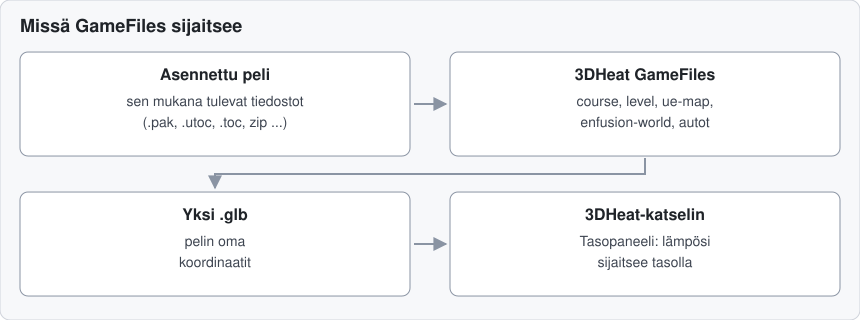

# Koko kentät {#whole-levels}

**Selkeästi:** ammuntapeleissä ja muissa peleissä ilman kierroksia työkalu tallentaa koko kartan yhtenä 3D-tiedostona, jotta katsoja voi piirtää, missä pelaajat liikkuivat.

`course` leikkaa kierroksen ympäriltä maaston. Peleissä ilman kierroksia työkalu vie kerralla koko kentän, kartan tai maailman:

| Peli tai moottori | Listaa | Vie | Sivu |
|---|---|---|---|
| Battlefield 6 (Frostbite) | `levels` | `level <level>` | [Battlefield 6 -kentät](https://holdi601.github.io/3DHeat-Ext-Battlefield/level-battlefield.html) |
| Unreal 5 World Partition -pelit | `ue-maps <game>` | `ue-map <game> <map>` | [Unreal 5 -kartat](level-unreal-world-partition.md) |
| Arma Reforger (Enfusion) | `enfusion-worlds` | `enfusion-world <world>` | [Arma Reforger -maailmat](https://holdi601.github.io/3DHeat-Ext-Reforger/level-arma-reforger.html) |

Jokainen pari toimii samalla tavalla: ensimmäinen komento listaa, mitä asennettu peli sisältää, ja toinen kirjoittaa yhden niistä yhdeksi `.glb`-tiedostoksi pelin omissa maailmakoordinaateissa. Näin pelissä tallennetut sijainnit osuvat sen päälle. Osat nimetään `ground:`, `structure:` ja `water:` kuten jokainen muu vienti (katso [Tulostemuoto](output-format.md)). Lataa tiedosto 3DHeat-katsojan paneeliin **Tausta / kenttä**.

