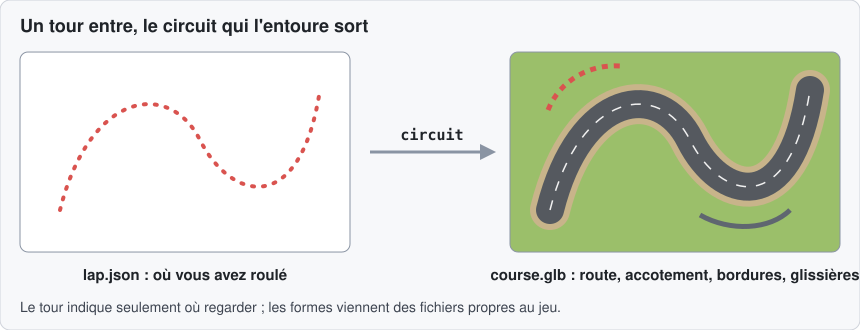
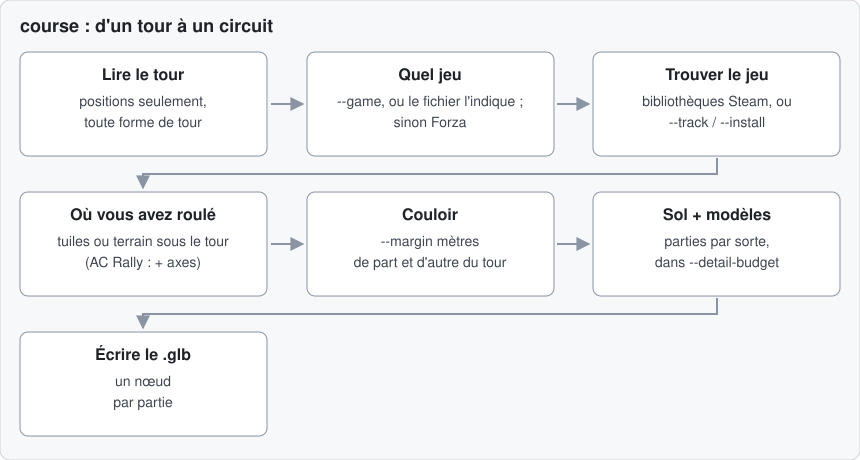

# Export de parcours {#course-export}

**En clair :** vous avez fait un tour ; ceci construit la piste que vous avez parcourue,
sous forme de fichier 3D. Le tour n'est qu'une suite de points ; la route, l'herbe et les
bordures viennent des fichiers propres au jeu.

`course` transforme un tour en parcours : le sol dans une bande de chaque côté de là où
la voiture est passée, et ce qui se dresse sur ce sol, dans un seul `.glb` pour la
visionneuse. Cette page décrit ce que les trois jeux pris en charge ont en commun. Les
pages qui suivent décrivent ce qui diffère :

- [Forza Horizon](course-forza-horizon.md) : archives ForzaTech `.minizip`
- [BeamNG.drive](course-beamng.md) : archives zip, champ de hauteurs du terrain, formes compilées
- [Assetto Corsa Rally](course-assetto-corsa-rally.md) : Unreal 5 IoStore, une étape World Partition
- [Niveaux de détail et budget](detail-budget.md) : combien de triangles reçoivent les modèles placés, et quelles copies restent

## Les étapes {#the-steps}

Mots utilisés ci-dessous : un **repère** indique dans quel sens pointent les axes ; le
**couloir** est la bande de sol de chaque côté du tour ; une **tuile** est un morceau
carré du terrain d'un jeu ; un **LOD** (niveau de détail) est une des copies plus simples
d'un modèle.

1. **Lire le tour.** Positions seulement, dans l'une des formes décrites dans
   [Entrées de tour](lap-inputs.md). La vitesse et les commandes ne sont pas utilisées.
   Un tour de moins de deux points est refusé (« holds no driving »).
2. **Déterminer le jeu.** `--game`, puis le champ `game` du fichier de tour, puis Forza
   (voir [Commandes](commands.md#which-game)).
3. **Trouver le jeu installé.** Les trois parcourent toutes les bibliothèques Steam listées
   dans `config\libraryfolders.vdf` de Steam. Forza cherche aussi dans `C:\XboxGames`.
   `--track` (Forza) ou `--install` (BeamNG, AC Rally) évite cette recherche.
4. **Trouver l'endroit où le tour a été fait.** Cela ne se décide jamais par la seule
   correspondance d'un nom. Forza choisit la piste dont les tuiles de terrain couvrent le
   tour. BeamNG choisit le niveau sur le terrain (ou les routes) duquel tombent les points
   du tour. AC Rally essaie chaque étape dans huit orientations d'axes et prend celle qui
   place le plus du tour sur la route.
5. **Découper un couloir** de `--margin` mètres de chaque côté de la conduite (voir plus bas).
6. **Construire le sol** dans le couloir, classé en route, accotement, gravier et terre,
   terrain, marquages, traces de pneus ou eau, et cuire une texture de sol pour chaque carré
   de 512 m.
7. **Placer les modèles** qui se trouvent dans le couloir, par catégorie, à un niveau de
   détail choisi selon la distance et un budget de triangles.
8. **Écrire le `.glb`** : un nœud nommé par partie. Voir [Format de sortie](output-format.md).

Ce qu'affiche une exécution — ici sur une installation synthétique de BeamNG.drive que
les tests construisent, un tour de 50 m sur une bande de route :

## Le couloir {#the-corridor}

La découpe est une bande autour de la ligne conduite, et non la boîte englobante du tour.
Pour un circuit, les deux sont presque identiques. Pour un sprint d'un point à un autre, la
boîte est surtout du versant que personne ne traverse, et la bande peut ne faire qu'un
dixième de sa surface. Source :
[`corridor.py`](https://github.com/Holdi601/3DHeat-GameFiles/blob/main/heat3d_gamefiles/corridor.py).

Comment elle est construite :

- La conduite est projetée sur le plan du sol : x et z du tour (BeamNG : x et y du repère
  propre au jeu).
- Elle est rastérisée sur une grille de cellules de **4 m** (`CELL`). Chaque cellule touchée
  par la conduite est élargie d'un disque de rayon `margin + 4 m` dans toutes les directions.
- Les points successifs à moins de **50 m** les uns des autres (`JOIN`) sont reliés par des
  points tous les 4 m, pour que la bande n'ait pas de trous. Les points plus éloignés sont
  considérés comme des tronçons séparés de conduite et ne sont pas reliés. Un circuit de
  la bibliothèque est fait de nombreux fichiers de tour bout à bout, et l'arrivée d'un sprint et
  le départ du suivant ne doivent pas tracer une bande d'un bout à l'autre de la carte.
- Un triangle est gardé si un de ses coins, le milieu d'une arête ou son centre de gravité
  est dans la bande. Les points du milieu attrapent un grand triangle qui traverse une bande
  étroite avec tous ses coins à l'extérieur.
- L'altitude ne compte jamais dans la découpe. Une boîte qui bornerait l'altitude couperait
  le sol sous une colline que la route gravit.

La console indique la surface du couloir, par exemple
`cutting 80 m either side of the driving: 1.53 km2 of a 6,000 by 3,600 m box`.

BeamNG et AC Rally construisent aussi un couloir d'**atteinte** plus large, de
`margin + 60 m`. Un modèle placé est considéré si son origine est dans le couloir d'atteinte,
et il n'est dessiné que si son emprise touche le vrai couloir. Ainsi, un long objet dont
l'origine est juste hors de la bande n'est pas perdu. BeamNG utilise aussi le couloir
d'atteinte pour choisir les décalques de route à peindre.

## De quoi est fait le sol {#what-the-ground-is-made-of}

Chaque export classe ses triangles de sol dans les mêmes natures, et chaque nature est
écrite comme sa propre partie pour que la visionneuse puisse l'afficher ou la masquer :

| Nature | Nom de la partie | Couleur unie (RVB linéaire) | Forza | BeamNG | AC Rally |
|---|---|---|---|---|---|
| route | `ground:road` | 0.22, 0.22, 0.23 | bandes de route : partie asphalte | types de couches `ASPHALT`, décalques de route, route modélisée | tuiles de piste (`/MeshesTrack/`) |
| accotement | `ground:verge` | 0.52, 0.47, 0.30 | bandes de route : l'accotement | trottoirs et modèles d'accotement | - |
| gravier et terre | `ground:gravel and dirt` | 0.50, 0.42, 0.30 | - | couches de terre, gravier, sable, boue et décalques | - |
| terrain | `ground:terrain` | 0.30, 0.44, 0.18 | tout le reste | tout le reste | tuiles `_Terrain` et terrain lointain |
| bordures | `ground:kerbs` | 0.60, 0.12, 0.10 (Forza) | props `road_gen_rum*` | modèles de bordure, de trottoir et de bandes rugueuses | modèles de bordure et de trottoir |
| marquages | `ground:markings` | 0.90, 0.90, 0.88 | sous-maillages de décalques, relevés de 5 cm | peints dans la texture | - |
| traces de pneus | `ground:tyre marks` | 0.20, 0.17, 0.16 | sous-maillages de décalques, relevés de 5 cm | peints dans la texture | - |
| eau | `water:water` | 0.16, 0.34, 0.48 | matériaux d'eau | plan de mer, blocs d'eau, rivières | - |

Les couleurs unies sont choisies pour se lire d'un coup d'œil, non pour imiter le jeu. Elles
servent aux parties sans texture et aux visionneuses qui ignorent les textures. Source :
[`surfaces.py`](https://github.com/Holdi601/3DHeat-GameFiles/blob/main/heat3d_gamefiles/surfaces.py).

Les parties de sol sont découpées par carré de 512 m, et chaque carré porte sa propre image
cuite. Le nom des parties contient donc le carré :

| Jeu | Nom de la partie de sol | Clé de carré |
|---|---|---|
| Forza | `ground:road x-2046 z1023` | le nom de grille de la tuile de terrain (pas de 1023, voir [Forza Horizon](course-forza-horizon.md)) |
| BeamNG | `ground:road 3_-2` | `floor(x / 512)`, `floor(y / 512)` en mètres BeamNG |
| AC Rally | `ground:road 1_-4` | `floor(x / 51200)`, `floor(y / 51200)` en centimètres Unreal |

## Ce qui se dresse dessus {#what-stands-on-it}

Les modèles placés sont écrits dans des parties nommées `structure:<category>`, ou
`ground:kerbs` pour les bordures (dans les trois jeux). Quand une partie a sa propre texture,
le nom de la texture ou du matériau suit la catégorie, par exemple
`structure:barriers bar_armco_bclr`.

| Catégorie | Forza | BeamNG | AC Rally |
|---|---|---|---|
| barrières | oui | oui | oui |
| accessoires | oui | oui | oui |
| panneaux | oui | oui | oui |
| bâtiments | oui (bâtiments entiers de substitution quand le jeu en a) | oui | oui |
| infrastructure | oui | oui | oui |
| ponts | oui | oui | (classés en infrastructure) |
| rochers | oui | oui | oui |
| bordures | oui, comme sol | oui, comme sol | oui, comme sol |
| arbres | avec `--trees` | avec `--trees` | avec `--trees` |
| objets destructibles | avec `--trees` | - | - |

La répartition des détails est la même dans les trois. Les copies situées à moins de 25 m
de la conduite gardent tout leur détail, les copies à 25-60 m descendent d'un cran, et les
copies plus loin passent au niveau le plus grossier. Ensuite, les modèles les plus coûteux
descendent jusqu'à ce qu'un budget de triangles tienne, et là où même les niveaux les plus
grossiers ne tiennent pas dans un budget que vous donnez, des copies sont laissées de côté.
Les bordures ne sont jamais simplifiées ni laissées de côté. Voir
[Niveaux de détail et budget](detail-budget.md).

## Les options qui changent le résultat {#options-that-shape-the-result}

| Vous voulez | Utilisez |
|---|---|
| un fichier plus petit | `--no-textures` (couleurs unies), `--texture-size 1024` ou `512`, `--detail-budget N`, `--margin 40` |
| seulement le sol | `--no-placed` |
| le décor aussi | `--trees` |
| une autre saison (Forza) | `--season winter` |
| un jeu hors de Steam | `--track` (Forza) ou `--install` (BeamNG, AC Rally) |
| un tour que la recherche ne place pas | `--level` (BeamNG, AC Rally), `--track` (Forza) |

## Coordonnées {#coordinates}

Chaque export écrit des mètres avec Y vers le haut, dans un repère sur lequel un tour
enregistré du même jeu s'aligne :

| Jeu | Repère écrit |
|---|---|
| Forza | les coordonnées du monde propres au jeu, sans changement |
| BeamNG | `(x, z, -y)` du monde de BeamNG en Z vers le haut, soit la rotation qu'applique l'enregistreur de télémétrie |
| AC Rally | le repère du tour, trouvé par ajustement : les centimètres Unreal deviennent des mètres, et les X et Y Unreal deviennent les x et z du tour, dans l'une des huit orientations qui convient |

Voir [Format de sortie](output-format.md).
