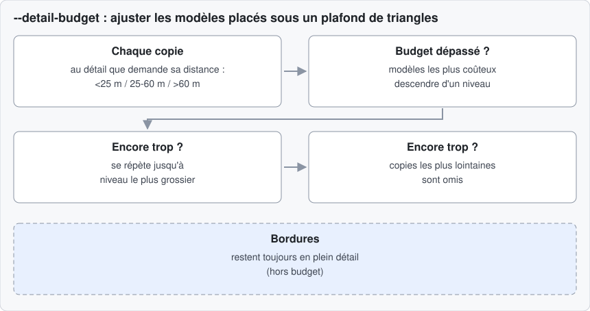

# Niveaux de détail et budget {#levels-of-detail-and-the-budget}

Un **triangle** est un minuscule morceau plat d'un modèle 3D. Plus il y en a, plus le
fichier est gros et lent. Le **budget** est une limite sur leur nombre. Un **niveau de
détail** est une copie plus simple d'un modèle, utilisée quand il est loin.

Le niveau le plus fin de tout ce qui est placé autour d'un circuit représente plusieurs
millions de triangles. Par exemple, des centaines de segments de glissière et de piles de
pneus à environ mille triangles chacun. Un corridor urbain compte plus de cent mille copies.
Donc chaque export de parcours donne aux modèles placés un **budget de triangles** et décide,
pour chaque modèle, à quel niveau de détail il est dessiné et, si besoin, quelles copies
laisser de côté.

Le système a été écrit pour Forza
([`forzaplacement.py`](https://github.com/Holdi601/3DHeat-GameFiles/blob/main/heat3d_gamefiles/forzaplacement.py) :
`choose_levels`, `auto_budget`, `_fit`), et BeamNG et AC Rally en réutilisent des parties.
Le terrain ne compte pas dans le budget.

## Bandes de distance {#distance-bands}

La distance de chaque copie à la conduite est mesurée dans le plan du sol, jusqu'au point
le plus proche du tour. Le tour est d'abord réduit à au plus 1 000 points, ce qui coûte
quelques mètres de précision et rien de ce qui compte ici. Les copies tombent ensuite dans
trois bandes, et chaque couple (modèle, bande) est budgété séparément :

| Bande | Distance | Commence à |
|---|---|---|
| proche | moins de 25 m (`NEAR`) | le niveau le plus fin |
| moyenne | 25-60 m (`FAR`) | un niveau plus grossier |
| lointaine | 60 m et plus | le niveau le plus grossier |

Sans tracé (Forza `terrain --box`), la distance est mesurée jusqu'au milieu de la boîte.

## Descendre pour tenir {#stepping-down-to-fit}



Le coût d'une entrée (modèle, bande) est copies x triangles à son niveau actuel. Tant que le
total dépasse le budget, l'entrée qui coûte le plus descend d'un niveau, et cela se répète
jusqu'à ce que le total tienne ou qu'aucune entrée ne puisse descendre davantage. Les entrées
épinglées ne descendent jamais :

| Jeu | Épinglé au plein détail |
|---|---|
| Forza | les bordures (`road_gen_rum*`) |
| BeamNG | les bordures, et chaque forme qui porte une surface de conduite |
| AC Rally | les bordures |

Le résumé de Forza l'indique par
`N of M models drawn at a coarser level to fit the budget`.

## Le budget automatique {#the-automatic-budget}

Sans `--detail-budget`, le budget se règle tout seul pour qu'**aucune copie ne soit laissée
de côté** :

```
budget = max(1,500,000, 1.25 x sum(copies x coarsest level))
```

Les entrées épinglées comptent à leur niveau le plus fin. Les 25 % (`HEADROOM`) permettent
aux éléments en bord de route de garder un peu de détail. Sur un circuit de campagne, c'est
le plancher de 1,5 million (`DEFAULT_BUDGET`). Sur un parcours urbain, où le corridor compte
plus de cent mille copies, il dépasse dix millions, et le fichier fait plusieurs centaines de
Mo. La visionneuse le charge.

## Un budget que vous donnez {#a-budget-you-give}

`--detail-budget N` est un **plafond**. Les niveaux descendent comme décrit plus haut. Si même
les niveaux les plus grossiers ne tiennent pas, des copies sont laissées de côté :

| Jeu | Ordre dans lequel les copies sont laissées de côté |
|---|---|
| Forza | d'abord tout ce qui est à 25 m ou plus de la conduite, puis ce qui se trouve à côté de la route ; dans chaque groupe, ce qui paraît le plus petit depuis la route en premier : plus grande distance / taille (taille = diagonale de la boîte englobante du modèle multipliée par sa plus grande échelle, au moins 0,25 m) |
| BeamNG | le plus éloigné de la conduite d'abord |
| AC Rally | le plus éloigné de la conduite d'abord, comme BeamNG |
| Battlefield 6 | le plus petit d'abord : diagonale de la boîte englobante multipliée par l'échelle |

Les bordures (et, pour BeamNG, les modèles de surface de conduite) ne sont jamais laissées
de côté. Un budget plus petit que leur coût propre est donc dépassé par elles seules, et par
rien d'autre.

L'outil utilise la distance par rapport à la taille pour Forza, parce que, si l'on ne
classait que par distance, une unité de climatisation sur un mur à neuf mètres survivrait à
la façade de vingt mètres à laquelle elle est accrochée, située à douze mètres. Les éléments
en bord de route partent en dernier quelle que soit leur taille, car une barrière de trois
mètres à cinq mètres de la ligne est le bord de la piste, tandis qu'un bâtiment de cinquante
mètres à soixante mètres en retrait fait partie du décor.

Le résumé indique
`N of M copies left out to fit the budget, the smallest and furthest from the driving first (--detail-budget raises it)`
(Forza), ou `N copies left out to fit the budget, the furthest from the driving first (--detail-budget raises it)`
(BeamNG, AC Rally).

## Bâtiments entiers (Forza) {#whole-buildings-forza}

Une substitution de bâtiment entier compte pour une seule copie, à une distance mesurée jusqu'à
l'arête la plus proche du bâtiment. Elle est gardée ou laissée de côté comme un tout. Les
pièces modulaires qu'elle remplace ne sont pas budgétées du tout. Voir
[Forza Horizon](course-forza-horizon.md#buildings-drawn-whole).

## Ce qu'est un niveau de détail, par jeu {#what-a-level-of-detail-is-per-game}

| Jeu | Les niveaux viennent de |
|---|---|
| Forza | le masque de niveau par triangle des sous-maillages `Mesh` du modèle (bit `level + 1`) ; `0xFFFF` pour les pièces destructibles seulement, pour un modèle sans niveau marqué |
| BeamNG | les `details` de la forme `.cdae` avec une taille positive ou nulle, du plus grand au plus petit ; pour `.dae`, le nombre final des noms de nœuds de maillage (`barrier75`, `barrier40`) |
| AC Rally | les niveaux de détail stockés du maillage statique, du plus fin au plus grossier |
| Battlefield 6 | les niveaux de détail du MeshSet, du plus fin au plus grossier, en ne comptant que les sections dessinées (pas les copies d'ombre et de profondeur seules), et sans un dernier niveau qui est une image de substitution pour la vue lointaine (matériaux `M_LastLod`, `M_Billboard`, `M_Vista` : le treillis d'un pylône devient une pointe pleine) |

Le `level` de Battlefield 6 n'a pas de tour, donc il n'y a pas de bandes de distance : chaque
maillage est une seule entrée, chaque copie au même niveau. Le budget automatique est la
formule ci-dessus, le fond de terrain étant épinglé. Le champ de hauteurs est hors budget et
dimensionné par `--ground-spacing`. Avec un budget que vous donnez, une fois que chaque
maillage est à son niveau le plus grossier, les copies sont laissées de côté les plus petites
d'abord, la taille étant la diagonale de la boîte englobante du maillage multipliée par
l'échelle de la copie, car il n'y a pas de conduite à partir de laquelle mesurer la distance.
Le fond de terrain n'est jamais laissé de côté. Un niveau atteint environ dix millions de
triangles automatiquement.

## Choisir un nombre {#choosing-a-number}

| Vous voulez | Essayez |
|---|---|
| tout, avec plein détail près de la route | laissez automatique |
| un fichier plusieurs fois plus petit | `--detail-budget 500000` avec `--texture-size 1024` |
| le sol seulement | `--no-placed` (aucun budget en jeu) |
