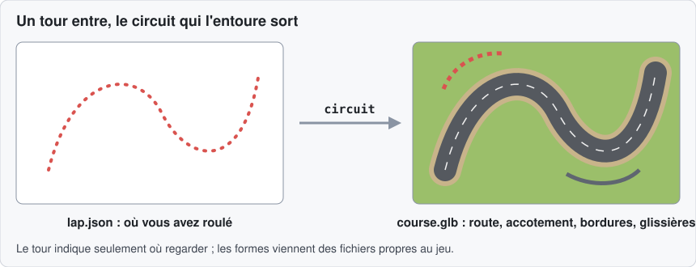
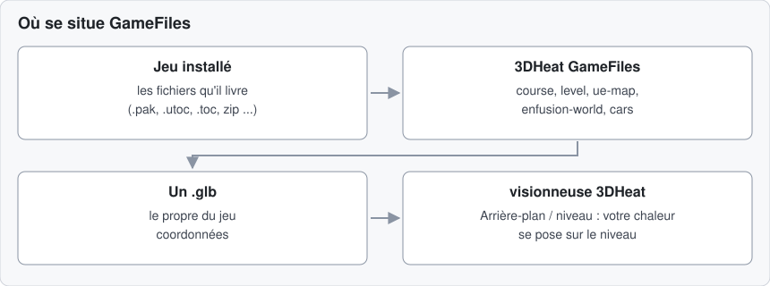

# 3DHeat GameFiles

**Qu'est-ce que c'est ?** Un outil qui construit un modèle 3D d'un circuit de course ou d'un
niveau de jeu, à partir des fichiers d'un jeu que vous avez déjà installé.

**À quoi ça sert ?** Le visualiseur 3DHeat peint les endroits où vous avez roulé ou joué sous forme
de carte de chaleur. Avec cet outil, elle la peint sur le vrai circuit ou le vrai niveau, et non sur un espace vide.

**Exemple :** prenez un tour que vous avez roulé. L'outil construit la route et le terrain autour
en un seul fichier 3D, pour que le visualiseur peigne votre vitesse ou vos sorties de route sur le vrai circuit :



Vous débutez avec la ligne de commande ? Commencez par [Avant de commencer](before-you-start.md).

En détail : il lit les données de niveau dans les archives qu'un jeu livre, et les écrit
sous forme de fichier glTF binaire (`.glb`). Sa tâche principale est l'**export de circuit** : vous
lui donnez un tour, et il écrit le sol, la route distinguée de l'accotement et de l'herbe, et les
bordures, glissières, murs de pneus, panneaux et bâtiments qui l'entourent.

Il fait partie de [3DHeat](https://github.com/Holdi601/3DHeat), un visualiseur de cartes de chaleur
de télémétrie 3D en temps réel, d'analyse de course et de revue de partie
([documentation](https://holdi601.github.io/3DHeat/)). Les fichiers `.glb` que cet
outil écrit sont les niveaux sur lesquels le visualiseur dessine la chaleur.



Il existe trois façons de faire entrer la géométrie d'un niveau dans 3DHeat :

| Voie | Il faut | Donne |
|---|---|---|
| 3DHeat Unreal Exporter | le projet Unreal ouvert dans l'éditeur | une géométrie exacte |
| 3DHeat GameCapture | un écran et une capture | une estimation |
| **3DHeat GameFiles** | **le jeu installé, tel qu'il est livré** | **une géométrie exacte, sans projet** |

Paquet Python : `heat3d_gamefiles`. Dépôt :
[Holdi601/3DHeat-GameFiles](https://github.com/Holdi601/3DHeat-GameFiles). Licence : MIT.

## Ce qu'il sait faire

| Jeu ou moteur | Export de circuit (`course`) | Lecture des archives |
|---|---|---|
| Forza Horizon (ForzaTech) | oui : terrain, route et accotement, texture du sol, modèles placés dans leurs propres textures | `identify`, `list`, `extract` sur un `.minizip` ; `identify` sur un `.modelbin` ; modèles, terrain et textures par `course` et `terrain` |
| BeamNG.drive | oui : terrain, décalques de route, circuits modélisés, modèles placés, eau | `identify`, `list`, `extract` sur les zips de niveau ; `identify` sur `.ter`, `.cdae` ; `.dae` par `course` |
| Assetto Corsa Rally (Unreal 5.6) | oui : tuiles de sol d'étape, couleur de sol cuite, modèles placés en couleurs unies | `identify`, `list`, `extract` sur les IoStore `.utoc`/`.ucas` ; paquets zen, maillages statiques, textures par `course` |
| `.pak` Unreal (versions 8 à 12) | non | `identify`, `list`, `extract` |
| Unity (format 22 et plus récent) | non | `identify`, `meshes` |
| Battlefield 6 (Frostbite `.toc`/`.cas`) | pas de tour ; un niveau entier avec `level` : terrain, maillages placés, leurs cartes de couleur avec `--textures` | `identify`, `levels` ; paquets, maillages, terrain, textures et placement par `level` |
| `.vpk` Source 2 | non | `identify`, `list`, `extract` |
| Jeux Unreal 5 en World Partition | pas de tour ; une carte entière avec `ue-map` (listée par `ue-maps`) : paysage, bâtiments HLOD et accessoires, eau | - |
| Arma Reforger (Enfusion) | pas de tour ; un monde entier avec `enfusion-world` (listé par `enfusion-worlds`) : terrain dans ses couleurs, la mer, bâtiments en boîtes | - |
| Forza (voitures) | `cars` : chaque voiture en faible détail, pour l'onglet Analyse de course du visualiseur | - |

Les tours d'Assetto Corsa EVO et d'iRacing sont refusés, avec la raison. Voir [Limites et lacunes connues](limits-and-known-gaps.md).

## Installation

Vous débutez avec la ligne de commande ? Lisez d'abord [Avant de commencer](before-you-start.md).

Il vous faut **Python 3.10 ou plus récent** (développé avec la 3.13) et les paquets listés dans
[`requirements.txt`](https://github.com/Holdi601/3DHeat-GameFiles/blob/main/requirements.txt).

```
git clone https://github.com/Holdi601/3DHeat-GameFiles.git
cd 3DHeat-GameFiles
pip install -r requirements.txt
```

Puis vérifiez : `python -m heat3d_gamefiles --help`. Vous devez voir
`usage: heat3d_gamefiles [-h]` et la liste des verbes. Lancez chaque commande depuis le
dossier du dépôt, sous la forme `python -m heat3d_gamefiles <verbe>`.

| Paquet | Utilisé pour |
|---|---|
| numpy | tout ce qui décode la géométrie |
| lz4 | archives Forza (surtout des blocs LZ4), certains bundles Unity, blocs LZ4 IoStore |
| Pillow | décodage des textures BC1 à BC7, écriture des textures JPEG dans le `.glb` |
| msgpack, zstandard | formes compilées de BeamNG (`.cdae`) |
| cryptography | seulement pour ouvrir un `.pak` chiffré avec une clé que vous possédez déjà |
| pytest | les tests |

Le contenu Unreal compressé en **Oodle** a besoin d'une bibliothèque Oodle déjà présente
sur votre ordinateur. Elle n'est jamais livrée avec cet outil. Voir [Oodle](reader-oodle.md).

L'outil est écrit pour Windows. Il trouve les jeux par la liste des bibliothèques Steam et par
`%LOCALAPPDATA%`, et charge Oodle comme DLL Windows. Les autres plateformes n'ont pas été testées.

## Démarrage rapide

Un **fichier de tour** est un enregistrement de l'endroit où votre voiture est passée : une liste de points x, y, z.
Il vient de [3DHeat GameCapture](https://github.com/Holdi601/3DHeat-GameCapture)
ou de la bibliothèque de tours de l'application FH Companion ; un CSV tapé à la main fonctionne aussi
([Entrées de tour](lap-inputs.md)).

```
# Forza : un fichier de tour, un dossier de tours, ou le nom d'un circuit de la bibliothèque FH Companion
python -m heat3d_gamefiles course "Circuit exemple"
python -m heat3d_gamefiles course chemin\vers\tour.json -o course.glb

# BeamNG.drive ou Assetto Corsa Rally : un fichier heat3d-lap indique le jeu d'origine
python -m heat3d_gamefiles course mon_tour.json

# Chaque circuit de la bibliothèque FH Companion, un .glb par circuit
python -m heat3d_gamefiles courses -o courses

# Battlefield 6 : lister les niveaux, puis en exporter un (un gros fichier ; voir Commandes)
python -m heat3d_gamefiles levels
python -m heat3d_gamefiles level <niveau> -o level.glb --textures

# Unreal 5 en World Partition et Arma Reforger : lister, puis exporter
python -m heat3d_gamefiles ue-maps "<jeu>"
python -m heat3d_gamefiles ue-map "<jeu>" <carte> -o map.glb
python -m heat3d_gamefiles enfusion-worlds
python -m heat3d_gamefiles enfusion-world <monde> -o world.glb

# Chaque voiture Forza, pour l'onglet Analyse de course du visualiseur
python -m heat3d_gamefiles cars -o forza.h3dcars

# Quel est ce fichier ?
python -m heat3d_gamefiles identify un_fichier_d_archive.pak
```

Ouvrez le `.glb` dans le visualiseur 3DHeat. Les coordonnées du monde propres au jeu sont conservées
(voir [Format de sortie](output-format.md)), donc un tour enregistré s'aligne sur le circuit.

## Plan de cette documentation

- [Avant de commencer](before-you-start.md) : Python, un terminal, la première commande.
- [Commandes](commands.md) : chaque verbe et chaque option, avec des exemples.
- [Référence des commandes](../cli-reference.md) : le `--help` de chaque verbe, généré depuis le code.
- [Inspecter les archives](inspecting-archives.md) : `identify`, `list`, `extract`, `meshes`, pas à pas.
- [Export de circuit](https://holdi601.github.io/3DHeat-Ext-Forza/course-export.html) : comment un tour devient un circuit, pour tous les jeux.
  - [Forza Horizon](https://holdi601.github.io/3DHeat-Ext-Forza/course-forza-horizon.html)
  - [BeamNG.drive](https://holdi601.github.io/3DHeat-Ext-BeamNG/course-beamng.html)
  - [Assetto Corsa Rally](https://holdi601.github.io/3DHeat-Ext-ACRally/course-assetto-corsa-rally.html)
  - [Niveaux de détail et budget](detail-budget.md)
- [Niveaux entiers](whole-levels.md) : un niveau, une carte ou un monde sans tour.
  - [Niveaux de Battlefield 6](https://holdi601.github.io/3DHeat-Ext-Battlefield/level-battlefield.html) : `levels`, `level`
  - [Cartes Unreal 5](level-unreal-world-partition.md) : `ue-maps`, `ue-map`
  - [Mondes d'Arma Reforger](https://holdi601.github.io/3DHeat-Ext-Reforger/level-arma-reforger.html) : `enfusion-worlds`, `enfusion-world`
- [Voitures Forza](https://holdi601.github.io/3DHeat-Ext-Forza/forza-cars.html) : `cars`, le fichier de voitures de l'onglet Analyse de course du visualiseur.
- [Entrées de tour](lap-inputs.md) : chaque forme de fichier de tour acceptée par l'outil.
- [Format de sortie](output-format.md) : ce qu'il y a dans le `.glb`.
- [Lecteurs d'archives](archive-readers.md) : une page par format de conteneur, décrivant ce qu'il lit,
  ce qu'il ne lit pas, et pourquoi.
- [Limites et lacunes connues](limits-and-known-gaps.md)
- [Dépannage](troubleshooting.md) : les messages d'erreur et quoi faire.
- [Règles et licences](rules-and-licences.md) : aucune clé, vos propres fichiers, aucune redistribution.
- [Mises à jour](updates.md) : la vérification des mises à jour et `heat3d_update`.
- [Développement](development.md) : carte des modules et tests, y compris les tests qui tournent sur des jeux installés.
- [Maintenir ces documents](maintaining.md) : la liste de contrôle des versions pour ces pages.

## Partie de 3DHeat

3DHeat GameFiles est l'un des outils gratuits qui entourent le visualiseur 3DHeat :

| Outil | Ce qu'il fait | Documentation |
|---|---|---|
| [3DHeat](https://github.com/Holdi601/3DHeat) | le visualiseur : cartes de chaleur 3D, analyse de course et revue de partie dans le navigateur | [site](https://holdi601.github.io/3DHeat/) |
| [GameFiles](https://github.com/Holdi601/3DHeat-GameFiles) | circuits et niveaux tirés des fichiers livrés par un jeu, en `.glb` | [site](https://holdi601.github.io/3DHeat-GameFiles/) |
| [GameCapture](https://github.com/Holdi601/3DHeat-GameCapture) | télémétrie de tour des jeux de course ; niveaux reconstruits à partir de vidéos de jeu | [site](https://holdi601.github.io/3DHeat-GameCapture/) |
| [Unreal Exporter](https://github.com/Holdi601/3DHeat-UnrealExporter) | un plugin de l'éditeur Unreal qui enregistre un niveau en `.glb` | [site](https://holdi601.github.io/3DHeat-UnrealExporter/) |
| [CS2](https://github.com/Holdi601/3DHeat-CS2) | démos de Counter-Strike 2 en fichiers de match ; cartes en `.glb` | [site](https://holdi601.github.io/3DHeat-CS2/) |
| [Watcher](https://github.com/Holdi601/3DHeat-Watcher) | enregistre votre jeu en arrière-plan à partir de ce que publient les jeux | [site](https://holdi601.github.io/3DHeat-Watcher/) |
| [Ext-WarThunder](https://github.com/Holdi601/3DHeat-Ext-WarThunder) | replays de War Thunder en fichiers de match | [site](https://holdi601.github.io/3DHeat-Ext-WarThunder/) |
| [Ext-WoT](https://github.com/Holdi601/3DHeat-Ext-WoT) | replays de World of Tanks en fichiers de match | [site](https://holdi601.github.io/3DHeat-Ext-WoT/) |
| [Ext-WoWs](https://github.com/Holdi601/3DHeat-Ext-WoWs) | replays de World of Warships en fichiers de match | [site](https://holdi601.github.io/3DHeat-Ext-WoWs/) |
| [Ext-Squad](https://github.com/Holdi601/3DHeat-Ext-Squad) | démos de serveurs Squad en fichiers de match | [site](https://holdi601.github.io/3DHeat-Ext-Squad/) |
| [Ext-DCS](https://github.com/Holdi601/3DHeat-Ext-DCS) | cartes de DCS World en niveaux `.glb` | [site](https://holdi601.github.io/3DHeat-Ext-DCS/) |
| [Ext-IL2](https://github.com/Holdi601/3DHeat-Ext-IL2) | cartes d'IL-2 Sturmovik en niveaux `.glb` | [site](https://holdi601.github.io/3DHeat-Ext-IL2/) |
| [Ext-Dota](https://github.com/Holdi601/3DHeat-Ext-Dota) | la carte de Dota 2 de votre propre installation, en niveau 3D | [site](https://holdi601.github.io/3DHeat-Ext-Dota/) |
| [Ext-DotaReplay](https://github.com/Holdi601/3DHeat-Ext-DotaReplay) | replays de Dota 2 | [site](https://holdi601.github.io/3DHeat-Ext-DotaReplay/) |
| [Ext-Riot](https://github.com/Holdi601/3DHeat-Ext-Riot) | replays de League of Legends et de VALORANT (ce qu'ils contiennent sans chiffrement) | [site](https://holdi601.github.io/3DHeat-Ext-Riot/) |
| [Ext-Forza](https://github.com/Holdi601/3DHeat-Ext-Forza) | tours, courses et voitures Forza depuis votre propre installation | [site](https://holdi601.github.io/3DHeat-Ext-Forza/) |
| [Ext-Battlefield](https://github.com/Holdi601/3DHeat-Ext-Battlefield) | niveaux de Battlefield (Frostbite) en niveaux 3D | [site](https://holdi601.github.io/3DHeat-Ext-Battlefield/) |
| [Ext-BeamNG](https://github.com/Holdi601/3DHeat-Ext-BeamNG) | circuits de BeamNG.drive | [site](https://holdi601.github.io/3DHeat-Ext-BeamNG/) |
| [Ext-ACRally](https://github.com/Holdi601/3DHeat-Ext-ACRally) | étapes d'Assetto Corsa Rally en circuits | [site](https://holdi601.github.io/3DHeat-Ext-ACRally/) |
| [Ext-Reforger](https://github.com/Holdi601/3DHeat-Ext-Reforger) | mondes d'Arma Reforger (Enfusion) en niveaux 3D | [site](https://holdi601.github.io/3DHeat-Ext-Reforger/) |
| [Ext-R6](https://github.com/Holdi601/3DHeat-Ext-R6) | replays de matchs Rainbow Six Siege | [site](https://holdi601.github.io/3DHeat-Ext-R6/) |

Chaque lecteur de jeu est un petit projet à part, avec son propre fichier de licence, ses versions et son suivi des tickets : il peut être installé, mis à jour, maintenu - ou retiré à la demande d'un ayant droit - séparément, sans toucher au visualiseur ni aux autres outils.

Les fichiers de match du visualiseur sont décrits dans
[Un fichier par match : `.3dheat`](https://holdi601.github.io/3DHeat/container.html) ;
un niveau fait ici se charge à côté d'eux, dans le panneau Arrière-plan / niveau du visualiseur.
