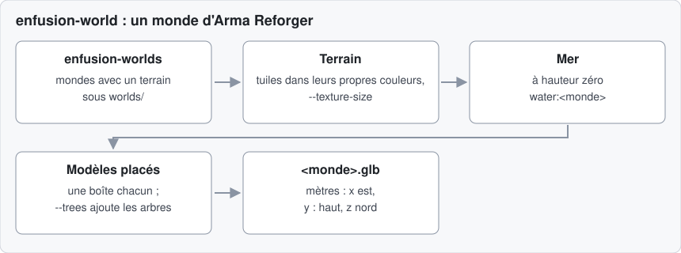

# Mondes Arma Reforger : `enfusion-worlds` et `enfusion-world` {#arma-reforger-worlds-enfusion-worlds-and-enfusion-world}

**Qu'est-ce que c'est ?** Un monde complet d'Arma Reforger en un seul fichier 3D.
**Pourquoi ?** Pour que la chaleur du jeu ait dessous le sol et les bâtiments. (*Enfusion* est le
moteur avec lequel Arma Reforger est fait ; un *monde* est ce que le jeu appelle une carte.)

Exporte un monde Enfusion complet d'Arma Reforger installé : le terrain dans les couleurs de ses
propres tuiles de supertexture, la mer, et chaque modèle placé sous forme de boîte, dans les mètres
propres au jeu.



## Pas à pas {#step-by-step}

1. **Lister les mondes** qui ont un terrain :

   ```
   python -m heat3d_gamefiles enfusion-worlds
   python -m heat3d_gamefiles enfusion-worlds --install "D:\Games\Arma Reforger"
   ```

2. **Exporter un monde**, par le nom de son dossier dans `worlds/` tel qu'il est listé :

   ```
   python -m heat3d_gamefiles enfusion-world <world> -o world.glb
   ```

3. **Variantes :**

   ```
   python -m heat3d_gamefiles enfusion-world <world> --trees               # vegetation too, as boxes
   python -m heat3d_gamefiles enfusion-world <world> --texture-size 0      # flat colour, small file
   python -m heat3d_gamefiles enfusion-world <world> --ground-spacing 4 --no-structures
   ```

4. **Ouvrez `world.glb`** dans le panneau Arrière-plan / niveau de la visionneuse 3DHeat
   ([charger un niveau](https://holdi601.github.io/3DHeat/levels.html)).

## Options {#options}

| Option | Par défaut | Signification |
|---|---|---|
| `<world>` | obligatoire | un monde tel que l'affiche `enfusion-worlds` |
| `-o`, `--out FILE` | `<world>.glb` | le fichier à écrire |
| `--install FOLDER` | la bibliothèque Steam qui contient le jeu | le dossier du jeu |
| `--ground-spacing METRES` | 2 (celui du terrain) | l'écart entre sommets du terrain dans le fichier |
| `--texture-size PIXELS` | 4096 | le côté le plus long de l'image de couleur du sol ; 0 pour une couleur unie |
| `--no-structures` | | laisser de côté les modèles placés |
| `--trees` | désactivé | placer aussi les arbres et autre végétation, en boîtes |

## Exemple de sortie {#example-output}

```text
<world> -> world.glb
  ground      <n> triangles, <w> x <h> m; <n> of <n> tile-edge vertices disagree; colour <w> x <h>
  structure   <n> boxes from <n> entities
  water       <n> triangles (the sea)
  left out    <what>: <n>, ...
```

## Les parties {#the-parts}

`ground:<world>` (le terrain), `water:<world>` (la mer, à hauteur zéro) et `structure:<world>`
(les boîtes). Les coordonnées sont celles du jeu : x vers l'est, y vers le haut, z vers le nord,
en mètres, ce que rapporte un enregistrement en jeu. Le repère du jeu est gauche ; l'option *Inverser un axe du monde* de la visionneuse l'affiche sans miroir.

## Comment c'est lu et vérifié {#how-it-is-read-and-checked}

Aucun Workbench n'est nécessaire, et rien n'est chiffré.

| Format | Ce que c'est | Vérifié contre |
|---|---|---|
| `.pak` | un bloc de données et un arbre de répertoires, entrées stockées ou en zlib | l'arbre utilise exactement son bloc ; les entrées zlib échantillonnées se décompressent exactement à leur taille annoncée |
| `.edds` | un en-tête DDS, puis par niveau de mip des morceaux `COPY` ou `LZ4 ` | les niveaux en morceaux se décodent exactement à leur taille en n'utilisant que leurs octets |
| `.terr` / `.ttile` | un en-tête et des tuiles de hauteurs sur 16 bits | chaque bord de tuile partagé concorde exactement |
| supertexture | la couleur de sol de chaque tuile, environ un mètre par pixel | elle correspond à la mer dans les hauteurs ; aucun retournement ni transposition ne colle aussi bien |
| `.ent` | noms, GUID de ressources, puis entités en valeurs typées | un fichier de monde se lit jusqu'à son dernier octet |
| `resourceDatabase.rdb` | GUID vers chemin | presque chaque GUID qu'utilise un monde nomme un fichier qui existe |

Les objets marqués comme posés à une hauteur absolue se trouvent à quelques centimètres près du
terrain décodé (avec la grille transposée, ils seraient à des mètres). Non dessinés : les
triangles des modèles eux-mêmes, les arbres par défaut (`--trees` les ajoute en boîtes), les
entités enfants, les lacs et rivières, les textures aux en-têtes d'avant DX10.

**Termes :** la licence du jeu autorise l'usage non commercial et interdit la rétro-ingénierie des
fichiers du jeu. Lire votre propre installation relève de votre décision au titre de cette licence ;
le résultat est pour votre usage personnel et ne doit pas être partagé.
