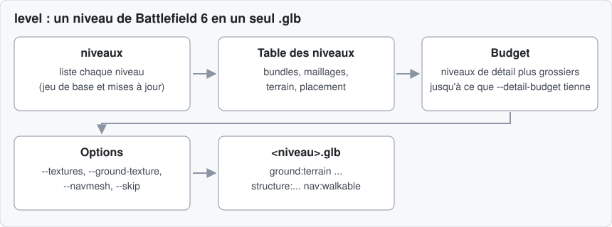

# Niveaux Battlefield 6 : `levels` et `level` {#battlefield-6-levels-levels-and-level}

**Qu'est-ce que c'est ?** Un niveau complet de Battlefield 6 en un seul fichier 3D.
**Pourquoi ?** Pour que la chaleur de vos parties ait dessous le sol et les bâtiments. (*Frostbite*
est le moteur avec lequel Battlefield est fait ; un *champ de hauteurs* est le sol stocké sous forme
de grille de hauteurs.)

Exporte un niveau Frostbite complet du jeu installé : le champ de hauteurs du terrain, chaque
maillage que placent ses groupes de modèles statiques, les objets placés un par un, le fond de
terrain autour de la carte, et, sur demande, les cartes de couleur des surfaces, les décalques de
terrain cuits dans le sol et les surfaces praticables par les soldats.



## Pas à pas {#step-by-step}

1. **Lister les niveaux** livrés avec le jeu :

   ```
   python -m heat3d_gamefiles levels
   python -m heat3d_gamefiles levels --install "D:\Games\<game folder>"
   ```

   Chaque ligne est une table de niveau (`levels/<level>/<level>.toc`) avec sa taille et son
   origine : `Data` pour le jeu de base, `Update/<pack>` pour une mise à jour.

2. **Exporter un niveau**, par son nom, une partie unique de celui-ci, ou son chemin `.toc`.
   Commencez sans texture pour voir la forme et la taille :

   ```
   python -m heat3d_gamefiles level <level> -o level.glb
   ```

3. **Ajouter la couleur** une fois que cela a la bonne allure :

   ```
   python -m heat3d_gamefiles level <level> -o level.glb --textures 512 --ground-texture 0.5
   ```

4. **Ajouter les surfaces praticables**, ou réduire le fichier :

   ```
   python -m heat3d_gamefiles level <level> --textures 512 --ground-texture 0.5 --navmesh
   python -m heat3d_gamefiles level <level> --textures 256 --detail-budget 3000000 --ground-spacing 8
   ```

5. **Ouvrez `level.glb`** dans le panneau Arrière-plan / niveau de la visionneuse 3DHeat
   ([charger un niveau](https://holdi601.github.io/3DHeat/levels.html)).

## Options {#options}

| Option | Par défaut | Signification |
|---|---|---|
| `<level>` | obligatoire | un nom tel que l'affiche `levels`, une partie unique d'un nom, ou le `.toc` d'un niveau |
| `-o`, `--out FILE` | `<level>.glb` | le fichier à écrire |
| `--install FOLDER` | trouvé dans les bibliothèques Steam | le dossier du jeu |
| `--textures [PIXELS]` | désactivé ; 512 sans valeur | la carte de couleur de chaque surface, au plus PIXELS de côté |
| `--ground-texture [METRES]` | désactivé ; 0.5 sans valeur | cuire routes, aires et marquages dans la couleur du sol, METRES par pixel |
| `--navmesh` | désactivé | ajoute le maillage de navigation du soldat comme `nav:walkable` |
| `--ground-spacing METRES` | 4 | l'écart le plus fin du champ de hauteurs ; 0 le laisse de côté |
| `--detail-budget N` | copies au niveau le plus grossier plus un quart, au moins 1 500 000 | un plafond de triangles (le terrain n'est jamais rendu plus grossier) |
| `--skip TEXT` | | laisse de côté les groupes de modèles dont le nom de partition contient TEXT ; répétable |
| `--by-mesh` | désactivé | une partie par maillage source et matériau, pour trouver ce qu'est une partie |
| `--clamped-uvs` | désactivé | pour les moteurs qui ne savent pas répéter une texture |

Le tableau complet, avec les tailles à attendre (un niveau entier fait des centaines de Mo), se
trouve dans [Commandes](commands.md#levels-and-level-frostbite). La manière dont les tables, bundles,
maillages et terrains sont lus est décrite dans [Frostbite](reader-frostbite.md).

## Exemple de sortie {#example-output}

Ce qu'affiche `level`, en gros (les lignes telles que le code les écrit ; `<n>` et les noms varient
selon le niveau) :

```text
<n> copies of <n> meshes, from <n> static model groups
      <n>  <group>
      <n>  placed one by one (object and prefab references)
<n> meshes left out: <why>
<n> triangles, budget <n>; <n> meshes drawn at a coarser level to fit
           <n>  ground:terrain
           <n>  structure:buildings, <n> textures
           ...
<n> of <n> drawn sections carry their colour map; the rest are flat colours
Ground: <what the ground is>.
Navigation mesh: <tiles read>.
-> level.glb (<n> MB)
```

## Les parties {#the-parts}

`ground:terrain` (le champ de hauteurs), `ground:terrain backdrop` et `ground:terrain blend`,
`structure:<kind>` par nature de maillage (par carte de couleur avec `--textures`, avec
` (destructible)` pour ce qu'une partie peut détruire), et `nav:walkable` avec `--navmesh`. Voir
[Format de sortie](output-format.md).

Le fichier contient le contenu du jeu : il est fait pour la machine où il a été produit, pas pour
circuler ([Règles et licences](rules-and-licences.md)).
