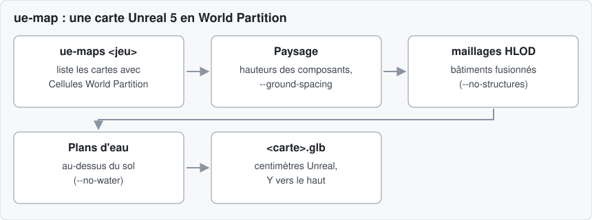

# Cartes Unreal 5 World Partition : `ue-maps` et `ue-map` {#unreal-5-world-partition-maps-ue-maps-and-ue-map}

**Qu'est-ce que c'est ?** Une carte complète d'un jeu Unreal 5 en un seul fichier 3D : le sol, les
bâtiments et l'eau. **Pourquoi ?** Pour que la chaleur de ce jeu ait cette carte dessous.
(*World Partition* est la manière dont Unreal 5 découpe une grande carte en morceaux ; *HLOD* est un
substitut simplifié d'un groupe de bâtiments, celui que le jeu dessine au loin.)

Exporte une carte complète d'un jeu Unreal 5 dont les cartes sont cuites en cellules World
Partition : le paysage (landscape), les maillages HLOD fusionnés de la carte (ses bâtiments et accessoires
tels que le jeu les dessine à distance) et ses plans d'eau. Aucun éditeur ni projet n'est nécessaire,
seulement le jeu installé.



## Pas à pas {#step-by-step}

1. **Lister les cartes.** `<game>` est le dossier du jeu, son `Content/Paks`, ou le nom de son
   dossier dans une bibliothèque Steam :

   ```
   python -m heat3d_gamefiles ue-maps "<Steam game folder name>"
   python -m heat3d_gamefiles ue-maps "D:\Games\<game>"
   ```

   Chaque carte dotée de cellules World Partition cuites est affichée avec son chemin de paquet.

2. **Exporter une carte** par son nom ou une partie unique de celui-ci :

   ```
   python -m heat3d_gamefiles ue-map "<game>" <map> -o map.glb
   ```

3. **Sol seul, ou plus grossier :**

   ```
   python -m heat3d_gamefiles ue-map "<game>" <map> --no-structures --no-water
   python -m heat3d_gamefiles ue-map "<game>" <map> --ground-spacing 4
   ```

4. **Ouvrez `map.glb`** dans le panneau Arrière-plan / niveau du visualiseur 3DHeat
   ([charger un niveau](https://holdi601.github.io/3DHeat/levels.html)).

## Options {#options}

| Option | Par défaut | Signification |
|---|---|---|
| `<game>` | obligatoire | le dossier du jeu, son `Content/Paks`, ou son nom de dossier Steam |
| `<map>` | obligatoire | un nom tel que l'affiche `ue-maps`, ou une partie unique de celui-ci |
| `-o`, `--out FILE` | `<map>.glb` (dans `$HEAT3D_LEVELS/<game>/` quand cette variable est définie) | le fichier à écrire |
| `--ground-spacing METRES` | 2 | l'écart entre sommets du paysage, arrondi à un nombre entier de ses propres quads |
| `--no-structures` | | laisser de côté les bâtiments HLOD et accessoires |
| `--no-water` | | laisser de côté les plans d'eau |

Le contenu compressé en Oodle a besoin d'une bibliothèque Oodle déjà présente sur la machine (voir
[Oodle](reader-oodle.md)).

## Exemple de sortie {#example-output}

```text
<map> -> map.glb
  ground      <n> triangles from <n> landscape components; <n> of <n> vertices stored twice disagree
  structure   <n> triangles in <n> HLOD meshes
  water       <n> triangles from <n> water bodies
```

Le compte des désaccords est un autocontrôle : des composants de paysage voisins stockent leur
bord commun deux fois, et les deux valeurs doivent concorder. Une carte de 3 km à 2 m fait
environ 4,6 millions de triangles de sol.

## Les parties {#the-parts}

`ground:<map>` (le paysage), `structure:<map>` (les maillages HLOD) et `water:<map>` (l'eau posée
au-dessus du sol).

**Unités :** c'est le seul export **qui n'est pas en mètres** : des centimètres Unreal, avec Y et Z
échangés (Y vers le haut), le repère qu'écrit le 3DHeat Unreal Exporter. La télémétrie du même jeu
utilise le même repère, donc elle tombe sur la carte.

## Comment c'est lu et vérifié {#how-it-is-read-and-checked}

| Partie | Lue depuis | Vérifiée contre |
|---|---|---|
| sol | la carte de hauteurs 16 bits de chaque composant de paysage, placée par sa base de section sur la transformation du paysage | chaque sommet stocké deux fois (sur une couture ou un bord de composant) doit concorder ; les désaccords sont comptés et affichés, non lissés |
| structure | les maillages HLOD fusionnés de la carte, construits par le moteur en coordonnées du monde | un maillage n'est gardé que si les limites que son composant met en cache décrivent ses propres sommets |
| eau | le maillage de chaque plan d'eau, posé sur la grille du sol, gardé là où il dépasse le sol | l'eau est à quelques mètres au-dessus du sol sous elle, comme une rivière au-dessus de son lit |

Les propriétés du paysage sont trouvées par leur forme, non par leur numéro d'emplacement (les
emplacements bougent entre versions du moteur). Les structures sont les substituts simplifiés, non
les modèles en pleine définition. Le feuillage, les décalques et les matériaux de paysage ne sont pas
exportés ; le sol est sans texture et éclairé par le visualiseur. Détails d'archive :
[Unreal 5 IoStore](reader-unreal-iostore.md).

**Vos propres fichiers :** la carte est lue depuis le jeu installé sur votre machine et écrite sur votre disque, pour votre propre analyse ; rien du jeu n'est livré avec cet outil.
