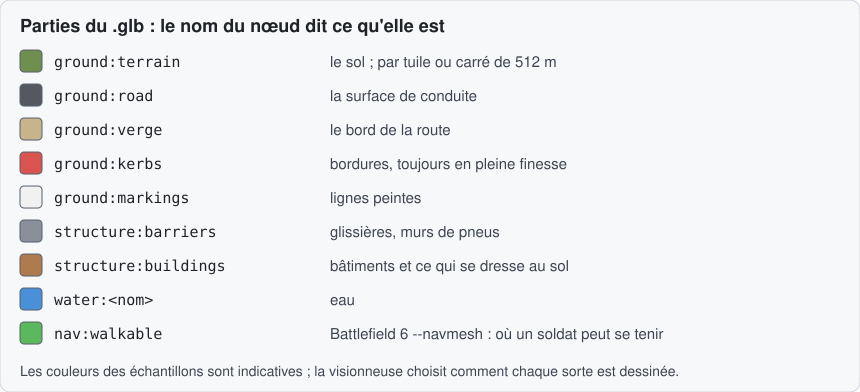

# Format de sortie {#output-format}

Un `.glb` est un fichier 3D unique : le sol, les bâtiments et l'eau d'une piste ou d'un
niveau, que vous ouvrez dans le panneau Arrière-plan / niveau de la visionneuse 3DHeat.

Chaque export (`course`, `courses`, `terrain`, `level`, `ue-map`, `enfusion-world`) écrit un
fichier **glTF 2.0 binaire** (`.glb`). Il est volontairement petit et plat, et organisé comme la
visionneuse 3DHeat lit un niveau. Source :
[`glb.py`](https://github.com/Holdi601/3DHeat-GameFiles/blob/main/heat3d_gamefiles/glb.py).

## Structure {#structure}

```
scene 0
 ├─ node "ground:terrain x-2046 z1023"  -> mesh 0 -> 1 primitive, material 0
 ├─ node "ground:road x-2046 z1023"     -> mesh 1 -> 1 primitive, material 1
 ├─ node "ground:markings"               -> mesh 2 -> ...
 ├─ node "ground:kerbs road_gen_rum_..." -> ...
 ├─ node "structure:barriers bar_armco_bclr"
 └─ ...
```

- **Un nœud par partie**, tous à la racine de la scène, **sans transformation**. Toute la géométrie est déjà en coordonnées du monde.
- Chaque nœud a son propre maillage avec **une primitive** et son propre matériau. Le nœud, le maillage et le matériau portent tous le nom de la partie.
- Chaque primitive a **ses propres tableaux de sommets compacts**, uniquement les sommets que la partie utilise. Un tableau de sommets partagé est du glTF valide, mais un lecteur qui développe les accesseurs de chaque primitive garderait alors chaque sommet une fois par partie.
- `asset.generator` vaut `heat3d_gamefiles`.
- **Aucun `extras`** n'est écrit : ni métadonnée personnalisée, ni tour, ni nom de jeu ou de piste, avec une exception : une partie Battlefield 6 d'un maillage destructible porte `{"destructible": true}` sur son nœud. Tout ce dont la visionneuse a besoin figure dans les noms des nœuds.

## Noms des nœuds : la classification {#node-names-the-classification}



La visionneuse prend la classe d'une partie à partir du nom du **nœud** (à défaut, du nom du
maillage), et seulement quand il correspond à

```
^(ground|structure|water)\s*[:|]
```

Tout le reste est classé par une heuristique écrite pour les paysages Unreal. Ainsi, chaque
partie écrite par l'exporteur commence par l'un de ces préfixes, ou par `nav:` (ci-dessous) :

| Préfixe | Signification | Parties écrites |
|---|---|---|
| `ground:` | la surface de roulage et le terrain | `ground:road`, `ground:verge`, `ground:terrain`, `ground:gravel and dirt`, `ground:kerbs`, `ground:markings`, `ground:tyre marks` |
| `structure:` | ce qui se dresse dessus | `structure:barriers`, `structure:props`, `structure:signs`, `structure:buildings`, `structure:infrastructure`, `structure:bridges`, `structure:rocks`, `structure:smashables`, `structure:trees` |
| `water:` | l'eau | `water:water` ; `water:<map>` (`ue-map`), `water:<world>` (`enfusion-world`) |
| `nav:` | là où un soldat peut marcher (Battlefield 6, `--navmesh` seulement) | `nav:walkable` |

`nav:` ne correspond pas au motif de la visionneuse ci-dessus ; la visionneuse le trie donc
par son heuristique. C'est une partie à part, pour que vous puissiez l'afficher ou la masquer
seule. `ue-map` écrit `ground:<map>`, `structure:<map>` et `water:<map>` ;
`enfusion-world` écrit `ground:<world>`, `structure:<world>` et `water:<world>`.

Après le type viennent, selon le jeu :

| Exemple | Signification |
|---|---|
| `ground:road x-2046 z1023` | sol Forza dans la tuile de terrain nommée `x-2046 z1023` (unités de grille, 1023 par 512 m) |
| `ground:road 3_-2` | sol BeamNG dans le carré de 512 m (3, -2) |
| `ground:road 3_-2 asphalt_light` | surface de roulage modélisée BeamNG du matériau `asphalt_light` dans ce carré |
| `ground:road 1_-4` | sol AC Rally dans le carré de 512 m (1, -4) de l'espace Unreal |
| `structure:barriers bar_armco_bclr` | modèles placés Forza partageant une texture (leur nom sans le GUID) |
| `structure:barriers` | modèles placés sans texture (Forza, AC Rally) |
| `structure:barriers armco_metal` | modèles placés BeamNG d'un même matériau |
| `ground:markings`, `water:water` | parties plates, une pour tout le fichier |
| `ground:terrain` (Battlefield 6) | le champ de hauteurs ; `ground:terrain backdrop` les maillages de terrain lointain, `ground:terrain blend` les maillages qui se fondent dans le terrain |
| `nav:walkable` (Battlefield 6, `--navmesh`) | le maillage de navigation du niveau pour un soldat : là où l'on peut se tenir debout, en vert uni |
| `ground:terrain x-512 z-512` (Battlefield 6, `--ground-texture`) | le champ de hauteurs sous une tuile de décalcomanie cuite, nommée par son coin bas en mètres |
| `structure:buildings t_concreteclean_01_cs` (Battlefield 6, `--textures`) | chaque surface de ce type qui montre cette carte de couleur ; sans `--textures`, une partie par type, sans suffixe |
| `structure:buildings t_concreteclean_01_cs (destructible)` (Battlefield 6) | la même chose, pour les maillages qu'un match peut détruire : ceux qui ont un élément de destruction de leur propre nom (murs, maisons, accessoires). Le nœud porte aussi les extras glTF `{"destructible": true}`. Leurs états détruits ne sont pas exportés |

La visionneuse peut filtrer par ces noms. Par exemple, « seulement la surface de course » est
`ground:road` avec `ground:kerbs`, dans les trois jeux. Le préfixe est aussi la façon dont la
visionneuse dessine une partie : le sol comme la surface sur laquelle repose la chaleur, la
structure comme ce qui se dresse dessus.

## Unités, axes et repère {#units-axes-and-frame}

- **Mètres, Y vers le haut**, la convention de glTF, pour chaque export sauf `ue-map`. Rien n'est remis à l'échelle ni recentré : les nombres sont les coordonnées du monde du jeu, ce qui est l'intérêt de lire l'archive au lieu de reconstruire.
- **Cartes Unreal 5 (`ue-map`) : centimètres**, l'unité propre à Unreal, avec Y et Z échangés pour que Y soit vers le haut : le repère que l'exporteur Unreal 3DHeat écrit et que la télémétrie du jeu utilise. Le seul export qui n'est pas en mètres.
- **Arma Reforger (`enfusion-world`) :** les mètres propres au jeu, x vers l'est, y vers le haut, z vers le nord. Le repère du jeu est gauche ; l'option *Inverser un axe du monde* de la visionneuse le montre sans miroir.
- **Forza :** les coordonnées du monde propres au jeu (x, y vers le haut, z), inchangées. Les mêmes que sa télémétrie, si bien qu'un tour enregistré se trouve sur le parcours.
- **BeamNG.drive :** `(x, z, -y)` du monde en Z vers le haut de BeamNG, qui est la rotation qu'applique l'enregistreur de télémétrie. Une rotation, pas un miroir.
- **Battlefield 6 :** les coordonnées du monde propres au jeu (x, y vers le haut, z), inchangées : les transformations d'instance du niveau appliquées à chaque maillage tel qu'il est stocké. Les copies en miroir sont réorientées pour que leurs normales pointent vers l'extérieur.
- **Assetto Corsa Rally :** le repère du tour. Les centimètres Unreal deviennent des mètres, le Z Unreal devient y, et les X et Y Unreal deviennent x et z dans celle des huit orientations où le tour s'est ajusté (voir [Assetto Corsa Rally](course-assetto-corsa-rally.md#which-stage-and-which-way-round)). Les triangles sont réorientés là où cette correspondance met en miroir.

Chaque export garde les axes qu'utilise sa télémétrie, si bien que l'enregistrement et le niveau
partagent un repère. Savoir si ce repère est gauche ou droit, dans chaque jeu, n'a pas été vérifié.

## Données de sommets {#vertex-data}

La forme par défaut est la forme **quantifiée** (`quantize=True`). Elle nécessite l'extension
`KHR_mesh_quantization`, listée à la fois dans `extensionsUsed` et `extensionsRequired`.

| Attribut | Quantifié (par défaut) | Pleine précision (`quantize=False`) |
|---|---|---|
| `POSITION` | float32 VEC3, avec min/max | float32 VEC3 |
| `NORMAL` | int8 VEC3 normalisé, complété à 4 octets (pas de 4) | float32 VEC3 |
| `TEXCOORD_0` (parties texturées seulement) | uint16 VEC2 normalisé, bridé à 0-1 ; float32 VEC2 là où les textures se répètent (Battlefield 6) | float32 VEC2 |
| `COLOR_0` (parties non texturées, quand une partie a une couleur) | uint8 VEC3 normalisé, complété à 4 octets | float32 VEC3 |
| indices | uint16 quand la partie a au plus 65 535 sommets, sinon uint32 | uint32 |

Un sommet fait 20 octets au lieu de 32 (24 au lieu de 44 avec la couleur). Cela retire un tiers de
chaque fichier, et c'est la différence entre un parcours de ville qui se charge dans un onglet de
navigateur et un qui n'y arrive pas. Le coût est de moins d'un demi-degré de normale et de 1/65 535
d'UV (un quinzième de texel à 4 096 px). La ligne de commande écrit toujours la forme quantifiée.
`write_glb(..., quantize=False)` en Python écrit l'autre.

Les normales viennent du jeu quand il les stocke (terrain et modèles Forza, formes et terrain BeamNG).
Sinon, elles sont calculées comme des normales lissées pondérées par l'aire, à partir des triangles.
Les normales d'AC Rally sont toujours calculées.

## Matériaux, couleurs et textures {#materials-colours-and-textures}

- Chaque matériau a `metallicFactor 0`, `roughnessFactor 1`.
- **Partie texturée :** `baseColorTexture` avec l'image de la partie, les UV, et aucune couleur de sommet. glTF multiplie les deux, donc une surface sortirait deux fois assombrie.
- **Partie non texturée :** couleur de sommet `COLOR_0` avec la couleur unie de la partie, et un `baseColorFactor` blanc. Si aucune partie du fichier n'a de couleur, il n'y a pas de `COLOR_0`. Quand des parties partagent des sommets, la couleur de la partie suivante l'emporte ; les parties plates sont donc écrites par importance croissante.
- **Images** : intégrées dans le bloc binaire en **JPEG**, qualité 90, sans sous-échantillonnage de chrominance, RVB seulement (l'alpha est retiré) — sauf une carte de découpe Battlefield 6 (feuilles, grillages), qui est en **PNG** avec son alpha, sur un matériau avec `alphaMode` MASK, `alphaCutoff` 0,5 et `doubleSided` (voir [Frostbite](reader-frostbite.md#textures-and-materials)). La visionneuse 3DHeat écarte les texels sous le seuil. Un sol de 2048 px fait d'herbe et de couronnes d'arbres est du bruit pour un codeur sans perte : plusieurs mégaoctets par tuile en PNG, moins d'un en JPEG. Une image partagée par plusieurs parties est stockée une seule fois.
- Un échantillonneur pour toutes les textures : agrandissement linéaire, réduction linéaire avec mipmap linéaire, **clamp to edge** sur les deux axes, pour les exports de parcours, dont les textures recouvrent leurs surfaces une seule fois. BeamNG dessine les textures de modèles répétées en couleurs unies (voir [BeamNG.drive](course-beamng.md#placed-models)).
- Une exportation Battlefield 6 avec `--textures`, dont les matériaux se répètent en mosaïque, écrit les propres coordonnées de texture du jeu, non bridées, en float32 `TEXCOORD_0` même sous la forme quantifiée, avec un échantillonneur qui **répète** sur les deux axes (`write_glb(..., repeat=True)`) : un mur de briques est une paire de triangles dont l'UV va de 0 à 40. La visionneuse 3DHeat enroule une telle texture dans son atlas (voir sa page *Model levels*). Pour un moteur de rendu qui ne peut pas répéter une texture, `level --clamped-uvs` (`write_level(..., clamped=True)`) découpe chaque triangle le long des lignes où sa texture se répète et déplace chaque morceau dans 0..1 : les mêmes pixels sur la même surface, environ un cinquième de triangles en plus. Les triangles sur lesquels une texture se répète plus de 16 fois gardent leurs coordonnées. Un triangle que sa texture découperait en plus de 4 morceaux — de l'écorce qui se répète sur chaque branche d'un arbre, ce qui découpé faisait passer les 1 099 triangles d'un arbre à 51 735 — va dans une partie à lui, `<part> (average colour)`, dans la couleur moyenne de la texture ; `level` indique combien il y en a.

| Texture | Taille | Couvre |
|---|---|---|
| sol (tous les jeux sauf Battlefield 6) | `--texture-size` : 2048, 1024 ou 512 px | un carré de 512 m : 25, 50 ou 100 cm par pixel |
| champ de hauteurs Battlefield 6 | le plus grand mip de la carte couleur de l'arrière-plan dans le niveau, recadré | le carré de terrain : 32 m par pixel dans le niveau vérifié |
| surfaces Battlefield 6 | `--textures` : au plus ce nombre de px par côté | la texture propre de la surface, une fois par morceau (coupée là où elle se répète) |
| sol cuit Battlefield 6 | `--ground-texture` : mètres par pixel, tuiles d'au plus 4 096 px | une tuile de l'étendue des décalcomanies : 2 048 m à 0,5 m par pixel |
| modèle placé Forza | au plus 256 px | la disposition UV propre au modèle |
| modèle placé BeamNG | au plus 256 px | la disposition UV propre au modèle, seulement là où elle ne se répète pas |
| modèle placé AC Rally | aucune | couleurs unies |

## Ce que l'écrivain refuse {#what-the-writer-refuses}

`write_glb` lève une erreur plutôt que d'écrire un fichier qu'une visionneuse ouvrirait et
afficherait mal :

| Refusé | Parce que |
|---|---|
| des positions qui ne sont pas N x 3, ou non finies | un maillage cassé |
| un indice au-delà de la fin de la liste de sommets | s'affiche comme du bruit |
| une partie texturée quand le fichier n'a pas d'UV | s'affiche comme un seul pixel étiré |
| aucun triangle du tout | s'affiche comme rien |
| un tableau de normales, de couleurs ou d'UV de la mauvaise longueur, ou non fini | il en faut un par sommet |

## Lecture ailleurs {#reading-it-elsewhere}

Tout lecteur glTF 2.0 qui prend en charge `KHR_mesh_quantization` devrait ouvrir ces fichiers.
Seule la visionneuse 3DHeat a été vérifiée ; les autres visionneuses ne sont pas testées. Un lecteur
sans l'extension refuse le fichier, car elle est marquée comme requise. Les fichiers peuvent être
gros : environ 80 Mo pour un circuit de campagne, jusqu'à plusieurs centaines de Mo pour un
parcours urbain avec le budget automatique.

## Dans 3DHeat {#in-3dheat}

Chargez le `.glb` dans le panneau Arrière-plan / niveau de la visionneuse
[3DHeat](https://github.com/Holdi601/3DHeat) ; la télémétrie que vous enregistrez dans le même jeu
se place dessus, car les deux gardent les coordonnées du jeu. La documentation propre à la
visionneuse ([holdi601.github.io/3DHeat](https://holdi601.github.io/3DHeat/)) couvre le panneau
Arrière-plan / niveau et les fichiers de match que les autres outils écrivent
([Un fichier par match : `.3dheat`](https://holdi601.github.io/3DHeat/container.html)).
Un niveau n'est pas stocké dans chaque fichier `.3dheat` : un match le nomme dans ses `references`
(`kind: "level"`, nom et sha256), et le `.glb` reste à côté des matchs.
