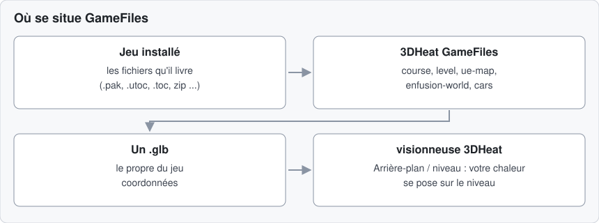

# Niveaux entiers {#whole-levels}

**En clair :** pour les jeux de tir et les autres jeux sans tours, l'outil enregistre la carte entière dans un seul fichier 3D, afin que la visionneuse puisse dessiner où les joueurs sont allés.

`course` découpe le sol autour d'un tour. Pour les jeux sans tours, l'outil exporte un niveau entier, carte ou monde, d'un seul coup :

| Jeu ou moteur | Liste | Export | Page |
|---|---|---|---|
| Battlefield 6 (Frostbite) | `levels` | `level <level>` | [Niveaux de Battlefield 6](level-battlefield.md) |
| Jeux Unreal 5 à World Partition | `ue-maps <game>` | `ue-map <game> <map>` | [Cartes Unreal 5](level-unreal-world-partition.md) |
| Arma Reforger (Enfusion) | `enfusion-worlds` | `enfusion-world <world>` | [Mondes d'Arma Reforger](level-arma-reforger.md) |

Chaque paire fonctionne de la même façon : le premier verbe liste ce que contient le jeu installé, le second écrit l'un d'eux sous forme d'un seul `.glb` dans les coordonnées du monde du jeu lui-même, de sorte que les positions enregistrées dans ce jeu s'y superposent. Les parties sont nommées `ground:`, `structure:` et `water:` comme pour tous les autres exports (voir [Format de sortie](output-format.md)) ; chargez le fichier dans le panneau Arrière-plan / niveau de la visionneuse 3DHeat.

