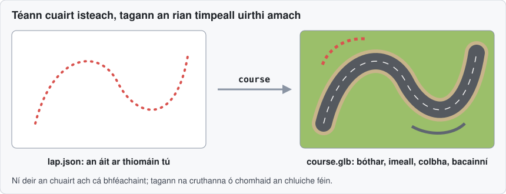
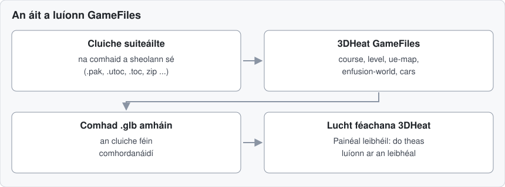

# 3DHeat GameFiles {#dheat-gamefiles}

**Cad é?** Uirlis a thógann samhail 3D de rian rása nó de leibhéal cluiche
ó chomhaid cluiche atá suiteáilte agat cheana.

**Cén fáth a n-úsáidfinn é?** Péinteálann an t-amharcán 3DHeat an áit ar thiomáin tú nó ar sheinn tú mar
theas. Leis an uirlis seo péinteálann sé ar an bhfíorrian nó ar an bhfíorleibhéal é, ní ar spás folamh.

**Sampla:** tóg cuairt a thiomáin tú. Tógann an uirlis an bóthar agus an talamh timpeall air
mar chomhad 3D amháin, ionas gur féidir leis an amharcán do luas nó do thitimí a phéinteáil ar an bhfíorrian:



An bhfuil tú nua leis an líne ordaithe? Tosaigh le [Sula dtosaíonn tú](before-you-start.md).

Níos mine: léann sí sonraí leibhéil as na cartlanna a sheolann cluiche agus scríobhann sí iad
mar chomhad glTF dénártha (`.glb`). Is í a príomhobair ná an **onnmhairiú cúrsa**: tugann tú cuairt di,
agus scríobhann sí an talamh, an bóthar scartha ón imeall agus
ón bhféar, agus na colbha, bacainní, ballaí boinn, comharthaí agus foirgnimh timpeall air.

Is cuid de [3DHeat](https://github.com/Holdi601/3DHeat) í, amharcán le haghaidh
léarscáileanna teasa telemetry 3D fíor-ama, anailís rása agus athbhreithniú cluiche
([doiciméadúchán](https://holdi601.github.io/3DHeat/)). Is iad na comhaid `.glb` a scríobhann an
uirlis seo na leibhéil a tharraingíonn an t-amharcán an teas orthu.



Tá sí ar cheann de thrí bhealach chun geoiméadracht leibhéil a fháil isteach in 3DHeat:

| Bealach | Teastaíonn | Tugann |
|---|---|---|
| 3DHeat Unreal Exporter | an tionscadal Unreal oscailte san eagarthóir | geoiméadracht chruinn |
| 3DHeat GameCapture | scáileán agus gabháil | meastachán |
| **3DHeat GameFiles** | **an cluiche suiteáilte, seolta** | **geoiméadracht chruinn, gan tionscadal** |

Pacáiste Python: `heat3d_gamefiles`. Stór:
[Holdi601/3DHeat-GameFiles](https://github.com/Holdi601/3DHeat-GameFiles). Ceadúnas: MIT.

## Cad is féidir léi a dhéanamh {#what-it-can-do}

| Cluiche nó inneall | Onnmhairiú cúrsa (`course`) | Léamh cartlainne |
|---|---|---|
| Forza Horizon (ForzaTech) | tá: tír-raon, bóthar agus imeall, uigeacht talún, samhlacha curtha ina n-uigeachtaí féin | `identify`, `list`, `extract` ar `.minizip`; `identify` ar `.modelbin`; samhlacha, tír-raon agus uigeachtaí trí `course` agus `terrain` |
| BeamNG.drive | tá: tír-raon, decals bóthair, ciorcaid shamhlaithe, samhlacha curtha, uisce | `identify`, `list`, `extract` ar zipeanna leibhéil; `identify` ar `.ter`, `.cdae`; `.dae` trí `course` |
| Assetto Corsa Rally (Unreal 5.6) | tá: tíleanna talún céime, dath talún bácáilte, samhlacha curtha i ndathanna cothroma | `identify`, `list`, `extract` ar IoStore `.utoc`/`.ucas`; pacáistí zen, mogaill statacha, uigeachtaí trí `course` |
| Unreal `.pak` (leaganacha 8-12) | níl | `identify`, `list`, `extract` |
| Unity (formáid 22 agus níos déanaí) | níl | `identify`, `meshes` |
| Battlefield 6 (Frostbite `.toc`/`.cas`) | gan cuairt; leibhéal iomlán le `level`: tír-raon, mogaill curtha, a léarscáileanna datha le `--textures` | `identify`, `levels`; burlaí, mogaill, tír-raon, uigeachtaí agus cur trí `level` |
| Source 2 `.vpk` | níl | `identify`, `list`, `extract` |
| Cluichí Unreal 5 World Partition | gan cuairt; léarscáil iomlán le `ue-map` (liostaithe ag `ue-maps`): tírdhreach, foirgnimh HLOD agus maisiúcháin, uisce | - |
| Arma Reforger (Enfusion) | gan cuairt; domhan iomlán le `enfusion-world` (liostaithe ag `enfusion-worlds`): tír-raon ina dhathanna, an fharraige, foirgnimh mar bhoscaí | - |
| Forza (carranna) | `cars`: gach carr ar mhionsonraí íseal, do chluaisín Anailís rása an amharcáin | - |

Diúltaítear do chuairteanna ó Assetto Corsa EVO agus iRacing le cúis. Féach
[Teorainneacha agus bearnaí aitheanta](../limits-and-known-gaps.md).

## Suiteáil {#install}

An bhfuil tú nua leis an líne ordaithe? Léigh [Sula dtosaíonn tú](before-you-start.md) ar dtús.

Teastaíonn **Python 3.10 nó níos nuaí** uait (forbartha ar 3.13) agus na pacáistí i
[`requirements.txt`](https://github.com/Holdi601/3DHeat-GameFiles/blob/main/requirements.txt).

```
git clone https://github.com/Holdi601/3DHeat-GameFiles.git
cd 3DHeat-GameFiles
pip install -r requirements.txt
```

Ansin seiceáil é: `python -m heat3d_gamefiles --help`. Ba chóir duit
`usage: heat3d_gamefiles [-h]` agus liosta na ngníomhairí (verbs) a fheiceáil. Rith gach ordú ó fhillteán an
stóir, mar `python -m heat3d_gamefiles <verb>`.

| Pacáiste | Úsáidte le haghaidh |
|---|---|
| numpy | gach rud a dhíchódaíonn geoiméadracht |
| lz4 | cartlanna Forza (blocanna LZ4 den chuid is mó), roinnt burlaí Unity, blocanna IoStore LZ4 |
| Pillow | uigeachtaí BC1-BC7 a dhíchódú, na huigeachtaí JPEG sa `.glb` a scríobh |
| msgpack, zstandard | cruthanna tiomsaithe BeamNG (`.cdae`) |
| cryptography | chun `.pak` criptithe a oscailt le heochair atá agat cheana amháin |
| pytest | na tástálacha |

Teastaíonn leabharlann **Oodle** ó ábhar Unreal comhbhrúite le Oodle atá ar do mheaisín
cheana. Ní sheoltar ceann leis an uirlis seo choíche. Féach [Oodle](../reader-oodle.md).

Scríobhadh an uirlis do Windows. Aimsíonn sí cluichí trí liosta leabharlainne Steam agus
`%LOCALAPPDATA%`, agus lódálann sí Oodle mar DLL Windows. Níor tástáladh ardáin eile.

## Tús tapa {#quick-start}

Is é **comhad cuarta** taifeadadh de cibé áit ar chuaigh do charr: liosta de phointí x, y, z.
Tagann sé ó [3DHeat GameCapture](https://github.com/Holdi601/3DHeat-GameCapture)
nó ó leabharlann cuairteanna an aip FH Companion; oibríonn CSV clóscríofa de láimh freisin
([Ionchuir chuarta](../lap-inputs.md)).

```
# Forza: a lap file, a lap folder, or a course name from the FH Companion library
python -m heat3d_gamefiles course "Example Circuit"
python -m heat3d_gamefiles course path\to\lap.json -o course.glb

# BeamNG.drive or Assetto Corsa Rally: a heat3d-lap file says which game it is from
python -m heat3d_gamefiles course my_lap.json

# Every course in the FH Companion library, one .glb each
python -m heat3d_gamefiles courses -o courses

# Battlefield 6: list the levels, then export one (a large file; see Commands)
python -m heat3d_gamefiles levels
python -m heat3d_gamefiles level <level> -o level.glb --textures

# Unreal 5 World Partition and Arma Reforger: list, then export
python -m heat3d_gamefiles ue-maps "<game>"
python -m heat3d_gamefiles ue-map "<game>" <map> -o map.glb
python -m heat3d_gamefiles enfusion-worlds
python -m heat3d_gamefiles enfusion-world <world> -o world.glb

# Every Forza car, for the viewer's race tab
python -m heat3d_gamefiles cars -o forza.h3dcars

# What is this file?
python -m heat3d_gamefiles identify some_archive.pak
```

Oscail an `.glb` in amharcán 3DHeat. Coinnítear comhordanáidí domhain an chluiche féin
(féach [Formáid an aschuir](../output-format.md)), mar sin ailíníonn cuairt thaifeadta leis an gcúrsa.

## Léarscáil na ndoiciméad seo {#map-of-this-documentation}

- [Sula dtosaíonn tú](before-you-start.md): Python, teirminéal, an chéad ordú.
- [Orduithe](../commands.md): gach gníomhaire (verb) agus rogha, le samplaí.
- [Tagairt orduithe](../cli-reference.md): `--help` gach gníomhaire, ginte ón gcód.
- [Cartlanna a iniúchadh](../inspecting-archives.md): `identify`, `list`, `extract`, `meshes`, céim ar chéim.
- [Onnmhairiú cúrsa](../course-export.md): conas a éiríonn cuairt ina cúrsa, do gach cluiche.
  - [Forza Horizon](../course-forza-horizon.md)
  - [BeamNG.drive](../course-beamng.md)
  - [Assetto Corsa Rally](../course-assetto-corsa-rally.md)
  - [Leibhéil mionsonraí agus an buiséad](../detail-budget.md)
- [Leibhéil iomlána](../whole-levels.md): leibhéal, léarscáil nó domhan gan cuairt.
  - [Leibhéil Battlefield 6](../level-battlefield.md): `levels`, `level`
  - [Léarscáileanna Unreal 5](../level-unreal-world-partition.md): `ue-maps`, `ue-map`
  - [Domhain Arma Reforger](../level-arma-reforger.md): `enfusion-worlds`, `enfusion-world`
- [Carranna Forza](../forza-cars.md): `cars`, comhad na gcarranna do chluaisín Anailís rása an amharcáin.
- [Ionchuir chuarta](../lap-inputs.md): gach cruth comhaid cuarta a ghlacann an uirlis.
- [Formáid an aschuir](../output-format.md): cad atá taobh istigh den `.glb`.
- [Léitheoirí cartlainne](../archive-readers.md): leathanach amháin in aghaidh gach formáide coimeádáin, a chlúdaíonn
  cad a léann gach ceann, cad nach léann, agus cén fáth.
- [Teorainneacha agus bearnaí aitheanta](../limits-and-known-gaps.md)
- [Fabhtcheartú](../troubleshooting.md): na teachtaireachtaí earráide agus cad atá le déanamh.
- [Rialacha agus ceadúnais](../rules-and-licences.md): gan eochracha, do chomhaid féin, gan athdháileadh.
- [Nuashonruithe](../updates.md): an seic nuashonraithe agus `heat3d_update`.
- [Forbairt](../development.md): léarscáil modúl agus tástálacha, lena n-áirítear na tástálacha a ritheann i gcoinne cluichí suiteáilte.
- [Cothabháil](../maintaining.md): seicliosta eisiúna na leathanach seo.

## Cuid de 3DHeat {#part-of-3dheat}

Tá 3DHeat GameFiles ar cheann de na huirlisí saora timpeall ar amharcán 3DHeat:

| Uirlis | Cad a dhéanann sí | Doiciméid |
|---|---|---|
| [3DHeat](https://github.com/Holdi601/3DHeat) | an t-amharcán: léarscáileanna teasa 3D, anailís rása agus athbhreithniú cluiche sa bhrabhsálaí | [suíomh](https://holdi601.github.io/3DHeat/) |
| [GameFiles](https://github.com/Holdi601/3DHeat-GameFiles) | cúrsaí agus leibhéil as na comhaid a sheolann cluiche, mar `.glb` | [suíomh](https://holdi601.github.io/3DHeat-GameFiles/) |
| [GameCapture](https://github.com/Holdi601/3DHeat-GameCapture) | telemetry cuarta ó chluichí rásaíochta; leibhéil atógtha ó fhíseán cluiche | [suíomh](https://holdi601.github.io/3DHeat-GameCapture/) |
| [Unreal Exporter](https://github.com/Holdi601/3DHeat-UnrealExporter) | breiseán d'Unreal Editor a shábhálann leibhéal mar `.glb` | [suíomh](https://holdi601.github.io/3DHeat-UnrealExporter/) |
| [CS2](https://github.com/Holdi601/3DHeat-CS2) | demos Counter-Strike 2 ina gcomhaid chluiche; léarscáileanna ina `.glb` | [suíomh](https://holdi601.github.io/3DHeat-CS2/) |
| [Watcher](https://github.com/Holdi601/3DHeat-Watcher) | taifeadann sé d'imirt sa chúlra ón méid a fhoilsíonn cluichí | [suíomh](https://holdi601.github.io/3DHeat-Watcher/) |
| [Ext-WarThunder](https://github.com/Holdi601/3DHeat-Ext-WarThunder) | athsheinmeanna War Thunder ina gcomhaid chluiche | [suíomh](https://holdi601.github.io/3DHeat-Ext-WarThunder/) |
| [Ext-WoT](https://github.com/Holdi601/3DHeat-Ext-WoT) | athsheinmeanna World of Tanks ina gcomhaid chluiche | [suíomh](https://holdi601.github.io/3DHeat-Ext-WoT/) |
| [Ext-WoWs](https://github.com/Holdi601/3DHeat-Ext-WoWs) | athsheinmeanna World of Warships ina gcomhaid chluiche | [suíomh](https://holdi601.github.io/3DHeat-Ext-WoWs/) |
| [Ext-Squad](https://github.com/Holdi601/3DHeat-Ext-Squad) | demos freastalaí Squad ina gcomhaid chluiche | [suíomh](https://holdi601.github.io/3DHeat-Ext-Squad/) |
| [Ext-DCS](https://github.com/Holdi601/3DHeat-Ext-DCS) | léarscáileanna DCS World ina leibhéil `.glb` | [suíomh](https://holdi601.github.io/3DHeat-Ext-DCS/) |
| [Ext-IL2](https://github.com/Holdi601/3DHeat-Ext-IL2) | léarscáileanna IL-2 Sturmovik ina leibhéil `.glb` | [suíomh](https://holdi601.github.io/3DHeat-Ext-IL2/) |

Tá comhaid chluiche an amharcáin curtha síos in
[Comhad amháin in aghaidh an chluiche: `.3dheat`](https://holdi601.github.io/3DHeat/container.html);
lódáiltear leibhéal a dhéantar anseo lena n-aice i bpainéal Cúlra / leibhéal an amharcáin.
