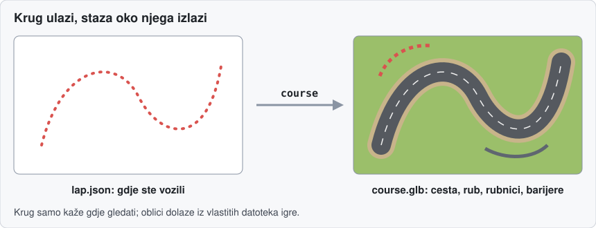
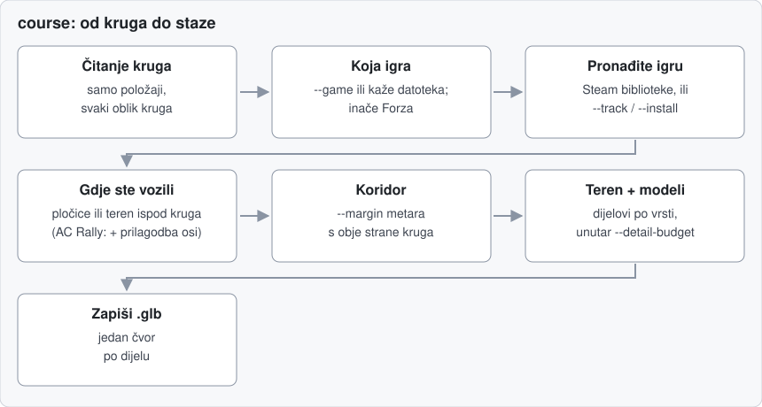

# Izvoz staze {#course-export}

**Ukratko:** vozili ste krug; ovo gradi stazu po kojoj ste vozili, kao 3D datoteku.
Krug je samo niz točaka; cesta, trava i rubnici dolaze iz vlastitih datoteka igre.

`course` pretvara krug u stazu: tlo u pojasu s obje strane mjesta gdje je auto
prošao, i ono što stoji na tom tlu, kao jednu `.glb` datoteku za preglednik. Ova
stranica pokriva što je zajedničko za sve tri podržane igre. Stranice ispod nje
pokrivaju što se razlikuje:

- [Forza Horizon](course-forza-horizon.md): ForzaTech `.minizip` arhive
- [BeamNG.drive](course-beamng.md): zip arhive, visinsko polje terena, sastavljeni oblici
- [Assetto Corsa Rally](course-assetto-corsa-rally.md): Unreal 5 IoStore, World Partition etapa
- [Razine detalja i proračun](detail-budget.md): koliko trokuta dobivaju postavljeni modeli i koji primjerci ostaju

## Koraci {#the-steps}

Pojmovi korišteni u nastavku: **okvir** je smjer u kojem pokazuju osi; **koridor** je
pojas tla s obje strane kruga; **pločica** je jedan kvadratni dio terena igre; **LOD**
(razina detalja) je jedna od jednostavnijih kopija modela.

1. **Pročitajte krug.** Samo pozicije, iz bilo kojeg oblika opisanog na
   [Ulazni podaci kruga](lap-inputs.md). Brzina i upravljanje se ne koriste. Krug s
   manje od dva uzorka se odbija ("holds no driving", krug ne sadrži vožnju).
2. **Odredite igru.** `--game`, zatim polje `game` u datoteci kruga, zatim Forza (vidi
   [Naredbe](commands.md#which-game)).
3. **Pronađite instaliranu igru.** Sve tri traže u svakoj Steam biblioteci navedenoj u
   Steamovoj datoteci `config\libraryfolders.vdf`. Forza traži i u `C:\XboxGames`.
   `--track` (Forza) ili `--install` (BeamNG, AC Rally) preskače pretragu.
4. **Pronađite gdje je krug vožen.** Nikad se ne odlučuje samo po podudaranju imena.
   Forza bira stazu čije pločice terena pokrivaju krug. BeamNG bira razinu na čijem
   terenu (ili cestama) leže uzorci kruga. AC Rally isprobava svaku etapu u osam
   orijentacija osi i bira onu koja stavlja najviše kruga na cestu.
5. **Izrežite koridor** `--margin` metara s obje strane vožnje (dolje).
6. **Izgradite tlo** unutar koridora, razvrstano na cestu, rub, šljunak i zemlju, teren,
   oznake, tragove guma ili vodu, i zapecite teksturu tla za svaki kvadrat od 512 m.
7. **Postavite modele** koji stoje u koridoru, po kategoriji, na razini detalja koja se
   bira prema udaljenosti i proračunu trokuta.
8. **Zapišite `.glb`**: jedan imenovani čvor po dijelu. Vidi [Format izlaza](output-format.md).

Što pokretanje ispiše: ovdje na sintetskoj BeamNG.drive instalaciji koju testovi
grade, 50 m kruga niz traku ceste:

## Koridor {#the-corridor}

Rez je pojas oko vožene linije, a ne okvir oko kruga. Za kružnu stazu to su skoro
isto. Za sprint od točke do točke okvir je uglavnom padina na kojoj nitko ne vozi, pa
pojas može biti desetina njegove površine. Izvor:
[`corridor.py`](https://github.com/Holdi601/3DHeat-GameFiles/blob/main/heat3d_gamefiles/corridor.py).

Kako se gradi:

- Vožnja se projicira na ravninu tla: x i z kruga (BeamNG: x i y vlastitog okvira igre).
- Rasterizira se na mreži ćelija od **4 m** (`CELL`). Svaka ćelija koju vožnja dotakne
  proširuje se diskom polumjera `margin + 4 m` u svim smjerovima.
- Uzastopni uzorci razmaknuti manje od **50 m** (`JOIN`) povezuju se točkama na svakih
  4 m, pa pojas nema rupa. Uzorci udaljeniji od toga tretiraju se kao zasebni dijelovi
  vožnje i ne spajaju se. Staza iz biblioteke je mnogo datoteka krugova jedna za drugom, i
  cilj jednog sprinta i početak sljedećeg ne smiju povlačiti pojas preko karte.
- Trokut se zadržava ako neki njegov kut, sredina bilo kojeg brida ili njegovo težište
  leži u pojasu. Središnje točke hvataju veliki trokut koji prelazi preko uskog pojasa
  dok su mu svi kutovi izvan njega.
- Visina nikad nije dio reza. Okvir koji bi ograničavao visinu isjekao bi tlo ispod
  brda koje cesta penje.

Konzola prijavljuje površinu koridora, na primjer
`cutting 80 m either side of the driving: 1.53 km2 of a 6,000 by 3,600 m box`.

BeamNG i AC Rally grade i šire **doseg** koridora, `margin + 60 m`. Postavljeni model
se razmatra ako mu ishodište leži u koridoru dosega, a crta se samo ako njegov otisak
dodiruje pravi koridor. Tako se ne izgubi dugi objekt čije je ishodište malo izvan
pojasa. BeamNG koristi koridor dosega i za odabir dekala cesta za bojanje.

## Od čega je tlo {#what-the-ground-is-made-of}

Svaki izvoz razvrstava trokute tla u iste vrste, a svaka se vrsta piše kao zaseban dio,
da je preglednik može prikazati ili sakriti:

| Vrsta | Ime dijela | Boja (linearni RGB) | Forza | BeamNG | AC Rally |
|---|---|---|---|---|---|
| cesta | `ground:road` | 0,22, 0,22, 0,23 | trake ceste: dio asfalta | slojevi tipa `ASPHALT`, dekali cesta, modelirana cesta | pločice staze (`/MeshesTrack/`) |
| rub | `ground:verge` | 0,52, 0,47, 0,30 | trake ceste: bankina | pločnici i modeli ruba | - |
| šljunak i zemlja | `ground:gravel and dirt` | 0,50, 0,42, 0,30 | - | slojevi zemlje, šljunka, pijeska i blata te dekali | - |
| teren | `ground:terrain` | 0,30, 0,44, 0,18 | sve ostalo | sve ostalo | pločice `_Terrain` i daleki teren |
| rubnici | `ground:kerbs` | 0,60, 0,12, 0,10 (Forza) | rekviziti `road_gen_rum*` | modeli rubnika, pločnika i udarnih traka | modeli rubnika i pločnika |
| oznake | `ground:markings` | 0,90, 0,90, 0,88 | podmreže dekala, podignute 5 cm | obojene u teksturu | - |
| tragovi guma | `ground:tyre marks` | 0,20, 0,17, 0,16 | podmreže dekala, podignute 5 cm | obojene u teksturu | - |
| voda | `water:water` | 0,16, 0,34, 0,48 | materijali vode | ravnina mora, vodeni blokovi, rijeke | - |

Boje su odabrane da se lako čitaju na prvi pogled, a ne da odgovaraju igri. Koriste se
za dijelove bez teksture i za preglednike koji tekture ignoriraju. Izvor:
[`surfaces.py`](https://github.com/Holdi601/3DHeat-GameFiles/blob/main/heat3d_gamefiles/surfaces.py).

Dijelovi tla dijele se po kvadratima od 512 m, i svaki nosi vlastitu zapečenu sliku, pa
imena dijelova nose i kvadrat:

| Igra | Ime dijela tla | Ključ kvadrata |
|---|---|---|
| Forza | `ground:road x-2046 z1023` | ime mreže pločice terena (koraci od 1023, vidi [Forza Horizon](course-forza-horizon.md)) |
| BeamNG | `ground:road 3_-2` | `floor(x / 512)`, `floor(y / 512)` u BeamNG metrima |
| AC Rally | `ground:road 1_-4` | `floor(x / 51200)`, `floor(y / 51200)` u Unreal centimetrima |

## Što stoji na tlu {#what-stands-on-it}

Postavljeni modeli zapisuju se u dijelove imenovane `structure:<kategorija>`, ili
`ground:kerbs` za rubnike (u sve tri igre). Kad dio ima vlastitu teksturu, ime teksture
ili materijala slijedi kategoriju, na primjer `structure:barriers bar_armco_bclr`.

| Kategorija | Forza | BeamNG | AC Rally |
|---|---|---|---|
| ograde | da | da | da |
| rekviziti | da | da | da |
| znakovi | da | da | da |
| zgrade | da (cjelovite zamjene zgrada gdje ih igra ima) | da | da |
| infrastruktura | da | da | da |
| mostovi | da | da | (ubrojeno u infrastrukturu) |
| stijene | da | da | da |
| rubnici | da, kao tlo | da, kao tlo | da, kao tlo |
| drveće | uz `--trees` | uz `--trees` | uz `--trees` |
| sitni razbijivi predmeti | uz `--trees` | - | - |

Raspodjela detalja je ista u sve tri. Primjerci unutar 25 m od vožnje počinju s punim
detaljem, primjerci na 25-60 m za jednu razinu grublji, a dalji primjerci na
najgrubljoj razini. Zatim se najskuplji modeli spuštaju dok ne stane proračun trokuta,
a gdje ni najgrublje razine ne stanu u proračun koji zadate, primjerci se izostavljaju.
Rubnici se nikad ne pojednostavljuju niti izostavljaju. Vidi
[Razine detalja i proračun](detail-budget.md).

## Opcije koje mijenjaju rezultat {#options-that-shape-the-result}

| Želite | Koristite |
|---|---|
| manju datoteku | `--no-textures` (jednolike boje), `--texture-size 1024` ili `512`, `--detail-budget N`, `--margin 40` |
| samo tlo | `--no-placed` |
| i pejzaž | `--trees` |
| drugo godišnje doba (Forza) | `--season winter` |
| igru izvan Steama | `--track` (Forza) ili `--install` (BeamNG, AC Rally) |
| krug koji pretraga ne smjesti | `--level` (BeamNG, AC Rally), `--track` (Forza) |

## Koordinate {#coordinates}

Svaki izvoz piše metre s Y prema gore, u okviru u koji se snimljeni krug iste igre
poravnava:

| Igra | Zapisani okvir |
|---|---|
| Forza | vlastite svjetske koordinate igre, nepromijenjene |
| BeamNG | `(x, z, -y)` BeamNG svijeta s Z prema gore, što je rotacija koju snimač telemetrije primjenjuje |
| AC Rally | okvir kruga, pronađen prilagodbom: Unreal centimetri postaju metri, a Unreal X i Y postaju x i z kruga u jednoj od osam orijentacija koja odgovara |

Vidi [Format izlaza](output-format.md).
