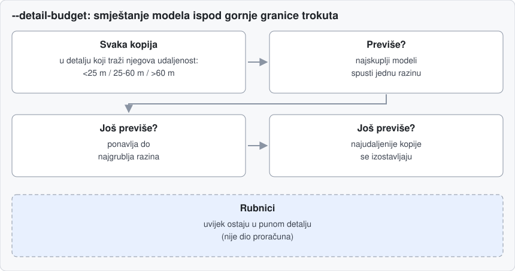

# Razine detalja i proračun {#levels-of-detail-and-the-budget}

**Trokut** je mali ravni dio 3D modela. Više trokuta znači veću i sporiju datoteku.
**Proračun** je ograničenje koliko ih smije biti. **Razina detalja** je jednostavnija
kopija modela, koja se koristi kad je model daleko.

Najfinija razina svega što je postavljeno oko staze iznosi nekoliko milijuna trokuta.
Na primjer, stotine segmenata zaštitne ograde i gomile guma po oko tisuću trokuta
svaka. Gradski koridor sadrži preko sto tisuća primjeraka. Zato svaki izvoz staze
postavljenim modelima daje **proračun trokuta** i za svaki model odlučuje kojoj
razini detalja pripada i, po potrebi, koje primjerke izostaviti.

Metoda je napisana za Forzu
([`forzaplacement.py`](https://github.com/Holdi601/3DHeat-GameFiles/blob/main/heat3d_gamefiles/forzaplacement.py):
`choose_levels`, `auto_budget`, `_fit`), a BeamNG i AC Rally koriste njezine dijelove.
Teren se ne ubraja u proračun.

## Pojasevi udaljenosti {#distance-bands}

Udaljenost svakog primjerka od vožnje mjeri se u ravnini tla, do najbližeg uzorka
kruga. Krug se prvo prorijedi na najviše 1000 točaka, što stoji nekoliko metara
preciznosti, a ništa što je ovdje važno. Primjerci zatim padaju u tri pojasa, i svaki
par (model, pojas) se proračunava zasebno:

| Pojas | Udaljenost | Počinje s |
|---|---|---|
| blizu | manje od 25 m (`NEAR`) | najfinijom razinom |
| srednje | 25-60 m (`FAR`) | jednu razinu grublje |
| daleko | 60 m i više | najgrubljom razinom |

Bez rute (Forza `terrain --box`) udaljenost se mjeri do sredine okvira.

## Spuštanje da stane {#stepping-down-to-fit}



Cijena unosa (model, pojas) jest broj primjeraka puta trokuti na njegovoj trenutnoj
razini. Dok je zbroj veći od proračuna, unos koji najviše košta spušta se za jednu
razinu, i to se ponavlja dok zbroj ne stane ili dok se ništa više ne može spustiti.
Unosi s fiksiranom razinom se ne spuštaju:

| Igra | Fiksirano na punom detalju |
|---|---|
| Forza | rubnici (`road_gen_rum*`) |
| BeamNG | rubnici i svaki oblik koji nosi vožnju po površini |
| AC Rally | rubnici |

Forza sažetak to prikazuje kao
`N of M models drawn at a coarser level to fit the budget`.

## Automatski proračun {#the-automatic-budget}

Bez `--detail-budget` proračun se sam dimenzionira tako da se **nijedan primjerak ne
izostavi**:

```
budget = max(1,500,000, 1.25 x sum(copies x coarsest level))
```

Fiksirani unosi broje se na svojoj najfinijoj razini. Faktor 25% (`HEADROOM`) ostavlja
prostor da stvari uz cestu zadrže neki detalj. Na seoskoj stazi ovo je donja granica od
1,5 milijuna (`DEFAULT_BUDGET`). Na gradskoj stazi, gdje koridor sadrži preko sto tisuća
primjeraka, raste na preko deset milijuna, a datoteka na nekoliko stotina MB. Preglednik
to učitava.

## Proračun koji zadajete {#a-budget-you-give}

`--detail-budget N` je **gornja granica**. Razine se spuštaju kao gore. Ako ni najgrublje
razine ne stanu, primjerci se izostavljaju:

| Igra | Redoslijed izostavljanja |
|---|---|
| Forza | prvo sve na 25 m ili dalje od vožnje, zatim ono što stoji uz cestu; unutar svake skupine prvo ono što se s ceste čini najmanje: najveća udaljenost / veličina (veličina = dijagonala omeđujućeg okvira modela puta najveća skala, najmanje 0,25 m) |
| BeamNG | najprije najudaljeniji od vožnje |
| AC Rally | najprije najudaljeniji od vožnje, kao kod BeamNG-a |
| Battlefield 6 | najprije najmanji: dijagonala omeđujućeg okvira puta skala |

Rubnike (i, kod BeamNG-a, modele vožnje po površini) nikad se ne izostavlja, pa proračun
manji od njihove cijene samo po sebi premašuju oni, a ništa drugo ne premašuje.

Forza koristi udaljenost prema veličini zato što, poredano samo po udaljenosti, rashladna
jedinica na zidu devet metara daleko nadživi fasadu od dvadeset metara na kojoj visi,
dvanaest metara dalje. Stvari uz cestu idu zadnje, što god bile veličine, jer je ograda
visoka tri metra pet metara od linije rub staze, dok je zgrada od pedeset metara
šezdeset metara u dubini pozadina.

Sažetak ispisuje
`N of M copies left out to fit the budget, the smallest and furthest from the driving first (--detail-budget raises it)`
(Forza), odnosno `N copies left out to fit the budget, the furthest from the driving first (--detail-budget raises it)`
(BeamNG, AC Rally).

## Cijele zgrade (Forza) {#whole-buildings-forza}

Cjelovita zamjena zgrade broji se kao jedan primjerak, s udaljenosti mjerenom do
najbližeg ruba zgrade. Zadržava se ili izostavlja kao cjelina. Modularni dijelovi koje
zamjenjuje uopće se ne proračunavaju. Vidi
[Forza Horizon](course-forza-horizon.md#buildings-drawn-whole).

## Što je razina detalja, po igri {#what-a-level-of-detail-is-per-game}

| Igra | Razine dolaze iz |
|---|---|
| Forza | maske razine po trokutu u podmrežama `Mesh` modela (bit `level + 1`); `0xFFFF` razbijivi dijelovi samo za model bez označene razine |
| BeamNG | `details` oblika `.cdae` s nenegativnom veličinom, najveće prvo; za `.dae` broj na kraju imena mreže čvora (`barrier75`, `barrier40`) |
| AC Rally | spremljene razine detalja statičke mreže, najfinija prva |
| Battlefield 6 | razine detalja MeshSeta, najfinija prva, brojeći samo dijelove koji se crtaju (ne sjene i kopije samo za dubinu), i bez zadnje razine koja je daleka zamjena (materijali `M_LastLod`, `M_Billboard`, `M_Vista`: rešetka stupa postaje čvrsti šiljak) |

`level` Battlefield 6 nema krug, pa nema pojaseva udaljenosti: svaka mreža je jedan
unos, a svaki primjerak je na istoj razini. Automatski proračun je gornja formula, uz
fiksiranu pozadinu terena. Visinsko polje je izvan proračuna i određuje ga
`--ground-spacing`. Pod proračunom koji zadate, kad je svaka mreža na najgrubljoj razini,
primjerci se izostavljaju od najmanjeg prema najvećem, pri čemu je veličina dijagonala
omeđujućeg okvira mreže puta skala primjerka, jer nema vožnje od koje bi se mjerila
udaljenost. Pozadina terena se nikad ne izostavlja. Razina bez zadanog proračuna dolazi
na oko deset milijuna trokuta.

## Odabir broja {#choosing-a-number}

| Želite | Pokušajte |
|---|---|
| sve, puni detalj uz cestu | ostavite automatski |
| datoteku nekoliko puta manju | `--detail-budget 500000` uz `--texture-size 1024` |
| samo tlo | `--no-placed` (proračun se ne primjenjuje) |
