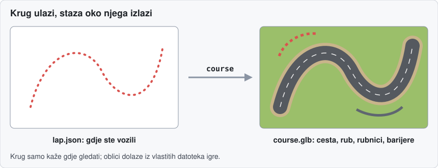
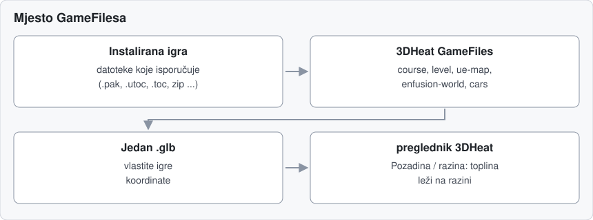

# 3DHeat GameFiles {#dheat-gamefiles}

**Što je to?** Alat koji gradi 3D model staze za utrke ili razine igre iz datoteka igre koju već imate instaliranu.

**Zašto bih ga koristio?** Preglednik 3DHeat boji gdje ste vozili ili igrali kao toplinsku kartu. Uz ovaj alat boji je na pravoj stazi ili razini, a ne u praznom prostoru.

**Primjer:** uzmite krug koji ste vozili. Alat gradi cestu i teren oko njega kao jednu 3D datoteku, pa preglednik može obojiti vašu brzinu ili sudare na pravoj stazi:



Ne znate ništa o naredbenom retku? Počnite s [Prije nego što počnete](before-you-start.md).

Detaljnije: čita podatke o razinama iz arhiva koje igra isporučuje i zapisuje ih kao binarnu glTF (`.glb`) datoteku. Njegov glavni posao je **izvoz staze**: dajete mu krug, a on zapisuje teren, cestu odvojenu od ruba i trave, te rubnike, barijere, gume, znakove i zgrade oko nje.

Dio je [3DHeata](https://github.com/Holdi601/3DHeat), preglednika za toplinske karte telemetrije u stvarnom vremenu, analizu utrka i pregled meča
([dokumentacija](https://holdi601.github.io/3DHeat/)). Datoteke `.glb` koje ovaj
alat piše razine su na kojima preglednik crta toplinsku kartu.



To je jedan od tri načina da geometriju razine dovedete u 3DHeat:

| Put | Treba | Daje |
|---|---|---|
| 3DHeat Unreal Exporter | Unreal projekt otvoren u uređivaču | točnu geometriju |
| 3DHeat GameCapture | ekran i snimku | procjenu |
| **3DHeat GameFiles** | **instaliranu, isporučenu igru** | **točnu geometriju, bez projekta** |

Python paket: `heat3d_gamefiles`. Repozitorij:
[Holdi601/3DHeat-GameFiles](https://github.com/Holdi601/3DHeat-GameFiles). Licenca: MIT.

## Što može {#what-it-can-do}

| Igra ili pogon | Izvoz staze (`course`) | Čitanje arhiva |
|---|---|---|
| Forza Horizon (ForzaTech) | da: teren, cesta i rub, tekstura tla, postavljeni modeli u vlastitim teksturama | `identify`, `list`, `extract` nad `.minizip`; `identify` nad `.modelbin`; modeli, teren i teksture kroz `course` i `terrain` |
| BeamNG.drive | da: teren, dekali ceste, modelirane staze, postavljeni modeli, voda | `identify`, `list`, `extract` nad zip razinama; `identify` nad `.ter`, `.cdae`; `.dae` kroz `course` |
| Assetto Corsa Rally (Unreal 5.6) | da: pločice tla dionice, zapečena boja tla, postavljeni modeli u ravnim bojama | `identify`, `list`, `extract` nad IoStore `.utoc`/`.ucas`; zen paketi, statičke mreže, teksture kroz `course` |
| Unreal `.pak` (verzije 8-12) | ne | `identify`, `list`, `extract` |
| Unity (format 22 i noviji) | ne | `identify`, `meshes` |
| Battlefield 6 (Frostbite `.toc`/`.cas`) | bez kruga; cijela razina s `level`: teren, postavljene mreže, njihove karte boja uz `--textures` | `identify`, `levels`; snopovi, mreže, teren, teksture i raspored kroz `level` |
| Source 2 `.vpk` | ne | `identify`, `list`, `extract` |
| Unreal 5 igre World Partition | bez kruga; cijela karta s `ue-map` (popisana s `ue-maps`): teren, HLOD zgrade i rekviziti, voda | - |
| Arma Reforger (Enfusion) | bez kruga; cijeli svijet s `enfusion-world` (popisan s `enfusion-worlds`): teren u svojim bojama, more, zgrade kao kvadri | - |
| Forza (automobili) | `cars`: svaki automobil u niskom detalju, za karticu Analiza utrke u pregledniku | - |

Krugovi iz Assetto Corsa EVO i iRacinga odbijaju se uz razlog. Vidi
[Ograničenja i poznati nedostaci](limits-and-known-gaps.md).

## Instalacija {#install}

Ne znate ništa o naredbenom retku? Prvo pročitajte [Prije nego što počnete](before-you-start.md).

Treba vam **Python 3.10 ili noviji** (razvijeno na 3.13) i paketi iz
[`requirements.txt`](https://github.com/Holdi601/3DHeat-GameFiles/blob/main/requirements.txt).

```
git clone https://github.com/Holdi601/3DHeat-GameFiles.git
cd 3DHeat-GameFiles
pip install -r requirements.txt
```

Zatim provjerite: `python -m heat3d_gamefiles --help`. Trebali biste vidjeti
`usage: heat3d_gamefiles [-h]` i popis naredbi. Pokrećite svaku naredbu iz
mape repozitorija, kao `python -m heat3d_gamefiles <verb>`.

| Paket | Za što |
|---|---|
| numpy | sve što dekodira geometriju |
| lz4 | Forza arhive (uglavnom LZ4 blokovi), neki Unity snopovi, IoStore LZ4 blokovi |
| Pillow | dekodiranje BC1-BC7 tekstura, pisanje JPEG tekstura u `.glb` |
| msgpack, zstandard | BeamNGovi kompajlirani oblici (`.cdae`) |
| cryptography | samo za otvaranje šifriranog `.pak`-a ključem koji već imate |
| pytest | testovi |

Unreal sadržaj komprimiran s **Oodle** treba Oodle biblioteku koja je već na vašem računalu. Nijedna se ne isporučuje s ovim alatom. Vidi [Oodle](reader-oodle.md).

Alat je pisan za Windows. Pronalazi igre preko popisa Steam biblioteka i `%LOCALAPPDATA%`, a Oodle učitava kao Windows DLL. Ostale platforme nisu testirane.

## Brzi početak {#quick-start}

**Datoteka kruga** je zapis gdje je vaš automobil išao: popis točaka x, y, z.
Dolazi iz [3DHeat GameCapture](https://github.com/Holdi601/3DHeat-GameCapture)
ili iz knjižnice krugova aplikacije FH Companion; ručno upisani CSV također radi
([Ulazni podaci kruga](lap-inputs.md)).

```
# Forza: datoteka kruga, mapa krugova ili ime staze iz knjižnice FH Companion
python -m heat3d_gamefiles course "Example Circuit"
python -m heat3d_gamefiles course path\to\lap.json -o course.glb

# BeamNG.drive ili Assetto Corsa Rally: datoteka heat3d-lap kaže iz koje je igre
python -m heat3d_gamefiles course my_lap.json

# Svaka staza iz knjižnice FH Companion, po jedan .glb
python -m heat3d_gamefiles courses -o courses

# Battlefield 6: popišite razine, zatim izvezite jednu (velika datoteka; vidi Naredbe)
python -m heat3d_gamefiles levels
python -m heat3d_gamefiles level <level> -o level.glb --textures

# Unreal 5 World Partition i Arma Reforger: popišite, zatim izvezite
python -m heat3d_gamefiles ue-maps "<game>"
python -m heat3d_gamefiles ue-map "<game>" <map> -o map.glb
python -m heat3d_gamefiles enfusion-worlds
python -m heat3d_gamefiles enfusion-world <world> -o world.glb

# Svaki Forza automobil, za karticu utrka preglednika
python -m heat3d_gamefiles cars -o forza.h3dcars

# Što je ova datoteka?
python -m heat3d_gamefiles identify some_archive.pak
```

Otvorite `.glb` u pregledniku 3DHeat. Svjetske koordinate igre se čuvaju
(vidi [Format izlaza](output-format.md)), pa se snimljeni krug poklapa sa stazom.

## Karta ove dokumentacije {#map-of-this-documentation}

- [Prije nego što počnete](before-you-start.md): Python, terminal, prva naredba.
- [Naredbe](commands.md): svaka naredba i opcija, s primjerima.
- [Referenca naredbi](../cli-reference.md): `--help` svake naredbe, generirano iz koda.
- [Pregled arhiva](inspecting-archives.md): `identify`, `list`, `extract`, `meshes`, korak po korak.
- [Izvoz staze](course-export.md): kako krug postaje stazom, za sve igre.
  - [Forza Horizon](course-forza-horizon.md)
  - [BeamNG.drive](course-beamng.md)
  - [Assetto Corsa Rally](course-assetto-corsa-rally.md)
  - [Razine detalja i proračun](detail-budget.md)
- [Cijele razine](whole-levels.md): razina, karta ili svijet bez kruga.
  - [Battlefield 6 razine](level-battlefield.md): `levels`, `level`
  - [Unreal 5 karte](level-unreal-world-partition.md): `ue-maps`, `ue-map`
  - [Arma Reforger svjetovi](level-arma-reforger.md): `enfusion-worlds`, `enfusion-world`
- [Forza automobili](forza-cars.md): `cars`, datoteka automobila za karticu utrka preglednika.
- [Ulazni podaci kruga](lap-inputs.md): svaki oblik datoteke kruga koji alat prihvaća.
- [Format izlaza](output-format.md): što je unutar `.glb`-a.
- [Čitači arhiva](archive-readers.md): jedna stranica po vrsti spremnika, što koji čita,
  što ne čita i zašto.
- [Ograničenja i poznati nedostaci](limits-and-known-gaps.md)
- [Rješavanje problema](troubleshooting.md): poruke o greškama i što učiniti.
- [Pravila i licence](rules-and-licences.md): bez ključeva, vaše vlastite datoteke, bez dalje distribucije.
- [Ažuriranja](updates.md): provjera ažuriranja i `heat3d_update`.
- [Razvoj](development.md): karta modula i testovi, uključujući testove koji rade nad instaliranim igrama.
- [Održavanje](maintaining.md): popis za izdavanje verzije ovih stranica.

## Dio 3DHeata {#part-of-3dheat}

3DHeat GameFiles je jedan od besplatnih alata oko preglednika 3DHeat:

| Alat | Što radi | Dokumentacija |
|---|---|---|
| [3DHeat](https://github.com/Holdi601/3DHeat) | preglednik: 3D toplinske karte, analiza utrka i pregled meča u pregledniku | [stranica](https://holdi601.github.io/3DHeat/) |
| [GameFiles](https://github.com/Holdi601/3DHeat-GameFiles) | staze i razine iz datoteka koje igra isporučuje, kao `.glb` | [stranica](https://holdi601.github.io/3DHeat-GameFiles/) |
| [GameCapture](https://github.com/Holdi601/3DHeat-GameCapture) | telemetrija krugova iz igara utrka; razine rekonstruirane iz snimki igranja | [stranica](https://holdi601.github.io/3DHeat-GameCapture/) |
| [Unreal Exporter](https://github.com/Holdi601/3DHeat-UnrealExporter) | dodatak za Unreal Editor koji razinu sprema kao `.glb` | [stranica](https://holdi601.github.io/3DHeat-UnrealExporter/) |
| [CS2](https://github.com/Holdi601/3DHeat-CS2) | demoi Counter-Strike 2 u datoteke meča; karte u `.glb` | [stranica](https://holdi601.github.io/3DHeat-CS2/) |
| [Watcher](https://github.com/Holdi601/3DHeat-Watcher) | bilježi vaše igranje u pozadini iz onoga što igre objavljuju | [stranica](https://holdi601.github.io/3DHeat-Watcher/) |
| [Ext-WarThunder](https://github.com/Holdi601/3DHeat-Ext-WarThunder) | War Thunder replay-i u datoteke meča | [stranica](https://holdi601.github.io/3DHeat-Ext-WarThunder/) |
| [Ext-WoT](https://github.com/Holdi601/3DHeat-Ext-WoT) | World of Tanks replay-i u datoteke meča | [stranica](https://holdi601.github.io/3DHeat-Ext-WoT/) |
| [Ext-WoWs](https://github.com/Holdi601/3DHeat-Ext-WoWs) | World of Warships replay-i u datoteke meča | [stranica](https://holdi601.github.io/3DHeat-Ext-WoWs/) |
| [Ext-Squad](https://github.com/Holdi601/3DHeat-Ext-Squad) | demoi Squad servera u datoteke meča | [stranica](https://holdi601.github.io/3DHeat-Ext-Squad/) |
| [Ext-DCS](https://github.com/Holdi601/3DHeat-Ext-DCS) | karte DCS Worlda u `.glb` razine | [stranica](https://holdi601.github.io/3DHeat-Ext-DCS/) |
| [Ext-IL2](https://github.com/Holdi601/3DHeat-Ext-IL2) | karte IL-2 Sturmovik u `.glb` razine | [stranica](https://holdi601.github.io/3DHeat-Ext-IL2/) |

Svaki čitač igre zaseban je mali projekt s vlastitom datotekom licence, vlastitim izdanjima i vlastitim sustavom prijava, pa se može instalirati, ažurirati, održavati - ili povući na zahtjev nositelja prava - zasebno, bez utjecaja na preglednik i ostale alate.

Datoteke meča preglednika opisane su u
[Jedna datoteka po meču: `.3dheat`](https://holdi601.github.io/3DHeat/container.html);
razina napravljena ovdje učitava se uz njih u panelu Pozadina / razina preglednika.
