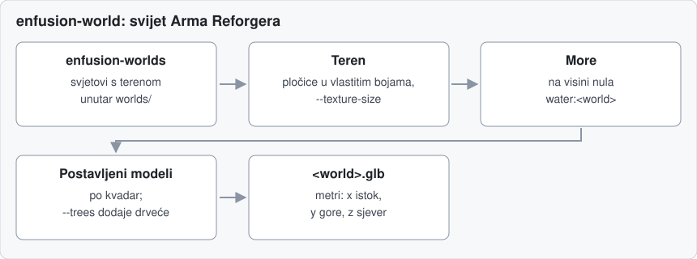

# Svjetovi Arma Reforger: `enfusion-worlds` i `enfusion-world` {#arma-reforger-worlds-enfusion-worlds-and-enfusion-world}

**Što je to?** Cijeli svijet Arma Reforgera kao jedna 3D datoteka. **Zašto?** Da toplina
iz igre ima teren i zgrade ispod sebe. (*Enfusion* je pogon u kojem je napravljen Arma
Reforger; *svijet* je ono što igra zove kartom.)

Izvozi cijeli Enfusion svijet instaliranog Arma Reforgera: teren u bojama vlastitih
pločica superteksture, more i svaki postavljeni model kao kutiju, u metrima same igre.



## Korak po korak {#step-by-step}

1. **Popišite svjetove** koji imaju teren:

   ```
   python -m heat3d_gamefiles enfusion-worlds
   python -m heat3d_gamefiles enfusion-worlds --install "D:\Games\Arma Reforger"
   ```

2. **Izvezite jedan**, po imenu njegove mape pod `worlds/`, kako je popisan:

   ```
   python -m heat3d_gamefiles enfusion-world <world> -o world.glb
   ```

3. **Varijante:**

   ```
   python -m heat3d_gamefiles enfusion-world <world> --trees               # i vegetacija, kao kutije
   python -m heat3d_gamefiles enfusion-world <world> --texture-size 0      # jednolika boja, mala datoteka
   python -m heat3d_gamefiles enfusion-world <world> --ground-spacing 4 --no-structures
   ```

4. **Otvorite `world.glb`** u panelu Pozadina / razina 3DHeat preglednika
   ([učitavanje razine](https://holdi601.github.io/3DHeat/levels.html)).

## Opcije {#options}

| Opcija | Zadano | Značenje |
|---|---|---|
| `<world>` | obavezno | svijet kako ga ispisuje `enfusion-worlds` |
| `-o`, `--out FILE` | `<world>.glb` | datoteka koja se piše |
| `--install FOLDER` | Steam biblioteka koja sadrži igru | mapa igre |
| `--ground-spacing METRES` | 2 (vlastiti razmak terena) | razmak vrhova terena u datoteci |
| `--texture-size PIXELS` | 4096 | veća stranica slike boje tla; 0 za jednolike boje |
| `--no-structures` | | izostavi postavljene modele |
| `--trees` | isključeno | postavi i drveće i ostalu vegetaciju, kao kutije |

## Primjer izlaza {#example-output}

```text
<world> -> world.glb
  ground      <n> triangles, <w> x <h> m; <n> of <n> tile-edge vertices disagree; colour <w> x <h>
  structure   <n> boxes from <n> entities
  water       <n> triangles (the sea)
  left out    <what>: <n>, ...
```

## Dijelovi {#the-parts}

`ground:<world>` (teren), `water:<world>` (more, na visini nula) i `structure:<world>`
(kutije). Koordinate su igrine: x istok, y gore, z sjever, u metrima, što pokazuje
snimka iz igre. Lijevo orijentirani koordinatni sustav igre; *Obrni os svijeta* u
pregledniku prikazuje ga nezrcaljeno.

## Kako se čita i provjerava {#how-it-is-read-and-checked}

Nije potreban Workbench i ništa nije šifrirano.

| Format | Što je | Provjereno prema |
|---|---|---|
| `.pak` | spremnik podataka i stablo direktorija, unosi pohranjeni ili zlib | stablo potroši svoj spremnik točno; uzorkovani zlib unosi se raspakiraju u točno svoju navedenu veličinu |
| `.edds` | DDS zaglavlje, pa po mip razini `COPY` ili `LZ4 ` dijelovi | razine podijeljene na dijelove dekodiraju se u točnu veličinu koristeći točno svoje bajtove |
| `.terr` / `.ttile` | zaglavlje i pločice 16-bitnih visina | svaki zajednički rub pločica se točno slaže |
| superteksture | boja tla svake pločice, oko jednog metra po pikselu | slaže se s morem u visinama; nijedan okret ili transpozicija ne pristaje bolje |
| `.ent` | imena, GUID-ovi resursa, pa entiteti kao tipizirane vrijednosti | datoteka svijeta se parsira do zadnjeg bajta |
| `resourceDatabase.rdb` | GUID u putanju | gotovo svaki GUID koji svijet koristi imenuje datoteku koja postoji |

Objekti označeni kao da stoje na apsolutnoj visini nalaze se unutar centimetara od
dekodiranog terena (s transponiranom mrežom bili bi metrima daleko). Nije crtano:
vlastiti trokuti modela, drveće po zadanim postavkama (`--trees` ih dodaje kao kutije),
podređeni entiteti, jezera i rijeke, teksture sa zaglavljima prije DX10.

**Pojmovi:** licenca igre dopušta nekomercijalnu upotrebu i zabranjuje obrnuto
inženjerstvo datoteka igre. Čitanje vlastite instalacije je vaša odluka unutar nje;
izlaz je za vašu vlastitu upotrebu i ne smije se dijeliti.
