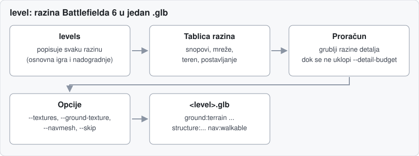

# Razine Battlefield 6: `levels` i `level` {#battlefield-6-levels-levels-and-level}

**Što je to?** Cijela razina Battlefield 6 kao jedna 3D datoteka. **Zašto?** Da toplina
iz vaših mečeva ima teren i zgrade ispod sebe. (*Frostbite* je pogon u kojem je
napravljen Battlefield; *visinsko polje* je teren spremljen kao mreža visina.)

Izvozi cijelu Frostbite razinu instalirane igre: visinsko polje terena, svaki model koji
njezine grupe statičkih modela postavljaju, objekte postavljene pojedinačno, pozadinu
terena oko karte i, na zahtjev, mape boja površina, dekale terena zapečene u tlo te
hodajuće površine vojnika.



## Korak po korak {#step-by-step}

1. **Popišite razine** koje igra isporučuje:

   ```
   python -m heat3d_gamefiles levels
   python -m heat3d_gamefiles levels --install "D:\Games\<game folder>"
   ```

   Svaki redak je tablica razine (`levels/<level>/<level>.toc`) s veličinom i mjestom
   odakle dolazi: `Data` za osnovnu igru, `Update/<pack>` za nadogradnju.

2. **Izvezite jednu**, po imenu, jedinstvenom dijelu imena ili njezinoj `.toc` putanji.
   Počnite bez teksture da vidite oblik i veličinu:

   ```
   python -m heat3d_gamefiles level <level> -o level.glb
   ```

3. **Dodajte boju** kad izgleda dobro:

   ```
   python -m heat3d_gamefiles level <level> -o level.glb --textures 512 --ground-texture 0.5
   ```

4. **Dodajte hodajuće površine**, ili smanjite datoteku:

   ```
   python -m heat3d_gamefiles level <level> --textures 512 --ground-texture 0.5 --navmesh
   python -m heat3d_gamefiles level <level> --textures 256 --detail-budget 3000000 --ground-spacing 8
   ```

5. **Otvorite `level.glb`** u panelu Pozadina / razina 3DHeat preglednika
   ([učitavanje razine](https://holdi601.github.io/3DHeat/levels.html)).

## Opcije {#options}

| Opcija | Zadano | Značenje |
|---|---|---|
| `<level>` | obavezno | ime kako ga ispisuje `levels`, jedinstveni dio imena, ili `.toc` razine |
| `-o`, `--out FILE` | `<level>.glb` | datoteka koja se piše |
| `--install FOLDER` | pronađeno u Steam bibliotekama | mapa igre |
| `--textures [PIXELS]` | isključeno; 512 bez veličine | mapa boja svake površine, najviše PIXELS po stranici |
| `--ground-texture [METRES]` | isključeno; 0,5 bez veličine | zapeći ceste, platoe i oznake u boju tla, METRES po pikselu |
| `--navmesh` | isključeno | dodati navigacijsku mrežu vojnika kao `nav:walkable` |
| `--ground-spacing METRES` | 4 | najfiniji razmak visinskog polja; 0 ga izostavlja |
| `--detail-budget N` | najgrublje kopije plus četvrtina, najmanje 1 500 000 | gornja granica trokuta (teren se nikad ne zgrubljuje) |
| `--skip TEXT` | | izostavi grupe modela čiji naziv particije sadrži TEXT; može se ponavljati |
| `--by-mesh` | isključeno | jedan dio po izvornoj mreži i materijalu, za pronalaženje što je koji dio |
| `--clamped-uvs` | isključeno | za renderere koji ne mogu ponavljati teksturu |

Potpuna tablica, s veličinama koje treba očekivati (cijela razina je stotine MB), nalazi
se na [Naredbe](commands.md#levels-and-level-frostbite). Kako se čitaju tablice,
paketi, mreže i teren, opisano je na [Frostbite](reader-frostbite.md).

## Primjer izlaza {#example-output}

Što ispisuje `level`, u obrisu (redovi kako ih piše kod; `<n>` i imena variraju ovisno o
razini):

```text
<n> copies of <n> meshes, from <n> static model groups
      <n>  <group>
      <n>  placed one by one (object and prefab references)
<n> meshes left out: <why>
<n> triangles, budget <n>; <n> meshes drawn at a coarser level to fit
           <n>  ground:terrain
           <n>  structure:buildings, <n> textures
           ...
<n> of <n> drawn sections carry their colour map; the rest are flat colours
Ground: <what the ground is>.
Navigation mesh: <tiles read>.
-> level.glb (<n> MB)
```

## Dijelovi {#the-parts}

`ground:terrain` (visinsko polje), `ground:terrain backdrop` i `ground:terrain blend`,
`structure:<vrsta>` po vrsti mreže (po mapi boja uz `--textures`, uz ` (destructible)`
za ono što se može uništiti u meču), i `nav:walkable` uz `--navmesh`. Vidi
[Format izlaza](output-format.md).

Datoteka sadrži sadržaj igre: namijenjena je računalu na kojem je napravljena, a ne za
prosljeđivanje ([Pravila i licence](rules-and-licences.md)).
