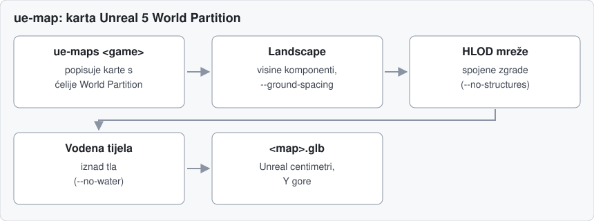

# Unreal 5 karte World Partition: `ue-maps` i `ue-map` {#unreal-5-world-partition-maps-ue-maps-and-ue-map}

**Što je to?** Cijela karta Unreal 5 igre kao jedna 3D datoteka: teren, zgrade i voda.
**Zašto?** Da toplina iz te igre ima kartu ispod sebe. (*World Partition* je način na
koji Unreal 5 dijeli veliku kartu na dijelove; *HLOD* je pojednostavljena zamjena za
skupinu zgrada, ona koju igra crta izdaleka.)

Izvozi cijelu kartu Unreal 5 igre čije su karte pečene kao World Partition ćelije:
krajolik, spojene HLOD mreže karte (njezine zgrade i rekviziti kako ih igra crta izdaleka)
i njezina vodena tijela. Nisu potrebni ni urednik ni projekt, samo instalirana igra.



## Korak po korak {#step-by-step}

1. **Popišite karte.** `<game>` je mapa igre, njezin `Content/Paks`, ili ime njezine mape
   u Steam biblioteci:

   ```
   python -m heat3d_gamefiles ue-maps "<Steam game folder name>"
   python -m heat3d_gamefiles ue-maps "D:\Games\<game>"
   ```

   Ispisuje se svaka karta s pečenim World Partition ćelijama, s putanjom paketa.

2. **Izvezite jednu** po imenu ili jedinstvenom dijelu imena:

   ```
   python -m heat3d_gamefiles ue-map "<game>" <map> -o map.glb
   ```

3. **Samo tlo, ili grublje:**

   ```
   python -m heat3d_gamefiles ue-map "<game>" <map> --no-structures --no-water
   python -m heat3d_gamefiles ue-map "<game>" <map> --ground-spacing 4
   ```

4. **Otvorite `map.glb`** u panelu Pozadina / razina 3DHeat preglednika
   ([učitavanje razine](https://holdi601.github.io/3DHeat/levels.html)).

## Opcije {#options}

| Opcija | Zadano | Značenje |
|---|---|---|
| `<game>` | obavezno | mapa igre, njezin `Content/Paks`, ili njezina mapa u Steamu |
| `<map>` | obavezno | ime kako ga ispisuje `ue-maps`, ili jedinstveni dio imena |
| `-o`, `--out FILE` | `<map>.glb` | datoteka koja se piše |
| `--ground-spacing METRES` | 2 | razmak vrhova krajolika, zaokružen na cijeli broj njegovih vlastitih četverokuta |
| `--no-structures` | | izostavi HLOD zgrade i rekvizite |
| `--no-water` | | izostavi vodena tijela |

Sadržaj komprimiran Oodleom treba Oodle biblioteku već instaliranu na računalu (vidi
[Oodle](reader-oodle.md)).

## Primjer izlaza {#example-output}

```text
<map> -> map.glb
  ground      <n> triangles from <n> landscape components; <n> of <n> vertices stored twice disagree
  structure   <n> triangles in <n> HLOD meshes
  water       <n> triangles from <n> water bodies
```

Broj neslaganja je samoprovjera: susjedne komponente krajolika spremaju svoj zajednički
rub dvaput, i oba se moraju podudarati. Karta od 3 km na 2 m ima oko 4,6 milijuna
trokuta tla.

## Dijelovi {#the-parts}

`ground:<map>` (krajolik), `structure:<map>` (HLOD mreže) i `water:<map>` (voda koja stoji
iznad tla).

**Jedinice:** ovo je jedini izvoz **koji nije u metrima**: Unreal centimetri, s
zamijenjenim Y i Z (Y gore), okvir koji piše 3DHeat Unreal Exporter. Telemetrija iz iste
igre koristi isti okvir, pa leži na karti.

## Kako se čita i provjerava {#how-it-is-read-and-checked}

| Dio | Čita se iz | Provjereno prema |
|---|---|---|
| tlo | 16-bitne visinske mape svake komponente krajolika, smještene prema bazi odjeljka na transformaciji krajolika | svaki vrh spremljen dvaput (na šavu ili rubu komponente) mora se slagati; neslaganja se broje i ispisuju, ne glade se |
| structure | spojene HLOD mreže karte, koje motor gradi u svjetskom prostoru | mreža se zadržava samo ako granice koje njezina komponenta sprema opisuju njezine vlastite vrhove |
| water | mreža svakog vodenog tijela, položena na mrežu tla, zadržana tamo gdje stoji iznad tla | voda stoji nekoliko metara iznad tla ispod, kao što rijeka stoji iznad svog korita |

Svojstva krajolika pronalaze se po obliku, a ne po broju mjesta (mjesta se pomiču među
verzijama motora). Strukture su pojednostavljene zamjene, a ne punodetaljni modeli.
Vegetacija, dekali i materijali krajolika se ne izvoze; tlo je bez teksture i sjenčano je
u pregledniku. Detalji arhive: [Unreal 5 IoStore](reader-unreal-iostore.md).

**Pojmovi:** licence igara obično dopuštaju osobnu, nekomercijalnu upotrebu i zabranjuju
obrnuto inženjerstvo "to the extent that such actions cannot be prohibited by law" (u mjeri u kojoj se takve radnje ne mogu zabraniti zakonom). Čitanje
vlastite instalacije je vaša odluka unutar njih; izlaz je za vašu vlastitu upotrebu i ne
smije se dijeliti.
