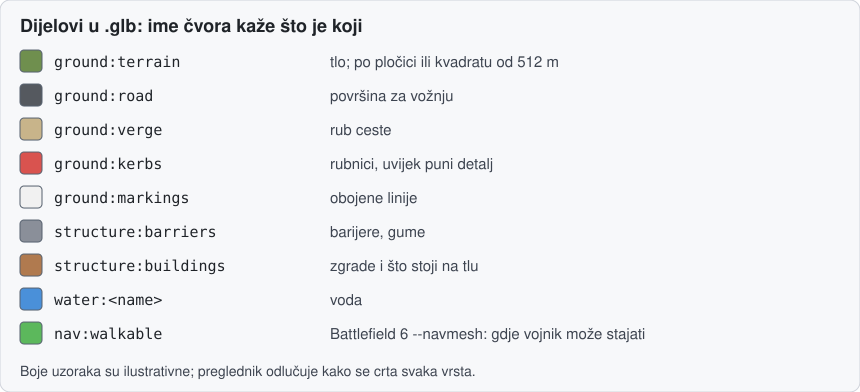

# Format izlaza {#output-format}

`.glb` je jedna 3D datoteka: teren, zgrade i voda staze ili razine, koju otvarate u panelu **Pozadina / razina** 3DHeat preglednika.

Svaki izvoz (`course`, `courses`, `terrain`, `level`, `ue-map`, `enfusion-world`) piše jednu **binarnu glTF 2.0** datoteku (`.glb`). Namjerno je mala i ravna te je posložena onako kako 3DHeat preglednik čita razinu. Izvor: [`glb.py`](https://github.com/Holdi601/3DHeat-GameFiles/blob/main/heat3d_gamefiles/glb.py).

## Struktura {#structure}

```
scene 0
 ├─ node "ground:terrain x-2046 z1023"  -> mesh 0 -> 1 primitive, material 0
 ├─ node "ground:road x-2046 z1023"     -> mesh 1 -> 1 primitive, material 1
 ├─ node "ground:markings"               -> mesh 2 -> ...
 ├─ node "ground:kerbs road_gen_rum_..." -> ...
 ├─ node "structure:barriers bar_armco_bclr"
 └─ ...
```

- **Jedan čvor po dijelu**, svi u korijenu scene, bez **transformacija**. Sva geometrija je već u prostoru svijeta.
- Svaki čvor ima vlastitu mrežu s **jednim primitivom** i vlastiti materijal. Čvor, mreža i materijal nose ime dijela.
- Svaki primitiv ima **vlastite zbijene nizove vrhova**, samo vrhove koje dio koristi. Zajednički niz vrhova je dopušten glTF, ali bi čitač koji proširuje pristupnike svakog primitiva tada držao svaki vrh jednom po dijelu.
- `asset.generator` je `heat3d_gamefiles`.
- **Malo `extras`**, i nikakvo ime kruga, igre ili staze:
  - dio Battlefield 6 uništive mreže nosi `{"destructible": true}` na svom čvoru;
  - Forza staza kaže što sadrži u `asset.extras` (verzija formata, id podudarene rute, koliko kopija sloja vlastite utrke, mjesta održavanja; vidi [Forza Horizon staze](course-forza-horizon.md#writing-the-file)), a njezini uključeni dijelovi nose svoj sloj na čvoru: `{"layer": "event", "route": <id>}` za sloj vlastite utrke, `{"layer": "layer"}` za drugi uključeni sloj, `{"layer": "venue"}` za tlo mjesta održavanja.

  Sve ostalo što preglednik treba nalazi se u imenima čvorova.

## Imena čvorova: razvrstavanje {#node-names-the-classification}



Preglednik uzima razred dijela iz imena **čvora** (ili, ako nema, imena mreže), i to samo kada se ime podudara s

```
^(ground|structure|water)\s*[:|]
```

Sve drugo razvrstava se heuristikom napisanom za Unreal krajolike. Zato svaki dio koji izvoznik piše počinje jednim od ovih prefiksa, ili s `nav:` (dolje):

| Prefiks | Značenje | Dijelovi koji se pišu |
|---|---|---|
| `ground:` | površina vožnje i zemljište | `ground:road`, `ground:verge`, `ground:terrain`, `ground:gravel and dirt`, `ground:kerbs`, `ground:markings`, `ground:tyre marks`, `ground:venue`, `ground:plinths` |
| `structure:` | što stoji na njoj | `structure:barriers`, `structure:props`, `structure:signs`, `structure:buildings`, `structure:infrastructure`, `structure:bridges`, `structure:rocks`, `structure:smashables`, `structure:trees`; Forza slojevi `structure:event_<category>` i `structure:layer_<category>` |
| `water:` | voda | `water:water`; `water:<map>` (`ue-map`), `water:<world>` (`enfusion-world`) |
| `nav:` | gdje vojnik može hodati (Battlefield 6, samo uz `--navmesh`) | `nav:walkable` |

`nav:` se ne podudara s uzorkom preglednika iznad, pa ga preglednik razvrstava svojom heuristikom; to je zaseban dio da ga možete prikazati ili sakriti samostalno. `ue-map` piše `ground:<map>`, `structure:<map>` i `water:<map>`; `enfusion-world` piše `ground:<world>`, `structure:<world>` i `water:<world>`.

Nakon vrste dolazi, ovisno o igri:

| Primjer | Značenje |
|---|---|
| `ground:road x-2046 z1023` | Forza tlo u pločici terena imenovanoj `x-2046 z1023` (jedinice mreže, 1023 po 512 m) |
| `ground:road 3_-2` | BeamNG tlo u kvadratu od 512 m (3, -2) |
| `ground:road 3_-2 asphalt_light` | BeamNG modelirana površina vožnje materijala `asphalt_light` u tom kvadratu |
| `ground:road 1_-4` | AC Rally tlo u kvadratu od 512 m (1, -4) Unreal prostora |
| `structure:barriers bar_armco_bclr` | Forza postavljeni modeli koji dijele jednu teksturu (njezino ime bez GUID-a) |
| `structure:barriers` | postavljeni modeli bez teksture (Forza, AC Rally) |
| `structure:event_barriers bar_example_bclr` | Forza: ono što podudarena utrka postavlja za sebe, odvojeno od svijeta slobodne vožnje (dodaci čvora `{"layer": "event", "route": <id>}`) |
| `structure:layer_props` | Forza: sloj koji igra uključuje za nešto drugo osim te utrke (aktivnost, skupljalo, sloj za vrijeme izvođenja) |
| `ground:venue`, `ground:plinths` | Forza: modeli već u svjetskim koordinatama - vlastito tlo mjesta održavanja (pod stadiona) i tlo kojim je ulica uređena |
| `structure:barriers armco_metal` | BeamNG postavljeni modeli jednog materijala |
| `ground:markings`, `water:water` | ravni dijelovi, jedan za cijelu datoteku |
| `ground:terrain` (Battlefield 6) | visinsko polje; `ground:terrain backdrop` daleke mreže terena, `ground:terrain blend` mreže koje se stapaju s terenom |
| `nav:walkable` (Battlefield 6, `--navmesh`) | navigacijska mreža razine za vojnika: gdje se može stajati, ravno zeleno |
| `ground:terrain x-512 z-512` (Battlefield 6, `--ground-texture`) | visinsko polje pod jednom pečenom pločicom dekala, imenovano po donjem uglu pločice u metrima |
| `structure:buildings t_concreteclean_01_cs` (Battlefield 6, `--textures`) | svaka površina te vrste koja prikazuje tu kartu boja; bez `--textures`, jedan dio po vrsti, bez nastavka |
| `structure:buildings t_concreteclean_01_cs (destructible)` (Battlefield 6) | isto, za mreže koje utakmica može uništiti: one s vlastitom datotekom uništenja istog imena (zidovi, kuće, rekviziti). Čvor također nosi glTF dodatak `{"destructible": true}`. Njihova uništena stanja se ne izvoze |

Preglednik može filtrirati po tim imenima. Na primjer, "samo površina utrke" je `ground:road` zajedno s `ground:kerbs`, u sve tri igre, a "svijet bez rekvizita vlastite utrke" je sve osim `structure:event_*`. Prefiks je i način na koji preglednik crta dio: tlo kao površinu na kojoj leži toplinski prikaz, a struktura kao ono što na njoj stoji.

## Jedinice, osi i okvir {#units-axes-and-frame}

- **Metri, Y gore**, glTF-ova konvencija, za svaki izvoz osim `ue-map`. Ništa se ne skalira niti centrira ponovno: brojevi su svjetske koordinate igre, što je i smisao čitanja arhiva umjesto rekonstrukcije.
- **Unreal 5 karte (`ue-map`): centimetri**, vlastita Unreal jedinica, sa zamijenjenim Y i Z tako da je Y gore: okvir koji piše 3DHeat Unreal Exporter i koji koristi telemetrija igre. Jedini izvoz koji nije u metrima.
- **Arma Reforger (`enfusion-world`):** metri same igre, x istok, y gore, z sjever. Okvir igre je lijevoruk; opcija **Obrni os svijeta** u pregledniku ga prikazuje nezrcaljeno.
- **Forza:** svjetske koordinate same igre (x, y gore, z), nepromijenjene. Iste su kao njezina telemetrija, pa snimljeni krug leži na stazi.
- **BeamNG.drive:** `(x, z, -y)` BeamNG-ova svijeta s Z prema gore, što je rotacija koju primjenjuje snimač telemetrije. Rotacija, a ne zrcaljenje.
- **Battlefield 6:** svjetske koordinate same igre (x, y gore, z), nepromijenjene: transformacije instanci razine primijenjene na svaku mrežu kako su spremljene. Zrcaljene kopije se ponovno namataju tako da njihove normale pokazuju prema van.
- **Assetto Corsa Rally:** okvir kruga. Unreal centimetri postaju metri, Unreal Z postaje y, a Unreal X i Y postaju x i z u jednoj od osam orijentacija koju je krug pristajao (vidi [Assetto Corsa Rally](course-assetto-corsa-rally.md#which-stage-and-which-way-round)). Trokuti se ponovno namataju tamo gdje to preslikavanje zrcali.

Svaki izvoz zadržava osi koje koristi njegova telemetrija, pa snimka i razina dijele okvir. Nije provjereno je li taj okvir u svakoj igri lijevoruk ili desnoruk.

## Podaci o vrhovima {#vertex-data}

Zadani oblik je **kvantizirani** (`quantize=True`). Treba mu proširenje `KHR_mesh_quantization`, navedeno i u `extensionsUsed` i u `extensionsRequired`.

| Atribut | Kvantizirano (zadano) | Puna preciznost (`quantize=False`) |
|---|---|---|
| `POSITION` | float32 VEC3, s min/max | float32 VEC3 |
| `NORMAL` | int8 VEC3 normaliziran, dopunjen na 4 bajta (korak 4) | float32 VEC3 |
| `TEXCOORD_0` (samo teksturirani dijelovi) | uint16 VEC2 normaliziran, ograničen na 0-1; float32 VEC2 gdje se teksture ponavljaju (Battlefield 6) | float32 VEC2 |
| `COLOR_0` (netekstrirani dijelovi, kada neki dio ima boju) | uint8 VEC3 normaliziran, dopunjen na 4 bajta | float32 VEC3 |
| indeksi | uint16 kada dio ima najviše 65,535 vrhova, inače uint32 | uint32 |

Vrh je 20 bajtova umjesto 32 (24 umjesto 44 s bojom). To skida trećinu s svake datoteke i razlika je između toga da se gradska staza učita u kartici preglednika i da se uopće ne učita. Cijena je manje od pola stupnja normale i 1/65,535 UV-a (petnaestina texela na 4,096 px). Naredbeni redak uvijek piše kvantizirani oblik. `write_glb(..., quantize=False)` u Pythonu piše drugi.

Normale dolaze iz igre gdje ih ona sprema (Forza teren i modeli, BeamNG oblici i teren). Inače se računaju kao glatke normale ponderirane površinom iz trokuta. AC Rally normale se uvijek računaju.

## Materijali, boje i teksture {#materials-colours-and-textures}

- Svaki materijal je `metallicFactor 0`, `roughnessFactor 1`.
- **Teksturirani dio:** `baseColorTexture` sa slikom dijela, UV-ovima i bez boje vrha. glTF ih množi, pa bi površina ispala dvostruko potamnjena.
- **Netekstrirani dio:** boja vrha `COLOR_0` s ravnom bojom dijela i bijelim `baseColorFactor`. Ako nijedan dio u datoteci nema boju, nema `COLOR_0`. Gdje dijelovi dijele vrhove, boja kasnijeg dijela pobjeđuje, pa se ravni dijelovi pišu redom rastuće važnosti.
- **Slike** su ugrađene u binarni dio kao **JPEG**, kvaliteta 90, bez smanjenja boje (chroma subsampling), samo RGB (alfa se odbacuje). Iznimka je karta izrezana za Battlefield 6 (lišće, ograde), koja je **PNG** s alfom, na materijalu s `alphaMode` MASK, `alphaCutoff` 0.5 i `doubleSided` (vidi [Frostbite](reader-frostbite.md#textures-and-materials)). Preglednik 3DHeat odbacuje texele ispod praga. Tlo od 2048 px s travom i krošnjama drveća je šum za koder bez gubitaka: nekoliko megabajta po pločici kao PNG, ispod jednog kao JPEG. Slika koju dijeli više dijelova sprema se jednom.
- Jedan uzorkivač za sve teksture: linearno povećanje, linearno-mipmap-linearno smanjenje, **clamp to edge** na obje osi, za izvoze staza, čije teksture pokrivaju svoje površine jednom. BeamNG crta ponavljajuće teksture modela kao ravne boje (vidi [BeamNG.drive](course-beamng.md#placed-models)).
- Izvoz Battlefield 6 s `--textures`, čiji se materijali popločavaju, piše izvorne UV koordinate igre, neograničene, kao float32 `TEXCOORD_0` čak i u kvantiziranom obliku, s uzorkivačem koji se **ponavlja** na obje osi (`write_glb(..., repeat=True)`): zid od opeke je jedan par trokuta čiji UV ide od 0 do 40. Preglednik 3DHeat omata takvu teksturu unutar svog atlasa (vidi njegovu stranicu *Model levels*). Za prikazivač koji ne može ponavljati teksturu, `level --clamped-uvs` (`write_level(..., clamped=True)`) reže svaki trokut duž linija na kojima se njegova tekstura ponavlja i pomiče svaki komad u 0..1: iste piksele na istoj površini, otprilike petinu više trokuta. Trokuti preko kojih se tekstura ponavlja više od 16 puta zadržavaju svoje koordinate. Trokut koji bi njegova tekstura rezala u više od 4 komada (kora koja se ponavlja niz svaku granu drveta; zbog takvog rezanja jedno stablo od 1,099 trokuta pretvorilo se u 51,735) ide u dio vlastit, `<part> (average colour)`, u prosječnoj boji teksture; `level` kaže koliko ih je.

| Tekstura | Veličina | Pokriva |
|---|---|---|
| tlo (sve igre osim Battlefield 6) | `--texture-size`: 2048, 1024 ili 512 px | jedan kvadrat od 512 m: 25, 50 ili 100 cm po pikselu |
| visinsko polje Battlefield 6 | najveći mip karte boja pozadine u razini, izrezan | kvadrat terena: 32 m po pikselu u provjerenoj razini |
| površine Battlefield 6 | `--textures`: najviše toliko px po strani | vlastita tekstura površine, jednom po komadu (rezana tamo gdje se ponavlja) |
| pečeno tlo Battlefield 6 | `--ground-texture`: metara po pikselu, pločice do 4,096 px | jedna pločica opsega dekala: 2,048 m uz 0.5 m po pikselu |
| postavljeni model Forze | najviše 256 px | vlastiti raspored UV-a modela |
| postavljeni model BeamNG-a | najviše 256 px | vlastiti raspored UV-a modela, samo gdje se ne ponavlja |
| postavljeni model AC Rally | nijedna | ravne boje |

## Što pisac odbija {#what-the-writer-refuses}

`write_glb` javlja grešku umjesto da zapiše datoteku koju bi preglednik otvorio i prikazao krivo:

| Odbijeno | Zato što |
|---|---|
| pozicije nisu N x 3 ili nisu konačne | neispravna mreža |
| indeks iza kraja popisa vrhova | prikazuje se kao šum |
| teksturirani dio kada datoteka nema UV-ova | prikazuje se kao jedan razmazani piksel |
| nema nijednog trokuta | prikazuje se kao ništa |
| niz normala, boja ili UV-a krive duljine ili nije konačan | treba jedan po vrhu |

## Čitanje drugdje {#reading-it-elsewhere}

Svaki glTF 2.0 preglednik koji podržava `KHR_mesh_quantization` trebao bi otvoriti ove datoteke. Provjeren je samo preglednik 3DHeat; drugi nisu provjereni. Čitač bez tog proširenja odbija datoteku, jer je označeno kao obvezno. Datoteke mogu biti velike: oko 80 MB za seosku stazu, do nekoliko stotina MB za gradsku stazu uz automatski proračun.

## U 3DHeat-u {#in-3dheat}

Učitajte `.glb` u panelu **Pozadina / razina** [3DHeat](https://github.com/Holdi601/3DHeat) preglednika; telemetrija koju snimite u istoj igri leži na njemu, jer oba zadržavaju koordinate igre. Vlastita dokumentacija preglednika ([holdi601.github.io/3DHeat](https://holdi601.github.io/3DHeat/)) pokriva panel Pozadina / razina i datoteke mečeva koje pišu ostali alati ([Jedna datoteka po meču: `.3dheat`](https://holdi601.github.io/3DHeat/container.html)). Razina nije spremljena u svakoj `.3dheat` datoteci: meč je imenuje u svojim `references` (`kind: "level"`, ime i sha256), a `.glb` ostaje pored mečeva.
