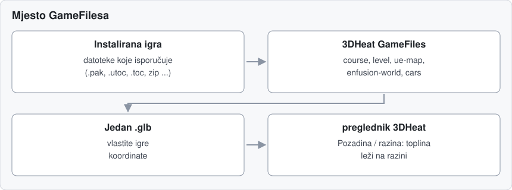

# Cijele razine {#whole-levels}

**Ukratko:** za pucačine i druge igre bez krugova, alat sprema cijelu kartu kao jednu 3D datoteku, pa preglednik može nacrtati gdje su igrači bili na njoj.

`course` izrezuje tlo oko kruga. Za igre bez krugova alatka izvozi cijelu razinu, kartu ili svijet odjednom:

| Igra ili pogon | Popis | Izvoz | Stranica |
|---|---|---|---|
| Battlefield 6 (Frostbite) | `levels` | `level <level>` | [Battlefield 6 razine](level-battlefield.md) |
| Unreal 5 igre s World Partition | `ue-maps <game>` | `ue-map <game> <map>` | [Unreal 5 karte](level-unreal-world-partition.md) |
| Arma Reforger (Enfusion) | `enfusion-worlds` | `enfusion-world <world>` | [Arma Reforger svjetovi](level-arma-reforger.md) |

Svaki par radi jednako: prvi glagol popisuje što instalirana igra ima, a drugi zapisuje jedan od tih svjetova kao jednu `.glb` datoteku u koordinatama svijeta same igre, pa se pozicije zabilježene u toj igri poklapaju s njim. Dijelovi se zovu `ground:`, `structure:` i `water:`, kao i svaki drugi izvoz (vidi [Format izlaza](output-format.md)). Učitajte datoteku u panelu **Pozadina / razina** u 3DHeat pregledniku.

