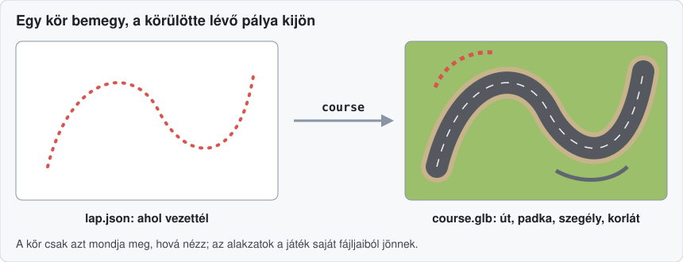
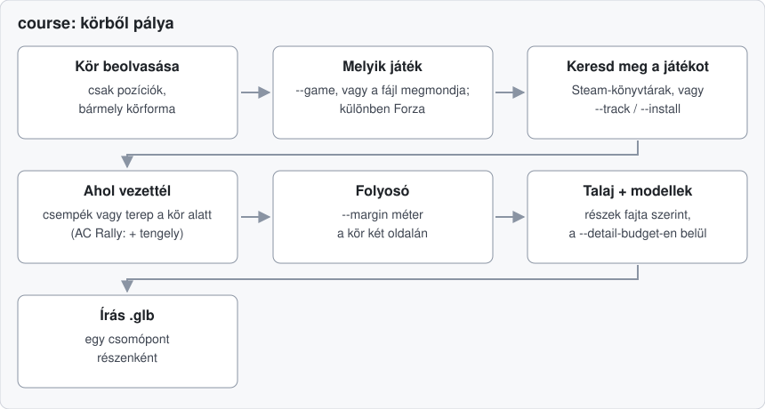

# Pályaexport {#course-export}

**Egyszerűen:** elvezettél egy kört; ez egy 3D-s fájlt épít a pályáról, amelyen mentél. A kör
csak pontok egy sora: az út, a fű és a szegélyek a játék saját fájljaiból jönnek.

A `course` egy kört pályává alakít: a talajt a kocsi útvonalának mindkét oldalán egy sávban,
és azt, ami ezen a talajon áll, egyetlen `.glb` fájlban a nézegetőnek. Ez az oldal azt
írja le, ami mind a három támogatott játékra közös. Az alatta lévő oldalak azt, ami
különbözik:

- [Forza Horizon](course-forza-horizon.md): ForzaTech `.minizip` archívumok
- [BeamNG.drive](course-beamng.md): zip-archívumok, terep magassági mezője, fordított alakzatok
- [Assetto Corsa Rally](course-assetto-corsa-rally.md): Unreal 5 IoStore, World Partition szakasz
- [Részletességi szintek és a keret](detail-budget.md): hány háromszöget kapnak az elhelyezett modellek, és mely példányok maradnak meg

## A lépések {#the-steps}

Az alábbi szavak jelentése: a **tengelyrendszer** azt mutatja, merre néznek a tengelyek; a
**sáv** a talaj sávja a kör két oldalán; egy **csempe** a játék terepének egy négyzet alakú
darabja; egy **LOD** (részletességi szint) egy modell egyszerűbb másolata.

1. **Olvasd be a kört.** Csak a pozíciók, bármelyik alak a [Körbemenetek](lap-inputs.md)
   oldalról. A sebességet és a bemeneteket nem használjuk. Ha a körnek két mintánál kevesebb
   van, az eszköz megáll („holds no driving").
2. **Döntsd el a játékot.** Először a `--game`, aztán a körfájl saját `game` mezője, végül a
   Forza (lásd: [Parancsok](commands.md#which-game)).
3. **Keresd meg a telepített játékot.** Mindhárom átnézi a Steam `config\libraryfolders.vdf`
   fájljában felsorolt Steam-könyvtárakat. A Forza emellett a `C:\XboxGames` mappát is
   átnézi. A `--track` (Forza) vagy `--install` (BeamNG, AC Rally) kihagyja a keresést.
4. **Keresd meg, hol mentél.** Ezt sosem csak névegyezés alapján döntjük el. A Forza azt a
   pályát választja, amelynek terepcsempéi lefedik a kört. A BeamNG azt a pályát, amelynek
   terepe (vagy útjai) a kör mintáin fekszenek. Az AC Rally minden szakaszt megpróbál nyolc
   tengelyirányban, és azt választja, amelyik a legtöbb kört az úton helyezi el.
5. **Vágj ki egy sávot** `--margin` méterrel a vezetett vonal mindkét oldalán (lent).
6. **Építsd meg a talajt** a sávon belül, osztályozva úti, szegély-, kavicsos és földes,
   terep-, jelölés-, gumiabroncs-nyom és víz részekre, és sütsd meg a talajtextúrát minden
   512 m-es négyzethez.
7. **Helyezd el a modelleket** a sávban álló elemeket, kategóriánként, távolság és
   háromszögkeret szerinti részletességi szinten.
8. **Írd ki a `.glb`-t**: egy nevesített csomópont minden részhez. Lásd: [Kimeneti formátum](output-format.md).

Egy futás kimenete – itt egy szintetikus BeamNG.drive telepítésen, amelyet a tesztek építenek,
egy 50 m-es kör egy úti csíkon –:

## A sáv {#the-corridor}

A kivágás a vezetett vonal körüli sáv, nem a kör határoló doboza. Egy körpályánál a kettő
szinte ugyanaz. Egy egy pontról pontra tartó sprintnél a doboz nagyrészt olyan lejtő, amely
mellett senki nem halad el, a sáv pedig a területének tizede lehet. Forrás:
[`corridor.py`](https://github.com/Holdi601/3DHeat-GameFiles/blob/main/heat3d_gamefiles/corridor.py).

Így épül fel:

- A vezetést a talajsíkra vetítjük: a kör x és z értékeit (BeamNG: a játék saját keretének x és y
  értékeit).
- **4 m-es** (`CELL`) cellákból álló rácsra rasztereljük. Minden cella, amelyet a vezetés
  érint, kiszélesedik egy `margin + 4 m` sugarú korong erejéig minden irányban.
- A **50 m-nél** (`JOIN`) közelebbi, egymást követő mintákat 4 méterenként pontokkal kötjük
  össze, hogy a sávnak ne legyen lyuk. A távolabbi mintákat a vezetés különálló szakaszainak
  tekintjük, és nem kötjük össze. A könyvtári pálya sok köri fájl egymás után, és egy sprint
  célja meg a következő sprint rajtja nem rajzolhat sávot a térképen át.
- Egy háromszöget akkor tartunk meg, ha bármely sarka, bármely élének felezőpontja vagy a
  súlypontja a sávban van. A felezőpontok elkapják azt a nagy háromszöget, amely keskeny sávon
  halad át úgy, hogy minden sarka kívül esik.
- A magasság soha nincs benne a vágásban. Egy magasságot határoló doboz kivágná a talajt a
  domb alól, amelyre az út felkapaszkodik.

A konzol jelenti a sáv területét, például
`cutting 80 m either side of the driving: 1.53 km2 of a 6,000 by 3,600 m box`.

A BeamNG és az AC Rally egy szélesebb **kiterjesztett sávot** is épít, `margin + 60 m`
szélességgel. Egy elhelyezett modellt akkor veszünk figyelembe, ha az origója a kiterjesztett
sávban van, és akkor rajzoljuk, ha a lábnyoma érinti a valódi sávot. Így egy hosszú tárgy,
amelynek origója éppen kívül esik a sávon, nem vész el. A BeamNG a kiterjesztett sávot arra is
használja, hogy eldöntse, mely úti matricákat fesse rá.

## Miből áll a talaj {#what-the-ground-is-made-of}

Minden export a talaj háromszögeit ugyanezekbe a fajtákba sorolja, és minden fajta külön
részként íródik, hogy a nézegető meg tudja mutatni vagy elrejteni:

| Fajta | Résznév | Egyszínű szín (lineáris RGB) | Forza | BeamNG | AC Rally |
|---|---|---|---|---|---|
| út | `ground:road` | 0.22, 0.22, 0.23 | úti csíkok: aszfalt rész | `ASPHALT` típusú rétegek, úti matricák, modellezett út | pályacsempék (`/MeshesTrack/`) |
| padka | `ground:verge` | 0.52, 0.47, 0.30 | úti csíkok: a váll | járdák és padka-modellek | - |
| kavics és föld | `ground:gravel and dirt` | 0.50, 0.42, 0.30 | - | föld-, kavics-, homok- és sárrétegek és matricák | - |
| terep | `ground:terrain` | 0.30, 0.44, 0.18 | minden más | minden más | `_Terrain` csempék és távoli terep |
| szegélykő | `ground:kerbs` | 0.60, 0.12, 0.10 (Forza) | `road_gen_rum*` kellékek | szegély-, járda- és rumble-modellek | szegély-modellek |
| jelölések | `ground:markings` | 0.90, 0.90, 0.88 | matrica-részek, 5 cm-rel felemelve | a textúrába festve | - |
| gumiabroncs-nyomok | `ground:tyre marks` | 0.20, 0.17, 0.16 | matrica-részek, 5 cm-rel felemelve | a textúrába festve | - |
| víz | `water:water` | 0.16, 0.34, 0.48 | vízanyagok | tengerfelület, víztömbök, folyók | - |

Az egyszínű színeket úgy választottuk, hogy egy pillantásra jól látszódjanak, nem azért, hogy a
játékhoz hasonlítsanak. Textúra nélküli részekhez és a textúrát figyelmen kívül hagyó
nézegetőkhöz használjuk őket. Forrás:
[`surfaces.py`](https://github.com/Holdi601/3DHeat-GameFiles/blob/main/heat3d_gamefiles/surfaces.py).

A talajrészek 512 m-es négyzetenként vannak felosztva, és minden négyzet saját sütött képet
kap, ezért a részek nevei hordozzák a négyzetet:

| Játék | Talajrész neve | Négyzetkulcs |
|---|---|---|
| Forza | `ground:road x-2046 z1023` | a terepcsempe rácsneve (1023-as lépésekben, lásd: [Forza Horizon](course-forza-horizon.md)) |
| BeamNG | `ground:road 3_-2` | `floor(x / 512)`, `floor(y / 512)` BeamNG-méterekben |
| AC Rally | `ground:road 1_-4` | `floor(x / 51200)`, `floor(y / 51200)` Unreal-centiméterekben |

## Ami rajta áll {#what-stands-on-it}

Az elhelyezett modellek `structure:<category>` nevű részekbe íródnak, a szegélykövek pedig
`ground:kerbs` néven (mindhárom játékban). Ha egy résznek saját textúrája van, a textúra vagy
anyag neve a kategóriát követi, például `structure:barriers bar_armco_bclr`.

| Kategória | Forza | BeamNG | AC Rally |
|---|---|---|---|
| korlátok | igen | igen | igen |
| kellékek | igen | igen | igen |
| táblák | igen | igen | igen |
| épületek | igen (egész épület-helyettesítők, ahol a játéknak van) | igen | igen |
| infrastruktúra | igen | igen | igen |
| hidak | igen | igen | (infrastruktúraként sorolva) |
| sziklák | igen | igen | igen |
| szegélykövek | igen, talajként | igen, talajként | igen, talajként |
| fák | `--trees`-szel | `--trees`-szel | `--trees`-szel |
| összetörhető elemek | `--trees`-szel | - | - |

A részletesség elosztása mindhárom játékban ugyanaz. A vezetéstől 25 m-en belüli példányok
teljes részletességgel indulnak, a 25–60 m-re lévők eggyel durvább szinten, a távolabbiak a
legdurvábban. Ezután a legköltségesebb modellek lejjebb lépnek, amíg egy háromszögkeret bele
nem fér. Ahol még a legdurvább szintek sem férnek bele egy megadott kerethez, példányokat
hagyunk ki. A szegélykövek soha nincsenek egyszerűsítve vagy kihagyva. Lásd:
[Részletességi szintek és a keret](detail-budget.md).

## Kimenetet alakító beállítások {#options-that-shape-the-result}

| Mit akarsz | Használd |
|---|---|
| kisebb fájlt | `--no-textures` (egyszínű), `--texture-size 1024` vagy `512`, `--detail-budget N`, `--margin 40` |
| csak a talajt | `--no-placed` |
| a díszletet is | `--trees` |
| más évszakot (Forza) | `--season winter` |
| Steam-on kívüli játékot | `--track` (Forza) vagy `--install` (BeamNG, AC Rally) |
| egy kört, amelyet a keresés nem helyez el | `--level` (BeamNG, AC Rally), `--track` (Forza) |

## Koordináták {#coordinates}

Minden export métert ír, Y felfelé, abban a keretben, amelyben ugyanazon játék rögzített köre
illeszkedik:

| Játék | Kiírt keret |
|---|---|
| Forza | a játék saját világkoordinátái, változatlanul |
| BeamNG | a BeamNG Z-felfelé világának `(x, z, -y)` értéke, ez az a forgatás, amelyet a telemetria-rögzítő alkalmaz |
| AC Rally | a kör keretét illesztéssel találjuk meg: az Unreal-centiméterek métert lesznek, az Unreal X és Y pedig a kör x és z értéke lesz a nyolc irány közül abban, amelyik illeszkedik |

Lásd: [Kimeneti formátum](output-format.md).
