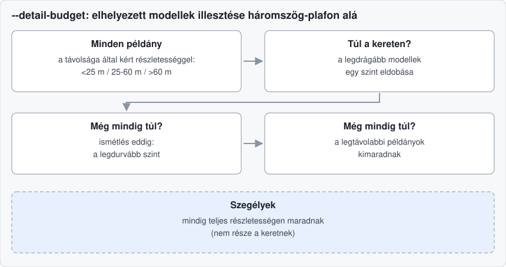

# Részletességi szintek és a keret {#levels-of-detail-and-the-budget}

Egy **háromszög** egy modell apró, lapos darabja. Több háromszög nagyobb, lassabb fájlt jelent.
A **keret** ezeknek a számát korlátozza. Egy **részletességi szint** (LOD) egy modell
egyszerűbb másolata, amelyet távolról használunk.

A pálya körül elhelyezett minden legfinomabb szint több millió háromszög. Például több száz
korlátszakasz és gumiabroncs-torony, egyenként mintegy ezer háromszöggel. Egy városi sáv
több mint százezer példányt tartalmaz. Ezért minden pályaexport **háromszögkeretet** ad az
elhelyezett modelleknek, és modellenként eldönti, milyen részletességi szinten rajzolja, és
ha kell, mely példányokat hagyja ki.

Az ütemezést a Forzához írták
([`forzaplacement.py`](https://github.com/Holdi601/3DHeat-GameFiles/blob/main/heat3d_gamefiles/forzaplacement.py):
`choose_levels`, `auto_budget`, `_fit`), a BeamNG és az AC Rally pedig ezeknek a részeit
használja újra. A terep nem számít bele a keretbe.

## Távolsági sávok {#distance-bands}

Minden példány távolságát a vezetéstől a talajsíkban mérjük a legközelebbi köri mintáig. A
kört először legfeljebb 1000 pontra ritkítjuk, ez néhány méteres pontosságot veszít, ami itt
nem számít. A példányok ezután három sávba esnek, és minden (modell, sáv) pár külön kapja a
keretet:

| Sáv | Távolság | Kezdődik |
|---|---|---|
| közeli | 25 m alatt (`NEAR`) | a legfinomabb szinten |
| közepes | 25–60 m (`FAR`) | eggyel durvább szinten |
| távoli | 60 m-től | a legdurvább szinten |

Útvonal nélkül (Forza `terrain --box`) a távolságot a doboz közepéig mérjük.

## Lefelé lépés, hogy beférjen {#stepping-down-to-fit}



Egy (modell, sáv) bejegyzés költsége: példányok száma x háromszögek az aktuális szinten. Amíg
az összeg meghaladja a keretet, a legtöbbet költő bejegyzés egy szinttel lejjebb lép, és ez
ismétlődik, amíg az összeg bele nem fér, vagy már nem lehet lejjebb lépni. A rögzített
bejegyzések soha nem lépnek:

| Játék | Teljes részletességen rögzítve |
|---|---|
| Forza | szegélykövek (`road_gen_rum*`) |
| BeamNG | szegélykövek és minden olyan alakzat, amely vezetési felületet hordoz |
| AC Rally | szegélykövek |

A Forza összefoglalója ezt így jelenti:
`N of M models drawn at a coarser level to fit the budget`.

## Az automatikus keret {#the-automatic-budget}

A `--detail-budget` nélkül a keret úgy méreteződik, hogy **egy példány se maradjon ki**:

```
budget = max(1,500,000, 1.25 x sum(copies x coarsest level))
```

A rögzített bejegyzések a legfinomabb szintjükön számítanak. Az 25%-os (`HEADROOM`) tartalék
arra kell, hogy az út melletti dolgok is megtartsák a részletességüket. Egy vidéki pályán ez
az 1,5 milliós alsó határ (`DEFAULT_BUDGET`). Egy városi pályán, ahol a sávban több mint
százezer példány van, tíz millió fölé nő, és a fájl több száz MB lesz. A nézegető ezt kezeli.

## Egy megadott keret {#a-budget-you-give}

A `--detail-budget N` **felső korlát**. A szintek a fentiek szerint lépnek lefelé. Ha még a
legdurvább szintek sem férnek bele, példányokat hagyunk ki:

| Játék | Ebben a sorrendben hagyjuk ki a példányokat |
|---|---|
| Forza | először mindent, ami 25 m-nél vagy távolabb van a vezetéstől, aztán ami az út mellett áll; mindkét csoporton belül előbb az, ami az úton lévőnek a legkisebbnek látszik: legnagyobb távolság / méret (a méret a modell határoló dobozának átlós hossza szorozva a legnagyobb skálájával, legalább 0,25 m) |
| BeamNG | a vezetéstől legtávolabbi először |
| AC Rally | a vezetéstől legtávolabbi először, mint a BeamNG-nél |
| Battlefield 6 | a legkisebb először: határoló doboz átlója szorozva a skálával |

A szegélykövek (és a BeamNG-nél a vezetési felületet hordozó modellek) soha nincsenek
egyszerűsítve vagy kihagyva. Ezért egy keret, amely kisebb, mint amennyibe ezek önmagukban
kerülnek, csak ezek miatt lépi túl, és semmi más miatt.

Az eszköz a Forzánál a távolságot a mérettel osztja el, mert ha csak a távolság számítana,
egy kilenc méterre lévő falon lévő légkondicionáló egység tovább maradna, mint a tizenkét
méterre lévő húsz méteres homlokzat, amelyen áll. Az út melletti dolgok minden méretnél
utoljára mennek, mert egy három méteres korlát öt méterre a vonaltól a pálya széle, míg egy
ötven méteres épület hatvan méterre hátrébb díszlet.

Az összefoglaló ezt jelenti:
`N of M copies left out to fit the budget, the smallest and furthest from the driving first (--detail-budget raises it)`
(Forza), vagy `N copies left out to fit the budget, the furthest from the driving first (--detail-budget raises it)`
(BeamNG, AC Rally).

## Egész épületek (Forza) {#whole-buildings-forza}

Egy egész épület-helyettesítő egy példánynak számít, a távolságát pedig az épület legközelebbi
széléig mérjük. Egységként marad meg vagy hagyjuk ki. A moduláris darabok, amelyeket helyettesít,
egyáltalán nincsenek keretezve. Lásd: [Forza Horizon](course-forza-horizon.md#buildings-drawn-whole).

## Részletességi szint játékonként {#what-a-level-of-detail-is-per-game}

| Játék | A szinteket innen kapjuk |
|---|---|
| Forza | a modell `Mesh` részhálóinak háromszögenkénti szintmaszkja (bit `level + 1`); a `0xFFFF` törhető darabok csak olyan modellnél, amelynek nincs jelölt szintje |
| BeamNG | a `.cdae` alakzat `details` mezőjének nem negatív méretű elemei, a legnagyobbal kezdve; `.dae`-nél a hálócsomópontok nevének végi szám (`barrier75`, `barrier40`) |
| AC Rally | a statikus háló tárolt részletességi szintjei, a legfinomabbal kezdve |
| Battlefield 6 | a MeshSet részletességi szintjei, a legfinomabbal kezdve, csak a kirajzolt szakaszokat számolva (nem az árnyék- és csak mélységi másolatokat), és nem azt az utolsó szintet, amely egy távoli nézet helyettesítője (`M_LastLod`, `M_Billboard`, `M_Vista` anyagok: egy villanyoszlop rácsos szerkezete tömör tüskévé válna) |

A Battlefield 6 `level` parancsának nincs köre, ezért nincsenek távolsági sávok: minden háló
egy bejegyzés, és minden példány ugyanazon a szinten van. Az automatikus keret a fenti képlet,
a terepi háttér rögzítve. A magasságmező a kereten kívül van, és a `--ground-spacing` méri.
Egy megadott keret alatt, ha minden háló a legdurvább szinten van, a példányokat a legkisebbel
kezdve hagyjuk ki. A méret a háló határoló dobozának átlója szorozva a példány skálájával, mivel
nincs vezetés, amelytől a távolságot mérhetnénk. A terepi háttér soha nincs kihagyva. Az
automatikus szint nagyjából tíz millió háromszög.

## Számot választani {#choosing-a-number}

| Amit akarsz | Próbáld ezt |
|---|---|
| mindent, teljes részletességgel az út mellett | hagyd automatikusra |
| néhányszor kisebb fájlt | `--detail-budget 500000` a `--texture-size 1024`-gyel |
| csak a talajt | `--no-placed` (nincs keret) |
