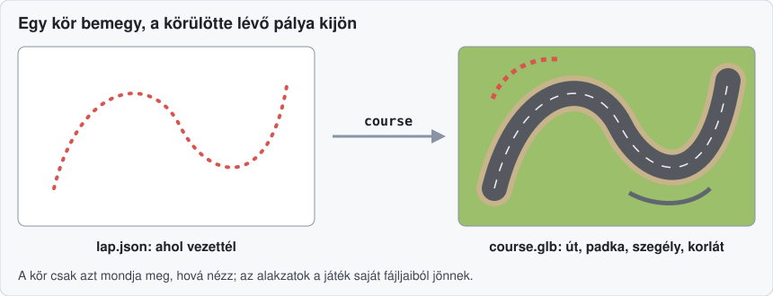
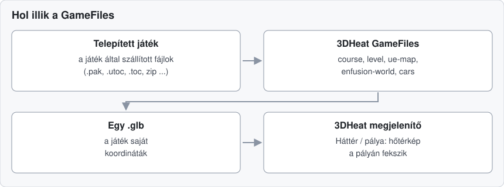

# 3DHeat GameFiles {#dheat-gamefiles}

**Mi ez?** Egy eszköz, amely egy versenypálya vagy játékpálya 3D-modelljét építi fel a már telepített
játék fájljaiból.

**Mire jó?** A 3DHeat megjelenítő hőként festi be, hol vezetett vagy játszott. Ezzel az eszközzel a valódi pályán festi be, nem üres térben.

**Példa:** végy egy kört, amelyet megtettél. Az eszköz egyetlen 3D-fájlba építi az ösvényt és a körülötte
lévő terepet, így a megjelenítő a valódi pályán tudja megfesteni a sebességét vagy a koccanásait:



Még nem használt parancssort? Kezdd a [Mielőtt elkezded](before-you-start.md) oldallal.

Részletesebben: a játék által szállított archívumokból pályaadatokat olvas, és bináris glTF (`.glb`)
fájlként írja ki. Fő feladata a **pályaexport**: megad neki egy kört, és kiírja a talajt, az utat
megkülönböztetve a szegélytől és a füvest, valamint a körülötte lévő szegélyeket, korlátokat, gumifalakat,
táblákat és épületeket.

Része a [3DHeat](https://github.com/Holdi601/3DHeat) rendszernek, amely egy megjelenítő valós idejű 3D
telemetriai hőtérképekhez, versenyelemzéshez és meccsáttekintéshez
([dokumentáció](https://holdi601.github.io/3DHeat/)). Ez az eszköz által írt `.glb` fájlok azok a pályák,
amelyekre a megjelenítő a hőt rajzolja.



Háromféle út van egy pálya geometriájának 3DHeat-be juttatására:

| Út | Mire van szükség | Mit ad |
|---|---|---|
| 3DHeat Unreal Exporter | a Unreal-projekt megnyitva a szerkesztőben | pontos geometria |
| 3DHeat GameCapture | egy képernyő és egy felvétel | becslés |
| **3DHeat GameFiles** | **a telepített, szállított játék** | **pontos geometria, projekt nélkül** |

Python-csomag: `heat3d_gamefiles`. Tároló:
[Holdi601/3DHeat-GameFiles](https://github.com/Holdi601/3DHeat-GameFiles). Licenc: MIT.

## Mire képes {#what-it-can-do}

| Játék vagy motor | Pályaexport (`course`) | Archívumolvasás |
|---|---|---|
| Forza Horizon (ForzaTech) | igen: terep, út és szegély, talajtextúra, elhelyezett modellek saját textúráikkal | `identify`, `list`, `extract` egy `.minizip`-en; `identify` egy `.modelbin`-en; modellek, terep és textúrák a `course` és a `terrain` parancson át |
| BeamNG.drive | igen: terep, útdekálok, modellezett pályák, elhelyezett modellek, víz | `identify`, `list`, `extract` pálya-zipeken; `identify` `.ter`-en, `.cdae`-n; `.dae` a `course` parancson át |
| Assetto Corsa Rally (Unreal 5.6) | igen: szakasz-talajcsempék, beégetett talajszín, elhelyezett modellek egyszínű festéssel | `identify`, `list`, `extract` IoStore `.utoc`/`.ucas` fájlokon; zen csomagok, statikus hálók, textúrák a `course` parancson át |
| Unreal `.pak` (8–12. verzió) | nem | `identify`, `list`, `extract` |
| Unity (22-es és újabb formátum) | nem | `identify`, `meshes` |
| Battlefield 6 (Frostbite `.toc`/`.cas`) | nincs kör; egész pálya a `level` paranccsal: terep, elhelyezett hálók, színtérképeik a `--textures` kapcsolóval | `identify`, `levels`; csomagok, hálók, terep, textúrák és elhelyezés a `level` parancson át |
| Source 2 `.vpk` | nem | `identify`, `list`, `extract` |
| Unreal 5 World Partition játékok | nincs kör; egész térkép az `ue-map` paranccsal (az `ue-maps` listázza): táj, HLOD épületek és dekorációk, víz | - |
| Arma Reforger (Enfusion) | nincs kör; egész világ az `enfusion-world` paranccsal (az `enfusion-worlds` listázza): terep a színeiben, a tenger, épületek dobozokként | - |
| Forza (autók) | `cars`: minden autó alacsony részletességgel, a megjelenítő Versenyelemzés fülének | - |

A kört Assetto Corsa EVO-ból és iRacingből indokkal visszautasítja. Lásd:
[Korlátok és ismert hiányosságok](../limits-and-known-gaps.md).

## Telepítés {#install}

Még nem használt parancssort? Előbb olvasd el a [Mielőtt elkezded](before-you-start.md) oldalt.

Szükséges a **Python 3.10 vagy újabb** (3.13-on fejlesztve), és a
[`requirements.txt`](https://github.com/Holdi601/3DHeat-GameFiles/blob/main/requirements.txt) fájlban
lévő csomagok.

```
git clone https://github.com/Holdi601/3DHeat-GameFiles.git
cd 3DHeat-GameFiles
pip install -r requirements.txt
```

Ezután ellenőrizd: `python -m heat3d_gamefiles --help`. A következőt kell látnod:
`usage: heat3d_gamefiles [-h]` és az igék listáját. A parancsokat mindig a tároló mappájából futtasd,
így: `python -m heat3d_gamefiles <ige>`.

| Csomag | Mire való |
|---|---|
| numpy | minden, ami a geometriát dekódolja |
| lz4 | Forza-archívumok (többnyire LZ4-blokkok), néhány Unity-csomag, IoStore LZ4-blokkok |
| Pillow | BC1–BC7 textúrák dekódolása, a `.glb` JPEG-textúráinak írása |
| msgpack, zstandard | BeamNG összeállított alakzatai (`.cdae`) |
| cryptography | csak titkosított `.pak` megnyitásához, egy kulccsal, amely már a tiéd |
| pytest | a tesztek |

Az **Oodle**-lel tömörített Unreal-tartalomhoz olyan Oodle-könyvtár kell, amely már a gépén van. Ezt az
eszközzel soha nem szállítjuk. Lásd: [Oodle](../reader-oodle.md).

Az eszköz Windowsra készült. A játékokat a Steam könyvtárlistájából és a `%LOCALAPPDATA%` mappából
keresi, és az Oodle-t Windows DLL-ként tölti be. Más platformokat nem teszteltek.

## Gyors kezdés {#quick-start}

Egy **körfájl** a felvétele arról, hová ment az autója: x, y, z pontok listája.
Származhat a [3DHeat GameCapture](https://github.com/Holdi601/3DHeat-GameCapture) eszközből vagy az
FH Companion alkalmazás körkönyvtárából; kézzel írt CSV is megteszi ([Körbemenetek bemenete](../lap-inputs.md)).

```
# Forza: egy körfájl, egy mappa, vagy egy pályanév az FH Companion könyvtárából
python -m heat3d_gamefiles course "Example Circuit"
python -m heat3d_gamefiles course path\to\lap.json -o course.glb

# BeamNG.drive vagy Assetto Corsa Rally: a heat3d-lap fájl megmondja, melyik játékból való
python -m heat3d_gamefiles course my_lap.json

# Az FH Companion könyvtár minden pályája, egy-egy .glb-ként
python -m heat3d_gamefiles courses -o courses

# Battlefield 6: sorolja fel a pályákat, majd exportáljon egyet (nagy fájl; lásd Parancsok)
python -m heat3d_gamefiles levels
python -m heat3d_gamefiles level <level> -o level.glb --textures

# Unreal 5 World Partition és Arma Reforger: listázás, majd exportálás
python -m heat3d_gamefiles ue-maps "<game>"
python -m heat3d_gamefiles ue-map "<game>" <map> -o map.glb
python -m heat3d_gamefiles enfusion-worlds
python -m heat3d_gamefiles enfusion-world <world> -o world.glb

# Minden Forza-autó, a megjelenítő Versenyelemzés fülének
python -m heat3d_gamefiles cars -o forza.h3dcars

# Mi ez a fájl?
python -m heat3d_gamefiles identify some_archive.pak
```

Nyisd meg a `.glb` fájlt a 3DHeat megjelenítőben. A játék saját világkoordinátái megmaradnak
(lásd: [Kimeneti formátum](../output-format.md)), így a rögzített kör egy vonalba áll a pályával.

## A dokumentáció térképe {#map-of-this-documentation}

- [Mielőtt elkezded](before-you-start.md): Python, egy terminál, az első parancs.
- [Parancsok](../commands.md): minden ige és kapcsoló, példákkal.
- [Parancsleírás](../cli-reference.md): minden ige `--help` kimenete, a kódból generálva.
- [Archívumok vizsgálata](../inspecting-archives.md): `identify`, `list`, `extract`, `meshes`, lépésről lépésre.
- [Pályaexport](../course-export.md): hogyan lesz egy körből pálya, minden játékra.
  - [Forza Horizon](../course-forza-horizon.md)
  - [BeamNG.drive](../course-beamng.md)
  - [Assetto Corsa Rally](../course-assetto-corsa-rally.md)
  - [Részletességi szintek és a költségkeret](../detail-budget.md)
- [Egész pályák](../whole-levels.md): pálya, térkép vagy világ körük nélkül.
  - [Battlefield 6 pályák](../level-battlefield.md): `levels`, `level`
  - [Unreal 5 térképek](../level-unreal-world-partition.md): `ue-maps`, `ue-map`
  - [Arma Reforger világok](../level-arma-reforger.md): `enfusion-worlds`, `enfusion-world`
- [Forza autók](../forza-cars.md): `cars`, az autófájl a megjelenítő Versenyelemzés füléhez.
- [Körbemenetek bemenete](../lap-inputs.md): minden elfogadott körfájl-forma.
- [Kimeneti formátum](../output-format.md): mi van a `.glb`-ben.
- [Archívumolvasók](../archive-readers.md): egy oldal konténerformátumonként, azzal, mit olvas, mit nem, és miért.
- [Korlátok és ismert hiányosságok](../limits-and-known-gaps.md)
- [Hibaelhárítás](../troubleshooting.md): a hibaüzenetek és mit kell tenni.
- [Szabályok és licencek](../rules-and-licences.md): nincsenek kulcsok, saját fájlok, nincs újraterjesztés.
- [Frissítések](../updates.md): a frissítés-ellenőrzés és a `heat3d_update`.
- [Fejlesztés](../development.md): modultérkép és tesztek, beleértve a telepített játékokon futó teszteket.
- [Karbantartás](../maintaining.md): a kiadási ellenőrzőlista ezekhez az oldalakhoz.

## A 3DHeat része {#part-of-3dheat}

A 3DHeat GameFiles a 3DHeat megjelenítő körüli ingyenes eszközök egyike:

| Eszköz | Mit csinál | Dokumentáció |
|---|---|---|
| [3DHeat](https://github.com/Holdi601/3DHeat) | a megjelenítő: 3D hőtérképek, versenyelemzés és meccsáttekintés a böngészőben | [oldal](https://holdi601.github.io/3DHeat/) |
| [GameFiles](https://github.com/Holdi601/3DHeat-GameFiles) | pályák és pályaszintek a játékok fájljaiból, `.glb`-ként | [oldal](https://holdi601.github.io/3DHeat-GameFiles/) |
| [GameCapture](https://github.com/Holdi601/3DHeat-GameCapture) | körtelemetria versenyjátékokból; pályák rekonstruálva játékvideóból | [oldal](https://holdi601.github.io/3DHeat-GameCapture/) |
| [Unreal Exporter](https://github.com/Holdi601/3DHeat-UnrealExporter) | Unreal Editor bővítmény, amely egy pályát `.glb`-ként ment | [oldal](https://holdi601.github.io/3DHeat-UnrealExporter/) |
| [CS2](https://github.com/Holdi601/3DHeat-CS2) | Counter-Strike 2 demók meccsfájlokba; térképek `.glb`-be | [oldal](https://holdi601.github.io/3DHeat-CS2/) |
| [Watcher](https://github.com/Holdi601/3DHeat-Watcher) | a játékmenetét rögzíti a háttérben abból, amit a játékok közzétesznek | [oldal](https://holdi601.github.io/3DHeat-Watcher/) |
| [Ext-WarThunder](https://github.com/Holdi601/3DHeat-Ext-WarThunder) | War Thunder visszajátszások meccsfájlokba | [oldal](https://holdi601.github.io/3DHeat-Ext-WarThunder/) |
| [Ext-WoT](https://github.com/Holdi601/3DHeat-Ext-WoT) | World of Tanks visszajátszások meccsfájlokba | [oldal](https://holdi601.github.io/3DHeat-Ext-WoT/) |
| [Ext-WoWs](https://github.com/Holdi601/3DHeat-Ext-WoWs) | World of Warships visszajátszások meccsfájlokba | [oldal](https://holdi601.github.io/3DHeat-Ext-WoWs/) |
| [Ext-Squad](https://github.com/Holdi601/3DHeat-Ext-Squad) | Squad-szerverdemók meccsfájlokba | [oldal](https://holdi601.github.io/3DHeat-Ext-Squad/) |
| [Ext-DCS](https://github.com/Holdi601/3DHeat-Ext-DCS) | DCS World térképek `.glb` pályákba | [oldal](https://holdi601.github.io/3DHeat-Ext-DCS/) |
| [Ext-IL2](https://github.com/Holdi601/3DHeat-Ext-IL2) | IL-2 Sturmovik térképek `.glb` pályákba | [oldal](https://holdi601.github.io/3DHeat-Ext-IL2/) |

A megjelenítő meccsfájljait a [Egy fájl meccsenként: `.3dheat`](https://holdi601.github.io/3DHeat/container.html)
oldal írja le; az itt készült pályát mellettük tölti be a megjelenítő Háttér / pálya paneljén.
