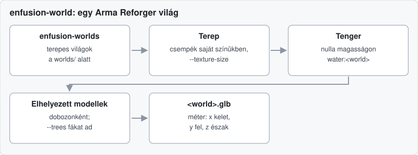

# Arma Reforger világok: `enfusion-worlds` és `enfusion-world` {#arma-reforger-worlds-enfusion-worlds-and-enfusion-world}

**Mi ez?** Egy teljes Arma Reforger-világ egyetlen 3D-s fájlban. **Miért?** Hogy a játék hőtérképe
alatt legyen a talaj és az épületek. (Az *Enfusion* az a motor, amellyel az Arma Reforger készült;
a *világ* az, amit a játék térképnek hív.)

Exportál egy teljes Enfusion-világot a telepített Arma Reforgerből: a terepet a saját
szupertextúra-csempéinek színeiben, a tengert, és minden elhelyezett modellt dobozként, a játék
saját méterében.



## Lépésről lépésre {#step-by-step}

1. **Listázd a világokat**, amelyeknek van terepe:

   ```
   python -m heat3d_gamefiles enfusion-worlds
   python -m heat3d_gamefiles enfusion-worlds --install "D:\Games\Arma Reforger"
   ```

2. **Exportálj egyet** a `worlds/` alatti mappanevével, ahogy listázva van:

   ```
   python -m heat3d_gamefiles enfusion-world <world> -o world.glb
   ```

3. **Változatok:**

   ```
   python -m heat3d_gamefiles enfusion-world <world> --trees               # vegetation too, as boxes
   python -m heat3d_gamefiles enfusion-world <world> --texture-size 0      # flat colour, small file
   python -m heat3d_gamefiles enfusion-world <world> --ground-spacing 4 --no-structures
   ```

4. **Nyisd meg a `world.glb`-t** a 3DHeat nézegető Háttér / pálya paneljében ([pálya betöltése](https://holdi601.github.io/3DHeat/levels.html)).

## Beállítások {#options}

| Beállítás | Alapérték | Jelentés |
|---|---|---|
| `<world>` | kötelező | egy világ, ahogy az `enfusion-worlds` kiírja |
| `-o`, `--out FILE` | `<world>.glb` (a `$HEAT3D_LEVELS/<game>/` mappában, ha az be van állítva) | a kiírandó fájl |
| `--install FOLDER` | a Steam-könyvtár, amely a játékot tartalmazza | a játék mappája |
| `--ground-spacing METRES` | 2 (a terep saját) | a terep csúcsainak távolsága a fájlban |
| `--texture-size PIXELS` | 4096 | a talajszín-kép nagyobb oldala; 0 egyszínű talajhoz |
| `--no-structures` | | a elhelyezett modelleket kihagyja |
| `--trees` | ki | fákat és más növényzetet is elhelyez, dobozként |

## Példa kimenet {#example-output}

```text
<world> -> world.glb
  ground      <n> triangles, <w> x <h> m; <n> of <n> tile-edge vertices disagree; colour <w> x <h>
  structure   <n> boxes from <n> entities
  water       <n> triangles (the sea)
  left out    <what>: <n>, ...
```

## A részek {#the-parts}

`ground:<world>` (a terep), `water:<world>` (a tenger, nulla magasságon) és `structure:<world>`
(a dobozok). A koordináták a játék sajátjai: x kelet, y fel, z észak, méterben – azok, amelyeket
egy játékbeli felvétel jelent. A játék koordináta-rendszere balkezes; a nézegető
*invert world axis* beállítása tükrözetlenül mutatja.

## Hogyan van olvasva és ellenőrizve {#how-it-is-read-and-checked}

Nem kell Workbench, és semmi sincs titkosítva.

| Formátum | Mi az | Összevetve ezzel |
|---|---|---|
| `.pak` | egy adatdarab és egy könyvtárfa, tárolva vagy zlib-bel | a fa pontosan felhasználja a darabját; a mintavett zlib-bejegyzések pontosan a megadott méretükre tömörítenek ki |
| `.edds` | egy DDS-fejléc, majd szintenként `COPY` vagy `LZ4 ` darabok | a darabos szintek pontosan a méretükre dekódolnak, pontosan a saját bájtjaikat használva |
| `.terr` / `.ttile` | egy fejléc és 16 bites magasságú csempék | minden megosztott csempeél pontosan egyezik |
| szupertextúra | minden csempe talajszíne, mintegy egy méter pixelenként | egyezik a tengerrel a magasságokban; nincs olyan tükrözés vagy transzponálás, amely ugyanígy illeszkedne |
| `.ent` | nevek, erőforrás-GUID-ok, majd típusos értékekként az entitások | egy világfájl az utolsó bájtjáig feldolgozódik |
| `resourceDatabase.rdb` | GUID-ból útvonal | szinte minden GUID, amelyet egy világ használ, egy létező fájlt nevez meg |

Az abszolút magasságon álló objektumok a dekódolt terep néhány centiméterén belül állnak (ha a
rács transzponálva lenne, méterekkel mellé lennének). Nincs kirajzolva: a modellek saját
háromszögei, a fák alapértelmezés szerint (a `--trees` dobozként hozzáadja őket), a gyermek-
entitások, a tavak és folyók, a DX10 előtti fejlécű textúrák.

**Feltételek:** a játék licence nem kereskedelmi használatot enged, és tiltja a játékfájlok
visszafejtését. A saját telepítésed olvasása a te döntésed ennek keretein belül; a kimenet a te
saját használatodra szolgál, és nem osztható meg.
