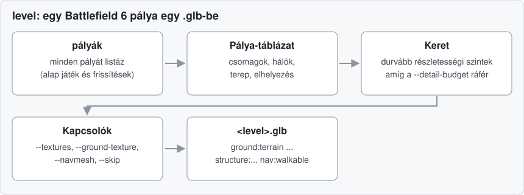

# Battlefield 6 pályák: `levels` és `level` {#battlefield-6-levels-levels-and-level}

**Mi ez?** Egy teljes Battlefield 6-pálya egyetlen 3D-s fájlban. **Miért?** Hogy a
hőtérképed alatt legyen a talaj és az épületek. (A *Frostbite* az a motor, amellyel a Battlefield
készül; a *magassági mező* a talaj mint magasságok rácsa.)

Exportál egy teljes Frostbite-pályát a telepített játékból: a terep magassági mezőjét, minden
hálót, amelyet a statikus modellcsoportok elhelyeznek, az egyenként elhelyezett objektumokat, a
térkép körüli terepi hátteret, és kérésre a felületek színtérképeit, a talajba sütött terepmatricákat
és a katonák járható felületeit.



## Lépésről lépésre {#step-by-step}

1. **Listázd a pályákat**, amelyeket a játék tartalmaz:

   ```
   python -m heat3d_gamefiles levels
   python -m heat3d_gamefiles levels --install "D:\Games\<game folder>"
   ```

   Minden sor egy pályatáblát (`levels/<level>/<level>.toc`) ír ki a méretével és a forrásával:
   `Data` az alapjátékhoz, `Update/<pack>` egy frissítéshez.

2. **Exportálj egyet** a nevével, egy egyedi részével vagy a `.toc` útvonalával. Kezdd színezés
   nélkül, hogy lásd az alakot és a méretet:

   ```
   python -m heat3d_gamefiles level <level> -o level.glb
   ```

3. **Adj színt**, ha már jónak látszik:

   ```
   python -m heat3d_gamefiles level <level> -o level.glb --textures 512 --ground-texture 0.5
   ```

4. **Add hozzá a járható felületeket**, vagy zsugorítsd a fájlt:

   ```
   python -m heat3d_gamefiles level <level> --textures 512 --ground-texture 0.5 --navmesh
   python -m heat3d_gamefiles level <level> --textures 256 --detail-budget 3000000 --ground-spacing 8
   ```

5. **Nyisd meg a `level.glb`-t** a 3DHeat nézegető Háttér / pálya paneljében ([pálya betöltése](https://holdi601.github.io/3DHeat/levels.html)).

## Beállítások {#options}

| Beállítás | Alapérték | Jelentés |
|---|---|---|
| `<level>` | kötelező | egy név, ahogy a `levels` kiírja, egy egyedi része, vagy egy pálya `.toc`-ja |
| `-o`, `--out FILE` | `<level>.glb` (a `$HEAT3D_LEVELS/<game>/` mappában, ha az be van állítva) | a kiírandó fájl |
| `--install FOLDER` | a Steam-könyvtárakban keresve | a játék mappája |
| `--textures [PIXELS]` | ki; méret nélkül 512 | minden felület színtérképe, legfeljebb PIXELS oldalhosszal |
| `--ground-texture [METRES]` | ki; méret nélkül 0.5 | az utak, előterek és jelölések beszüremlése a talaj színébe, METRES méter pixelenként |
| `--navmesh` | ki | a katonák navigációs hálója, `nav:walkable` néven |
| `--ground-spacing METRES` | 4 | a magasságmező legfinomabb távolsága; 0 esetén kimarad |
| `--detail-budget N` | a legdurvább példányok plusz egynegyed, legalább 1 500 000 | felső korlát a háromszögekre (a terepet soha nem durvítjuk) |
| `--skip TEXT` | | a modellcsoportok kihagyása, amelyek partíciónevében a TEXT szerepel; ismételhető |
| `--by-mesh` | ki | egy rész forrásháló és anyag szerint, hogy kiderüljön, mi a rész |
| `--clamped-uvs` | ki | olyan megjelenítőknek, amelyek nem tudnak textúrát ismételni |

A teljes táblázat, a várható méretekkel (egy egész pálya több száz MB), a
[Parancsok](commands.md#levels-and-level-frostbite) oldalon van. Hogyan olvassuk a
táblákat, csomagokat, hálókat és a terepet, a [Frostbite](reader-frostbite.md) oldalon.

## Példa kimenet {#example-output}

Amit a `level` kiír, vázlatosan (a sorok úgy, ahogy a kód írja; a `<n>` és a nevek pályánként
eltérnek):

```text
<n> copies of <n> meshes, from <n> static model groups
      <n>  <group>
      <n>  placed one by one (object and prefab references)
<n> meshes left out: <why>
<n> triangles, budget <n>; <n> meshes drawn at a coarser level to fit
           <n>  ground:terrain
           <n>  structure:buildings, <n> textures
           ...
<n> of <n> drawn sections carry their colour map; the rest are flat colours
Ground: <what the ground is>.
Navigation mesh: <tiles read>.
-> level.glb (<n> MB)
```

## A részek {#the-parts}

`ground:terrain` (a magasságmező), `ground:terrain backdrop` és `ground:terrain blend`,
`structure:<kind>` típusonként (színtérképenként `--textures` mellett, a ` (destructible)`
utótaggal azoknál, amelyeket egy meccsen el lehet pusztítani), és `nav:walkable` a
`--navmesh`-sel. Lásd: [Kimeneti formátum](output-format.md).

A fájl a játék tartalmát hordozza: a készítő gépéhez való, nem arra, hogy továbbadják
([Szabályok és licencek](rules-and-licences.md)).
