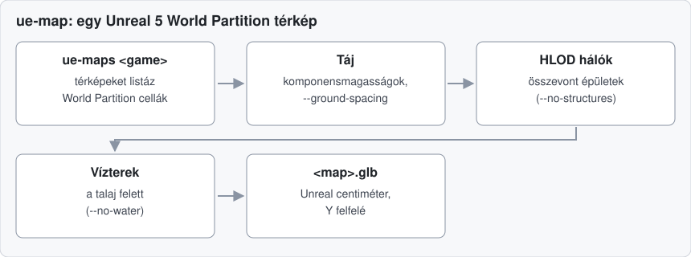

# Unreal 5 World Partition térképek: `ue-maps` és `ue-map` {#unreal-5-world-partition-maps-ue-maps-and-ue-map}

**Mi ez?** Egy Unreal 5-ös játék teljes térképe egyetlen 3D-s fájlban: a talaj, az épületek és a víz.
**Miért?** Hogy a hőtérképed alatt legyen a térkép ehhez a játékhoz. (A *World Partition* az, ahogy
az Unreal 5 nagy térképet darabokra oszt; a *HLOD* egy egyszerűsített helyettesítő egy épületcsoportra,
azt, amelyet a játék távolról rajzol.)

Exportál egy Unreal 5-ös játék teljes térképét, amelynek térképei World Partition cellákként vannak
cookolva: a talajrácsot (landscape), a térkép összevont HLOD-hálóit (az épületeket és kellékeket úgy,
ahogy a játék távolról rajzolja) és a vízterületeket. Nincs szükség szerkesztőre és projektre, csak
a telepített játékra.



## Lépésről lépésre {#step-by-step}

1. **Listázd a térképeket.** A `<game>` a játék mappája, a `Content/Paks` mappája vagy a neve a
   Steam-könyvtárban:

   ```
   python -m heat3d_gamefiles ue-maps "<Steam game folder name>"
   python -m heat3d_gamefiles ue-maps "D:\Games\<game>"
   ```

   Minden térkép, amelynek van cookolt World Partition cellája, a csomagútvonalával kiírásra kerül.

2. **Exportálj egyet** a nevével vagy egyedi részével:

   ```
   python -m heat3d_gamefiles ue-map "<game>" <map> -o map.glb
   ```

3. **Csak a talaj, vagy durvábban:**

   ```
   python -m heat3d_gamefiles ue-map "<game>" <map> --no-structures --no-water
   python -m heat3d_gamefiles ue-map "<game>" <map> --ground-spacing 4
   ```

4. **Nyisd meg a `map.glb`-t** a 3DHeat nézegető Háttér / pálya paneljében
   ([pálya betöltése](https://holdi601.github.io/3DHeat/levels.html)).

## Beállítások {#options}

| Beállítás | Alapérték | Jelentés |
|---|---|---|
| `<game>` | kötelező | a játék mappája, a `Content/Paks`, vagy a Steam-mappa neve |
| `<map>` | kötelező | egy név, ahogy az `ue-maps` kiírja, vagy egy egyedi része |
| `-o`, `--out FILE` | `<map>.glb` (a `$HEAT3D_LEVELS/<game>/` mappában, ha az be van állítva) | a kiírandó fájl |
| `--ground-spacing METRES` | 2 | a talajrács csúcsainak távolsága, egész számú saját négyzetre kerekítve |
| `--no-structures` | | a HLOD-épületeket és kellékeket kihagyja |
| `--no-water` | | a vízterületeket kihagyja |

Az Oodle-lel tömörített tartalomhoz egy Oodle-könyvtár kell, amely már a gépen van
(lásd: [Oodle](reader-oodle.md)).

## Példa kimenet {#example-output}

```text
<map> -> map.glb
  ground      <n> triangles from <n> landscape components; <n> of <n> vertices stored twice disagree
  structure   <n> triangles in <n> HLOD meshes
  water       <n> triangles from <n> water bodies
```

Az eltérések száma önellenőrzés: a szomszédos talajrács-komponensek a közös élüket kétszer tárolják,
és a kettőnek egyeznie kell. Egy 3 km-es térkép 2 m-en mintegy 4,6 millió talajháromszög.

## A részek {#the-parts}

`ground:<map>` (a talajrács), `structure:<map>` (a HLOD-hálók) és `water:<map>` (a víz a talaj
fölött).

**Mértékegység:** ez az egyetlen export, **nem méterben**: Unreal-centiméterben, az Y és a Z
felcserélve (Y felfelé), abban a keretben, amelyet az 3DHeat Unreal Exporter ír. Ugyanannak a
játéknak a telemetriája ugyanezt a keretet használja, ezért rákerül a térképre.

## Hogyan van olvasva és ellenőrizve {#how-it-is-read-and-checked}

| Rész | Ebből olvasva | Összevetve ezzel |
|---|---|---|
| talaj | minden talajrács-komponens 16 bites magasságtérképe, a szakasz alapjával a talajrács transzformációján elhelyezve | minden kétszer tárolt csúcsnak (varraton vagy komponenshatáron) egyeznie kell; az eltéréseket számoljuk és kiírjuk, nem simítjuk el |
| szerkezet | a térkép összevont HLOD-hálói, amelyeket a motor világtérben épít | egy háló csak akkor marad meg, ha a komponense által gyorsítótárazott doboz leírja a saját csúcsait |
| víz | minden vízterület hálója, a talajrácsra fektetve, ott megtartva, ahol a talaj fölött áll | a víz néhány méterrel a talaj fölött ül, ahogy egy folyó a medre fölött |

A talajrács tulajdonságait alakjuk alapján találjuk meg, nem a rekesz számuk alapján (a rekeszek
motorverziónként mozognak). A szerkezetek az egyszerűsített helyettesítők, nem a teljes
részletességű modellek. A lombozatot, a matricákat és a talajanyagokat nem exportáljuk; a talaj
textúra nélküli, a nézegető árnyalja. Az archívum részletei: [Unreal 5 IoStore](reader-unreal-iostore.md).

**Feltételek:** a játékok licencei általában személyes, nem kereskedelmi használatot engednek, és
tiltják a visszafejtést, „amennyiben az ilyen cselekedetek törvényileg nem tilthatók". A saját
telepítésed olvasása a te döntésed ezek keretein belül; a kimenet a te saját használatodra szolgál,
és nem osztható meg.
