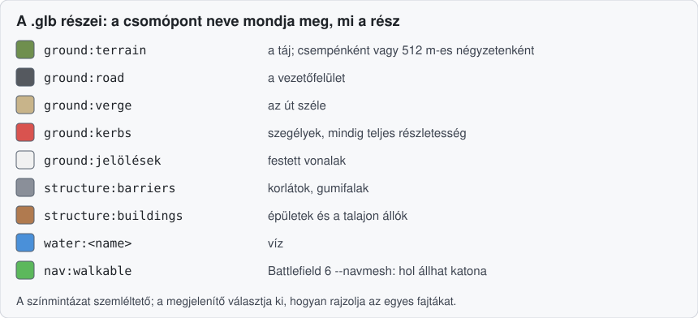

# Kimeneti formátum {#output-format}

A `.glb` egyetlen 3D-fájl: egy pálya vagy szint talaját, épületeit és vizét
tartalmazza, amelyet a 3DHeat megjelenítő Háttér / pálya paneljében nyithatsz meg.

Minden export (`course`, `courses`, `terrain`, `level`, `ue-map`, `enfusion-world`)
egy **bináris glTF 2.0** fájlt (`.glb`) ír. Szándékosan kicsi és lapos, és úgy van
felépítve, ahogy a 3DHeat megjelenítő egy szintet olvas. Forrás:
[`glb.py`](https://github.com/Holdi601/3DHeat-GameFiles/blob/main/heat3d_gamefiles/glb.py).

## Szerkezet {#structure}

```
scene 0
 ├─ node "ground:terrain x-2046 z1023"  -> mesh 0 -> 1 primitive, material 0
 ├─ node "ground:road x-2046 z1023"     -> mesh 1 -> 1 primitive, material 1
 ├─ node "ground:markings"               -> mesh 2 -> ...
 ├─ node "ground:kerbs road_gen_rum_..." -> ...
 ├─ node "structure:barriers bar_armco_bclr"
 └─ ...
```

- **Egy csomópont részenként**, mind a jelenet gyökerén, **átalakítás nélkül**.
  Minden geometria már világi koordinátában van.
- Minden csomópontnak saját mesh-e van **egy primitívvel** és saját anyaggal. A
  csomópont, a mesh és az anyag mind a rész nevét viseli.
- Minden primitívnek **saját, tömör csúcstömbjei** vannak, csak azok a csúcsok,
  amelyeket az adott rész használ. A megosztott csúcstömb szabályos glTF, de ha
  egy olvasó minden primitív elérőit kibontja, minden csúcs minden résznél újra
  szerepelne a memóriában.
- Az `asset.generator` értéke `heat3d_gamefiles`.
- **Kevés `extras`**, és nincs benne pálya-, játék- vagy pályanév:
  - egy Battlefield 6 rombolható mesh része a csomópontján `{"destructible": true}`
    jelölést hordoz;
  - egy Forza-pálya az `asset.extras` mezőben mondja meg, mit tartalmaz (formátumverzió,
    az illesztett útvonal azonosítója, hány példány van a verseny saját rétegéből,
    helyszínek; lásd: [Forza Horizon pályák](course-forza-horizon.md#writing-the-file)),
    a bekapcsolt részei pedig a csomópontjukon viszik a rétegüket:
    `{"layer": "event", "route": <id>}` a verseny saját rétegéhez,
    `{"layer": "layer"}` más bekapcsolt réteghez, `{"layer": "venue"}` egy helyszín
    talajához.

  Minden más, amire a megjelenítőnek szüksége van, a csomópontok nevében van.

## Csomópontnevek: a besorolás {#node-names-the-classification}



A megjelenítő a rész osztályát a **csomópont** nevéből veszi (ennek hiányában a
mesh nevéből), és csak akkor, ha az illeszkedik erre:

```
^(ground|structure|water)\s*[:|]
```

Minden más egy Unreal-tájképhez írt heurisztikával kerül besorolásra. Ezért az
exportáló minden része ezen előtagok egyikével kezdődik, vagy a `nav:` előtaggal
(lent).

| Előtag | Jelentés | Kiírt részek |
|---|---|---|
| `ground:` | a vezetőfelület és a talaj | `ground:road`, `ground:verge`, `ground:terrain`, `ground:gravel and dirt`, `ground:kerbs`, `ground:markings`, `ground:tyre marks`, `ground:venue`, `ground:plinths` |
| `structure:` | ami a talajon áll | `structure:barriers`, `structure:props`, `structure:signs`, `structure:buildings`, `structure:infrastructure`, `structure:bridges`, `structure:rocks`, `structure:smashables`, `structure:trees`; Forza-rétegek: `structure:event_<category>` és `structure:layer_<category>` |
| `water:` | víz | `water:water`; `water:<map>` (`ue-map`), `water:<world>` (`enfusion-world`) |
| `nav:` | ahol a katona járhat (Battlefield 6, csak `--navmesh`) | `nav:walkable` |

A `nav:` nem illeszkedik a megjelenítő fenti mintájára, ezért a megjelenítő a
saját heurisztikája szerint sorolja; külön rész, hogy egyedül meg vagy el lehessen
rejteni. A `ue-map` a `ground:<map>`, `structure:<map>` és `water:<map>` részeket
írja; az `enfusion-world` a `ground:<world>`, `structure:<world>` és `water:<world>`
részeket.

A típus után a játéktól függően a következő jön:

| Példa | Jelentés |
|---|---|
| `ground:road x-2046 z1023` | Forza-talaj a `x-2046 z1023` nevű terepcsempében (rácsegység, 1023 minden 512 m-re) |
| `ground:road 3_-2` | BeamNG-talaj az 512 m-es (3, -2) négyzetben |
| `ground:road 3_-2 asphalt_light` | BeamNG modellezett vezetőfelület a `asphalt_light` anyagból abban a négyzetben |
| `ground:road 1_-4` | AC Rally talaj az Unreal-tér (1, -4) 512 m-es négyzetében |
| `structure:barriers bar_armco_bclr` | Forza elhelyezett modellek, amelyek egy textúrát osztanak (a neve GUID nélkül) |
| `structure:barriers` | textúra nélküli elhelyezett modellek (Forza, AC Rally) |
| `structure:event_barriers bar_example_bclr` | Forza: amit az egyeztetett verseny maga ad ki, a szabad mozgású világtól külön (csomópont-extrák `{"layer": "event", "route": <id>}`) |
| `structure:layer_props` | Forza: a játék által bekapcsolt réteg, amely nem ehhez a versenyhez tartozik (tevékenység, gyűjthető, futásidejű réteg) |
| `ground:venue`, `ground:plinths` | Forza: világi koordinátájú modellek - egy helyszín saját talaja (stadion padlója) és az utca díszítő talaja |
| `structure:barriers armco_metal` | BeamNG elhelyezett modellek egy anyagból |
| `ground:markings`, `water:water` | lapos részek, egy a teljes fájlhoz |
| `ground:terrain` (Battlefield 6) | a magassági mező; `ground:terrain backdrop` a távoli terepmeshek, `ground:terrain blend` a terepbe olvadó meshek |
| `nav:walkable` (Battlefield 6, `--navmesh`) | a szint navigációs hálója egy katonának: ahol meg lehet állni, lapos zölddel |
| `ground:terrain x-512 z-512` (Battlefield 6, `--ground-texture`) | az alatta lévő magassági mező egy sütött matricacsempénél, a csempe alsó sarkának métere szerint elnevezve |
| `structure:buildings t_concreteclean_01_cs` (Battlefield 6, `--textures`) | minden olyan felület, amely ezt a színtérképet mutatja; `--textures` nélkül egy rész típusonként, utótag nélkül |
| `structure:buildings t_concreteclean_01_cs (destructible)` (Battlefield 6) | ugyanaz azoknál a meshéknél, amelyeket egy meccsen le lehet rombolni: amelyeknek saját nevű rombolási eszközük van (falak, házak, tárgyak). A csomópont a `{"destructible": true}` glTF-extrákat is hordozza. Romboló állapotaik nem exportálódnak |

A megjelenítő a nevek alapján szűrhet. Például a "csak a versenyfelület" a
`ground:road` és a `ground:kerbs` együtt, mindhárom játékban; "a világ a verseny
saját kellékei nélkül" minden, kivéve a `structure:event_*`. Az előtag az is, ahogy
a megjelenítő egy részt rajzol: a talajt mint felületet, amelyre a hő rákerül, a
struktúrát mint azt, ami rajta áll.

## Mértékegységek, tengelyek és koordinátarendszer {#units-axes-and-frame}

- **Méter, Y felfelé**, a glTF szabálya, minden exportnál a `ue-map` kivételével.
  Semmit nem skáláznak át és nem központosítanak újra: a számok a játék világi
  koordinátái, és ez a lényege annak, hogy az archívumot olvassuk, és nem
  rekonstruáljuk.
- **Unreal 5 térképek (`ue-map`): centiméter**, az Unreal saját egysége, az Y és Z
  felcserélve, így az Y felfelé mutat - ugyanaz a keret, amelyet a 3DHeat Unreal
  Exporter ír, és amelyet a játék telemetriája használ. Az egyetlen export, ami nem
  méterben van.
- **Arma Reforger (`enfusion-world`):** a játék saját méterei, x kelet, y fel, z
  észak. A játék koordinátarendszere balkezes; a megjelenítő *invert world axis*
  beállítása tükröződés nélkül mutatja.
- **Forza:** a játék saját világi koordinátái (x, y felfelé, z), változatlanul. Ugyanaz,
  mint a telemetriája, így egy rögzített kör ráfekszik a pályára.
- **BeamNG.drive:** a BeamNG Z-felfelé világának `(x, z, -y)` értékei, ami az a
  forgatás, amelyet a telemetria-rögzítő alkalmaz. Forgatás, nem tükrözés.
- **Battlefield 6:** a játék saját világi koordinátái (x, y felfelé, z), változatlanul:
  a szint példány-transzformációi minden meshre, ahogy tárolva vannak. A tükrözött
  másolatok úgy vannak újra felcsavarva, hogy a normáljuk kifelé mutasson.
- **Assetto Corsa Rally:** a kör keretrendszere. Az Unreal centiméterek méterré
  válnak, az Unreal Z y lesz, az Unreal X és Y pedig x és z lesz abban a nyolc
  tájolás egyikében, amelyet a kör illesztett (lásd:
  [Assetto Corsa Rally](course-assetto-corsa-rally.md#which-stage-and-which-way-round)).
  A háromszögek újra vannak csavarva, ahol a leképezés tükröz.

Minden export megtartja azokat a tengelyeket, amelyeket a telemetriája használ, így
a rögzítés és a szint ugyanazt a keretet használja. Hogy ez a keret bal- vagy
jobbkezes-e az egyes játékokban, az nincs ellenőrizve.

## Csúcsadatok {#vertex-data}

Az alapértelmezés a **kvantált** forma (`quantize=True`). Ehhez a
`KHR_mesh_quantization` kiterjesztés kell, amely az `extensionsUsed` és az
`extensionsRequired` listában is szerepel.

| Attribútum | Kvantált (alapértelmezés) | Teljes pontosság (`quantize=False`) |
|---|---|---|
| `POSITION` | float32 VEC3, min/max értékkel | float32 VEC3 |
| `NORMAL` | int8 VEC3 normalizált, 4 bájtra kitöltve (lépésköz 4) | float32 VEC3 |
| `TEXCOORD_0` (csak textúrázott részeknél) | uint16 VEC2 normalizált, 0-1 közé szorítva; float32 VEC2 ott, ahol a textúrák ismétlődnek (Battlefield 6) | float32 VEC2 |
| `COLOR_0` (textúra nélküli részeknél, ha van bármelyik részben szín) | uint8 VEC3 normalizált, 4 bájtra kitöltve | float32 VEC3 |
| indexek | uint16, ha a résznek legfeljebb 65 535 csúcsa van, különben uint32 | uint32 |

Egy csúcs 20 bájt 32 helyett (24 44 helyett színnel). Ez minden fájlból egyharmadot
levesz, és ez a különbség aközött, hogy egy városi pálya betöltődik-e egy
böngészőlapon, vagy sem. Az ár félfoknál kisebb normálhiba és az UV 1/65 535-ed része
(egy 4096 px-es textúránál a texel tizenötöd része). A parancssor mindig a kvantált
formát írja. A Python-ban a `write_glb(..., quantize=False)` a másikat írja.

A normálok ott jönnek a játéktól, ahol az tárolja őket (Forza-terep és -modellek,
BeamNG-alakzatok és -terep). Máshol a háromszögekből számított, területtel súlyozott,
sima normálok. Az AC Rally normáljait mindig számoljuk.

## Anyagok, színek és textúrák {#materials-colours-and-textures}

- Minden anyag `metallicFactor 0`, `roughnessFactor 1`.
- **Textúrázott rész:** `baseColorTexture` a rész képével, UV-kkal, és csúcsszín nélkül.
  A glTF a kettőt összeszorozza, így a felület kétszer sötétedne.
- **Textúra nélküli rész:** `COLOR_0` csúcsszín a rész lapos színével, és fehér
  `baseColorFactor`. Ha a fájl egyik részének sincs színe, nincs `COLOR_0`. Ahol a
  részek csúcsokat osztanak meg, a későbbi rész színe nyer, ezért a lapos részek a
  fontosság növekvő sorrendjében íródnak.
- **A képek** a bináris blokkba beágyazva, **JPEG**-ként, 90-es minőségben, színalmintavétel
  nélkül, csak RGB (az alfa elvész) - kivéve a Battlefield 6 kivágási térképét
  (levelek, kerítések), amely **PNG**, az alfájával, `alphaMode` MASK, `alphaCutoff` 0,5
  és `doubleSided` anyagon (lásd: [Frostbite](reader-frostbite.md#textures-and-materials)).
  A 3DHeat megjelenítő eldobja a küszöb alatti texeleket. Egy 2048 px-es fű- és
  lombkorona-talaj veszteségmentes kódolóval zaj: több megabájt egy csempéért PNG-ben,
  egy alatt JPEG-ben. Egy több rész által megosztott kép egyszer tárolódik.
- Egy mintavételező minden textúrához: lineáris nagyítás, lineáris-mipmap-lineáris
  kicsinyítés, **szélre szorítás** mindkét tengelyen, a pályaexportokhoz, amelyek
  textúrái egyszer fedik le a felületeket. A BeamNG az ismétlődő modell-textúrákat
  lapos színnel rajzolja (lásd: [BeamNG.drive](course-beamng.md#placed-models)).
- Egy Battlefield 6 export `--textures` kapcsolóval, ahol az anyagok csempéznek, a
  játék saját textúrakoordinátáit írja, szorítatlanul, float32 `TEXCOORD_0`-ként még a
  kvantált formában is, egy olyan mintavételezővel, amely **ismétel** mindkét tengelyen
  (`write_glb(..., repeat=True)`): egy téglafal két háromszög, amelynek UV-ja 0-tól
  40-ig fut. A 3DHeat megjelenítő az ilyen textúrát az atlaszán belül csomagolja (lásd
  a megjelenítő *Model levels* oldalát). Olyan megjelenítőhöz, amely nem tud textúrát
  ismételni, a `level --clamped-uvs` (`write_level(..., clamped=True)`) minden
  háromszöget ott vág szét, ahol a textúrája ismétlődik, és minden darabot 0..1
  közé mozgat: ugyanazok a pixelek ugyanazon a felületen, kb. egyötöddel több
  háromszöggel. Azok a háromszögek, amelyeken a textúra 16-nál többször ismétlődik,
  megtartják a koordinátáikat. Egy háromszög, amelyet a textúrája 4-nél több darabra
  vágna - a kéreg, amely minden ágon ismétlődik, egy fa 1099 háromszögét 51 735-re
  növelte -, egy saját `<part> (average colour)` nevű részbe kerül, a textúra átlagszínével;
  a `level` megmondja, hányat.

| Textúra | Méret | Mit fed le |
|---|---|---|
| talaj (minden játék a Battlefield 6 kivételével) | `--texture-size`: 2048, 1024 vagy 512 px | egy 512 m-es négyzet: 25, 50 vagy 100 cm pixelenként |
| Battlefield 6 magassági mező | a háttér színtérképének legnagyobb mipje a szintben, kivágva | a terepnégyzet: 32 m pixelenként az ellenőrzött szintben |
| Battlefield 6 felületek | `--textures`: legfeljebb ennyi px oldalanként | a felület saját textúrája, darabonként egyszer (ott vágva, ahol ismétlődik) |
| Battlefield 6 sütött talaj | `--ground-texture`: méter pixelenként, legfeljebb 4096 px-es csempék | a matricák kiterjedésének egy csempéje: 2048 m 0,5 m pixelenként |
| Forza elhelyezett modell | legfeljebb 256 px | a modell saját UV-elrendezése |
| BeamNG elhelyezett modell | legfeljebb 256 px | a modell saját UV-elrendezése, csak ahol nem ismétlődik |
| AC Rally elhelyezett modell | nincs | lapos színek |

## Amit az író elutasít {#what-the-writer-refuses}

A `write_glb` hibát dob ahelyett, hogy olyan fájlt írna, amelyet egy megjelenítő
rosszul mutatna meg:

| Elutasítva | Mert |
|---|---|
| nem N x 3-as, vagy nem véges pozíciók | hibás mesh |
| a csúcslistán túli index | zajként jelenik meg |
| textúrázott rész, ha a fájlnak nincsenek UV-jai | egyetlen elkent pixelként jelenik meg |
| egyáltalán nincs háromszög | semminek látszik |
| normál-, szín- vagy UV-tömb rossz hosszal vagy nem végesen | csúcsonként egy kell |

## Más eszközökkel való olvasás {#reading-it-elsewhere}

Bármely glTF 2.0 megjelenítő, amely támogatja a `KHR_mesh_quantization`-t, meg kell
hogy nyissa ezeket a fájlokat. Csak a 3DHeat megjelenítőt ellenőrizték; más
megjelenítők nincsenek ellenőrizve. A kiterjesztés nélküli olvasó elutasítja a
fájlt, mert az kötelezőnek van jelölve. A fájlok nagyok lehetnek: egy országos kör
kb. 80 MB, egy városi pálya az automatikus kerettel több száz MB.

## A 3DHeatben {#in-3dheat}

Töltsd be a `.glb`-t a [3DHeat](https://github.com/Holdi601/3DHeat) megjelenítő
Háttér / pálya paneljébe; az ugyanabban a játékban rögzített telemetria ráfekszik,
mert mindkettő megtartja a játék koordinátáit. A megjelenítő saját
dokumentációja ([holdi601.github.io/3DHeat](https://holdi601.github.io/3DHeat/))
leírja a Háttér / pálya panelt és a többi eszköz által írt meccsfájlokat
([Egy fájl meccsenként: `.3dheat`](https://holdi601.github.io/3DHeat/container.html)).
A szintet nem tárolja minden `.3dheat` fájl: egy meccs a `references`-ében nevezi
meg (`kind: "level"`, név és sha256), a `.glb` pedig a meccsek mellett marad.
