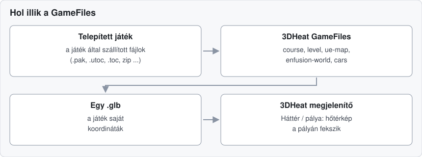

# Teljes pályák {#whole-levels}

**Egyszerűen:** lövöldözős és más, körök nélküli játékoknál az eszköz a teljes térképet egyetlen 3D
fájlba menti, hogy a megtekintő le tudja rajzolni, hol jártak a játékosok rajta.

A `course` a kör körüli talajt vágja ki. Körök nélküli játékoknál az eszköz egyszerre exportálja a
teljes pályát, térképet vagy világot:

| Játék vagy motor | Listázás | Exportálás | Oldal |
|---|---|---|---|
| Battlefield 6 (Frostbite) | `levels` | `level <level>` | [Battlefield 6 pályák](level-battlefield.md) |
| Unreal 5 World Partition játékok | `ue-maps <game>` | `ue-map <game> <map>` | [Unreal 5 térképek](level-unreal-world-partition.md) |
| Arma Reforger (Enfusion) | `enfusion-worlds` | `enfusion-world <world>` | [Arma Reforger világok](level-arma-reforger.md) |

Mindegyik pár ugyanúgy működik: az első parancs felsorolja, mit tartalmaz a telepített játék; a
második ezek egyikét egyetlen `.glb` fájlba írja a játék saját világkoordinátáiban, így a játékban
rögzített pozíciók rajta fekszenek. A részek a többi exporthoz hasonlóan `ground:`, `structure:` és
`water:` nevet kapnak (lásd [Kimeneti formátum](output-format.md)); a fájlt a 3DHeat megtekintő
Pálya panelében töltsd be.

