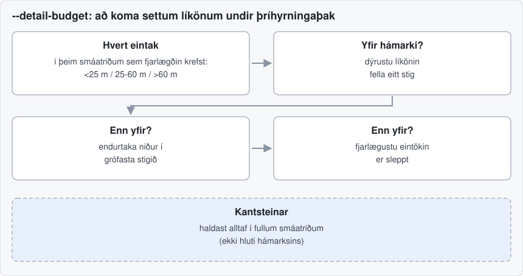

# Smáatriðastig og kostnaðarhámarkið {#levels-of-detail-and-the-budget}

**Þríhyrningur** er örlítill flatur biti af 3D líkani. Fleiri þríhyrningar þýða
stærri og hægari skrá. **Kostnaðarhámarkið** (budget) er þak á fjölda þeirra. **Smáatriðastig**
(level of detail) er einfaldara afrit af líkani, notað þegar það er langt í burtu.

Fínasta stig alls sem er sett í kringum hringbraut er nokkrar milljónir
þríhyrninga. Til dæmis hundruð vegriðshluta og dekkjastafla með um það bil
þúsund þríhyrninga hvert. Borgargangur geymir yfir hundrað þúsund eintök. Þess vegna gefur hver
brautarútflutningur staðsettu líkönunum **þríhyrningahámark** og ákveður, fyrir hvert
líkan, á hvaða smáatriðastigi það er teiknað, og, ef þarf, hvaða eintök á að skilja
eftir.

Kerfið var skrifað fyrir Forza
([`forzaplacement.py`](https://github.com/Holdi601/3DHeat-GameFiles/blob/main/heat3d_gamefiles/forzaplacement.py):
`choose_levels`, `auto_budget`, `_fit`), og BeamNG og AC Rally endurnota hluta þess.
Landið telst ekki með í hámarkinu.

## Fjarlægðarbönd {#distance-bands}

Fjarlægð hvers eintaks frá akstrinum er mæld í jarðfletinum, að
næsta hringsýni. Hringurinn er fyrst grisjaður í í mesta lagi 1.000 punkta, sem kostar
nokkra metra í nákvæmni og ekkert sem skiptir máli hér. Eintökum er svo skipt í
þrjú bönd, og hvert (líkan, band) par fær sitt eigið hámark:

| Band | Fjarlægð | Byrjar á |
|---|---|---|
| nær | undir 25 m (`NEAR`) | fínasta stigi |
| miðja | 25-60 m (`FAR`) | einu stigi grófara |
| fjær | 60 m og meira | grófasta stigi |

Án leiðar (Forza `terrain --box`) er fjarlægð mæld að miðju
kassans.

## Stigið niður til að passa {#stepping-down-to-fit}



Kostnaður færslu (líkan, band) er fjöldi eintaka x þríhyrningar á núverandi stigi hennar.
Á meðan heildin er yfir hámarkinu fer dýrasta færslan niður um eitt stig,
og það endurtekur sig þar til heildin passar eða ekkert getur farið lengra. Festar færslur
fara aldrei niður:

| Leikur | Fest á fullum smáatriðum |
|---|---|
| Forza | kantsteinar (`road_gen_rum*`) |
| BeamNG | kantsteinar, og hvert form sem ber akstursflöt |
| AC Rally | kantsteinar |

Samantekt Forza greinir frá þessu sem
`N of M models drawn at a coarser level to fit the budget`.

## Sjálfvirka hámarkið {#the-automatic-budget}

Án `--detail-budget` stillir hámarkið sig sjálft þannig að **ekkert eintak er skilið
eftir**:

```
budget = max(1,500,000, 1.25 x sum(copies x coarsest level))
```

Festar færslur telja á fínasta stigi sínu. 25% (`HEADROOM`) leyfa því sem er
við hlið vegarins að halda einhverjum smáatriðum. Á sveitahringbraut er þetta gólfið
upp á 1,5 milljón (`DEFAULT_BUDGET`). Á borgarbraut, þar sem gangurinn geymir yfir hundrað þúsund
eintök, vex það
upp í yfir tíu milljónir, og skráin í nokkur hundruð MB. Skoðarinn hleður því.

## Hámark sem þú gefur {#a-budget-you-give}

`--detail-budget N` er **þak**. Stig fara niður eins og að ofan. Ef jafnvel
grófustu stigin passa ekki eru eintök skilin eftir:

| Leikur | Í hvaða röð eintök eru skilin eftir |
|---|---|
| Forza | fyrst allt sem er 25 m eða meira frá akstrinum, síðan það sem stendur við hlið vegarins; innan hvors hóps, það sem lítur minnst út frá veginum fyrst: mest fjarlægð / stærð (stærð = hornalína umlykjandi kassa líkansins sinnum stærsti kvarði þess, að minnsta kosti 0,25 m) |
| BeamNG | fjærst akstrinum fyrst |
| AC Rally | fjærst akstrinum fyrst, eins og BeamNG |
| Battlefield 6 | minnst fyrst: hornalína umlykjandi kassa sinnum kvarði |

Kantsteinum (og, í BeamNG, líkönum akstursflata) er aldrei sleppt, svo hámark
sem er minna en þeir kosta einir og sér er farið yfir af þeim og engu öðru.

Verkfærið notar fjarlægð yfir stærð fyrir Forza því, raðað eftir fjarlægð einni saman,
lifir loftræstibúnaður á vegg níu metra í burtu af tuttugu metra framhliðina
sem hann hangir á, tólf metra í burtu. Það sem er við hlið vegarins fer síðast sama hver
stærðin er, því þriggja metra vörn fimm metra frá línunni er kantur
brautarinnar, en fimmtíu metra bygging sextíu metra aftar er umhverfi.

Samantektin greinir frá
`N of M copies left out to fit the budget, the smallest and furthest from the driving first (--detail-budget raises it)`
(Forza), eða `N copies left out to fit the budget, the furthest from the driving first (--detail-budget raises it)`
(BeamNG, AC Rally).

## Heilar byggingar (Forza) {#whole-buildings-forza}

Staðgengill heillar byggingar telst eitt eintak, með fjarlægð mælda að
næstu brún byggingarinnar. Hann er geymdur eða skilinn eftir sem heild. Einingahlutarnir sem hann
kemur í staðinn fyrir fá ekkert hámark. Sjá
[Forza Horizon](course-forza-horizon.md#buildings-drawn-whole).

## Hvað smáatriðastig er, eftir leik {#what-a-level-of-detail-is-per-game}

| Leikur | Stigin koma úr |
|---|---|
| Forza | stigagrímu hvers þríhyrnings í `Mesh` undirnetum líkansins (biti `level + 1`); `0xFFFF` brotanlegir hlutar aðeins fyrir líkan án merkts stigs |
| BeamNG | `details` í `.cdae` forminu með óneikvæðri stærð, stærst fyrst; fyrir `.dae`, talan aftast í heitum netahnúta (`barrier75`, `barrier40`) |
| AC Rally | geymd smáatriðastig kyrrstæða netsins, fínast fyrst |
| Battlefield 6 | smáatriðastig MeshSet, fínast fyrst, aðeins talin þau hlutar sem eru teiknaðir (ekki skugga- og dýptareintök), og ekki síðasta stig sem er staðgengill fjarsýnar (`M_LastLod`, `M_Billboard`, `M_Vista` efni: grind rafmagnsmasturs verður að föstum broddi) |

`level` í Battlefield 6 hefur engan hring, svo engin fjarlægðarbönd eru til: hvert net er
ein færsla, öll eintök á sama stigi. Sjálfvirka hámarkið er formúlan
að ofan með landbakgrunninn festan; landhæðarsviðið er utan hámarksins
og stærð þess ræðst af `--ground-spacing`. Undir hámarki sem þú gefur, þegar hvert net
er á grófasta stigi, eru eintök skilin eftir minnst fyrst, þar sem stærð er hornalína
umlykjandi kassa netsins sinnum kvarði eintaksins, því enginn akstur er til að
mæla fjarlægð frá. Landbakgrunninum er aldrei sleppt. Borð endar sjálfkrafa í
um tíu milljónum þríhyrninga.

## Að velja tölu {#choosing-a-number}

| Þú vilt | Prófaðu |
|---|---|
| allt, full smáatriði nálægt veginum | láttu það vera sjálfvirkt |
| skrá sem er nokkrum sinnum minni | `--detail-budget 500000` með `--texture-size 1024` |
| bara jörðina | `--no-placed` (ekkert hámark kemur við sögu) |
