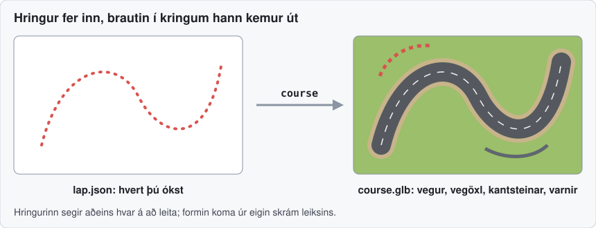
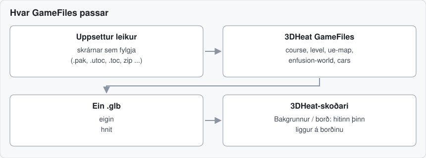

# 3DHeat GameFiles {#dheat-gamefiles}

**Hvað er þetta?** Verkfæri sem smíðar 3D líkan af kappakstursbraut eða leikjaborði
úr skrám leiks sem þú hefur þegar sett upp.

**Hvers vegna ætti ég að nota það?** 3DHeat-skoðarinn málar hvar þú ókst eða spilaðir sem
hita. Með þessu verkfæri málar hann það á raunverulegu brautina eða borðið, ekki á tómt rými.

**Dæmi:** taktu hring sem þú ókst. Verkfærið smíðar veginn og landið í kringum hann
sem eina 3D skrá, svo skoðarinn geti málað hraðann þinn eða árekstra á raunverulegu brautina:



Hefurðu aldrei notað skipanalínu? Byrjaðu á [Áður en þú byrjar](before-you-start.md).

Nánar: það les borðagögn úr skjalasöfnum sem leikur sendir með og skrifar þau
sem tvíundar glTF (`.glb`) skrá. Aðalverkefni þess er **brautarútflutningurinn** (course export): þú
gefur því hring og það skrifar landið, veginn aðgreindan frá vegöxl og
grasi, og kantsteina, varnir, dekkjaveggi, skilti og byggingar í kring.

Það er hluti af [3DHeat](https://github.com/Holdi601/3DHeat), skoðara fyrir
rauntíma 3D mælingahitakort, kappakstursgreiningu og leikjayfirlit
([skjöl](https://holdi601.github.io/3DHeat/)). `.glb` skrárnar sem þetta
verkfæri skrifar eru borðin sem skoðarinn teiknar hitann á.



Það er ein af þremur leiðum til að koma rúmfræði borðs inn í 3DHeat:

| Leið | Þarf | Gefur |
|---|---|---|
| 3DHeat Unreal Exporter | Unreal-verkefnið opið í ritlinum | nákvæma rúmfræði |
| 3DHeat GameCapture | skjá og upptöku | mat |
| **3DHeat GameFiles** | **uppsetta, útgefna leikinn** | **nákvæma rúmfræði, ekkert verkefni** |

Python-pakki: `heat3d_gamefiles`. Geymsla (repository):
[Holdi601/3DHeat-GameFiles](https://github.com/Holdi601/3DHeat-GameFiles). Leyfi: MIT.


## Eigin lesarar leikjanna {#the-games-own-readers}

Lesari hvers leiks er sérstakt verkefni, svo vandamál með skilmála eins leiks
snertir aðeins þann leik: settu upp verkfærið fyrir þinn leik (síða þess segir
hvernig), og þá virka bæði eigin skipun þess og skipanirnar hér. GameFiles keyrir
verkfæri leiksins með þeim færibreytum sem þú gafst; ekkert úr verkfærinu er
flutt inn. Það finnst sem skipun þess á `PATH`, sem uppsettur pakki þess, eða sem
mappa þess í `HEAT3D_<GAME>_MAPS` eða við hlið GameFiles (`exporters/ext/<game>-maps` í
3DHeat-afriti, eða `3DHeat-Ext-<Game>` við hlið þessarar möppu). Þegar það er ekki
uppsett segir skipunin hvar hægt er að fá það og hættir með kóðann 2.

| Leikur | Eigið verkfæri hans | Skipanir hér sem keyra það |
|---|---|---|
| Forza Horizon / Motorsport | [3DHeat-Ext-Forza](https://holdi601.github.io/3DHeat-Ext-Forza/) (`heat3d-forza-maps`) | `course` (Forza-hringir), `courses`, `races`, `cars`, `terrain`; `identify`, `list`, `extract` á `.minizip` |
| Battlefield (Frostbite) | [3DHeat-Ext-Battlefield](https://holdi601.github.io/3DHeat-Ext-Battlefield/) (`heat3d-battlefield-maps`) | `levels`, `level`; `identify` á Frostbite `.toc` |
| BeamNG.drive | [3DHeat-Ext-BeamNG](https://holdi601.github.io/3DHeat-Ext-BeamNG/) (`heat3d-beamng-maps`) | `course` (BeamNG-hringir); `identify` á `.cdae` eða `.ter` |
| Assetto Corsa Rally | [3DHeat-Ext-ACRally](https://holdi601.github.io/3DHeat-Ext-ACRally/) (`heat3d-acrally-maps`) | `course` (AC Rally hringir) |
| Arma Reforger (Enfusion) | [3DHeat-Ext-Reforger](https://holdi601.github.io/3DHeat-Ext-Reforger/) (`heat3d-reforger-maps`) | `enfusion-worlds`, `enfusion-world` |

## Hvað það getur {#what-it-can-do}

| Leikur eða vél | Brautarútflutningur (`course`) | Lestur skjalasafna |
|---|---|---|
| Forza Horizon (ForzaTech) | já: landslag, vegur og vegöxl, landáferð, sett líkön í eigin áferðum | `identify`, `list`, `extract` á `.minizip`; `identify` á `.modelbin`; líkön, landslag og áferðir gegnum `course` og `terrain` |
| BeamNG.drive | já: landslag, vegamerkingar (decals), smíðaðar hringbrautir, sett líkön, vatn | `identify`, `list`, `extract` á borðazip; `identify` á `.ter`, `.cdae`; `.dae` gegnum `course` |
| Assetto Corsa Rally (Unreal 5.6) | já: landflísar áfanga, bökuð landlitun, sett líkön í flötum litum | `identify`, `list`, `extract` á IoStore `.utoc`/`.ucas`; zen-pakkar, kyrrnet (static meshes), áferðir gegnum `course` |
| Unreal `.pak` (útgáfur 8-12) | nei | `identify`, `list`, `extract` |
| Unity (snið 22 og síðar) | nei | `identify`, `meshes` |
| Battlefield 6 (Frostbite `.toc`/`.cas`) | enginn hringur; heilt borð með `level`: landslag, sett net, litakort þeirra með `--textures` | `identify`, `levels`; búnt, net, landslag, áferðir og staðsetning gegnum `level` |
| Source 2 `.vpk` | nei | `identify`, `list`, `extract` |
| Unreal 5 World Partition leikir | enginn hringur; heilt kort með `ue-map` (talið upp af `ue-maps`): landslag, HLOD byggingar og hlutir, vatn | - |
| Arma Reforger (Enfusion) | enginn hringur; heill heimur með `enfusion-world` (talinn upp af `enfusion-worlds`): landslag í sínum litum, sjórinn, byggingar sem kassar | - |
| Forza (bílar) | `cars`: sérhver bíll í lágum smáatriðum, fyrir flipann Kappakstursgreining í skoðaranum | - |

Hringjum úr Assetto Corsa EVO og iRacing er hafnað með ástæðu. Sjá
[Takmarkanir og þekktar eyður](limits-and-known-gaps.md).

## Uppsetning {#install}

Hefurðu aldrei notað skipanalínu? Lestu fyrst [Áður en þú byrjar](before-you-start.md).

Þú þarft **Python 3.10 eða nýrra** (þróað á 3.13) og pakkana í
[`requirements.txt`](https://github.com/Holdi601/3DHeat-GameFiles/blob/main/requirements.txt).

```
git clone https://github.com/Holdi601/3DHeat-GameFiles.git
cd 3DHeat-GameFiles
pip install -r requirements.txt
```

Athugaðu síðan: `python -m heat3d_gamefiles --help`. Þú ættir að sjá
`usage: heat3d_gamefiles [-h]` og lista yfir skipanir (verbs). Keyrðu hverja skipun úr
möppu geymslunnar, sem `python -m heat3d_gamefiles <verb>`.

| Pakki | Notaður til |
|---|---|
| numpy | alls sem afkóðar rúmfræði |
| lz4 | Forza-skjalasafna (aðallega LZ4 blokkir), sumra Unity-búnta, IoStore LZ4 blokka |
| Pillow | að afkóða BC1-BC7 áferðir, skrifa JPEG áferðirnar í `.glb` |
| msgpack, zstandard | samsettra forma BeamNG (`.cdae`) |
| cryptography | aðeins til að opna dulkóðaða `.pak` með lykli sem þú átt þegar |
| pytest | prófananna |

Unreal-efni þjappað með **Oodle** þarf Oodle-safn sem er þegar til
á vélinni þinni. Slíku er aldrei dreift með þessu verkfæri. Sjá [Oodle](reader-oodle.md).

Verkfærið er skrifað fyrir Windows. Það finnur leiki gegnum safnalista Steam og
`%LOCALAPPDATA%`, og hleður Oodle sem Windows DLL. Aðrir vettvangar hafa ekki verið
prófaðir.

## Fljótleg byrjun {#quick-start}

**Hringskrá** (lap file) er upptaka af því hvert bíllinn þinn fór: listi af x, y, z punktum.
Hún kemur frá [3DHeat GameCapture](https://github.com/Holdi601/3DHeat-GameCapture)
eða hringasafni FH Companion forritsins; handskrifuð CSV virkar líka
([Hringinntök](lap-inputs.md)).

```
# Forza: a lap file, a lap folder, or a course name from the FH Companion library
python -m heat3d_gamefiles course "Example Circuit"
python -m heat3d_gamefiles course path\to\lap.json -o course.glb

# BeamNG.drive or Assetto Corsa Rally: a heat3d-lap file says which game it is from
python -m heat3d_gamefiles course my_lap.json

# Every course in the FH Companion library, one .glb each
python -m heat3d_gamefiles courses -o courses

# Battlefield 6: list the levels, then export one (a large file; see Commands)
python -m heat3d_gamefiles levels
python -m heat3d_gamefiles level <level> -o level.glb --textures

# Unreal 5 World Partition and Arma Reforger: list, then export
python -m heat3d_gamefiles ue-maps "<game>"
python -m heat3d_gamefiles ue-map "<game>" <map> -o map.glb
python -m heat3d_gamefiles enfusion-worlds
python -m heat3d_gamefiles enfusion-world <world> -o world.glb

# Every Forza car, for the viewer's race tab
python -m heat3d_gamefiles cars -o forza.h3dcars

# What is this file?
python -m heat3d_gamefiles identify some_archive.pak
```

Opnaðu `.glb` skrána í 3DHeat-skoðaranum. Eigin heimshnit leiksins haldast
(sjá [Úttakssnið](output-format.md)), svo skráður hringur raðast upp við brautina.

## Kort yfir þessi skjöl {#map-of-this-documentation}

- [Áður en þú byrjar](before-you-start.md): Python, skipanalína, fyrsta skipunin.
- [Skipanir](commands.md): hver skipun og valkostur, með dæmum.
- [Skipanayfirlit](../cli-reference.md): `--help` hverrar skipunar, búið til úr kóðanum.
- [Skoðun skjalasafna](inspecting-archives.md): `identify`, `list`, `extract`, `meshes`, skref fyrir skref.
- [Brautarútflutningur](https://holdi601.github.io/3DHeat-Ext-Forza/course-export.html): hvernig hringur verður að braut, fyrir alla leiki.
  - [Forza Horizon](https://holdi601.github.io/3DHeat-Ext-Forza/course-forza-horizon.html)
  - [BeamNG.drive](https://holdi601.github.io/3DHeat-Ext-BeamNG/course-beamng.html)
  - [Assetto Corsa Rally](https://holdi601.github.io/3DHeat-Ext-ACRally/course-assetto-corsa-rally.html)
  - [Smáatriðastig og kostnaðarhámarkið](detail-budget.md)
- [Heil borð](whole-levels.md): borð, kort eða heimur án hrings.
  - [Battlefield 6 borð](https://holdi601.github.io/3DHeat-Ext-Battlefield/level-battlefield.html): `levels`, `level`
  - [Unreal 5 kort](level-unreal-world-partition.md): `ue-maps`, `ue-map`
  - [Arma Reforger heimar](https://holdi601.github.io/3DHeat-Ext-Reforger/level-arma-reforger.html): `enfusion-worlds`, `enfusion-world`
- [Forza bílar](https://holdi601.github.io/3DHeat-Ext-Forza/forza-cars.html): `cars`, bílaskráin fyrir flipann Kappakstursgreining í skoðaranum.
- [Hringinntök](lap-inputs.md): hver hringskráargerð sem verkfærið tekur við.
- [Úttakssnið](output-format.md): hvað er inni í `.glb`.
- [Skjalasafnalesarar](archive-readers.md): ein síða fyrir hvert gámasnið, sem fjallar um
  hvað hver les, hvað ekki, og hvers vegna.
- [Takmarkanir og þekktar eyður](limits-and-known-gaps.md)
- [Bilanaleit](troubleshooting.md): villuboðin og hvað á að gera.
- [Reglur og leyfi](rules-and-licences.md): engir lyklar, þínar eigin skrár, engin endurdreifing.
- [Uppfærslur](updates.md): uppfærsluathugunin og `heat3d_update`.
- [Þróun](development.md): einingakort og prófanir, þar á meðal prófanirnar sem keyra gegn uppsettum leikjum.
- [Viðhald](maintaining.md): útgáfugátlisti fyrir þessar síður.

## Hluti af 3DHeat {#part-of-3dheat}

3DHeat GameFiles er eitt af ókeypis verkfærunum í kringum 3DHeat-skoðarann:

| Verkfæri | Hvað það gerir | Skjöl |
|---|---|---|
| [3DHeat](https://github.com/Holdi601/3DHeat) | skoðarinn: 3D hitakort, kappakstursgreining og leikjayfirlit í vafranum | [vefur](https://holdi601.github.io/3DHeat/) |
| [GameFiles](https://github.com/Holdi601/3DHeat-GameFiles) | brautir og borð úr skrám sem leikur sendir með, sem `.glb` | [vefur](https://holdi601.github.io/3DHeat-GameFiles/) |
| [GameCapture](https://github.com/Holdi601/3DHeat-GameCapture) | hringmælingagögn úr kappakstursleikjum; borð endurbyggð úr leikmyndbandi | [vefur](https://holdi601.github.io/3DHeat-GameCapture/) |
| [Unreal Exporter](https://github.com/Holdi601/3DHeat-UnrealExporter) | viðbót fyrir Unreal Editor sem vistar borð sem `.glb` | [vefur](https://holdi601.github.io/3DHeat-UnrealExporter/) |
| [CS2](https://github.com/Holdi601/3DHeat-CS2) | Counter-Strike 2 demo í leikskrár; kort í `.glb` | [vefur](https://holdi601.github.io/3DHeat-CS2/) |
| [Watcher](https://github.com/Holdi601/3DHeat-Watcher) | skráir leik þinn í bakgrunni úr því sem leikir birta | [vefur](https://holdi601.github.io/3DHeat-Watcher/) |
| [Ext-WarThunder](https://github.com/Holdi601/3DHeat-Ext-WarThunder) | War Thunder upptökur í leikskrár | [vefur](https://holdi601.github.io/3DHeat-Ext-WarThunder/) |
| [Ext-WoT](https://github.com/Holdi601/3DHeat-Ext-WoT) | World of Tanks upptökur í leikskrár | [vefur](https://holdi601.github.io/3DHeat-Ext-WoT/) |
| [Ext-WoWs](https://github.com/Holdi601/3DHeat-Ext-WoWs) | World of Warships upptökur í leikskrár | [vefur](https://holdi601.github.io/3DHeat-Ext-WoWs/) |
| [Ext-Squad](https://github.com/Holdi601/3DHeat-Ext-Squad) | Squad þjónsdemo í leikskrár | [vefur](https://holdi601.github.io/3DHeat-Ext-Squad/) |
| [Ext-DCS](https://github.com/Holdi601/3DHeat-Ext-DCS) | DCS World kort í `.glb` borð | [vefur](https://holdi601.github.io/3DHeat-Ext-DCS/) |
| [Ext-IL2](https://github.com/Holdi601/3DHeat-Ext-IL2) | IL-2 Sturmovik kort í `.glb` borð | [vefur](https://holdi601.github.io/3DHeat-Ext-IL2/) |

Leikskrár skoðarans eru lýstar í
[Ein skrá fyrir hvern leik: `.3dheat`](https://holdi601.github.io/3DHeat/container.html);
borð sem er gert hér er hlaðið við hlið þeirra í spjaldinu Bakgrunnur / borð í skoðaranum.
