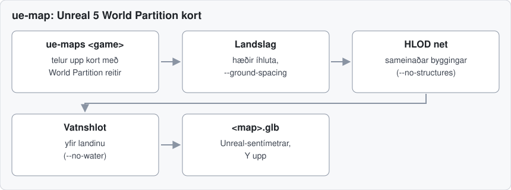

# Unreal 5 World Partition kort: `ue-maps` og `ue-map` {#unreal-5-world-partition-maps-ue-maps-and-ue-map}

**Hvað er þetta?** Heilt kort úr Unreal 5 leik sem ein 3D skrá: jörðin,
byggingarnar og vatnið. **Hvers vegna?** Svo hiti úr þeim leik hafi kortið undir sér.
(*World Partition* er hvernig Unreal 5 skiptir stóru korti í búta; *HLOD* er
einfaldaður staðgengill fyrir hóp bygginga, sá sem leikurinn teiknar langt í burtu.)

Flytur út heilt kort úr Unreal 5 leik þar sem kort eru bökuð sem World
Partition reitir: landslagið, sameinuð HLOD net kortsins (byggingar þess
og munir eins og leikurinn teiknar þá í fjarlægð) og vatnshlot þess. Enginn
ritill og ekkert verkefni þarf, aðeins uppsetti leikurinn.



## Skref fyrir skref {#step-by-step}

1. **Listaðu kortin.** `<game>` er mappa leiksins, `Content/Paks` hennar, eða
   heiti möppu hans í Steam-safni:

   ```
   python -m heat3d_gamefiles ue-maps "<Steam game folder name>"
   python -m heat3d_gamefiles ue-maps "D:\Games\<game>"
   ```

   Hvert kort með bökuðum World Partition reitum er prentað með pakkaslóð sinni.

2. **Fluttu eitt út** með heiti þess eða einstökum hluta þess:

   ```
   python -m heat3d_gamefiles ue-map "<game>" <map> -o map.glb
   ```

3. **Bara jörðin, eða grófara:**

   ```
   python -m heat3d_gamefiles ue-map "<game>" <map> --no-structures --no-water
   python -m heat3d_gamefiles ue-map "<game>" <map> --ground-spacing 4
   ```

4. **Opnaðu `map.glb`** í Bakgrunnur / borð spjaldi 3DHeat-skoðarans
   ([að hlaða borði](https://holdi601.github.io/3DHeat/levels.html)).

## Valkostir {#options}

| Valkostur | Sjálfgefið | Merking |
|---|---|---|
| `<game>` | nauðsynlegt | mappa leiksins, `Content/Paks` hennar, eða heiti Steam-möppu hans |
| `<map>` | nauðsynlegt | heiti eins og `ue-maps` prentar það, eða einstakur hluti þess |
| `-o`, `--out FILE` | `<map>.glb` (í `$HEAT3D_LEVELS/<game>/` þegar það er stillt) | skráin sem er skrifuð |
| `--ground-spacing METRES` | 2 | hnútabil landslagsins, rúnnað í heilan fjölda eigin ferhyrninga þess |
| `--no-structures` | | sleppa HLOD byggingum og munum |
| `--no-water` | | sleppa vatnshlotum |

Efni sem er þjappað með Oodle þarf Oodle safn sem þegar er á tölvunni
(sjá [Oodle](reader-oodle.md)).

## Dæmi um úttak {#example-output}

```text
<map> -> map.glb
  ground      <n> triangles from <n> landscape components; <n> of <n> vertices stored twice disagree
  structure   <n> triangles in <n> HLOD meshes
  water       <n> triangles from <n> water bodies
```

Ósamræmistalan er sjálfsprófun: nágrannalandslagsíhlutir
geyma sameiginlega brún sína tvisvar, og þetta tvennt verður að passa. 3 km kort í 2 m er
um 4,6 milljónir jarðarþríhyrninga.

## Hlutarnir {#the-parts}

`ground:<map>` (landslagið), `structure:<map>` (HLOD netin) og
`water:<map>` (vatn sem stendur yfir jörðinni).

**Einingar:** þetta er eini útflutningurinn sem er **ekki í metrum**: Unreal sentímetrar, með Y
og Z víxluð (Y upp), ásakerfið sem 3DHeat Unreal Exporter skrifar. Mælingar
úr sama leik nota sama ásakerfi, svo þær liggja á kortinu.

## Hvernig það er lesið og prófað {#how-it-is-read-and-checked}

| Hluti | Lesið úr | Prófað á móti |
|---|---|---|
| jörð | 16 bita hæðarkort hvers landslagsíhluta, sett með kaflagrunni hans á hnitabreytingu landslagsins | hver hnútur sem er geymdur tvisvar (á samskeyti eða brún íhluta) verður að passa; ósamræmi er talið og prentað, ekki jafnað út |
| bygging | sameinuð HLOD net kortsins, smíðuð af vélinni í heimsrými | net er aðeins geymt ef mörkin sem íhlutur þess geymir lýsa eigin hnútum þess |
| vatn | net hvers vatnshlots, lagt á jarðarnetið, geymt þar sem það stendur yfir jörðinni | vatn situr nokkra metra yfir jörðinni undir sér, eins og á yfir farvegi sínum |

Eigindir landslagsins eru fundnar eftir lögun, ekki eftir raufanúmeri (raufar færast
milli útgáfa vélarinnar). Byggingarnar eru einfölduðu staðgenglarnir, ekki
líkönin með fullum smáatriðum. Gróður, límmiðar og landslagsefni eru ekki flutt út;
jörðin er án áferðar og skyggð af skoðaranum. Upplýsingar um skjalasafnið:
[Unreal 5 IoStore](reader-unreal-iostore.md).

**Skilmálar:** leyfi leikja heimila yfirleitt persónulega notkun sem er ekki í viðskiptaskyni og banna
bakverkfræði „to the extent that such actions cannot be prohibited by
law“. Að lesa eigin uppsetningu er þín ákvörðun samkvæmt þeim; úttakið er til
eigin nota og má ekki deila.
