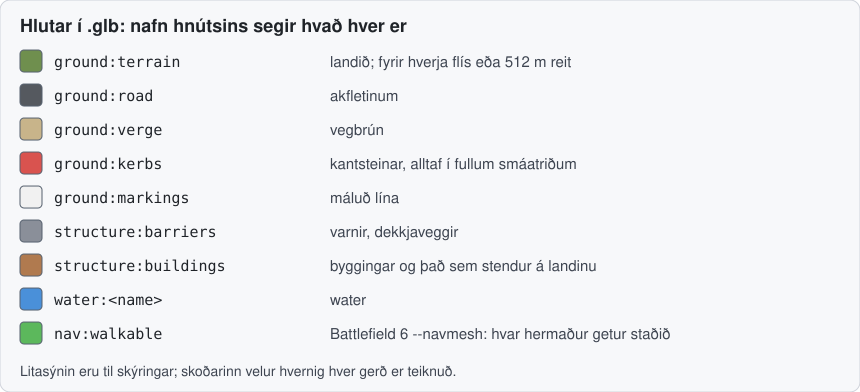

# Úttakssnið {#output-format}

`.glb` er ein 3D skrá: jörðin, byggingarnar og vatnið á braut eða
borði, sem þú opnar í spjaldinu Bakgrunnur / borð í 3DHeat-skoðaranum.

Sérhver útflutningur (`course`, `courses`, `terrain`, `level`, `ue-map`, `enfusion-world`) skrifar eina **tvíundar glTF 2.0**
skrá (`.glb`). Hún er viljandi lítil og flöt, og sett upp eins og 3DHeat
skoðarinn les borð. Frumkóði:
[`glb.py`](https://github.com/Holdi601/3DHeat-GameFiles/blob/main/heat3d_gamefiles/glb.py).

## Uppbygging {#structure}

```
scene 0
 ├─ node "ground:terrain x-2046 z1023"  -> mesh 0 -> 1 primitive, material 0
 ├─ node "ground:road x-2046 z1023"     -> mesh 1 -> 1 primitive, material 1
 ├─ node "ground:markings"               -> mesh 2 -> ...
 ├─ node "ground:kerbs road_gen_rum_..." -> ...
 ├─ node "structure:barriers bar_armco_bclr"
 └─ ...
```

- **Einn hnútur (node) fyrir hvern hluta**, allir í rót senunnar, án **nokkurra umbreytinga**. Öll
  rúmfræði er þegar í heimsrúmi.
- Hver hnútur hefur sitt eigið net með **einu frumstæði (primitive)** og sitt eigið efni. Hnúturinn,
  netið og efnið bera öll nafn hlutans.
- Hvert frumstæði hefur **sín eigin þéttu hnútafylki**, aðeins hnútana sem sá
  hluti notar. Sameiginlegt hnútafylki er löglegt glTF, en lesari sem víkkar út aðgangsstig (accessors)
  hvers frumstæðis myndi þá geyma hvern hnút einu sinni fyrir hvern hluta.
- `asset.generator` er `heat3d_gamefiles`.
- **Fá `extras`**, og ekkert hringa-, leikja- eða brautarnafn:
  - Battlefield 6 hluti úr eyðanlegu neti ber `{"destructible": true}` á hnúti sínum;
  - Forza braut segir hvað hún geymir í `asset.extras` (sniðútgáfa, leiðarauðkenni sem
    passaði, hversu mörg eintök af eigin lagi kappakstursins, vettvangar; sjá
    [Forza Horizon brautir](course-forza-horizon.md#writing-the-file)), og
    hlutar hennar sem kveikt er á bera lag sitt á hnútnum: `{"layer": "event", "route": <id>}`
    fyrir eigið lag kappakstursins, `{"layer": "layer"}` fyrir annað lag sem kveikt er á,
    `{"layer": "venue"}` fyrir jörð vettvangs.

  Allt annað sem skoðarinn þarf er í hnútanöfnunum.

## Hnútanöfn: flokkunin {#node-names-the-classification}



Skoðarinn tekur flokk hlutar úr nafni **hnútsins** (og fellur aftur á nafn netsins),
og aðeins þegar það passar við

```
^(ground|structure|water)\s*[:|]
```

Allt annað er flokkað með reglu sem var skrifuð fyrir Unreal landslag. Því
byrjar sérhver hluti sem útflytjandinn skrifar á einu af þessum forskeytum, eða á
`nav:` (hér á eftir):

| Forskeyti | Merking | Hlutar sem eru skrifaðir |
|---|---|---|
| `ground:` | akstursflöturinn og landið | `ground:road`, `ground:verge`, `ground:terrain`, `ground:gravel and dirt`, `ground:kerbs`, `ground:markings`, `ground:tyre marks`, `ground:venue`, `ground:plinths` |
| `structure:` | það sem stendur á því | `structure:barriers`, `structure:props`, `structure:signs`, `structure:buildings`, `structure:infrastructure`, `structure:bridges`, `structure:rocks`, `structure:smashables`, `structure:trees`; Forza lög `structure:event_<category>` og `structure:layer_<category>` |
| `water:` | vatn | `water:water`; `water:<map>` (`ue-map`), `water:<world>` (`enfusion-world`) |
| `nav:` | þar sem hermaður getur gengið (Battlefield 6, aðeins `--navmesh`) | `nav:walkable` |

`nav:` passar ekki við mynstur skoðarans hér að ofan, svo skoðarinn flokkar það með
reglunni sinni; það er sérstakur hluti svo þú getir sýnt það eða falið eitt og sér.
`ue-map` skrifar `ground:<map>`, `structure:<map>` og `water:<map>`;
`enfusion-world` skrifar `ground:<world>`, `structure:<world>` og `water:<world>`.

Á eftir tegundinni kemur, eftir leik:

| Dæmi | Merking |
|---|---|
| `ground:road x-2046 z1023` | Forza jörð í landslagsflísinni sem heitir `x-2046 z1023` (netaeiningar, 1023 á hverja 512 m) |
| `ground:road 3_-2` | BeamNG jörð í 512 m ferningi (3, -2) |
| `ground:road 3_-2 asphalt_light` | BeamNG smíðaður akstursflötur úr efninu `asphalt_light` í þeim ferningi |
| `ground:road 1_-4` | AC Rally jörð í 512 m ferningi (1, -4) í Unreal rými |
| `structure:barriers bar_armco_bclr` | Forza sett líkön sem deila einni áferð (nafn hennar án GUID) |
| `structure:barriers` | sett líkön án áferðar (Forza, AC Rally) |
| `structure:event_barriers bar_example_bclr` | Forza: það sem kappaksturinn sem passaði setur út fyrir sjálfan sig, aðskilið frá frjálsa heiminum (hnútaextras `{"layer": "event", "route": <id>}`) |
| `structure:layer_props` | Forza: lag sem leikurinn kveikir á fyrir eitthvað annað en þennan kappakstur (athöfn, safngrip, keyrslulag) |
| `ground:venue`, `ground:plinths` | Forza: líkön þegar í heimshnitum - eigin jörð vettvangs (gólf leikvangs), og jörð sem gata er skreytt með |
| `structure:barriers armco_metal` | BeamNG sett líkön úr einu efni |
| `ground:markings`, `water:water` | flatir hlutar, einn fyrir alla skrána |
| `ground:terrain` (Battlefield 6) | hæðarsviðið; `ground:terrain backdrop` fjarlægu landslagsnetin, `ground:terrain blend` net sem blandast inn í landslagið |
| `nav:walkable` (Battlefield 6, `--navmesh`) | leiðsögunet borðsins fyrir hermann: þar sem hægt er að standa, flatt grænt |
| `ground:terrain x-512 z-512` (Battlefield 6, `--ground-texture`) | hæðarsviðið undir einni bakaðri merkingaflís, nefnd eftir lága horni flísarinnar í metrum |
| `structure:buildings t_concreteclean_01_cs` (Battlefield 6, `--textures`) | allir fletir af þeirri tegund sem sýna það litakort; án `--textures` einn hluti fyrir hverja tegund, engin viðskeyti |
| `structure:buildings t_concreteclean_01_cs (destructible)` (Battlefield 6) | það sama, fyrir net sem leikur getur eyðilagt: þau sem hafa eyðingareign með sínu eigin nafni (veggir, hús, leikmunir). Hnúturinn ber líka glTF extras `{"destructible": true}`. Eyðilögð ástönd þeirra eru ekki flutt út |

Skoðarinn getur síað eftir þessum nöfnum. Til dæmis er "aðeins kappakstursflöturinn"
`ground:road` ásamt `ground:kerbs`, í öllum þremur leikjunum, og "heimurinn
án eigin leikmuna kappakstursins" er allt nema `structure:event_*`. Forskeytið er líka
hvernig skoðarinn teiknar hluta: jörð sem flötinn sem hitinn liggur á, mannvirki sem
það sem stendur á honum.

## Einingar, ásar og hnitakerfi {#units-axes-and-frame}

- **Metrar, Y upp**, venja glTF, fyrir sérhvern útflutning nema `ue-map`. Ekkert
  er kvarðað aftur eða miðjað aftur: tölurnar eru heimshnit leiksins, sem
  er tilgangurinn með því að lesa skjalasafnið í stað þess að endurbyggja.
- **Unreal 5 kort (`ue-map`): sentímetrar**, eigin eining Unreal, með Y og Z
  víxluð svo Y sé upp - hnitakerfið sem 3DHeat Unreal Exporter skrifar og
  mælingagögn leiksins nota. Eini útflutningurinn sem er ekki í metrum.
- **Arma Reforger (`enfusion-world`):** metrar leiksins sjálfs, x austur, y upp,
  z norður. Hnitakerfi leiksins er vinstrihandar; *Snúa heimsás við* í skoðaranum
  sýnir það óspeglað.
- **Forza:** heimshnit leiksins sjálfs (x, y upp, z), óbreytt. Það sama og
  mælingagögnin, svo upptekinn hringur liggur á brautinni.
- **BeamNG.drive:** `(x, z, -y)` úr Z-upp heimi BeamNG, sem er snúningurinn sem
  mælingaupptakan beitir. Snúningur, ekki speglun.
- **Battlefield 6:** heimshnit leiksins sjálfs (x, y upp, z), óbreytt:
  umbreytingar eintaka borðsins beitt á hvert net eins og það er geymt. Spegluð
  eintök eru undin upp á nýtt svo stefnuvektorar þeirra vísi út á við.
- **Assetto Corsa Rally:** hnitakerfi hringsins. Unreal sentímetrar verða metrar,
  Unreal Z verður y, og Unreal X og Y verða x og z í þeirri af átta
  stefnum sem hringurinn passaði í (sjá
  [Assetto Corsa Rally](course-assetto-corsa-rally.md#which-stage-and-which-way-round)).
  Þríhyrningar eru undnir upp á nýtt þar sem sú vörpun speglar.

Hver útflutningur heldur ásunum sem mælingagögn hans nota, svo upptakan og borðið
deila hnitakerfi. Hvort það hnitakerfi er vinstri- eða hægrihandar í hverjum leik
hefur ekki verið athugað.

## Hnútagögn {#vertex-data}

Sjálfgefið er **skammtað (quantised)** form (`quantize=True`). Það þarf
`KHR_mesh_quantization` viðbótina, sem er skráð bæði í `extensionsUsed` og
`extensionsRequired`.

| Eigind | Skammtað (sjálfgefið) | Full nákvæmni (`quantize=False`) |
|---|---|---|
| `POSITION` | float32 VEC3, með min/max | float32 VEC3 |
| `NORMAL` | int8 VEC3 normað, fyllt í 4 bæti (stride 4) | float32 VEC3 |
| `TEXCOORD_0` (aðeins áferðarhlutar) | uint16 VEC2 normað, klemmt í 0-1; float32 VEC2 þar sem áferðir endurtaka sig (Battlefield 6) | float32 VEC2 |
| `COLOR_0` (hlutar án áferðar, þegar einhver hluti hefur lit) | uint8 VEC3 normað, fyllt í 4 bæti | float32 VEC3 |
| vísar (indices) | uint16 þegar hlutinn hefur í mesta lagi 65.535 hnúta, annars uint32 | uint32 |

Hnútur er 20 bæti í stað 32 (24 í stað 44 með lit). Það tekur þriðjung af
hverri skrá, og er munurinn á því hvort borgarbraut hleðst í
vafraflipa eða ekki. Kostnaðurinn er undir hálfri gráðu í stefnuvektor og 1/65.535 af
UV (fimmtándi hluti áferðarpunkts í 4.096 px). Skipanalínan skrifar alltaf
skammtaða formið. `write_glb(..., quantize=False)` í Python skrifar hitt.

Stefnuvektorar koma frá leiknum þar sem hann geymir þá (Forza landslag og líkön, BeamNG
form og landslag). Annars eru þeir reiknaðir sem flatarmálsvegnir mjúkir stefnuvektorar
úr þríhyrningunum. AC Rally stefnuvektorar eru alltaf reiknaðir.

## Efni, litir og áferðir {#materials-colours-and-textures}

- Sérhvert efni er `metallicFactor 0`, `roughnessFactor 1`.
- **Hluti með áferð:** `baseColorTexture` með mynd hlutans, UV hnitum, og engum hnútalit.
  glTF margfaldar þetta tvennt, svo flötur kæmi út dekktur tvisvar.
- **Hluti án áferðar:** hnútalitur `COLOR_0` með flata lit hlutans, og
  hvítur `baseColorFactor`. Ef enginn hluti í skránni hefur lit er enginn
  `COLOR_0`. Þar sem hlutar deila hnútum ræður litur síðari hlutans, svo flatir
  hlutar eru skrifaðir í röð vaxandi mikilvægis.
- **Myndir** eru felldar inn í tvíundarbútinn sem **JPEG**, gæði 90, engin litasýnatökuminnkun
  (chroma subsampling), aðeins RGB (alfa er sleppt) - nema Battlefield 6 útskorið kort
  (lauf, girðingar), sem er **PNG** með alfa sínu, á efni með
  `alphaMode` MASK, `alphaCutoff` 0,5 og `doubleSided` (sjá
  [Frostbite](reader-frostbite.md#textures-and-materials)). 3DHeat skoðarinn
  hendir áferðarpunktum undir þröskuldinum. 2048 px jörð af grasi og trjákrónum
  er suð fyrir taplausan kóðara: nokkur megabæti á flís sem PNG, undir einu
  sem JPEG. Mynd sem nokkrir hlutar deila er geymd einu sinni.
- Einn sýnatökubúnaður (sampler) fyrir allar áferðir: línuleg stækkun, línuleg-mipmap-línuleg
  minnkun, **klemma við brún** á báðum ásum, fyrir brautarútflutninginn, þar sem
  áferðir þekja fleti sína einu sinni. BeamNG teiknar endurteknar líkanaáferðir sem
  flata liti (sjá [BeamNG.drive](course-beamng.md#placed-models)).
- Battlefield 6 útflutningur með `--textures`, þar sem efni flísast, skrifar
  eigin áferðarhnit leiksins, óklemmd, sem float32 `TEXCOORD_0` jafnvel í
  skammtaða forminu, með sýnatökubúnaði sem **endurtekur** á báðum ásum
  (`write_glb(..., repeat=True)`): múrsteinsveggur er eitt par þríhyrninga þar sem
  UV gengur frá 0 til 40. 3DHeat skoðarinn vefur slíka áferð inni í atlasinum sínum (sjá
  síðuna *Model levels* þar). Fyrir birti sem getur ekki endurtekið áferð
  sker `level --clamped-uvs` (`write_level(..., clamped=True)`) hvern þríhyrning
  eftir línunum þar sem áferðin endurtekur sig og flytur hvern bút í 0..1:
  sömu punktar á sama fleti, um fimmtungi fleiri þríhyrningar. Þríhyrningar
  sem áferð endurtekur sig yfir oftar en 16 sinnum halda hnitum sínum. Þríhyrningur
  sem áferðin myndi skera í fleiri en 4 búta - börkur sem endurtekur sig niður
  hverja grein trés, þar sem skurðurinn breytti 1.099 þríhyrningum eins trés í
  51.735 - fer í sérstakan hluta, `<part> (average colour)`, í
  meðallit áferðarinnar; `level` segir hversu marga.

| Áferð | Stærð | Þekur |
|---|---|---|
| jörð (allir leikir nema Battlefield 6) | `--texture-size`: 2048, 1024 eða 512 px | einn 512 m ferning: 25, 50 eða 100 cm á punkt |
| Battlefield 6 hæðarsvið | stærsta mip litakorts bakgrunnsins í borðinu, skorið | landslagsferninginn: 32 m á punkt í borðinu sem var athugað |
| Battlefield 6 fletir | `--textures`: í mesta lagi svo margir px á hlið | eigin áferð flatarins, einu sinni fyrir hvern bút (skorið þar sem hún endurtekur sig) |
| Battlefield 6 bökuð jörð | `--ground-texture`: metrar á punkt, flísar allt að 4.096 px | eina flís af útbreiðslu merkinganna: 2.048 m við 0,5 m á punkt |
| Forza sett líkan | í mesta lagi 256 px | eigið UV skipulag líkansins |
| BeamNG sett líkan | í mesta lagi 256 px | eigið UV skipulag líkansins, aðeins þar sem það endurtekur sig ekki |
| AC Rally sett líkan | engin | flatir litir |

## Hverju ritarinn hafnar {#what-the-writer-refuses}

`write_glb` kastar villu frekar en að skrifa skrá sem skoðari myndi opna og sýna
rangt:

| Hafnað | Vegna þess |
|---|---|
| staðsetningar sem eru ekki N x 3, eða ekki endanlegar | brotið net |
| vísir fram yfir lok hnútalistans | teiknast sem suð |
| hluti með áferð þegar skráin hefur engin UV | teiknast sem einn útsmurður punktur |
| engir þríhyrningar | teiknast sem ekkert |
| stefnuvektor-, lita- eða UV-fylki af rangri lengd, eða ekki endanlegt | einn fyrir hvern hnút þarf |

## Að lesa það annars staðar {#reading-it-elsewhere}

Sérhver glTF 2.0 skoðari sem styður `KHR_mesh_quantization` ætti að opna þessar
skrár. Aðeins 3DHeat skoðarinn hefur verið athugaður; aðrir skoðarar eru óstaðfestir. Lesari
án viðbótarinnar hafnar skránni, því hún er merkt sem nauðsynleg. Skrárnar geta verið stórar: um 80 MB fyrir
sveitahringbraut, allt að nokkur hundruð MB fyrir borgarbraut með sjálfvirka
hámarkinu.

## Í 3DHeat {#in-3dheat}

Hladdu `.glb` í spjaldið Bakgrunnur / borð í [3DHeat](https://github.com/Holdi601/3DHeat) skoðaranum;
mælingagögnin sem þú tekur upp í sama leik liggja á henni, því bæði
halda hnitum leiksins. Eigin skjöl skoðarans
([holdi601.github.io/3DHeat](https://holdi601.github.io/3DHeat/)) fjalla um
spjaldið Bakgrunnur / borð og leikskrárnar sem hin verkfærin skrifa
([Ein skrá fyrir hvern leik: `.3dheat`](https://holdi601.github.io/3DHeat/container.html)).
Borð er ekki geymt í hverri `.3dheat` skrá: leikur nefnir það í sínum
`references` (`kind: "level"`, nafn og sha256) og `.glb` er geymt við hliðina á
leikjunum.
