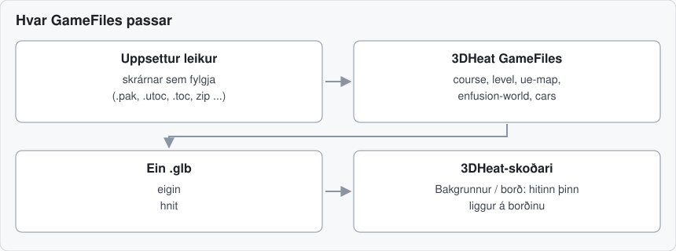

# Heil borð {#whole-levels}

**Í einföldu máli:** fyrir skotleiki og aðra leiki án hringja vistar verkfærið
allt kortið sem eina 3D skrá, svo skoðarinn geti teiknað hvert leikmenn fóru á því.

`course` sker landið í kringum hring. Fyrir leiki án hringja flytur verkfærið út
heilt borð, kort eða heim í einu:

| Leikur eða vél | Listi | Útflutningur | Síða |
|---|---|---|---|
| Battlefield 6 (Frostbite) | `levels` | `level <level>` | [Battlefield 6 borð](https://holdi601.github.io/3DHeat-Ext-Battlefield/level-battlefield.html) |
| Unreal 5 World Partition leikir | `ue-maps <game>` | `ue-map <game> <map>` | [Unreal 5 kort](level-unreal-world-partition.md) |
| Arma Reforger (Enfusion) | `enfusion-worlds` | `enfusion-world <world>` | [Arma Reforger heimar](https://holdi601.github.io/3DHeat-Ext-Reforger/level-arma-reforger.html) |

Hvert par virkar eins: fyrri skipunin telur upp hvað uppsetti leikurinn
geymir, sú síðari skrifar eitt af því sem eina `.glb` í eigin
heimshnitum leiksins, svo staðsetningar skráðar í þeim leik liggja á því. Hlutarnir eru
nefndir `ground:`, `structure:` og `water:` eins og allur annar útflutningur (sjá
[Úttakssnið](output-format.md)); hladdu skránni í spjaldinu Bakgrunnur / borð
í 3DHeat-skoðaranum.

