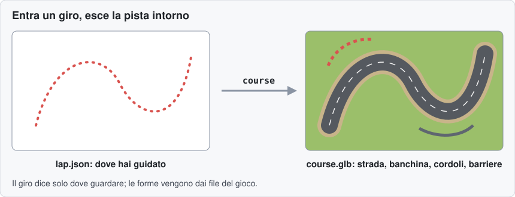
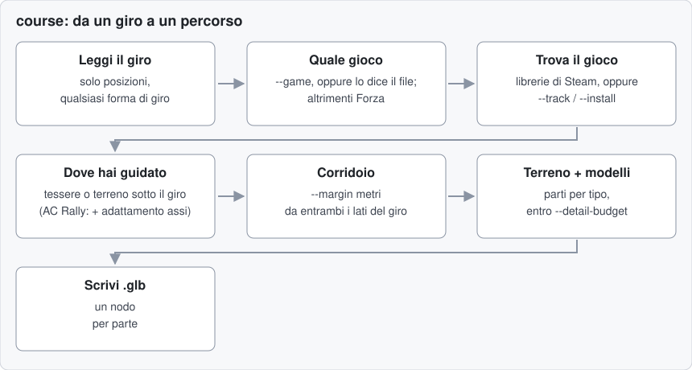

# Esportazione del percorso {#course-export}

**In parole semplici:** hai guidato un giro; questo costruisce la pista su cui hai guidato, come file 3D.
Il giro è solo una serie di punti; la strada, l'erba e i cordoli vengono dai file del gioco stesso.

`course` trasforma un giro in un percorso: il suolo in una fascia su entrambi i lati del punto in cui è
passata l'auto, e ciò che sta su quel suolo, in un unico `.glb` per il visualizzatore. Questa pagina
descrive ciò che hanno in comune i tre giochi supportati. Le pagine sotto descrivono ciò che cambia:

- [Forza Horizon](course-forza-horizon.md): archivi `.minizip` di ForzaTech
- [BeamNG.drive](course-beamng.md): archivi zip, una mappa dell'altezza del terreno, forme compilate
- [Assetto Corsa Rally](course-assetto-corsa-rally.md): Unreal 5 IoStore, una tappa World Partition
- [Livelli di dettaglio e budget](detail-budget.md): quanti triangoli ricevono i modelli collocati, e quali copie restano

## I passaggi {#the-steps}

Termini usati qui sotto: un **sistema di riferimento** è la direzione degli assi; il **corridoio** è la fascia di suolo
su entrambi i lati del giro; una **tessera** è un pezzo quadrato del terreno di un gioco; un **LOD**
(livello di dettaglio) è una delle copie più semplici di un modello.

1. **Leggi il giro.** Solo le posizioni, da una qualsiasi delle forme in
   [Input dei giri](lap-inputs.md). Velocità e comandi non vengono usati. Un giro con meno di due campioni
   viene rifiutato ("holds no driving").
2. **Decidi il gioco.** `--game`, poi il campo `game` del file del giro, poi Forza (vedi
   [Comandi](commands.md#which-game)).
3. **Trova il gioco installato.** Tutti e tre cercano in ogni libreria Steam elencata nel file
   `config\libraryfolders.vdf` di Steam. Forza cerca anche in `C:\XboxGames`. `--track` (Forza) o
   `--install` (BeamNG, AC Rally) salta la ricerca.
4. **Trova dove è stato guidato il giro.** Questo non viene mai deciso solo da una corrispondenza di nome.
   Forza sceglie la pista le cui tessere di terreno coprono il giro. BeamNG sceglie il livello sul cui
   terreno (o strade) cadono i campioni del giro. AC Rally prova ogni tappa in otto orientamenti degli
   assi e sceglie quello che mette sulla strada la quota maggiore del giro.
5. **Ritaglia un corridoio** di `--margin` metri su entrambi i lati della guida (sotto).
6. **Costruisci il suolo** dentro il corridoio, classificato come strada, bordo, ghiaia e terra battuta,
   terreno, segnaletica, segni di pneumatici o acqua, e cuoci una texture del suolo per ogni quadrato di
   512 m.
7. **Colloca i modelli** che stanno nel corridoio, per categoria, a un livello di dettaglio scelto in base
   alla distanza e a un budget di triangoli.
8. **Scrivi il `.glb`**: un nodo con nome per parte. Vedi [Formato di output](output-format.md).

Cosa stampa un'esecuzione: qui su un'installazione sintetica di BeamNG.drive che i test costruiscono, un
giro di 50 m su una striscia di strada.

## Il corridoio {#the-corridor}

Il ritaglio è una fascia intorno alla linea guidata, non il riquadro che racchiude il giro. Per un circuito
i due sono quasi uguali. Per una corsa da un punto all'altro il riquadro è per lo più pendio che nessuno
percorre, e la fascia può valere un decimo della sua area. Sorgente:
[`corridor.py`](https://github.com/Holdi601/3DHeat-GameFiles/blob/main/heat3d_gamefiles/corridor.py).

Come viene costruito:

- La guida viene proiettata sul piano del suolo: x e z del giro (BeamNG: x e y del sistema di riferimento
  del gioco).
- Viene rasterizzata su una griglia di celle da **4 m** (`CELL`). Ogni cella toccata dalla guida viene
  allargata da un disco di raggio `margin + 4 m` in ogni direzione.
- I campioni consecutivi distanti meno di **50 m** (`JOIN`) vengono uniti da punti ogni 4 m, così la fascia
  non ha buchi. I campioni più distanti vengono trattati come tratti di guida separati e non vengono uniti.
  Una libreria di percorsi è molti file di giro uno dopo l'altro, e l'arrivo di uno sprint e la partenza del
  successivo non devono disegnare una fascia attraverso la mappa.
- Un triangolo viene tenuto se un angolo, il centro di un lato o il baricentro sta nella fascia. I punti
  medi catturano un triangolo grande che attraversa una fascia stretta con tutti gli angoli fuori.
- L'altezza non fa parte del ritaglio. Un riquadro che limitasse l'altitudine taglierebbe via il suolo sotto
  una collina che la strada sale.

La console riporta l'area del corridoio, per esempio
`cutting 80 m either side of the driving: 1.53 km2 of a 6,000 by 3,600 m box`.

BeamNG e AC Rally costruiscono anche un corridoio di **portata** più ampio, di `margin + 60 m`. Una copia
collocata viene considerata se la sua origine sta nel corridoio di portata, e disegnata solo se la sua
impronta tocca il corridoio reale. Così un oggetto lungo la cui origine è appena fuori dalla fascia non
va perso. BeamNG usa anche il corridoio di portata per scegliere quali decalcomanie stradali dipingere.

## Di che cosa è fatto il suolo {#what-the-ground-is-made-of}

Ogni esportazione classifica i suoi triangoli di suolo nello stesso insieme di tipi, e ogni tipo viene
scritto come parte propria, così il visualizzatore può mostrarlo o nasconderlo:

| Tipo | Nome della parte | Colore piatto (RGB lineare) | Forza | BeamNG | AC Rally |
|---|---|---|---|---|---|
| strada | `ground:road` | 0,22, 0,22, 0,23 | strisce di strada: parte in asfalto | livelli di tipo `ASPHALT`, decalcomanie stradali, strada modellata | tessere di pista (`/MeshesTrack/`) |
| bordo | `ground:verge` | 0,52, 0,47, 0,30 | strisce di strada: la spalla | marciapiedi e modelli di bordo | - |
| ghiaia e terra battuta | `ground:gravel and dirt` | 0,50, 0,42, 0,30 | - | livelli di terra, ghiaia, sabbia, fango e decalcomanie | - |
| terreno | `ground:terrain` | 0,30, 0,44, 0,18 | tutto il resto | tutto il resto | tessere `_Terrain` e terreno lontano |
| cordoli | `ground:kerbs` | 0,60, 0,12, 0,10 (Forza) | props `road_gen_rum*` | modelli di cordolo, bordo e rumble | modelli di cordolo e bordo |
| segnaletica | `ground:markings` | 0,90, 0,90, 0,88 | sottomesh di decalcomania, sollevate di 5 cm | dipinte nella texture | - |
| segni di pneumatici | `ground:tyre marks` | 0,20, 0,17, 0,16 | sottomesh di decalcomania, sollevate di 5 cm | dipinti nella texture | - |
| acqua | `water:water` | 0,16, 0,34, 0,48 | materiali dell'acqua | piano del mare, blocchi d'acqua, fiumi | - |

I colori piatti sono scelti per leggersi a colpo d'occhio, non per somigliare al gioco. Vengono usati per le
parti senza texture e dai visualizzatori che ignorano le texture. Sorgente:
[`surfaces.py`](https://github.com/Holdi601/3DHeat-GameFiles/blob/main/heat3d_gamefiles/surfaces.py).

Le parti del suolo sono divise per quadrato di 512 m, e ogni quadrato porta la propria immagine cotta, quindi
i nomi delle parti portano il quadrato:

| Gioco | Nome della parte del suolo | Chiave del quadrato |
|---|---|---|
| Forza | `ground:road x-2046 z1023` | il nome della griglia della tessera di terreno (passi di 1023, vedi [Forza Horizon](course-forza-horizon.md)) |
| BeamNG | `ground:road 3_-2` | `floor(x / 512)`, `floor(y / 512)` in metri di BeamNG |
| AC Rally | `ground:road 1_-4` | `floor(x / 51200)`, `floor(y / 51200)` in centimetri di Unreal |

## Ciò che sta sul suolo {#what-stands-on-it}

I modelli collocati vengono scritti in parti chiamate `structure:<categoria>`, oppure
`ground:kerbs` per i cordoli (in tutti e tre i giochi). Quando una parte ha una propria texture, il nome
della texture o del materiale segue la categoria, per esempio `structure:barriers bar_armco_bclr`.

| Categoria | Forza | BeamNG | AC Rally |
|---|---|---|---|
| barriere | sì | sì | sì |
| oggetti di scena | sì | sì | sì |
| cartelli | sì | sì | sì |
| edifici | sì (sostituti di edificio intero dove il gioco li ha) | sì | sì |
| infrastrutture | sì | sì | sì |
| ponti | sì | sì | (classificati come infrastrutture) |
| rocce | sì | sì | sì |
| cordoli | sì, come suolo | sì, come suolo | sì, come suolo |
| alberi | con `--trees` | con `--trees` | con `--trees` |
| oggetti da frantumare | con `--trees` | - | - |

La ripartizione del dettaglio è la stessa nei tre giochi. Le copie entro 25 m dalla guida partono a pieno
dettaglio, le copie a 25-60 m un livello più grossolane, e quelle più lontane al livello più grossolano.
Poi i modelli più costosi scendono di livello finché non rientra un budget di triangoli, e dove anche i
livelli più grossolani non rientrano in un budget che dai tu, le copie vengono escluse. I cordoli non
vengono mai semplificati né esclusi. Vedi [Livelli di dettaglio e budget](detail-budget.md).

## Opzioni che modificano il risultato {#options-that-shape-the-result}

| Vuoi | Usa |
|---|---|
| un file più piccolo | `--no-textures` (colori piatti), `--texture-size 1024` o `512`, `--detail-budget N`, `--margin 40` |
| solo il suolo | `--no-placed` |
| anche lo scenario | `--trees` |
| un'altra stagione (Forza) | `--season winter` |
| un gioco fuori da Steam | `--track` (Forza) o `--install` (BeamNG, AC Rally) |
| un giro che la ricerca non colloca | `--level` (BeamNG, AC Rally), `--track` (Forza) |

## Coordinate {#coordinates}

Ogni esportazione scrive metri con Y in alto, in un sistema di riferimento su cui si allinea un giro
registrato dello stesso gioco:

| Gioco | Sistema di riferimento scritto |
|---|---|
| Forza | le coordinate del mondo del gioco stesso, senza cambiamenti |
| BeamNG | `(x, z, -y)` del mondo di BeamNG con Z in alto, che è la rotazione applicata dal registratore di telemetria |
| AC Rally | il sistema di riferimento del giro, trovato per adattamento: i centimetri di Unreal diventano metri, e X e Y di Unreal diventano la x e la z del giro nell'orientamento tra gli otto che si adatta |

Vedi [Formato di output](output-format.md).
