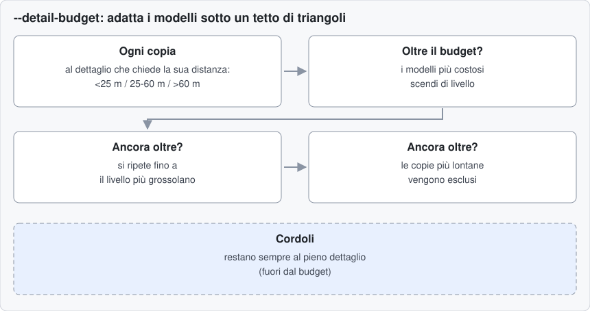

# Livelli di dettaglio e budget {#levels-of-detail-and-the-budget}

Un **triangolo** è un minuscolo pezzo piatto di un modello 3D. Più triangoli significano un file più grande
e più lento. Il **budget** è un limite a quanti ce ne possono essere. Un **livello di dettaglio** è una copia
più semplice di un modello, usata quando è lontano.

Il livello più fine di tutto ciò che è collocato intorno a un circuito è di diversi milioni di triangoli. Per
esempio, centinaia di segmenti di guardrail e pile di pneumatici di circa mille triangoli ciascuno. Un corridoio
urbano contiene oltre centomila copie. Quindi ogni esportazione del percorso assegna ai modelli collocati un
**budget di triangoli** e decide, per ogni modello, a quale livello di dettaglio viene disegnato e, se serve,
quali copie lasciare fuori.

Lo schema è stato scritto per Forza
([`forzaplacement.py`](https://github.com/Holdi601/3DHeat-GameFiles/blob/main/heat3d_gamefiles/forzaplacement.py):
`choose_levels`, `auto_budget`, `_fit`), e BeamNG e AC Rally ne riusano le parti. Il terreno non conta nel
budget.

## Fasce di distanza {#distance-bands}

La distanza di ogni copia dalla guida viene misurata nel piano del suolo, fino al campione del giro più
vicino. Il giro viene prima sfoltito a un massimo di 1.000 punti, al costo di pochi metri di precisione e di
nulla che conti qui. Le copie poi cadono in tre fasce, e ogni coppia (modello, fascia) ha un budget proprio:

| Fascia | Distanza | Parte da |
|---|---|---|
| vicina | sotto 25 m (`NEAR`) | il livello più fine |
| media | 25-60 m (`FAR`) | un livello più grossolano del precedente |
| lontana | 60 m e oltre | il livello più grossolano |

Senza un percorso (Forza `terrain --box`), la distanza si misura fino al centro del riquadro.

## Scendere di livello per entrare nel budget {#stepping-down-to-fit}



Il costo di una voce (modello, fascia) è copie x triangoli al suo livello attuale. Finché il totale supera il
budget, la voce che costa di più scende di un livello, e l'operazione si ripete finché il totale rientra o
nessuna voce può scendere oltre. Le voci fissate non scendono mai:

| Gioco | Fissato a pieno dettaglio |
|---|---|
| Forza | cordoli (`road_gen_rum*`) |
| BeamNG | cordoli, e ogni forma che porta una superficie di guida |
| AC Rally | cordoli |

Il riepilogo di Forza lo riporta come
`N of M models drawn at a coarser level to fit the budget`.

## Il budget automatico {#the-automatic-budget}

Senza `--detail-budget`, il budget si dimensiona da solo così che **nessuna copia venga esclusa**:

```
budget = max(1,500,000, 1.25 x sum(copies x coarsest level))
```

Le voci fissate contano al loro livello più fine. Il 25% (`HEADROOM`) lascia alle cose accanto alla strada
un po' di dettaglio. Su un circuito di campagna questo è il pavimento di 1,5 milioni (`DEFAULT_BUDGET`). Su un
percorso urbano, dove il corridoio contiene oltre centomila copie, cresce fino a oltre dieci milioni, e il file
fino a diverse centinaia di MB. Il visualizzatore lo carica.

## Un budget che dai tu {#a-budget-you-give}

`--detail-budget N` è un **tetto**. I livelli scendono come sopra. Se anche i livelli più grossolani non
entrano, le copie vengono escluse:

| Gioco | Ordine in cui le copie vengono escluse |
|---|---|
| Forza | prima tutto ciò che sta a 25 m o più dalla guida, poi ciò che sta accanto alla strada; dentro ogni gruppo, prima ciò che appare più piccolo dalla strada: distanza maggiore / dimensione (dimensione = diagonale del riquadro del modello per il suo fattore di scala più grande, almeno 0,25 m) |
| BeamNG | prima quelle più lontane dalla guida |
| AC Rally | prima quelle più lontane dalla guida, come BeamNG |
| Battlefield 6 | prima le più piccole: diagonale del riquadro per la scala |

I cordoli (e, per BeamNG, i modelli di superficie di guida) non vengono mai esclusi, quindi un budget più
piccolo di quanto costino da soli viene superato da loro, e da nient'altro.

Lo strumento usa distanza su dimensione per Forza perché, ordinando solo per distanza, un'unità di
condizionamento su un muro a nove metri supererebbe la facciata di venti metri a cui è appesa, a dodici metri.
Le cose accanto alla strada vanno per ultime qualunque sia la loro dimensione, perché una barriera alta tre
metri a cinque dalla linea è il bordo della pista, mentre un edificio di cinquanta metri arretrato di sessanta
è scenografia.

Il riepilogo riporta
`N of M copies left out to fit the budget, the smallest and furthest from the driving first (--detail-budget raises it)`
(Forza), oppure `N copies left out to fit the budget, the furthest from the driving first (--detail-budget raises it)`
(BeamNG, AC Rally).

## Edifici interi (Forza) {#whole-buildings-forza}

Un sostituto di edificio intero conta come una copia, a una distanza misurata fino allo spigolo più vicino
dell'edificio. Viene tenuto o escluso come un'unità. I pezzi modulari che sostituisce non sono affatto nel
budget. Vedi [Forza Horizon](course-forza-horizon.md#buildings-drawn-whole).

## Che cosa è un livello di dettaglio, per gioco {#what-a-level-of-detail-is-per-game}

| Gioco | I livelli vengono da |
|---|---|
| Forza | la maschera di livello per triangolo delle sottomesh `Mesh` del modello (bit `level + 1`); `0xFFFF` per i pezzi distruttibili solo per un modello senza un livello segnato |
| BeamNG | i `details` della forma `.cdae` con una dimensione non negativa, il più grande per primo; per `.dae`, il numero finale nei nomi dei nodi mesh (`barrier75`, `barrier40`) |
| AC Rally | i livelli di dettaglio memorizzati nella mesh statica, dal più fine |
| Battlefield 6 | i livelli di dettaglio della MeshSet, dal più fine, contando solo le sezioni disegnate (non le copie per le ombre e solo per la profondità), e non un ultimo livello che è un segnaposto per la vista lontana (materiali `M_LastLod`, `M_Billboard`, `M_Vista`: il reticolo di un pilone diventerebbe una punta piena) |

Il `level` di Battlefield 6 non ha un giro, quindi non ci sono fasce di distanza: ogni mesh è una voce, ogni
copia allo stesso livello. Il budget automatico è la formula sopra con il fondale del terreno fissato; la
mappa dell'altezza è fuori dal budget e si dimensiona con `--ground-spacing`. Con un budget che dai tu, una
volta che ogni mesh è al suo livello più grossolano, le copie vengono escluse dalla più piccola: la dimensione
è la diagonale del riquadro della mesh per la scala della copia, dato che non c'è guida da cui misurare la
distanza. Il fondale del terreno non viene mai escluso. Un livello arriva a circa dieci milioni di triangoli
in automatico.

## Scegliere un numero {#choosing-a-number}

| Vuoi | Prova |
|---|---|
| tutto, con il pieno dettaglio vicino alla strada | lascia l'automatico |
| un file più piccolo di qualche volta | `--detail-budget 500000` con `--texture-size 1024` |
| solo il suolo | `--no-placed` (il budget non entra in gioco) |
