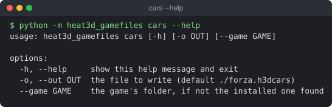

# Auto di Forza: `cars` {#forza-cars-cars}

Scrive ogni auto di un Forza installato, al livello di dettaglio proprio del gioco, in un
unico file per la scheda Analisi di gara del visualizzatore (disegna un'auto per ogni giro che hai fatto), così ogni auto registrata
viene disegnata con la sua forma e alla sua dimensione reale.



## Passo dopo passo {#step-by-step}

1. **Eseguilo** con il gioco installato (viene trovato nelle librerie di Steam e in
   `C:\XboxGames`):

   ```
   python -m heat3d_gamefiles cars -o forza.h3dcars
   ```

   Oppure indica la cartella del gioco:

   ```
   python -m heat3d_gamefiles cars --game "D:\Games\<cartella Forza>" -o forza.h3dcars
   ```

2. **Caricalo nel visualizzatore**: **Carica file delle auto...** nel pannello Vista, oppure trascina il
   file sulla scheda Analisi di gara; resta in quel browser. I giri il cui numero di auto è
   nel file vengono poi disegnati come quella stessa auto (vedi la
   [documentazione del replay di gara](https://holdi601.github.io/3DHeat/race-replay-and-scene.html#the-cars)
   del visualizzatore).

3. **Eseguilo di nuovo** quando il gioco riceve nuove auto. Ci vogliono pochi secondi e
   scrive circa 5 MB.

## Opzioni {#options}

| Opzione | Predefinito | Significato |
|---|---|---|
| `-o`, `--out FILE` | `./forza.h3dcars` | il file da scrivere |
| `--game CARTELLA` | il gioco installato trovato | la cartella del gioco |

## Cosa c'è nel file {#what-is-in-the-file}

Per ogni archivio di auto sotto `media/Cars`: il modello `ProxyLOD` che contiene (circa
900 triangoli), il numero dell'auto come lo indica la telemetria, la marca, il tag del modello e
l'anno dal nome dell'archivio, e le ruote e le luci posteriori. Le forme sono in metri, 1:1 con
l'auto. Un archivio senza un tale modello (un oggetto di traffico) viene nominato e lasciato fuori.

Il file è fatto per il visualizzatore 3DHeat; la sua struttura, per chi lo legge altrove
([`forzacars.py`](https://github.com/Holdi601/3DHeat-GameFiles/blob/main/heat3d_gamefiles/forzacars.py)):

| Parte | Struttura |
|---|---|
| intero file | compresso con gzip |
| magic | gli 8 byte `H3DCARS1` |
| lunghezza dell'intestazione | u32 little-endian |
| intestazione | JSON UTF-8: `format` (`heat3d-cars`), `version`, `game`, `source`, `cars` |
| riempimento | spazi fino a un multiplo di 4 byte |
| dati | per auto: vertici come tre i16 ciascuno (millimetri; x destra, y su, z avanti), poi triangoli come tre u16 ciascuno |

Ogni voce `cars`: `key`, `ordinals` (i numeri dell'auto come li indica la telemetria), `make`, `model`,
`year`, `height` e `length` (m), `wheels` (per ruota `[x, y, z, raggio]`, m), `lights`
(punti delle luci posteriori `[x, y, z]`, m), e `vertexAt`, `vertices`, `faceAt`, `faces`
(scostamenti in byte dall'inizio dei dati, e conteggi).

Il file contiene i contenuti del gioco: è fatto per la macchina su cui è stato creato, non
per essere passato ad altri ([Regole e licenze](rules-and-licences.md)).
